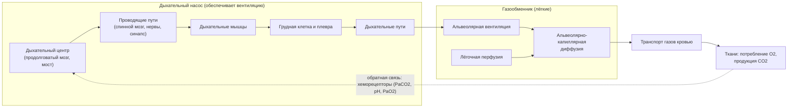

## 2. Основная часть

### 2.1. Физиологические основы дыхания и газообмена

Дыхательная недостаточность — это всегда поломка конкретного звена в цепи, которая начинается в дыхательном центре и заканчивается в митохондриях. Поэтому прежде чем говорить о болезни, восстановим в памяти устройство этой цепи, расставив акценты на тех её свойствах, которые объясняют клинику хронической дыхательной недостаточности: почему вентиляционно-перфузионная неоднородность снижает PaO₂, но не повышает PaCO₂; почему сатурация остаётся высокой до тех пор, пока PaO₂ не упадёт ниже 60 мм рт. ст.; почему уплощённая диафрагма работает хуже куполообразной; почему почки за несколько дней делают хроническую гиперкапнию «переносимой».

#### 2.1.1. Ключевые понятия

##### 2.1.1.1. Внешнее дыхание

📌 **Определение:** **внешнее дыхание** — совокупность процессов, обеспечивающих обмен кислорода и углекислого газа между атмосферным воздухом и кровью лёгочных капилляров. Оно включает вентиляцию (конвективный перенос газа по дыхательным путям к альвеолам), диффузию газов через альвеолярно-капиллярную мембрану, лёгочную перфузию и пространственное сопряжение вентиляции и перфузии. Внешнему дыханию противопоставляют тканевое (внутреннее) дыхание — утилизацию кислорода в митохондриях.

Для клинициста удобно представлять систему внешнего дыхания как два функционально разных блока (см. рис. 1). Первый — **дыхательный насос** (respiratory pump): дыхательный центр, проводящие пути, нервно-мышечный синапс, дыхательные мышцы, грудная клетка и плевра. Его задача — создавать градиент давления и перемещать воздух, то есть обеспечивать альвеолярную вентиляцию. Второй — **газообменник**: альвеолы, альвеолярно-капиллярная мембрана и лёгочное капиллярное русло. Его задача — обеспечить переход O₂ в кровь и CO₂ из крови при заданной вентиляции и перфузии. Это разделение, последовательно развитое в работах C. Roussos и P. T. Macklem, лежит в основе патогенетической классификации дыхательной недостаточности: отказ газообменника даёт прежде всего гипоксемию, отказ насоса — гиперкапнию.



**Рис. 1.** Звенья системы внешнего дыхания: дыхательный насос и газообменник. Схема читается слева направо; пунктирная стрелка показывает контур обратной связи через хеморецепторы.

Схема на рис. 1 понадобится нам многократно: каждая этиологическая группа хронической дыхательной недостаточности (глава 2.5) — это поражение одного или нескольких её блоков, а каждый метод лечения (главы 2.17–2.20) — это протезирование определённого звена.

##### 2.1.1.2. Альвеолярная вентиляция

📌 **Определение:** **альвеолярная вентиляция** (V̇A) — объём свежего воздуха, достигающего газообменных зон лёгких за единицу времени. Она меньше минутной вентиляции (V̇E) на величину вентиляции мёртвого пространства:

$$\dot V_A = (V_T - V_D)\cdot f \quad (1)$$

где $V_T$ — дыхательный объём (мл), $V_D$ — объём мёртвого пространства (мл), $f$ — частота дыхания (мин⁻¹).

При типичных значениях покоя (V_T ≈ 500 мл, V_D ≈ 150 мл, f ≈ 12–16 мин⁻¹) минутная вентиляция составляет 6–8 л/мин, а альвеолярная — около 4–5,5 л/мин. Обратите внимание на следствие формулы (1): при одной и той же минутной вентиляции частое поверхностное дыхание даёт меньшую альвеолярную вентиляцию, чем редкое глубокое, потому что доля мёртвого пространства в каждом вдохе растёт. Пациент с нервно-мышечным заболеванием, дышащий с объёмом 250 мл и частотой 28 в минуту, имеет V̇E = 7 л/мин — формально нормальную — и V̇A = (250 − 150) × 28 = 2,8 л/мин, то есть выраженную альвеолярную гиповентиляцию. Именно поэтому частота дыхания и «нормальная» минутная вентиляция ничего не гарантируют в отношении PaCO₂.

Связь альвеолярной вентиляции с PaCO₂ описывает уравнение альвеолярной вентиляции:

$$PaCO_2 = k \cdot \frac{\dot V_{CO_2}}{\dot V_A} \quad (2)$$

где $\dot V_{CO_2}$ — продукция углекислого газа (мл/мин, в норме около 200 мл/мин в покое), $\dot V_A$ — альвеолярная вентиляция (л/мин), $k$ = 0,863 — коэффициент пересчёта единиц измерения (мм рт. ст. · л / мл) с учётом приведения объёмов к стандартным условиям. Из уравнения (2) следуют два принципиальных вывода. Во-первых, PaCO₂ определяется исключительно соотношением продукции CO₂ и альвеолярной вентиляции: гиперкапния — это всегда либо снижение V̇A, либо недостаточный прирост V̇A в ответ на возросшую продукцию CO₂ (лихорадка, избыточное питание, работа дыхания). Во-вторых, зависимость гиперболическая: снижение V̇A вдвое удваивает PaCO₂ (с 40 до 80 мм рт. ст.), а удвоение V̇A снижает его вдвое (до 20 мм рт. ст.).

##### 2.1.1.3. Лёгочная перфузия

Малый круг кровообращения — система низкого давления и высокой ёмкости: через него проходит весь сердечный выброс (около 5 л/мин в покое), при среднем давлении в лёгочной артерии около 14 мм рт. ст. (верхняя граница нормы по современным критериям — 20 мм рт. ст.). Низкое давление достигается малым сопротивлением тонкостенных сосудов и двумя резервными механизмами — **рекрутированием** (открытием ранее не перфузируемых капилляров) и **растяжением** уже открытых. Благодаря им при физической нагрузке сердечный выброс может вырасти в 4–5 раз при лишь умеренном подъёме давления в лёгочной артерии; утрата этого резерва (при разрушении капиллярного русла эмфиземой или фиброзом) — один из механизмов лёгочной гипертензии (глава 2.8).

В вертикальном положении перфузия распределяется неравномерно под действием силы тяжести: гидростатическое давление в сосудах оснований лёгких выше, чем в сосудах верхушек, поэтому кровоток нарастает от верхушки к основанию. Эта неравномерность — ключ к модели зон J. B. West, которую мы разберём в п. 2.1.8.3. Второй регулятор распределения перфузии — **гипоксическая лёгочная вазоконстрикция**: сужение артериол в ответ на снижение парциального давления кислорода в альвеолах. В норме этот рефлекс перенаправляет кровь из плохо вентилируемых зон в хорошо вентилируемые и улучшает оксигенацию; при хронической альвеолярной гипоксии он становится диффузным и ведёт к лёгочной гипертензии (подробно — п. 2.8.3.1).

##### 2.1.1.4. Альвеолярно-капиллярная диффузия

Перенос газа через альвеолярно-капиллярную мембрану подчиняется закону Фика: поток газа пропорционален площади мембраны и разности парциальных давлений по обе её стороны и обратно пропорционален толщине мембраны; коэффициент пропорциональности зависит от растворимости газа и его молекулярной массы. Площадь газообмена у взрослого человека огромна (порядка 70–100 м²), толщина мембраны в её тонкой части — доли микрометра, поэтому в норме диффузионный резерв велик: кровь проходит лёгочный капилляр примерно за 0,75 с, а парциальное давление O₂ в ней уравнивается с альвеолярным примерно за треть этого времени.

Углекислый газ диффундирует через мембрану существенно быстрее кислорода (примерно в 20 раз — за счёт значительно большей растворимости), поэтому «диффузионная» гиперкапния в клинике практически не встречается: даже при тяжёлом фиброзе CO₂ успевает выйти из крови. Диффузионные нарушения проявляются только гипоксемией, причём сначала при нагрузке (укорочение времени капиллярного транзита) и лишь затем в покое. Клиническая мера диффузионной способности — **диффузионная способность лёгких по монооксиду углерода** (DLCO), которая зависит не только от свойств мембраны, но и от объёма капиллярной крови и концентрации гемоглобина (подробно — п. 2.11.1.4).

##### 2.1.1.5. Вентиляционно-перфузионное отношение

📌 **Определение:** **вентиляционно-перфузионное отношение** (V̇A/Q̇) — отношение альвеолярной вентиляции к кровотоку в данной единице лёгкого (или в лёгких в целом). Для лёгких в целом в покое оно составляет около 0,8–1,0 (примерно 4–5 л/мин вентиляции на 5 л/мин кровотока).

Это самое важное понятие всей главы. Парциальные давления O₂ и CO₂ в каждой альвеоле определяются не вентиляцией и не перфузией по отдельности, а их отношением. Два крайних случая: единица с V̇A/Q̇ = 0 перфузируется, но не вентилируется — кровь проходит через неё, не изменив состава (это **шунт**); единица с V̇A/Q̇ → ∞ вентилируется, но не перфузируется — газ в ней не отличается от вдыхаемого (это **альвеолярное мёртвое пространство**). Между крайностями лежит континуум: в единицах с низким V̇A/Q̇ альвеолярный газ приближается по составу к венозной крови (PO₂ низкое, PCO₂ высокое), в единицах с высоким — к вдыхаемому воздуху. Реальные лёгкие даже у здорового человека представляют собой распределение единиц с разными отношениями; при болезни это распределение расширяется, и именно расширение распределения — а не «средняя» величина — создаёт гипоксемию (см. п. 2.1.8.3 и 2.6.1.1).

##### 2.1.1.6. Анатомическое и физиологическое мёртвое пространство

📌 **Определение:** **анатомическое мёртвое пространство** — объём проводящих дыхательных путей, в которых газообмен не происходит (у взрослого около 150 мл, ориентировочно 2 мл на 1 кг массы тела). **Альвеолярное мёртвое пространство** — объём вентилируемых, но не перфузируемых (или слабо перфузируемых) альвеол. **Физиологическое мёртвое пространство** — их сумма, то есть вся часть дыхательного объёма, не участвующая в выведении CO₂.

Анатомическое мёртвое пространство измеряют методом Фаулера (по вымыванию азота после вдоха кислорода); физиологическое — по уравнению Бора, которое сравнивает PCO₂ артериальной крови и смешанного выдыхаемого воздуха:

$$\frac{V_D}{V_T} = \frac{PaCO_2 - P_{\bar{E}}CO_2}{PaCO_2} \quad (3)$$

где $P_{\bar{E}}CO_2$ — парциальное давление CO₂ в смешанном выдыхаемом воздухе (мм рт. ст.). В норме доля мёртвого пространства V_D/V_T составляет около 0,2–0,35 и уменьшается при нагрузке (растёт V_T). Она увеличивается при эмфиземе (разрушение капилляров при сохранении вентиляции), тромбоэмболии лёгочной артерии, лёгочной гипертензии, а также при поверхностном дыхании. Рост мёртвого пространства — второй после снижения V̇A механизм гиперкапнии: чтобы удержать прежний PaCO₂, пациент вынужден увеличивать минутную вентиляцию, а значит — работу дыхания (п. 2.6.2.2).

##### 2.1.1.7. Респираторный драйв

📌 **Определение:** **респираторный драйв** (respiratory drive) — интенсивность нейронной активности дыхательного центра, направленной на дыхательные мышцы. Это «команда», а не результат: при слабости мышц или высокой нагрузке большой драйв может сопровождаться малой вентиляцией.

Прямого способа измерить драйв у человека нет; используют косвенные показатели: минутную вентиляцию (при неизменённой механике), окклюзионное давление в ротовой полости за первые 100 мс вдоха (P₀.₁ — давление, развиваемое при неожиданно перекрытом вдохе и поэтому не зависящее от сопротивления дыхательных путей), электромиографию диафрагмы, вентиляционный ответ на CO₂. Различение «не может дышать» и «не хочет дышать» (can't breathe versus won't breathe) — одна из ключевых задач при гиперкапнии: у большинства пациентов с ХОБЛ драйв повышен, а гиперкапния развивается вопреки ему — из-за непосильной нагрузки; при центральной гиповентиляции, передозировке опиоидов или поражении ствола мозга драйв снижен при сохранных лёгких и мышцах. Терапевтические выводы противоположны: в первом случае нужно разгрузить насос (вентиляция), во втором — устранить причину угнетения.

#### 2.1.2. Транспорт газов

##### 2.1.2.1. Транспорт кислорода

Кислород переносится кровью в двух формах: растворённой в плазме (0,003 мл O₂ на 100 мл крови на каждый мм рт. ст. PaO₂ — ничтожно мало при дыхании воздухом) и связанной с гемоглобином (каждый грамм полностью насыщенного гемоглобина связывает около 1,34 мл O₂; теоретическое значение 1,39 мл/г, называемое константой Хюфнера, на практике не достигается из-за присутствия неактивных форм гемоглобина). Отсюда формула содержания кислорода в артериальной крови:

$$CaO_2 = 1{,}34 \cdot Hb \cdot SaO_2 + 0{,}003 \cdot PaO_2 \quad (4)$$

где $CaO_2$ — содержание O₂ (мл/дл), $Hb$ — концентрация гемоглобина (г/дл), $SaO_2$ — насыщение гемоглобина кислородом (доля от 1), $PaO_2$ — парциальное давление O₂ в артериальной крови (мм рт. ст.). При Hb = 15 г/дл, SaO₂ = 0,98 и PaO₂ = 100 мм рт. ст. получаем 1,34 × 15 × 0,98 + 0,3 ≈ 20 мл/дл. Формула (4) показывает, что главные детерминанты содержания кислорода — гемоглобин и сатурация, а PaO₂ влияет на него лишь опосредованно, через сатурацию. Это объясняет, почему анемия со снижением Hb до 7,5 г/дл уменьшает CaO₂ вдвое при нормальном PaO₂, а подъём PaO₂ со 100 до 500 мм рт. ст. при дыхании чистым кислородом добавляет лишь около 1,2 мл/дл растворённого O₂.

##### 2.1.2.2. Транспорт углекислого газа

Углекислый газ транспортируется в трёх формах: в виде бикарбоната (основная часть — по разным оценкам около 70 %), в виде карбаминовых соединений с белками, прежде всего с гемоглобином (порядка 20–25 %), и в растворённом виде (5–10 %). Ключевая реакция — гидратация CO₂ с образованием угольной кислоты, диссоциирующей на H⁺ и HCO₃⁻, — многократно ускоряется карбоангидразой эритроцитов; образующийся бикарбонат выходит в плазму в обмен на хлорид (хлоридный сдвиг, или сдвиг Гамбургера), а протоны связываются гемоглобином. В лёгких процесс идёт в обратном направлении.

Для понимания дыхательной недостаточности важно одно свойство: кривая диссоциации CO₂ (зависимость содержания CO₂ в крови от PCO₂) в физиологическом диапазоне почти линейна и не имеет плато. Это означает, что хорошо вентилируемые единицы лёгких способны «вывести лишний» CO₂ и компенсировать его задержку в плохо вентилируемых единицах, тогда как для кислорода такая компенсация невозможна (см. п. 2.1.2.4). Именно поэтому вентиляционно-перфузионная неоднородность, пока сохранён вентиляционный резерв, вызывает гипоксемию без гиперкапнии.

##### 2.1.2.3. Доставка и потребление кислорода

📌 **Определение:** **доставка кислорода** (DO₂) — количество кислорода, доставляемое артериальной кровью к тканям за минуту; **потребление кислорода** (V̇O₂) — количество кислорода, извлекаемое тканями за минуту.

$$DO_2 = CO \cdot CaO_2 \cdot 10 \quad (5)$$

$$\dot V O_2 = CO \cdot (CaO_2 - C\bar{v}O_2) \cdot 10 \quad (6)$$

где $CO$ — сердечный выброс (л/мин), $CaO_2$ и $C\bar{v}O_2$ — содержание O₂ в артериальной и смешанной венозной крови (мл/дл), множитель 10 переводит дл в л. Уравнение (6) — принцип Фика. Ориентировочные значения в покое приведены в табл. 1.

**Табл. 1.** Ориентировочные показатели транспорта кислорода у здорового взрослого в покое

| Показатель | Ориентировочное значение | Комментарий |
|---|---|---|
| Сердечный выброс | ≈ 5 л/мин | растёт до 20–25 л/мин при максимальной нагрузке |
| CaO₂ | ≈ 20 мл/дл | определяется формулой (4) |
| Cv̄O₂ | ≈ 15 мл/дл | при Sv̄O₂ ≈ 70–75 % |
| DO₂ | ≈ 1000 мл/мин | формула (5) |
| V̇O₂ | ≈ 250 мл/мин | формула (6); ≈ 3,5 мл/кг/мин (1 МЕТ) |
| Коэффициент экстракции O₂ (V̇O₂/DO₂) | ≈ 25 % | растёт при снижении DO₂ до критического уровня |

Из табл. 1 видно, что в покое ткани извлекают лишь четверть доставляемого кислорода — у организма есть трёх-четырёхкратный резерв. При снижении DO₂ (гипоксемия, анемия, снижение сердечного выброса) экстракция возрастает, и потребление сохраняется до тех пор, пока доставка не упадёт ниже критического уровня; дальше V̇O₂ становится зависимым от доставки, и начинается анаэробный метаболизм с накоплением лактата. У пациента с хронической дыхательной недостаточностью доставка кислорода поддерживается за счёт компенсаторных механизмов — эритроцитоза и перераспределения кровотока, — но резерв сужен, и любое дополнительное событие (анемия, инфекция, аритмия) может перевести систему в состояние тканевой гипоксии.

##### 2.1.2.4. Кривая диссоциации оксигемоглобина

Зависимость насыщения гемоглобина кислородом от PaO₂ имеет сигмоидную форму (см. рис. 2). Её причина — кооперативное связывание: присоединение первой молекулы O₂ к тетрамеру гемоглобина облегчает связывание последующих. Ключевые ориентиры кривой при нормальных условиях (pH 7,40, температура 37 °C): PaO₂ 100 мм рт. ст. соответствует сатурации около 97–98 %; 60 мм рт. ст. — около 90 %; 40 мм рт. ст. (типичное венозное) — около 75 %; **P₅₀** — PaO₂, при котором сатурация равна 50 %, — составляет около 26–27 мм рт. ст.

```svg
<svg xmlns="http://www.w3.org/2000/svg" viewBox="0 0 800 460" width="100%" role="img" aria-labelledby="fig2-title">
  <title id="fig2-title">Кривая диссоциации оксигемоглобина (качественный вид)</title>
  <defs>
    <marker id="fig2-arrow" viewBox="0 0 10 10" refX="9" refY="5" markerWidth="8" markerHeight="8" orient="auto">
      <path d="M 0 0 L 10 5 L 0 10 z" fill="#334155"/>
    </marker>
  </defs>
  <!-- Заголовок -->
  <text x="400" y="30" text-anchor="middle" font-family="Arial, Helvetica, sans-serif" font-size="18" font-weight="bold" fill="#0F172A">Кривая диссоциации оксигемоглобина (качественный вид)</text>
  <!-- Оси: x от 80 до 720 (0–100 мм рт. ст.), y от 380 до 60 (0–100 %) -->
  <line x1="80" y1="380" x2="740" y2="380" stroke="#334155" stroke-width="2" marker-end="url(#fig2-arrow)"/>
  <line x1="80" y1="380" x2="80" y2="50" stroke="#334155" stroke-width="2" marker-end="url(#fig2-arrow)"/>
  <text x="420" y="430" text-anchor="middle" font-family="Arial, Helvetica, sans-serif" font-size="14" fill="#0F172A">PaO2, мм рт. ст.</text>
  <text x="30" y="215" text-anchor="middle" font-family="Arial, Helvetica, sans-serif" font-size="14" fill="#0F172A" transform="rotate(-90 30 215)">SaO2, %</text>
  <!-- Деления оси x -->
  <g font-family="Arial, Helvetica, sans-serif" font-size="12" fill="#334155" text-anchor="middle">
    <text x="80" y="398">0</text>
    <text x="208" y="398">20</text>
    <text x="336" y="398">40</text>
    <text x="464" y="398">60</text>
    <text x="592" y="398">80</text>
    <text x="720" y="398">100</text>
  </g>
  <!-- Деления оси y -->
  <g font-family="Arial, Helvetica, sans-serif" font-size="12" fill="#334155" text-anchor="end">
    <text x="72" y="384">0</text>
    <text x="72" y="304">25</text>
    <text x="72" y="224">50</text>
    <text x="72" y="144">75</text>
    <text x="72" y="64">100</text>
  </g>
  <!-- Кривая (качественная сигмоида) -->
  <path d="M 80 380 C 140 375, 200 290, 252 220 S 400 110, 464 92 S 600 68, 720 66" fill="none" stroke="#1D4ED8" stroke-width="3"/>
  <!-- Опорные точки: P50 (27; 50) и точка (60; 90) -->
  <line x1="252" y1="380" x2="252" y2="220" stroke="#F59E0B" stroke-width="1.5" stroke-dasharray="6 4"/>
  <line x1="80" y1="220" x2="252" y2="220" stroke="#F59E0B" stroke-width="1.5" stroke-dasharray="6 4"/>
  <circle cx="252" cy="220" r="5" fill="#F59E0B"/>
  <text x="262" y="240" font-family="Arial, Helvetica, sans-serif" font-size="13" fill="#0F172A">P50 ≈ 26–27 мм рт. ст.</text>
  <line x1="464" y1="380" x2="464" y2="92" stroke="#F59E0B" stroke-width="1.5" stroke-dasharray="6 4"/>
  <line x1="80" y1="92" x2="464" y2="92" stroke="#F59E0B" stroke-width="1.5" stroke-dasharray="6 4"/>
  <circle cx="464" cy="92" r="5" fill="#F59E0B"/>
  <text x="474" y="118" font-family="Arial, Helvetica, sans-serif" font-size="13" fill="#0F172A">PaO2 60 → SaO2 ≈ 90 %</text>
  <!-- Подписи участков -->
  <text x="300" y="300" font-family="Arial, Helvetica, sans-serif" font-size="13" fill="#334155">крутой участок</text>
  <text x="300" y="316" font-family="Arial, Helvetica, sans-serif" font-size="13" fill="#334155">(разгрузка в тканях)</text>
  <text x="560" y="150" font-family="Arial, Helvetica, sans-serif" font-size="13" fill="#334155">плато (загрузка в лёгких)</text>
  <!-- Стрелки сдвига -->
  <line x1="330" y1="250" x2="390" y2="250" stroke="#334155" stroke-width="2" marker-end="url(#fig2-arrow)"/>
  <text x="400" y="255" font-family="Arial, Helvetica, sans-serif" font-size="12" fill="#334155">сдвиг вправо: ↑t°, ↑PaCO2, ↓pH, ↑2,3-ДФГ</text>
  <line x1="230" y1="160" x2="170" y2="160" stroke="#334155" stroke-width="2" marker-end="url(#fig2-arrow)"/>
  <text x="100" y="140" font-family="Arial, Helvetica, sans-serif" font-size="12" fill="#334155">сдвиг влево: ↓t°, ↓PaCO2,</text>
  <text x="100" y="156" font-family="Arial, Helvetica, sans-serif" font-size="12" fill="#334155">↑pH, ↓2,3-ДФГ, CO, HbF</text>
</svg>
```

**Рис. 2.** Кривая диссоциации оксигемоглобина (качественный вид). Пунктиром отмечены P₅₀ и точка PaO₂ 60 мм рт. ст., соответствующая сатурации около 90 %; стрелки показывают направление сдвига кривой при изменении температуры, PaCO₂, pH и концентрации 2,3-дифосфоглицерата.

График читается так: по горизонтали отложено PaO₂, по вертикали — сатурация. Верхняя пологая часть (плато) — область загрузки гемоглобина в лёгких; нижняя крутая часть — область разгрузки в тканях. Клинических следствий у этой формы три.

1. **Плато защищает.** Падение PaO₂ со 100 до 70 мм рт. ст. снижает сатурацию лишь на 3–4 %; содержание кислорода почти не меняется. Поэтому умеренная гипоксемия долго остаётся клинически незаметной, а пульсоксиметрия нечувствительна к ранним стадиям нарушений газообмена (п. 2.10.6.3).
2. **Ниже 60 мм рт. ст. начинается обрыв.** Здесь каждый мм рт. ст. «стоит» уже 1–1,5 % сатурации; небольшое дополнительное ухудшение газообмена резко уменьшает содержание кислорода. Это и есть физиологическое обоснование порога 60 мм рт. ст. в определении дыхательной недостаточности (глава 2.2).
3. **Высокие V̇A/Q̇ не компенсируют низкие.** Кровь из хорошо вентилируемых единиц уже почти полностью насыщена и не может «взять» дополнительный кислород, чтобы компенсировать недонасыщенную кровь из плохо вентилируемых единиц. Поэтому смешивание крови из единиц с разными отношениями V̇A/Q̇ всегда снижает PaO₂ ниже «среднего» (п. 2.1.9).

Сдвиг кривой вправо (ацидоз, гиперкапния, лихорадка, рост 2,3-дифосфоглицерата при хронической гипоксемии) снижает сродство гемоглобина к кислороду и облегчает его отдачу тканям — при той же сатурации кислорода тканям достаётся больше. Сдвиг влево (алкалоз, гипокапния, гипотермия, фетальный гемоглобин, карбоксигемоглобин) затрудняет отдачу. Рост 2,3-ДФГ в эритроцитах — один из адаптационных механизмов при хронической гипоксемии (п. 2.6.7.4).

##### 2.1.2.5. Эффекты Бора и Холдейна

**Эффект Бора** — снижение сродства гемоглобина к кислороду при повышении PCO₂ и снижении pH (сдвиг кривой диссоциации вправо). Физиологический смысл: в тканях, где образуется CO₂ и кислые метаболиты, гемоглобин легче отдаёт кислород; в лёгких, где CO₂ выводится, сродство восстанавливается. Эффект описан датским физиологом Христианом Бором в 1904 году.

**Эффект Холдейна** — зеркальное явление для углекислого газа: деоксигенированный гемоглобин связывает больше CO₂ (в карбаминовой форме и как буфер для H⁺), чем оксигенированный. В тканях отдача кислорода увеличивает ёмкость крови для CO₂; в лёгких оксигенация гемоглобина «вытесняет» CO₂ и облегчает его выведение. Эффект описан группой британского физиолога Джона Скотта Холдейна в 1914 году.

У эффекта Холдейна есть прямое клиническое следствие, к которому мы вернёмся в главах 2.17 и 2.24: если пациенту с хронической гиперкапнией дать высокую концентрацию кислорода, оксигенация гемоглобина уменьшит его способность переносить CO₂, растворённый CO₂ и PaCO₂ возрастут. Это один из трёх механизмов кислород-индуцированной гиперкапнии, наряду с устранением гипоксической вазоконстрикции (ухудшение V̇A/Q̇) и снижением гипоксического драйва.

#### 2.1.3. Механика дыхания

##### 2.1.3.1. Эластические свойства лёгких и грудной стенки

📌 **Определение:** **растяжимость** (комплайнс, compliance, C) — изменение объёма на единицу изменения давления: C = ΔV/ΔP (мл/см вод. ст.). Обратная величина — эластанс (жёсткость).

Лёгкие и грудная стенка — две упругие структуры, соединённые через плевральную щель и действующие как последовательно соединённые пружины. Растяжимость лёгких взрослого составляет около 200 мл/см вод. ст., грудной стенки — примерно столько же, а растяжимость всей дыхательной системы — около 100 мл/см вод. ст. (при последовательном соединении эластансы складываются). Эластическая тяга лёгких определяется тканевыми волокнами (эластин, коллаген) и поверхностным натяжением в альвеолах, которое снижает сурфактант. В конце спокойного выдоха, на уровне функциональной остаточной ёмкости (ФОЕ), тяга лёгких внутрь уравновешена тягой грудной стенки наружу; плевральное давление при этом отрицательно (около −5 см вод. ст.).

Болезни меняют этот баланс в разные стороны. При эмфиземе эластическая тяга лёгких уменьшается, растяжимость растёт, точка равновесия смещается в сторону больших объёмов — развивается гиперинфляция; грудная клетка приобретает бочкообразную форму, а диафрагма уплощается. При лёгочном фиброзе, напротив, растяжимость лёгких падает, объёмы уменьшаются, и каждый вдох требует большего усилия — растёт эластическая работа дыхания. При кифосколиозе, фибротораксе, ожирении жёсткой становится грудная стенка (при ожирении — за счёт массы, лежащей на грудной клетке и животе; ФОЕ и резервный объём выдоха снижаются особенно в положении лёжа). При нервно-мышечных заболеваниях растяжимость снижена вторично: грудной стенки — из-за тугоподвижности рёберно-позвоночных суставов при длительном поверхностном дыхании, лёгких — из-за микроателектазов.

##### 2.1.3.2. Сопротивление дыхательных путей

📌 **Определение:** **сопротивление дыхательных путей** (airway resistance, Raw) — отношение градиента давления между ротовой полостью и альвеолами к потоку воздуха: Raw = ΔP/V̇ (см вод. ст./(л/с)). В норме при спокойном дыхании оно составляет порядка 1–2 см вод. ст./(л/с).

При ламинарном потоке сопротивление, по закону Пуазейля, обратно пропорционально четвёртой степени радиуса трубки: уменьшение просвета бронха вдвое увеличивает сопротивление в 16 раз. Основная часть сопротивления в норме приходится на верхние дыхательные пути и крупные бронхи; мелкие бронхи (менее 2 мм в диаметре) из-за огромной суммарной площади сечения вносят небольшой вклад — их называют «немой зоной», поскольку значительное их поражение может не отражаться на суммарном сопротивлении и на стандартной спирометрии.

Для хронических обструктивных заболеваний принципиально важен феномен **экспираторного ограничения потока**. При форсированном выдохе плевральное давление становится положительным и сдавливает внутригрудные дыхательные пути; в точке, где давление внутри бронха сравнивается с давлением снаружи (точка равного давления), развивается динамическая компрессия, и дальнейшее усилие уже не увеличивает поток. При эмфиземе снижение эластической тяги, поддерживающей просвет бронхов, и воспалительное ремоделирование стенок смещают точку равного давления в периферические, лишённые хрящей бронхи: ограничение потока наступает уже при спокойном выдохе. Пациент не успевает выдохнуть до уровня ФОЕ к началу следующего вдоха — развивается динамическая гиперинфляция и внутреннее положительное давление конца выдоха (п. 2.6.3.3–2.6.3.4).

##### 2.1.3.3. Работа дыхания

📌 **Определение:** **работа дыхания** (work of breathing) — механическая работа, совершаемая дыхательными мышцами (или аппаратом ИВЛ) для перемещения воздуха; графически — площадь под кривой «давление — объём» за дыхательный цикл.

Работа дыхания складывается из эластической составляющей (растяжение лёгких и грудной стенки) и резистивной (преодоление сопротивления дыхательных путей и вязкого сопротивления тканей). В норме выдох пассивен, а энергетическая стоимость дыхания мала — порядка 1–3 % общего потребления кислорода в покое. При тяжёлой ХОБЛ или рестрикции она многократно возрастает; при обострении ХОБЛ значительная часть потребляемого организмом кислорода может уходить на работу самих дыхательных мышц, которые к тому же находятся в невыгодных механических условиях.

Соотношение эластической и резистивной составляющих определяет оптимальный паттерн дыхания — наблюдение, сформулированное А. Otis с соавторами в 1950 году: при преобладании эластической нагрузки (фиброз, кифосколиоз) минимальная работа достигается частым поверхностным дыханием, при преобладании резистивной (обструкция) — редким глубоким. Это объясняет характерные паттерны: тахипноэ при интерстициальных заболеваниях и удлинённый выдох через сомкнутые губы при эмфиземе. Работа дыхания — центральная переменная концепции недостаточности дыхательного насоса (п. 2.6.12.1): гиперкапния развивается тогда, когда требуемая работа превышает возможности мышц.

#### 2.1.4. Дыхательный насос

##### 2.1.4.1. Дыхательный центр

Автоматический ритм дыхания генерируется нейронными сетями продолговатого мозга. Традиционно выделяют дорсальную дыхательную группу (в области ядра одиночного пути, преимущественно инспираторные нейроны), вентральную дыхательную группу (ядра двойное и ретроамбигуальное, инспираторные и экспираторные нейроны) и расположенный в вентральной группе **пре-Бётцингеров комплекс** — скопление нейронов, которое, по данным J. C. Smith и соавторов (1991), служит основным генератором инспираторного ритма. Структуры моста (понтинная дыхательная группа — парабрахиальные ядра и ядро Кёлликера — Фузе) модулируют смену фаз дыхания. Над автоматическим контуром надстроены произвольный (кора — кортикоспинальные пути) и эмоциональный (лимбическая система) контуры, что позволяет задерживать дыхание, говорить, петь и объясняет гипервентиляцию при тревоге.

Разделение автоматического и произвольного контроля имеет клиническое выражение: при врождённом синдроме центральной гиповентиляции и некоторых поражениях ствола мозга пациент адекватно дышит, пока бодрствует и контролирует дыхание произвольно, но гиповентилирует во сне, когда остаётся только автоматический контур (п. 2.5.6.1).

##### 2.1.4.2. Проводящие пути и нервы

Команда дыхательного центра спускается по бульбоспинальным путям к мотонейронам передних рогов спинного мозга. Диафрагму иннервирует **диафрагмальный нерв**, формирующийся из корешков C3–C5 (отсюда мнемоника: травма выше C3 лишает пациента самостоятельного дыхания, травма ниже C5 его сохраняет, хотя и ослабляет за счёт выпадения межрёберных и брюшных мышц). Межрёберные мышцы иннервируются межрёберными нервами T1–T11, мышцы брюшной стенки — нижними грудными и верхними поясничными сегментами; вспомогательные мышцы шеи — черепными нервами и шейным сплетением. Последнее звено — нервно-мышечный синапс.

Каждому уровню этой цепи соответствует своя группа болезней: мотонейроны — боковой амиотрофический склероз, спинальная мышечная атрофия, полиомиелит; спинной мозг — травма, миелит; периферические нервы — хроническая воспалительная демиелинизирующая полинейропатия, изолированное поражение диафрагмального нерва; синапс — миастения, миастенические синдромы; мышца — дистрофии и миопатии (глава 2.5.5). Диагностическая логика (глава 2.11.9) следует этой же топографии.

##### 2.1.4.3. Дыхательные мышцы

Главная инспираторная мышца — **диафрагма**, обеспечивающая в покое большую часть дыхательного объёма. Её купол при сокращении опускается, увеличивая вертикальный размер грудной полости, а зона прилегания к нижним рёбрам (зона аппозиции) при опоре на содержимое живота разводит нижние рёбра в стороны. Эффективность этого механизма зависит от геометрии: по закону Лапласа давление, развиваемое изогнутой мышцей, обратно пропорционально радиусу её кривизны, поэтому уплощённая при гиперинфляции диафрагма при том же напряжении создаёт меньшее давление, а при крайней гиперинфляции может даже втягивать нижние рёбра внутрь (признак Хувера). Кроме того, укороченная мышца работает на невыгодном участке кривой «длина — напряжение». Диафрагма относительно устойчива к утомлению благодаря высокой доле медленных окислительных волокон, но при хронической перегрузке и утомляется, и перестраивается (п. 2.6.4).

Наружные межрёберные и парастернальные мышцы участвуют в спокойном вдохе, лестничные мышцы — в вдохе при возрастании нагрузки; грудино-ключично-сосцевидные мышцы включаются при значительном усилии (их видимое напряжение — клинический маркёр перегрузки насоса). Выдох в покое пассивен; при форсированном выдохе и кашле работают мышцы брюшной стенки и внутренние межрёберные мышцы. Для пациента с нервно-мышечным заболеванием слабость экспираторных мышц означает неэффективный кашель — отдельную проблему, которой посвящена глава 2.21.

##### 2.1.4.4. Грудная клетка

Грудная клетка — не пассивный футляр, а часть насоса. Движения рёбер («ручка ведра» и «ручка насоса») увеличивают поперечный и переднезадний размеры грудной полости; подвижность рёберно-позвоночных суставов и упругость рёберных хрящей определяют растяжимость грудной стенки. Плевральная щель передаёт усилие мышц лёгким: отрицательное плевральное давление растягивает лёгкие на вдохе. Деформации (кифосколиоз с углом Кобба более 100°, последствия торакопластики), фиброторакс, анкилозирующий спондилит и ожирение превращают грудную клетку в источник эластической нагрузки, а при нервно-мышечных заболеваниях длительное поверхностное дыхание ведёт к вторичной ригидности грудной стенки — отсюда идея «тренировки объёма» (air stacking) в п. 2.21.7.

#### 2.1.5. Регуляция дыхания

##### 2.1.5.1. Центральные хеморецепторы

Центральные хеморецепторы расположены на вентральной поверхности продолговатого мозга и в прилегающих структурах (в частности, в ретротрапециевидном ядре). Они реагируют не на CO₂ как таковой, а на концентрацию ионов водорода во внеклеточной жидкости мозга. CO₂ свободно проходит гематоэнцефалический барьер и, гидратируясь, закисляет ликвор; бикарбонат проникает через барьер медленно. Поэтому центральные хеморецепторы быстро отвечают на острые изменения PaCO₂ (на них приходится основная часть — по разным оценкам около 70–80 % — вентиляционного ответа на CO₂) и слабо — на метаболические сдвиги pH крови. Вентиляционный ответ здорового человека на CO₂ составляет в среднем порядка 2–3 л/мин на каждый мм рт. ст. прироста PaCO₂, с широким индивидуальным разбросом.

При хронической гиперкапнии состав ликвора «подстраивается»: концентрация бикарбоната в нём повышается, pH нормализуется, и установочная точка хеморецепторов смещается. Вентиляционный ответ на дальнейший прирост CO₂ ослабевает — это и есть то «притупление» центральной чувствительности, которое наблюдается у пациентов с хронической гиперкапнией. Важно понимать, что оно является следствием, а не первопричиной гиперкапнии у большинства пациентов с ХОБЛ: хеморецепторы здесь адаптируются к состоянию, которое насос не в силах исправить.

##### 2.1.5.2. Периферические хеморецепторы

Периферические хеморецепторы — **каротидные тельца** в области бифуркации общих сонных артерий (афферентация по языкоглоточному нерву) и аортальные тельца (по блуждающему нерву; у человека их роль второстепенна). Каротидные тельца — единственные рецепторы, реагирующие на снижение PaO₂; они отвечают на парциальное давление, а не на содержание кислорода, поэтому анемия и отравление монооксидом углерода их практически не стимулируют. Зависимость их активности от PaO₂ гиперболическая: выше 60–70 мм рт. ст. ответ невелик, ниже — резко возрастает. Каротидные тельца также реагируют на PaCO₂ (быстрее центральных рецепторов, но с меньшим суммарным вкладом) и на pH артериальной крови, и именно через них метаболический ацидоз вызывает компенсаторную гипервентиляцию.

💡 **Интересный факт:** в середине XX века двустороннюю резекцию каротидных телец предлагали как метод лечения бронхиальной астмы и эмфиземы. Операция не улучшала течение болезни, но позволила изучить последствия утраты периферической хемочувствительности у человека: такие пациенты практически не увеличивали вентиляцию в ответ на гипоксию.

При хронической дыхательной недостаточности вклад периферических рецепторов в поддержание вентиляции возрастает: когда центральный ответ на CO₂ притуплён, гипоксический стимул становится заметной частью драйва. Однако представление о том, что высокопоточный кислород «выключает» дыхание у пациента с ХОБЛ через этот механизм, сильно преувеличено: экспериментальные работы показали, что снижение вентиляции при подаче кислорода невелико и преходяще, а главный вклад в рост PaCO₂ вносят ухудшение V̇A/Q̇ (устранение гипоксической вазоконстрикции) и эффект Холдейна (п. 2.17.12.1).

Регуляция дыхания не ограничивается хеморецепторами. Медленно адаптирующиеся рецепторы растяжения лёгких (рефлекс Геринга — Брейера), ирритантные рецепторы и юкстакапиллярные J-рецепторы (стимулируемые интерстициальным отёком и фиброзом — одна из причин тахипноэ при интерстициальных заболеваниях), проприорецепторы дыхательных мышц и грудной стенки формируют афферентный поток, который участвует и в регуляции паттерна дыхания, и в формировании ощущения одышки. Современное понимание одышки как результата несоответствия между командой дыхательного центра и достигнутым механическим ответом (нейромеханическое разобщение) мы используем в главе 2.7.

#### 2.1.6. Кислотно-основное состояние

Нормальные значения артериальной крови: pH 7,35–7,45 (концентрация H⁺ около 40 нмоль/л), PaCO₂ 35–45 мм рт. ст., стандартный бикарбонат 22–26 ммоль/л, избыток оснований (BE) от −2 до +2 ммоль/л. Связь трёх главных параметров описывает уравнение Гендерсона — Гассельбальха для бикарбонатной буферной системы:

$$pH = 6{,}1 + \lg\frac{[HCO_3^-]}{0{,}03 \cdot PaCO_2} \quad (7)$$

где $[HCO_3^-]$ — концентрация бикарбоната (ммоль/л), $0{,}03$ — коэффициент растворимости CO₂ (ммоль/л на мм рт. ст.), $6{,}1$ — pK угольной кислоты. Из уравнения (7) видно, что pH определяется отношением бикарбоната к CO₂ (в норме 24/1,2 = 20), а не их абсолютными значениями: пропорциональный рост обоих оставляет pH неизменным. Это математическая основа компенсации.

Числитель отношения контролируют почки (реабсорбция и регенерация бикарбоната, экскреция кислот), знаменатель — лёгкие (выведение CO₂). Респираторная компенсация метаболических нарушений начинается в течение минут и завершается за часы; почечная компенсация респираторных нарушений начинается через несколько часов, но достигает максимума лишь за 3–5 суток. Это различие во времени — главный критерий разграничения острого и хронического респираторного ацидоза: при острой задержке CO₂ бикарбонат повышается незначительно (только за счёт небелковых буферов), и pH падает резко; при хронической — почки успевают поднять бикарбонат, и pH остаётся близким к норме. Ожидаемые величины компенсации сведены в табл. 2; пошаговый алгоритм анализа КОС приведён в п. 2.10.9.

**Табл. 2.** Первичные нарушения КОС и ожидаемая компенсация (эмпирические правила для взрослых)

| Нарушение | Первичное изменение | Ожидаемая компенсация | Ориентировочное изменение pH |
|---|---|---|---|
| Острый респираторный ацидоз | ↑ PaCO₂ | ↑ HCO₃⁻ примерно на 1 ммоль/л на каждые 10 мм рт. ст. прироста PaCO₂ | снижение ≈ 0,08 на каждые 10 мм рт. ст. |
| Хронический респираторный ацидоз | ↑ PaCO₂ | ↑ HCO₃⁻ примерно на 3,5–4 ммоль/л на каждые 10 мм рт. ст. | снижение ≈ 0,03 на каждые 10 мм рт. ст. |
| Острый респираторный алкалоз | ↓ PaCO₂ | ↓ HCO₃⁻ примерно на 2 ммоль/л на каждые 10 мм рт. ст. | — |
| Хронический респираторный алкалоз | ↓ PaCO₂ | ↓ HCO₃⁻ примерно на 4–5 ммоль/л на каждые 10 мм рт. ст. | — |
| Метаболический ацидоз | ↓ HCO₃⁻ | ожидаемый PaCO₂ = 1,5 × HCO₃⁻ + 8 (± 2) (формула Винтера) | — |
| Метаболический алкалоз | ↑ HCO₃⁻ | ↑ PaCO₂ примерно на 0,6–0,7 мм рт. ст. на каждый ммоль/л прироста HCO₃⁻ | — |

Пример использования табл. 2: у пациента PaCO₂ 60 мм рт. ст., HCO₃⁻ 31 ммоль/л, pH 7,33. Прирост PaCO₂ на 20 мм рт. ст. при хронической задержке должен был бы поднять бикарбонат примерно до 24 + 7–8 = 31–32 ммоль/л — наблюдаемое значение соответствует хроническому, компенсированному респираторному ацидозу. Если бы бикарбонат был 26 ммоль/л при pH 7,24 — речь шла бы об остром ацидозе; если 31 ммоль/л при PaCO₂ 80 и pH 7,20 — об остром ухудшении на фоне хронической гиперкапнии (острое на фоне хронического). Этот ход рассуждений мы многократно повторим в главах 2.10 и 2.24.

🔬 **Углубление:** помимо классического («бостонского») подхода, основанного на бикарбонате, и «копенгагенского» подхода с избытком оснований, существует физико-химическая модель П. Стюарта, в которой независимыми переменными являются PaCO₂, разность сильных ионов (SID) и общая концентрация слабых кислот (Atot — альбумин, фосфаты). Для пациента с ХДН модель Стюарта полезна при разборе смешанных нарушений: например, гипоальбуминемия у кахектичного больного маскирует метаболический ацидоз, а гипохлоремия на фоне диуретиков вносит вклад в метаболический алкалоз, который в свою очередь угнетает вентиляцию.

#### 2.1.7. Физиология дыхания при нагрузке

Физическая нагрузка — естественный стресс-тест системы дыхания, и многие нарушения при хронических болезнях лёгких впервые проявляются именно при ней. У здорового человека потребление кислорода возрастает от ≈ 3,5 мл/кг/мин в покое до 35–50 мл/кг/мин при максимальной нагрузке (у тренированных — больше). Минутная вентиляция увеличивается в 15–20 раз, сначала за счёт дыхательного объёма (до 50–60 % жизненной ёмкости), затем за счёт частоты; сердечный выброс — в 4–5 раз; время капиллярного транзита укорачивается примерно втрое, но у здорового человека его всё ещё хватает для полного насыщения, и PaO₂ при нагрузке не падает. Продукция CO₂ растёт быстрее потребления O₂ после достижения порога анаэробного обмена (лактатного порога), когда буферирование лактата бикарбонатом высвобождает дополнительный CO₂; вентиляция возрастает непропорционально, и этот перелом регистрируется при кардиопульмональном нагрузочном тестировании.

Важная характеристика — **вентиляционный резерв**: разность между максимальной произвольной вентиляцией (МВЛ; её приближённо оценивают как ОФВ₁ × 35–40) и вентиляцией на пике нагрузки. У здорового человека на пике нагрузки остаётся резерв не менее 20–30 % МВЛ, то есть дыхание не лимитирует нагрузку — её лимитирует сердечно-сосудистая система и мышцы. При тяжёлой ХОБЛ пациент достигает потолка вентиляции задолго до сердечного предела; к этому добавляется динамическая гиперинфляция: при учащении дыхания время выдоха сокращается, конечно-экспираторный объём лёгких нарастает с каждым вдохом, и дыхательный объём оказывается «зажатым» между растущим остаточным объёмом и общей ёмкостью лёгких. Это главный механизм одышки при нагрузке у таких пациентов. При интерстициальных заболеваниях лимитирующим становится диффузионный резерв: укорочение транзита крови через капилляр с утолщённой мембраной и сокращённым капиллярным руслом приводит к десатурации при нагрузке — часто задолго до гипоксемии покоя. При нервно-мышечных заболеваниях и деформациях грудной клетки ограничен прирост дыхательного объёма, и вентиляция растёт только за счёт частоты — с соответствующим ростом доли мёртвого пространства.

Эти три паттерна ограничения — вентиляционный, газообменный и «насосный» — мы будем различать при интерпретации нагрузочных тестов (п. 2.11.3) и при обосновании кислородотерапии при нагрузке (п. 2.17.2.3).

#### 2.1.8. Теоретические модели

##### 2.1.8.1. Уравнение альвеолярного газа

Парциальное давление кислорода в альвеолах нельзя измерить напрямую, но его можно рассчитать:

$$P_AO_2 = F_iO_2 \cdot (P_B - P_{H_2O}) - \frac{PaCO_2}{R} \quad (8)$$

где $P_AO_2$ — альвеолярное парциальное давление O₂ (мм рт. ст.), $F_iO_2$ — фракция кислорода во вдыхаемом газе (0,21 для воздуха), $P_B$ — барометрическое давление (760 мм рт. ст. на уровне моря), $P_{H_2O}$ — давление насыщенных паров воды при 37 °C (47 мм рт. ст.), $PaCO_2$ — артериальное PCO₂, принимаемое равным альвеолярному, $R$ — дыхательный коэффициент (отношение продукции CO₂ к потреблению O₂, в среднем 0,8 при смешанном питании). Полная форма уравнения содержит небольшой поправочный член, которым в клинике пренебрегают.

При дыхании воздухом на уровне моря PiO₂ = 0,21 × 713 ≈ 150 мм рт. ст., и уравнение (8) упрощается до P_AO₂ ≈ 150 − 1,25 × PaCO₂, что при PaCO₂ 40 мм рт. ст. даёт около 100 мм рт. ст. Из уравнения вытекают три следствия, которые делают его рабочим инструментом.

1. **Гиповентиляция сама по себе вызывает гипоксемию.** При PaCO₂ 80 мм рт. ст. альвеолярный PO₂ при дыхании воздухом падает до 150 − 100 = 50 мм рт. ст. — даже при совершенно здоровых альвеолах.
2. **Небольшое повышение FiO₂ полностью устраняет такую гипоксемию.** При FiO₂ 0,28 PiO₂ ≈ 200 мм рт. ст., и при том же PaCO₂ 80 альвеолярный PO₂ составит около 100 мм рт. ст. Это одновременно и польза, и ловушка: кислород «нормализует» сатурацию у гиповентилирующего пациента, не влияя на причину и маскируя нарастающую гиперкапнию — пульсоксиметр у пациента на кислороде ничего не говорит о его вентиляции.
3. **Высота снижает PiO₂.** На высоте 2500 м барометрическое давление составляет примерно 560 мм рт. ст., PiO₂ ≈ 108 мм рт. ст., и нормальный альвеолярный PO₂ оказывается в диапазоне, который на уровне моря считался бы патологическим (п. 2.2.7).

##### 2.1.8.2. Альвеолярно-артериальный градиент по кислороду

📌 **Определение:** **альвеолярно-артериальный градиент по кислороду** (P(A–a)O₂) — разность между рассчитанным альвеолярным и измеренным артериальным парциальным давлением кислорода:

$$P(A{-}a)O_2 = P_AO_2 - PaO_2 \quad (9)$$

Градиент отражает эффективность газообменника: у молодого здорового человека при дыхании воздухом он не превышает 10–15 мм рт. ст. и обусловлен физиологическим шунтом (бронхиальные и тебезиевы вены) и небольшой вентиляционно-перфузионной неоднородностью. С возрастом он растёт; широко используется эмпирическое правило «верхняя граница нормы ≈ возраст/4 + 4». Градиент также увеличивается при повышении FiO₂, поэтому сопоставлять его с нормой корректно только при дыхании воздухом; при кислородотерапии вместо градиента используют отношение PaO₂/FiO₂.

Диагностическая ценность градиента в том, что он разделяет два класса причин гипоксемии. При чистой альвеолярной гиповентиляции (угнетение дыхательного центра, нервно-мышечная слабость, деформация грудной клетки без поражения паренхимы) и при снижении PiO₂ (высота) альвеолярный и артериальный PO₂ падают параллельно — градиент нормален. При вентиляционно-перфузионном несоответствии, шунте и диффузионных нарушениях — градиент повышен. Пациент с PaO₂ 55 и PaCO₂ 70 мм рт. ст. при нормальном градиенте (P_AO₂ ≈ 150 − 87,5 = 62,5; градиент ≈ 7,5) — это «чистая» гиповентиляция, и искать надо внелёгочную причину; пациент с теми же PaCO₂ 70, но PaO₂ 40 (градиент ≈ 22) имеет, помимо гиповентиляции, поражение паренхимы. Алгоритм дифференциальной диагностики, построенный на этом принципе, приведён в п. 2.13.1.2.

##### 2.1.8.3. Модель вентиляционно-перфузионной неоднородности (J. B. West)

Джон Б. Уэст в 1960-х годах, используя радиоактивные газы, показал, что в вертикальном положении и вентиляция, и перфузия нарастают от верхушки к основанию лёгких, но перфузия нарастает значительно круче. Следствие — вентиляционно-перфузионное отношение высоко на верхушках (по классическим расчётам порядка 3) и низко у оснований (около 0,6). Соответственно, альвеолярный газ верхушек богаче кислородом и беднее CO₂, чем газ оснований.

Распределение перфузии West описал моделью трёх зон, определяемых соотношением альвеолярного давления (P_A), давления в лёгочных артериолах (P_a) и венулах (P_v) (см. рис. 3). В зоне 1 (P_A > P_a > P_v) альвеолярное давление сдавливает капилляры, и кровоток отсутствует — в норме такой зоны нет, она появляется при кровопотере, при ИВЛ с высоким давлением. В зоне 2 (P_a > P_A > P_v) кровоток определяется разностью артериального и альвеолярного давления и нарастает книзу. В зоне 3 (P_a > P_v > P_A) капилляры растянуты, кровоток определяется артерио-венозной разностью и максимален. Позднее была описана зона 4 у самых оснований, где кровоток несколько снижается из-за сдавления внеальвеолярных сосудов при малых объёмах лёгких.

```svg
<svg xmlns="http://www.w3.org/2000/svg" viewBox="0 0 800 420" width="100%" role="img" aria-labelledby="fig3-title">
  <title id="fig3-title">Зоны лёгкого по J. B. West и градиенты вентиляции и перфузии</title>
  <defs>
    <marker id="fig3-arrow" viewBox="0 0 10 10" refX="9" refY="5" markerWidth="8" markerHeight="8" orient="auto">
      <path d="M 0 0 L 10 5 L 0 10 z" fill="#334155"/>
    </marker>
  </defs>
  <text x="400" y="30" text-anchor="middle" font-family="Arial, Helvetica, sans-serif" font-size="18" font-weight="bold" fill="#0F172A">Зоны лёгкого по J. B. West (вертикальное положение)</text>
  <!-- Контур лёгкого: три зоны сверху вниз -->
  <rect x="80" y="60" width="300" height="100" fill="#EFF6FF" stroke="#1D4ED8" stroke-width="2"/>
  <rect x="80" y="160" width="300" height="100" fill="#DBEAFE" stroke="#1D4ED8" stroke-width="2"/>
  <rect x="80" y="260" width="300" height="100" fill="#BFDBFE" stroke="#1D4ED8" stroke-width="2"/>
  <g font-family="Arial, Helvetica, sans-serif" font-size="14" fill="#0F172A" text-anchor="middle">
    <text x="230" y="100">Зона 1 (верхушка)</text>
    <text x="230" y="122">PA &gt; Pa &gt; Pv: кровоток отсутствует</text>
    <text x="230" y="140">(в норме не выражена)</text>
    <text x="230" y="200">Зона 2</text>
    <text x="230" y="222">Pa &gt; PA &gt; Pv: кровоток ~ (Pa − PA)</text>
    <text x="230" y="300">Зона 3 (основание)</text>
    <text x="230" y="322">Pa &gt; Pv &gt; PA: кровоток ~ (Pa − Pv)</text>
    <text x="230" y="340">капилляры растянуты, кровоток максимален</text>
  </g>
  <!-- Градиенты справа: стрелки сверху вниз -->
  <line x1="470" y1="70" x2="470" y2="350" stroke="#334155" stroke-width="2" marker-end="url(#fig3-arrow)"/>
  <text x="470" y="375" text-anchor="middle" font-family="Arial, Helvetica, sans-serif" font-size="13" fill="#0F172A">вентиляция ↑</text>
  <line x1="580" y1="70" x2="580" y2="350" stroke="#334155" stroke-width="4" marker-end="url(#fig3-arrow)"/>
  <text x="580" y="375" text-anchor="middle" font-family="Arial, Helvetica, sans-serif" font-size="13" fill="#0F172A">перфузия ↑↑</text>
  <!-- V/Q -->
  <rect x="640" y="80" width="140" height="50" rx="8" fill="#FFFFFF" stroke="#F59E0B" stroke-width="2"/>
  <text x="710" y="101" text-anchor="middle" font-family="Arial, Helvetica, sans-serif" font-size="13" fill="#0F172A">V/Q верхушки</text>
  <text x="710" y="119" text-anchor="middle" font-family="Arial, Helvetica, sans-serif" font-size="13" fill="#0F172A">высокое (~3)</text>
  <rect x="640" y="290" width="140" height="50" rx="8" fill="#FFFFFF" stroke="#F59E0B" stroke-width="2"/>
  <text x="710" y="311" text-anchor="middle" font-family="Arial, Helvetica, sans-serif" font-size="13" fill="#0F172A">V/Q основания</text>
  <text x="710" y="329" text-anchor="middle" font-family="Arial, Helvetica, sans-serif" font-size="13" fill="#0F172A">низкое (~0,6)</text>
  <text x="400" y="405" text-anchor="middle" font-family="Arial, Helvetica, sans-serif" font-size="12" fill="#334155">PA — альвеолярное давление; Pa — давление в лёгочных артериолах; Pv — давление в лёгочных венулах. Качественная схема.</text>
</svg>
```

**Рис. 3.** Зоны лёгкого по J. B. West и градиенты вентиляции и перфузии в вертикальном положении (качественная схема). Слева — три зоны с условиями кровотока; справа — направление нарастания вентиляции (тонкая стрелка) и перфузии (толстая стрелка) и ориентировочные значения V̇A/Q̇ на верхушке и у основания.

Второй вклад школы West — метод множественной элиминации инертных газов (MIGET), разработанный P. D. Wagner и соавторами в 1970-х годах: он позволяет построить непрерывное распределение вентиляции и перфузии по единицам с разными V̇A/Q̇. Этот метод показал, что при ХОБЛ гипоксемия почти целиком объясняется расширением распределения V̇A/Q̇ (появлением единиц с очень низкими и очень высокими отношениями), а истинный шунт невелик — отсюда хороший ответ на кислород; при тяжёлой пневмонии и остром респираторном дистресс-синдроме, напротив, доминирует шунт, и кислород помогает меньше. Мы используем эту модель при разборе механизмов гипоксемии (п. 2.6.1) и ответа на кислородотерапию (п. 2.3.9).

#### 2.1.9. Примеры и иллюстрации: распределение вентиляционно-перфузионных зон лёгких

Соберём сказанное в один пример. Рассмотрим здорового человека в положении стоя. Верхушки его лёгких вентилируются хорошо относительно своего кровотока: альвеолярный PO₂ здесь высокий, PCO₂ низкий, кровь уходит почти полностью насыщенной. Основания получают большую часть кровотока при относительно меньшей вентиляции: альвеолярный PO₂ здесь ниже, PCO₂ выше, сатурация оттекающей крови несколько ниже. Артериальная кровь — это смесь, в которой доля крови из оснований существенно больше, чем из верхушек. По кислороду верхушки не могут «вытянуть» эту смесь: их кровь и так насыщена почти на 100 %, и дополнительный PO₂ на плато кривой диссоциации почти не добавляет содержания кислорода. Поэтому даже у здорового человека PaO₂ немного ниже «идеального» альвеолярного — это и есть физиологический компонент альвеолярно-артериального градиента. По углекислому газу такой проблемы нет: линейная кривая диссоциации CO₂ позволяет верхушкам вывести чуть больше, компенсируя основания, и PaCO₂ практически равен среднему альвеолярному.

Теперь представим, что часть оснований выключена из вентиляции воспалением или бронхиальной обструкцией, но продолжает перфузироваться. Распределение V̇A/Q̇ расширяется влево — появляются единицы с очень низкими отношениями; оттекающая от них кровь почти венозная. Градиент растёт, PaO₂ падает. Дыхательный центр отвечает на гипоксемию и на небольшой подъём PaCO₂ учащением дыхания: здоровые единицы вентилируются сильнее, выводят больше CO₂, и PaCO₂ возвращается к норме или даже снижается — но PaO₂ остаётся сниженным, потому что гипервентилируемые единицы не могут добавить кислорода в уже насыщенную кровь. Так возникает классическая картина гипоксемической дыхательной недостаточности: низкий PaO₂, нормальный или низкий PaCO₂, повышенный градиент. Гиперкапния присоединится позже — когда вентиляционный резерв будет исчерпан или насос перестанет справляться с возросшей работой дыхания.

Практическое следствие гравитационного распределения: при одностороннем поражении лёгкого положение пациента на здоровом боку (здоровое лёгкое внизу) у взрослых улучшает оксигенацию, поскольку кровоток направляется в лучше вентилируемое лёгкое; положение на больном боку её ухудшает. У пациентов с ХДН, проводящих много времени лёжа, это соображение учитывают при позиционировании и при позиционном дренаже (глава 2.21).

❗ **Типичная ошибка:** считать, что при вентиляционно-перфузионной неоднородности «часть лёгких работает лучше и компенсирует остальные». Для кислорода такая компенсация невозможна из-за плато кривой диссоциации оксигемоглобина; усиленная вентиляция здоровых участков компенсирует только выведение CO₂. Поэтому сочетание гипоксемии с нормокапнией или гипокапнией — не парадокс, а закономерность ранних стадий паренхиматозного поражения.

📝 **Обобщение**

Мы рассмотрели систему внешнего дыхания как цепь из двух блоков — дыхательного насоса, обеспечивающего альвеолярную вентиляцию, и газообменника, обеспечивающего переход газов между альвеолами и кровью. Ключевые положения главы:

- PaCO₂ определяется исключительно отношением продукции CO₂ к альвеолярной вентиляции (формула 2); гиперкапния — всегда недостаточность вентиляции относительно потребности, то есть проблема насоса или мёртвого пространства.
- PaO₂ определяется вентиляционно-перфузионными отношениями, шунтом, диффузией и альвеолярной вентиляцией; из-за плато кривой диссоциации оксигемоглобина неоднородность V̇A/Q̇ снижает PaO₂, но не повышает PaCO₂, пока сохранён вентиляционный резерв.
- Сигмоидная форма кривой диссоциации делает порог 60 мм рт. ст. физиологически обоснованным: ниже него содержание кислорода падает круто.
- Механика дыхания (растяжимость, сопротивление, ограничение потока, гиперинфляция) определяет работу дыхания — нагрузку, которую должен выдерживать насос.
- Хеморецепция поддерживает PaCO₂ в узких пределах, но при хронической гиперкапнии перестраивается; почечная компенсация за 3–5 суток делает хронический респираторный ацидоз «переносимым» ценой повышения бикарбоната.
- Уравнение альвеолярного газа и альвеолярно-артериальный градиент — два расчётных инструмента, которые отличают гиповентиляцию от поражения паренхимы и объясняют, почему кислород устраняет гипоксемию при гиповентиляции, не устраняя её причины.

Главный вывод: хроническая дыхательная недостаточность всегда локализуема — либо в газообменнике, либо в насосе, либо в обоих, — и эта локализация определяет и газометрический портрет, и выбор лечения. В следующей главе мы превратим физиологические пороги в клинические определения и критерии.

❓ **Контрольные вопросы**

1. Что такое альвеолярная вентиляция и чем она отличается от минутной? Как формула (1) объясняет гиперкапнию при частом поверхностном дыхании?
2. Почему вентиляционно-перфузионная неоднородность вызывает гипоксемию, но, пока сохранён вентиляционный резерв, не вызывает гиперкапнии? Используйте в ответе свойства кривых диссоциации O₂ и CO₂.
3. Чем различаются эффекты Бора и Холдейна и какое клиническое следствие имеет эффект Холдейна при кислородотерапии у пациента с хронической гиперкапнией?
4. Как изменится альвеолярный PO₂ у пациента с PaCO₂ 70 мм рт. ст. при дыхании воздухом и при FiO₂ 0,30 на уровне моря? Что это означает для интерпретации пульсоксиметрии у пациента на кислороде?
5. У пациента PaCO₂ 65 мм рт. ст., HCO₃⁻ 34 ммоль/л, pH 7,35. Пользуясь табл. 2, определите, идёт ли речь об остром или хроническом респираторном ацидозе, и объясните, какой орган и за какое время обеспечил такую компенсацию.
