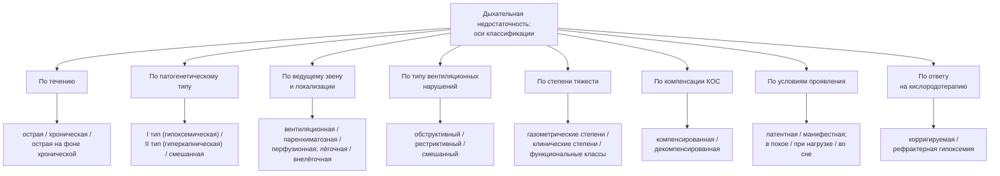

### 2.3. Классификации

Классификации дыхательной недостаточности многочисленны, и это не недостаток, а отражение того, что одного и того же пациента нужно описать с нескольких сторон: как быстро развилось состояние, какой газ нарушен, где поломка, насколько она тяжела, компенсирована ли она, когда проявляется и как отвечает на лечение. Каждая ось классификации отвечает на свой вопрос и влияет на своё решение (см. рис. 4). В клиническом диагнозе эти оси сочетаются.

**Рис. 4.** Оси классификации дыхательной недостаточности. Схема читается сверху вниз: от общего понятия — к восьми независимым осям и их градациям; в развёрнутом диагнозе используются одновременно несколько осей.

#### 2.3.1. По течению

##### 2.3.1.1. Острая

📌 **Определение:** **острая дыхательная недостаточность** (ОДН; acute respiratory failure) — быстро (за минуты, часы, реже дни) развивающееся нарушение газового состава артериальной крови, при котором компенсаторные механизмы — прежде всего почечная задержка бикарбоната — не успевают включиться, и гиперкапния сопровождается выраженным снижением pH, а гипоксемия — острой тканевой гипоксией.

ОДН — состояние, непосредственно угрожающее жизни и требующее немедленной респираторной поддержки; её причины (пневмония, острый респираторный дистресс-синдром, отёк лёгких, тромбоэмболия, передозировка, травма) в целом отличаются от причин ХДН, хотя могут их дополнять.

##### 2.3.1.2. Хроническая

Хроническая ДН была определена в п. 2.2.2.2: постепенное развитие, стабильность, включение компенсаторных механизмов. Её главная клиническая особенность — возможность длительной жизни с показателями газового состава, которые при остром развитии были бы несовместимы с сознанием: пациенты с ХОБЛ или кифосколиозом годами живут с PaCO₂ 60–70 мм рт. ст. при нормальном pH.

##### 2.3.1.3. Острая на фоне хронической

📌 **Определение:** **острая дыхательная недостаточность на фоне хронической** (ОДН на фоне ХДН; acute-on-chronic respiratory failure) — быстрое ухудшение газового состава у пациента с предсуществующей ХДН, обычно спровоцированное внешним фактором (инфекция, сердечная недостаточность, седативные препараты, пневмоторакс и др.), при котором на хроническую, компенсированную гиперкапнию наслаивается острый компонент с падением pH.

Это самый частый вариант ДН, с которым встречается приёмное отделение и ОРИТ терапевтического стационара; его патофизиология, маркёры и тактика рассматриваются в главе 2.24. Важно, что для этих пациентов «нормальные» целевые значения (PaCO₂ 40 мм рт. ст., SpO₂ 98 %) не являются целью лечения: цель — вернуть пациента к его привычному компенсированному состоянию.

##### 2.3.1.4. Критерии разграничения

Разграничить три варианта позволяет сочетание трёх признаков — времени, КОС и анамнеза (табл. 5). Решающий признак — соотношение бикарбоната и pH при данном PaCO₂: при остром респираторном ацидозе бикарбонат почти нормален и pH снижен значительно; при хроническом — бикарбонат повышен в соответствии с правилом 3,5–4 ммоль/л на 10 мм рт. ст. (табл. 2), pH близок к норме; при остром на фоне хронического — бикарбонат повышен, но его недостаточно для наблюдаемого PaCO₂, и pH снижен.

**Табл. 5.** Разграничение острой, хронической и острой на фоне хронической дыхательной недостаточности

| Признак | ОДН | ХДН | ОДН на фоне ХДН |
|---|---|---|---|
| Время развития | минуты — часы — дни | недели — месяцы — годы | часы — дни на фоне длительного анамнеза |
| PaCO₂ (при гиперкапническом варианте) | повышен | повышен устойчиво | повышен выше привычного уровня пациента |
| HCO₃⁻ | нормальный или слегка повышен (≈ +1 ммоль/л на 10 мм рт. ст.) | повышен (≈ +3,5–4 ммоль/л на 10 мм рт. ст.) | повышен, но меньше ожидаемого для текущего PaCO₂ |
| pH | значительно снижен | нормальный или близкий к норме (≥ 7,35) | снижен (< 7,35) |
| Компенсаторные признаки гипоксемии (эритроцитоз, лёгочное сердце) | отсутствуют | часто присутствуют | присутствуют |
| Клиника | острая, нарастающая | стабильная, адаптированная | острое ухудшение привычного состояния |
| Цель лечения | нормализация газов | компенсация и профилактика декомпенсации | возврат к привычному компенсированному уровню |

❗ **Типичная ошибка:** стремиться при ОДН на фоне ХДН «нормализовать» PaCO₂ до 40 мм рт. ст. Быстрое снижение PaCO₂ ниже привычного уровня у пациента с высоким бикарбонатом приводит к постгиперкапническому метаболическому алкалозу (pH может превысить 7,50), который угнетает дыхательный центр, смещает кривую диссоциации влево, ухудшает отдачу кислорода тканям и провоцирует аритмии и судороги. Ориентиром служит pH, а не абсолютное значение PaCO₂.

#### 2.3.2. По патогенетическому типу

Классификация по патогенетическому типу — самая распространённая в мировой литературе; она восходит к работам Кэмпбелла и в современном виде закреплена в руководствах по интенсивной терапии (табл. 6).

##### 2.3.2.1. Гипоксемическая (паренхиматозная, I тип)

📌 **Определение:** **гипоксемическая дыхательная недостаточность** (I тип; type 1, hypoxemic respiratory failure) — ДН с PaO₂ ниже 60 мм рт. ст. при нормальном или сниженном PaCO₂. Механизмы — вентиляционно-перфузионное несоответствие, внутрилёгочный шунт, диффузионные нарушения; альвеолярно-артериальный градиент повышен. Синоним — паренхиматозная ДН, поскольку её субстрат — поражение альвеол, интерстиция или сосудов лёгких.

Хронические примеры: интерстициальные заболевания лёгких, эмфизема на ранних стадиях ДН, лёгочная артериальная гипертензия, лёгочные артериовенозные мальформации, муковисцидоз и бронхоэктазы до исчерпания вентиляционного резерва.

##### 2.3.2.2. Гиперкапническая (вентиляционная, II тип)

📌 **Определение:** **гиперкапническая дыхательная недостаточность** (II тип; type 2, hypercapnic respiratory failure) — ДН с PaCO₂ выше 45 мм рт. ст.; гипоксемия присутствует как следствие гиповентиляции (формула 8) и может усугубляться сопутствующим поражением лёгких. Механизм — недостаточность альвеолярной вентиляции: отказ дыхательного насоса, увеличение мёртвого пространства, нарушение центральной регуляции. Синоним — вентиляционная ДН.

Хронические примеры: ХОБЛ в поздних стадиях, нервно-мышечные заболевания, кифосколиоз и другие торакальные деформации, синдром ожирения-гиповентиляции, центральная гиповентиляция.

##### 2.3.2.3. Смешанная

**Смешанная ДН** — сочетание признаков обоих типов: гиперкапния и гипоксемия, превышающая ожидаемую от гиповентиляции (повышенный альвеолярно-артериальный градиент). Это типичный портрет далеко зашедшей ХОБЛ, терминального муковисцидоза, overlap-синдрома (ХОБЛ + обструктивное апноэ сна), а также любого пациента с «насосной» ДН, у которого присоединилось поражение паренхимы (ателектазы, пневмония, аспирация у нервно-мышечного больного). В динамике большинство хронических заболеваний лёгких проходят путь от I типа к смешанному: сначала страдает газообменник, затем, по мере роста работы дыхания и исчерпания резервов, — насос.

**Табл. 6.** Сравнение гипоксемического и гиперкапнического типов дыхательной недостаточности

| Признак | I тип (гипоксемический) | II тип (гиперкапнический) |
|---|---|---|
| PaO₂ | < 60 мм рт. ст. | снижен пропорционально гиповентиляции (может быть < 60) |
| PaCO₂ | нормальный или снижен | > 45 мм рт. ст. |
| P(A–a)O₂ | повышен | нормальный при «чистой» гиповентиляции; повышен при сопутствующем поражении лёгких |
| Ведущие механизмы | V̇A/Q̇-несоответствие, шунт, диффузионные нарушения | снижение альвеолярной вентиляции, рост мёртвого пространства, нарушение драйва |
| Поражённое звено | газообменник | дыхательный насос / регуляция |
| Ответ на кислород | хороший при V̇A/Q̇-несоответствии и диффузионных нарушениях, слабый при шунте | гипоксемия устраняется легко, но вентиляция не улучшается; риск кислород-индуцированной гиперкапнии |
| Основной метод коррекции при ХДН | длительная кислородотерапия | вентиляционная поддержка (НИВЛ), при необходимости — в сочетании с кислородом |
| Типичные хронические причины | ИЗЛ, эмфизема, лёгочно-сосудистые болезни | ХОБЛ (поздние стадии), НМЗ, кифосколиоз, СОГ, центральная гиповентиляция |

🔬 **Углубление:** в реаниматологической литературе (классификация, предложенная L. D. H. Wood и используемая в руководствах по интенсивной терапии) к I и II типам добавляют III тип — периоперационную ДН, обусловленную ателектазами при снижении ФОЕ, и IV тип — ДН при шоке, когда гипоперфузия дыхательных мышц и рост их кислородной потребности требуют вентиляции для «разгрузки» кровообращения. Для хронической ДН эти типы прямого значения не имеют, но объясняют, почему пациент с ХДН особенно уязвим в периоперационном периоде и при любом шоковом состоянии (п. 2.26.8).

#### 2.3.3. По ведущему звену

Отечественная патофизиологическая традиция (А. П. Зильбер и др.) классифицирует ДН по ведущему нарушенному процессу внешнего дыхания.

##### 2.3.3.1. Вентиляционная

Нарушен конвективный перенос газа — альвеолярная вентиляция. Это аналог II типа; подразделяется по уровню поражения на центрогенную (дыхательный центр), нервно-мышечную, торакодиафрагмальную и обструктивную (бронхолёгочную) формы.

##### 2.3.3.2. Паренхиматозная

Нарушен газообмен в лёгочной паренхиме при сохранной вентиляции — вентиляционно-перфузионная неоднородность, шунт, нарушения диффузии. Аналог I типа.

##### 2.3.3.3. Перфузионная

Выделение перфузионной формы — особенность отечественной схемы: в англоязычной традиции сосудистые причины (тромбоэмболия, лёгочная гипертензия, васкулиты, артериовенозные мальформации) обычно включаются в I тип. Её обособление оправдано тем, что ведущим механизмом здесь служит нарушение кровотока — рост альвеолярного мёртвого пространства при обструкции сосудов и шунтирование при мальформациях, — а лечение направлено на сосудистое русло (антикоагулянты, лёгочные вазодилататоры, эндартерэктомия), а не на вентиляцию.

##### 2.3.3.4. Смешанная

Сочетание нескольких ведущих звеньев — наиболее частый вариант в поздних стадиях любого заболевания. Ценность классификации по ведущему звену — в том, что она заставляет назвать конкретный нарушенный процесс, а значит, подсказывает, что измерять (вентиляцию — газометрией и спирометрией, паренхиму — DLCO и КТ, перфузию — ЭхоКГ, сцинтиграфией, катетеризацией).

#### 2.3.4. Лёгочная и внелёгочная дыхательная недостаточность

Это деление соответствует двум блокам рис. 1 и концепции C. Roussos: «отказ лёгких» (lung failure) и «отказ насоса» (pump failure). **Лёгочная ДН** — следствие поражения самих лёгких (дыхательных путей, паренхимы, сосудов); **внелёгочная** — следствие поражения дыхательного центра, спинного мозга, нервов, нервно-мышечного синапса, мышц, грудной клетки, плевры, а также ожирения.

Деление имеет несколько практических следствий. Во-первых, газометрических: при внелёгочной ДН альвеолярно-артериальный градиент нормален, гипоксемия объясняется целиком гиповентиляцией, диффузионная способность в пересчёте на альвеолярный объём (KCO) нормальна или даже повышена. Во-вторых, терапевтических: внелёгочная ДН почти всегда хорошо отвечает на вентиляционную поддержку — именно при ней длительная НИВЛ даёт наиболее убедительные результаты (кифосколиоз, последствия полиомиелита, мышечные дистрофии), — тогда как при лёгочной ДН на первый план выходят кислород и лечение основного заболевания. В-третьих, прогностических: при внелёгочной ДН со стабильным или медленно прогрессирующим субстратом (кифосколиоз, постполиомиелитный синдром) прогноз на вентиляции хороший на годы и десятилетия; при быстро прогрессирующем (БАС) — определяется темпом основного заболевания.

#### 2.3.5. По типу вентиляционных нарушений

Эта ось описывает не газовый состав, а функцию внешнего дыхания по данным спирометрии и бодиплетизмографии; она характеризует основное заболевание и часто фигурирует в диагнозе рядом с ДН.

##### 2.3.5.1. Обструктивный

Снижение отношения ОФВ₁/ФЖЕЛ ниже нижней границы нормы (в практике ХОБЛ — ниже 0,70 после бронходилататора) при нормальной или сниженной ФЖЕЛ; характерны вогнутая форма экспираторной части кривой «поток — объём», рост остаточного объёма и отношения ООЛ/ОЕЛ (воздушные ловушки), гиперинфляция. Причины — ХОБЛ, астма, бронхоэктазы, муковисцидоз, облитерирующий бронхиолит.

##### 2.3.5.2. Рестриктивный

Снижение общей ёмкости лёгких (ОЕЛ) ниже нижней границы нормы при нормальном или повышенном ОФВ₁/ФЖЕЛ. Спирометрия (снижение ФЖЕЛ при нормальном отношении) лишь предполагает рестрикцию; подтверждение требует измерения ОЕЛ бодиплетизмографией или газоразведением. Рестрикция бывает лёгочной (фиброз — со снижением DLCO) и внелёгочной (нервно-мышечная слабость, кифосколиоз, ожирение, плевральные сращения — с нормальной или повышенной KCO).

##### 2.3.5.3. Смешанный

Снижены и отношение ОФВ₁/ФЖЕЛ, и ОЕЛ: сочетание ХОБЛ с фиброзом (в том числе синдром сочетания фиброза и эмфиземы), саркоидоз, последствия туберкулёза, муковисцидоз на поздних стадиях, ХОБЛ у пациента с ожирением или после резекции лёгкого.

Связь между типом вентиляционных нарушений и ДН не прямая: значительная часть пациентов с тяжёлой обструкцией не имеет ДН, тогда как ДН может развиться при умеренных спирометрических изменениях — при лёгочной гипертензии, синдроме ожирения-гиповентиляции, при нервно-мышечных заболеваниях, где спирометрия отражает слабость, а не поражение лёгких. Поэтому спирометрическая стадия и степень ДН указываются в диагнозе раздельно.

#### 2.3.6. По степени тяжести

##### 2.3.6.1. Газометрические степени

В российских клинических рекомендациях (в частности, по ХОБЛ) и в руководстве «Респираторная медицина» используется трёхстепенная классификация по уровню PaO₂ и SaO₂ (табл. 7).

**Табл. 7.** Газометрические степени тяжести дыхательной недостаточности (отечественная классификация)

| Степень | PaO₂, мм рт. ст. | SaO₂, % | Клинический комментарий |
|---|---|---|---|
| I | 60–79 | 90–94 | гипоксемия без формальных критериев ДН по PaO₂; отражает начальные нарушения газообмена |
| II | 40–59 | 75–89 | ДН по кэмпбелловскому критерию; типичный диапазон показаний к длительной кислородотерапии |
| III | < 40 | < 75 | тяжёлая гипоксемия, угрожающая жизни |

Обратите внимание на расхождение: I степень по этой классификации включает значения PaO₂ 60–79 мм рт. ст., которые по международному определению дыхательной недостаточностью не являются. Это отражает отечественную традицию считать ДН стадийным процессом, включающим начальные нарушения. Международные руководства не используют степеней ДН как таковых, но применяют пороги тяжести гипоксемии для принятия решений: «тяжёлая гипоксемия покоя» — PaO₂ ≤ 55 мм рт. ст. (или ≤ 59 при признаках лёгочного сердца или эритроцитозе), «умеренная» — 56–59 мм рт. ст. или SpO₂ 89–93 % (глава 2.17). Для гиперкапнии стандартизованной шкалы степеней нет; тяжесть описывают абсолютным значением PaCO₂ и состоянием компенсации (pH).

##### 2.3.6.2. Клинические степени по выраженности одышки

Классификация А. Г. Дембо (1957), сохраняющаяся в отечественных учебниках и экспертной практике, выделяет три степени: I — одышка при повышенной (ранее переносимой) физической нагрузке; II — одышка при обычной нагрузке; III — одышка в покое. Её международный аналог — шкала mMRC (0–4 балла; п. 2.10.5.1), а также функциональные классы ВОЗ для лёгочной гипертензии. Клинические степени не заменяют газометрических: они описывают разные измерения тяжести (симптомную нагрузку и нарушение газообмена), которые могут расходиться — пациент с центральной гиповентиляцией имеет гиперкапнию без одышки, пациент с ХОБЛ и тревожным расстройством — выраженную одышку при умеренной гипоксемии.

##### 2.3.6.3. Функциональные классы

Понятие функционального класса, заимствованное из кардиологии (NYHA) и адаптированное ВОЗ для лёгочной гипертензии (классы I–IV по переносимости нагрузки и наличию симптомов в покое), применяется к пациентам с ХДН, осложнённой лёгочной гипертензией и лёгочным сердцем (п. 2.8.5). В практике медико-социальной экспертизы дополнительно используются степени выраженности нарушений функций дыхательной системы, привязанные к степени ДН и к ограничениям жизнедеятельности (п. 2.27.14).

#### 2.3.7. По компенсации кислотно-основного состояния

Для гиперкапнической ХДН состояние компенсации — обязательный элемент характеристики. **Компенсированная** — pH в пределах 7,35–7,45 при повышенном PaCO₂ и соответствующем росте бикарбоната. **Декомпенсированная** — pH ниже 7,35 (острый компонент); pH ниже 7,25–7,30 обычно рассматривается как показание к немедленной вентиляционной поддержке (п. 2.24.4). В ряде отечественных источников выделяют также **субкомпенсированную** стадию с пограничными значениями pH (около 7,30–7,35) — это удобное клиническое понятие, подчёркивающее нестойкость равновесия, хотя чётких общепринятых границ для него нет. Для гипоксемической ХДН понятие компенсации используется в клиническом смысле — наличие или отсутствие признаков тканевой гипоксии и декомпенсации лёгочного сердца.

#### 2.3.8. По условиям проявления

##### 2.3.8.1. Латентная и манифестная

**Латентная (скрытая) ДН** — газовый состав в покое и бодрствовании нормален, но нарушения выявляются при нагрузке или во сне; **манифестная** — нарушения присутствуют в покое. Выявление латентной стадии — задача скрининга групп риска (п. 2.31.5): нагрузочная десатурация при интерстициальных заболеваниях, ночная гиповентиляция при нервно-мышечных болезнях.

##### 2.3.8.2. Нарушения в покое, при нагрузке и во сне

Три условия проявления соответствуют трём разным нагрузкам на систему дыхания. **Нагрузка** предъявляет требования к газообменнику (укорочение капиллярного транзита) и к вентиляционному резерву — поэтому первой десатурацией при нагрузке проявляются интерстициальные заболевания и эмфизема. **Сон** предъявляет требования к насосу и регуляции: в фазу быстрого сна тонус вспомогательных мышц падает, и вентиляция держится почти исключительно на диафрагме, а чувствительность хеморецепторов снижена; поэтому при нервно-мышечных заболеваниях, кифосколиозе, ожирении и ХОБЛ гиповентиляция сначала появляется в REM-сне, затем распространяется на весь сон и лишь потом — на бодрствование. Эта последовательность (сон → нагрузка → покой для насосной ДН; нагрузка → покой для паренхиматозной) определяет порядок обследования в главах 2.11–2.12 и момент начала лечения — один из дискуссионных вопросов (п. 3.12).

#### 2.3.9. По ответу на кислородотерапию

Гипоксемия, обусловленная вентиляционно-перфузионным несоответствием, диффузионными нарушениями и гиповентиляцией, устраняется небольшим повышением FiO₂ — её называют **корригируемой** (кислород-чувствительной). Гипоксемия, обусловленная шунтом, при подаче кислорода улучшается незначительно — она **рефрактерна**: кровь, проходящая через невентилируемые единицы, не контактирует с добавленным кислородом. Количественно вклад шунта оценивают по уравнению шунта (пробы при дыхании 100 % кислородом):

$$\frac{\dot Q_s}{\dot Q_t} = \frac{Cc'O_2 - CaO_2}{Cc'O_2 - C\bar vO_2} \quad (10)$$

где $\dot Q_s/\dot Q_t$ — доля шунтируемого кровотока, $Cc'O_2$ — содержание O₂ в крови конца лёгочного капилляра (рассчитывается из альвеолярного PO₂), $CaO_2$ и $C\bar vO_2$ — содержание O₂ в артериальной и смешанной венозной крови (мл/дл). Для ХДН эта ось важна по двум причинам: при лёгочной артериовенозной мальформации, печёночно-лёгочном синдроме или открытом овальном окне с право-левым сбросом кислород неэффективен и нужно устранять шунт; а у пациента с гиперкапнией ответ на кислород имеет обратную сторону — риск нарастания PaCO₂, поэтому в классификации по ответу на кислород иногда выделяют вариант «гипоксемия корригируется, но с задержкой CO₂», требующий контролируемой оксигенотерапии (п. 2.17.12.1, 2.24.7).

#### 2.3.10. Нозологические системы стратификации (GOLD, ATS/ERS)

Помимо универсальных классификаций ДН, каждая нозология имеет собственные системы стратификации, в которых газообмен — лишь один из параметров.

**GOLD** (Глобальная инициатива по ХОБЛ) оценивает тяжесть обструкции по постбронходилатационному ОФВ₁ при отношении ОФВ₁/ФЖЕЛ < 0,70: GOLD 1 — ОФВ₁ ≥ 80 % должного, GOLD 2 — 50–79 %, GOLD 3 — 30–49 %, GOLD 4 — < 30 %; отдельно по симптомам (mMRC, CAT) и обострениям пациентов относят к группам A, B и E (в редакции 2023 года группы C и D объединены в группу E — «обострения»). Дыхательная недостаточность не входит в эту стратификацию формально, но хроническая гипоксемия и гиперкапния фигурируют в документе как показания к кислородотерапии и НИВЛ соответственно и как критерии направления на трансплантацию.

**ATS/ERS** в документе по интерпретации лёгочных функциональных тестов (2005) предложили градации тяжести вентиляционных нарушений по ОФВ₁ в процентах от должного (лёгкие — более 70 %, умеренные — 60–69 %, умеренно тяжёлые — 50–59 %, тяжёлые — 35–49 %, очень тяжёлые — менее 35 %) и по DLCO (лёгкое снижение — более 60 % при значении ниже нижней границы нормы, умеренное — 40–60 %, тяжёлое — менее 40 %); обновлённый документ 2022 года рекомендует градации по z-оценкам (лёгкие — от −1,65 до −2,5, умеренные — от −2,51 до −4,0, тяжёлые — ниже −4,1) и отказ от фиксированных процентов (п. 2.11.1.7).

Для интерстициальных заболеваний применяют индекс GAP (пол, возраст, ФЖЕЛ и DLCO; стадии I–III) и критерии прогрессирования; для лёгочной гипертензии — многопараметрическую стратификацию риска ESC/ERS (низкий, промежуточный, высокий); для бокового амиотрофического склероза — респираторный субдомен шкалы ALSFRS-R и функциональные показатели (ФЖЕЛ, SNIP). Эти системы сосуществуют с классификацией ДН и дополняют её при оценке прогноза (глава 2.14).

#### 2.3.11. Ограничения существующих классификаций

Классификации ДН полезны, но у них есть границы, о которых нужно помнить.

1. **Пороги — конвенции.** Значения 60 и 45 мм рт. ст. физиологически обоснованы, но дихотомизация непрерывной переменной создаёт иллюзию качественного скачка: пациент с PaO₂ 61 мм рт. ст. не отличается от пациента с 59 мм рт. ст. ничем, кроме кода. Решения должны опираться на динамику и совокупность данных.
2. **Изменчивость измерений.** PaO₂ и PaCO₂ у стабильного пациента колеблются в пределах нескольких мм рт. ст. в зависимости от времени суток, положения тела, недавней нагрузки, тревоги при пункции и качества забора; классификация по единичному измерению ненадёжна.
3. **Разные шкалы тяжести измеряют разное.** Газометрические степени, степени по одышке и функциональные классы не совпадают и не должны подменять друг друга; ни одна из них не валидирована как предиктор исходов во всех нозологиях.
4. **Дихотомия типов упрощает континуум.** Большинство хронических заболеваний проходят путь от I типа к смешанному; момент «перехода» условен, а гипоксемия при II типе требует отдельной оценки её причин.
5. **Отсутствие единого критерия хронизации.** Разные источники по-разному определяют стабильное состояние (2–4 недели, 6–8 недель после обострения), что затрудняет сравнение исследований и регистров.
6. **Особые группы.** Классификации созданы для взрослых на уровне моря; у детей, на высокогорье, у пациентов, уже получающих кислород или вентиляцию, они требуют адаптации, а состояние компенсации у пациента на НИВЛ отражает не столько болезнь, сколько эффективность лечения.

Наиболее практичной остаётся комбинация: течение + тип (с указанием ведущего механизма и локализации) + степень + компенсация + условия проявления. Именно так мы будем строить формулировку диагноза в п. 2.13.15.

#### 2.3.12. Примеры и иллюстрации: классификационная оценка учебных клинических профилей

Применим оси классификации к пяти учебным профилям (табл. 8). Профили составлены для демонстрации и не являются описаниями реальных пациентов; все измерения — при дыхании воздухом на уровне моря, если не указано иное.

**Табл. 8.** Классификационная оценка учебных клинических профилей

| Профиль | Ключевые данные | Течение | Тип и ведущее звено | Локализация | Степень (по PaO₂) | Компенсация | Условия проявления |
|---|---|---|---|---|---|---|---|
| А. Мужчина 68 лет, ХОБЛ, ОФВ₁ 28 % | PaO₂ 52, PaCO₂ 58 мм рт. ст., pH 7,37, HCO₃⁻ 33 ммоль/л; P(A–a)O₂ ≈ 25 мм рт. ст.; стабилен | хроническая | смешанная (II тип + паренхиматозный компонент); обструктивный тип вентиляционных нарушений | лёгочная с присоединением недостаточности насоса | II | компенсированная | манифестная в покое |
| Б. Юноша 22 лет, мышечная дистрофия Дюшенна, ФЖЕЛ 24 % | днём PaO₂ 70, PaCO₂ 48, pH 7,39, HCO₃⁻ 30; ночью tcPCO₂ до 62 мм рт. ст.; утренние головные боли | хроническая | гиперкапническая (II тип), вентиляционная, нервно-мышечная; рестриктивный (внелёгочный) | внелёгочная | I | компенсированная | манифестная днём (пограничная), выраженная ночная гиповентиляция |
| В. Женщина 61 года, идиопатический лёгочный фиброз, DLCO 32 % | PaO₂ 54, PaCO₂ 34, pH 7,45; десатурация при ходьбе до 80 % | хроническая | гипоксемическая (I тип), паренхиматозная; рестриктивный (лёгочный) | лёгочная | II | компенсированная (гипокапния — компенсаторная гипервентиляция) | в покое и резко — при нагрузке |
| Г. Мужчина 52 лет, ИМТ 48 кг/м², ИАГ 45 событий/ч | PaO₂ 58, PaCO₂ 56, pH 7,36, HCO₃⁻ 32; P(A–a)O₂ в норме | хроническая | гиперкапническая (II тип), вентиляционная; синдром ожирения-гиповентиляции с тяжёлым апноэ сна | внелёгочная | II | компенсированная | во сне (выраженно) и в покое |
| Д. Мужчина 70 лет, ХОБЛ, госпитализирован с обострением | PaO₂ 45, PaCO₂ 75, pH 7,24, HCO₃⁻ 31; сонлив | острая на фоне хронической | гиперкапническая с гипоксемией; обструктивный | лёгочная + насос | III | декомпенсированная (острый респираторный ацидоз на фоне хронического) | в покое |

Разберём логику на двух профилях. У пациента Б дневной PaCO₂ 48 мм рт. ст. формально чуть выше порога, но бикарбонат 30 ммоль/л и ночной подъём PCO₂ до 62 мм рт. ст. показывают, что ночная гиповентиляция уже устойчива и компенсирована почками — это сформировавшаяся гиперкапническая ХДН внелёгочного происхождения, при которой показана ночная НИВЛ, а не наблюдение (глава 2.19). У пациента Д бикарбонат 31 ммоль/л при PaCO₂ 75 мм рт. ст. явно недостаточен для хронического ацидоза (ожидалось бы около 36–38 ммоль/л) — значит, его привычный PaCO₂ был около 55–60 мм рт. ст., а сейчас наслоился острый компонент; целью лечения будет возврат к pH ≥ 7,35 при PaCO₂ около его привычных значений, а не 40 мм рт. ст.

💡 **Интересный факт:** в странах, использующих единицы СИ (Великобритания, Скандинавия), критерии дыхательной недостаточности формулируются как PaO₂ < 8,0 кПа и PaCO₂ > 6,0 кПа. Поскольку 1 кПа = 7,50 мм рт. ст., эти «круглые» значения соответствуют 60,0 и 45,0 мм рт. ст. — редкий случай, когда пороги в двух системах единиц совпадают практически без округления; поэтому международные классификации ДН, в отличие, например, от пороговых значений глюкозы или холестерина, не содержат расхождений, связанных с пересчётом единиц.

📝 **Обобщение**

Мы рассмотрели восемь осей классификации дыхательной недостаточности и научились сочетать их в описании пациента.

- По течению различают острую, хроническую и острую на фоне хронической ДН; решающий критерий разграничения — соотношение бикарбоната и pH при данном PaCO₂.
- По патогенетическому типу — гипоксемическую (I тип, отказ газообменника) и гиперкапническую (II тип, отказ насоса), а также смешанную; это деление определяет основной метод коррекции — кислород или вентиляцию.
- Отечественные классификации по ведущему звену (вентиляционная, паренхиматозная, перфузионная) и деление на лёгочную и внелёгочную ДН уточняют локализацию поломки и подсказывают методы обследования и прогноз.
- Степень тяжести описывается газометрически (три степени по PaO₂/SaO₂), клинически (по одышке) и функциональными классами; эти шкалы измеряют разное и не подменяют друг друга.
- Компенсация (pH), условия проявления (покой, нагрузка, сон; латентная и манифестная) и ответ на кислород дополняют характеристику; последовательность появления нарушений — во сне, затем при нагрузке, затем в покое для насосной ДН — определяет стратегию раннего выявления.
- Нозологические системы (GOLD, ATS/ERS, GAP, стратификация риска при лёгочной гипертензии) сосуществуют с классификацией ДН; все классификации ограничены конвенциональностью порогов и изменчивостью измерений.

Главный вывод: развёрнутая характеристика ДН — это не выбор одной классификации, а ответ на серию вопросов (как быстро, какой газ, где поломка, насколько тяжело, компенсировано ли, когда проявляется, как отвечает на кислород). В следующих главах мы наполним эти оси содержанием: эпидемиологией (2.4), причинами (2.5) и механизмами (2.6).

❓ **Контрольные вопросы**

1. Перечислите оси классификации дыхательной недостаточности и укажите, на какое клиническое решение влияет каждая из них.
2. Чем гиперкапническая ДН отличается от гипоксемической по механизмам, альвеолярно-артериальному градиенту и основному методу коррекции?
3. Почему при нервно-мышечных заболеваниях нарушения газообмена появляются сначала во сне, затем при нагрузке и лишь потом в покое, а при интерстициальных заболеваниях — сначала при нагрузке?
4. У пациента с ХОБЛ при поступлении PaCO₂ 70 мм рт. ст., HCO₃⁻ 36 ммоль/л, pH 7,33. Определите течение ДН и оцените, каким мог быть его привычный уровень PaCO₂; какую цель лечения по газам крови вы поставите?
5. Как изменится классификационная оценка пациента В из табл. 8, если при повторной газометрии через год PaCO₂ составит 50 мм рт. ст. при PaO₂ 50 мм рт. ст.? Какое звено системы дыхания присоединилось к поражению?
