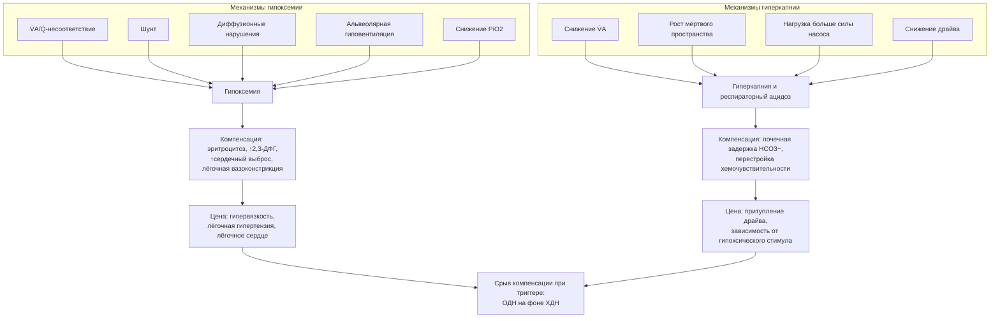

### 2.6. Патогенез и хроническая адаптация

В главе 2.1 мы описали, как устроена система дыхания, в главе 2.5 — что в ней ломается. Теперь соединим одно с другим: как конкретные поломки приводят к гипоксемии и гиперкапнии, как организм перестраивается, чтобы жить с ними, и почему эта перестройка в какой-то момент перестаёт справляться. Общая схема механизмов представлена на рис. 6; далее мы разберём каждый её блок.

**Рис. 6.** Механизмы гипоксемии и гиперкапнии, компенсаторные ответы и их «цена». Схема читается сверху вниз: от механизмов — к нарушениям газового состава, адаптации и срыву компенсации.

#### 2.6.1. Механизмы гипоксемии

Классическая патофизиология выделяет пять механизмов снижения PaO₂; их различают по двум признакам — альвеолярно-артериальному градиенту и ответу на кислород (табл. 11).

**Табл. 11.** Механизмы гипоксемии и их дифференциальные признаки

| Механизм | P(A–a)O₂ | Ответ на повышение FiO₂ | PaCO₂ | Типичные хронические примеры |
|---|---|---|---|---|
| V̇A/Q̇-несоответствие | повышен | хороший | нормальный/снижен; повышен при исчерпании резерва | ХОБЛ, бронхоэктазы, ИЗЛ, лёгочная гипертензия |
| Шунт | повышен | слабый (рефрактерная гипоксемия) | нормальный/снижен | артериовенозные мальформации, печёночно-лёгочный синдром, ателектазы, открытое овальное окно |
| Диффузионные нарушения | повышен (сначала только при нагрузке) | хороший | снижен | ИЛФ и другие ИЗЛ, эмфизема, лёгочная гипертензия |
| Альвеолярная гиповентиляция | нормальный | хороший (но маскирует гиперкапнию) | повышен | НМЗ, кифосколиоз, СОГ, центральная гиповентиляция |
| Снижение PiO₂ | нормальный | хороший | снижен (гипервентиляция) | высокогорье, авиаперелёт |

##### 2.6.1.1. Вентиляционно-перфузионное несоответствие

Это главный механизм гипоксемии при подавляющем большинстве хронических заболеваний лёгких. Он был описан в п. 2.1.9: единицы с низким V̇A/Q̇ отдают в артериальную кровь недонасыщенную кровь, а единицы с высоким V̇A/Q̇ не могут компенсировать это из-за плато кривой диссоциации оксигемоглобина. При ХОБЛ метод MIGET выявляет два типа распределений: «низкий V̇A/Q̇» (перфузия плохо вентилируемых единиц — бронхитический вариант) и «высокий V̇A/Q̇» (вентиляция плохо перфузируемых единиц — эмфизематозный вариант, фактически рост мёртвого пространства). При ИЗЛ и лёгочной гипертензии неоднородность тоже присутствует, но дополняется другими механизмами. Ответ на кислород хороший: даже небольшое повышение FiO₂ поднимает альвеолярный PO₂ в единицах с низким V̇A/Q̇ настолько, что сатурация оттекающей крови нормализуется. Именно поэтому пациенту с ХОБЛ обычно достаточно 1–2 л/мин кислорода через назальные канюли.

##### 2.6.1.2. Внутрилёгочное шунтирование

Шунт — крайний случай низкого V̇A/Q̇ (равного нулю): кровь проходит через невентилируемые альвеолы или минует их по анатомическим сообщениям. Анатомический шунт при ХДН — артериовенозные мальформации, печёночно-лёгочный синдром (дилатация внутрилёгочных сосудов при циррозе), внутрисердечный право-левый сброс через открытое овальное окно при лёгочной гипертензии; функциональный — ателектазы, заполненные экссудатом альвеолы при пневмонии. Отличительный признак — рефрактерность к кислороду: при шунте более 30 % даже дыхание чистым кислородом не нормализует PaO₂, поскольку шунтируемая кровь не контактирует с кислородом, а кровь из вентилируемых единиц уже насыщена. Выявление рефрактерной гипоксемии у «стабильного» пациента с ХДН должно направить поиск на шунт (контрастная ЭхоКГ с пузырьковым контрастом, КТ-ангиография).

##### 2.6.1.3. Диффузионные нарушения

Утолщение мембраны, уменьшение площади газообмена и объёма капиллярной крови снижают скорость уравновешивания PO₂ между альвеолой и капилляром. В покое резерва времени обычно хватает, поэтому изолированная диффузионная гипоксемия покоя редка; она манифестирует при нагрузке, когда время капиллярного транзита укорачивается, и при снижении PiO₂ (в полёте). Классический пример — ИЛФ: пациент с нормальной сатурацией покоя падает до 80 % при ходьбе. Диффузионный компонент почти всегда сочетается с V̇A/Q̇-неоднородностью; разделить их у постели больного невозможно, да и не нужно — оба хорошо отвечают на кислород. Отметим, что низкая DLCO сама по себе не доказывает «диффузионную» гипоксемию: при эмфиземе она отражает потерю капиллярного русла, при анемии — дефицит гемоглобина, при лёгочной гипертензии — сосудистую патологию.

##### 2.6.1.4. Альвеолярная гиповентиляция

Снижение V̇A повышает альвеолярное PCO₂ и, по уравнению альвеолярного газа (формула 8), снижает альвеолярное PO₂: при PaCO₂ 80 мм рт. ст. и дыхании воздухом P_AO₂ ≈ 50 мм рт. ст. Градиент при «чистой» гиповентиляции нормален — это ключевой дифференциальный признак внелёгочной ДН. Гипоксемия легко устраняется кислородом, но это устранение обманчиво: вентиляция не улучшается, PaCO₂ продолжает расти, а пульсоксиметр показывает благополучие. Отсюда правило: у пациента с риском гиповентиляции нормальная SpO₂ на кислороде ничего не говорит о его вентиляции, нужна капнометрия или газометрия.

##### 2.6.1.5. Снижение парциального давления кислорода во вдыхаемом воздухе

На высоте PiO₂ падает (п. 2.1.8.1); у здорового человека это компенсируется гипервентиляцией, у пациента с ХДН резерв компенсации исчерпан, и десатурация при подъёме на высоту или в полёте (давление в салоне соответствует высоте до 2438 м) бывает глубокой. Редкие бытовые варианты — вдыхание гипоксических смесей (неисправные газовые приборы в закрытых помещениях, когда к гипоксии добавляется отравление CO).

🔬 **Углубление:** на практике вклад механизмов меняется с течением болезни и при обострении. При стабильной ХОБЛ истинный шунт по данным MIGET обычно не превышает нескольких процентов, а гипоксемия почти целиком объясняется неоднородностью V̇A/Q̇; при обострении вклад шунта растёт (секрет, ателектазы, пневмония), и потребность в кислороде увеличивается. Третий фактор, о котором часто забывают, — сатурация смешанной венозной крови: при том же распределении V̇A/Q̇ снижение сердечного выброса или рост потребления кислорода (лихорадка, работа дыхания) снижает Sv̄O₂ и углубляет артериальную гипоксемию через примесь венозной крови из низких V̇A/Q̇-единиц и шунта. Поэтому у пациента с ХДН и сердечной недостаточностью коррекция гемодинамики улучшает оксигенацию без изменения лёгких.

#### 2.6.2. Механизмы гиперкапнии

##### 2.6.2.1. Снижение альвеолярной вентиляции

По формуле (2) PaCO₂ обратно пропорционален V̇A. Снижение V̇A может быть следствием снижения минутной вентиляции (угнетение центра, слабость мышц) или уменьшения её эффективной доли при неизменной или даже возросшей минутной вентиляции (частое поверхностное дыхание). Второй вариант — типичный для ХОБЛ и нервно-мышечных заболеваний: пациент дышит с частотой 25–30 в минуту и объёмом 250–300 мл, минутная вентиляция формально нормальна, а альвеолярная — снижена вдвое.

##### 2.6.2.2. Увеличение мёртвого пространства

Рост доли физиологического мёртвого пространства (формула 3) означает, что для выведения того же количества CO₂ требуется большая минутная вентиляция. При эмфиземе V_D/V_T в покое может достигать 0,5 и выше; при лёгочной гипертензии и ХТЭЛГ растёт альвеолярное мёртвое пространство. Пока насос способен нарастить минутную вентиляцию, PaCO₂ остаётся нормальным — но ценой увеличения работы дыхания. Когда резерв исчерпан (при нагрузке, обострении, во сне), развивается гиперкапния. Так мёртвое пространство превращает проблему газообменника в проблему насоса.

##### 2.6.2.3. Несоответствие вентиляционного запроса и возможностей дыхательного насоса

Это центральная идея патогенеза хронической гиперкапнии. Вентиляционный запрос определяется продукцией CO₂ и долей мёртвого пространства; возможности насоса — силой и выносливостью дыхательных мышц, механическими условиями их работы и эффективностью нейронной команды. Хроническая гиперкапния — результат длительного превышения запроса над возможностями, при котором дыхательный центр «выбирает» паттерн, предотвращающий утомление мышц (частое поверхностное дыхание), ценой задержки CO₂. Подробно — в п. 2.6.4 и 2.6.12.1.

##### 2.6.2.4. Нарушения центрального респираторного драйва

Снижение драйва как первичная причина гиперкапнии встречается при центральной гиповентиляции, поражениях ствола, приёме опиоидов и седативных средств, гипотиреозе. Как вторичный феномен — притупление хемочувствительности — оно сопутствует любой длительной гиперкапнии и затрудняет выход из неё: после устранения триггера декомпенсации пациент не «автоматически» возвращается к прежней вентиляции. Снижение драйва во сне физиологично и объясняет, почему все насосные варианты ДН манифестируют сначала ночью.

#### 2.6.3. Нарушения механики дыхания

##### 2.6.3.1. Обструктивные нарушения

Сужение дыхательных путей (воспаление, ремоделирование, секрет, потеря эластической поддержки) увеличивает резистивную работу дыхания, удлиняет выдох и создаёт экспираторное ограничение потока (п. 2.1.3.2). Последствия для насоса — рост нагрузки и, через гиперинфляцию, ухудшение условий работы диафрагмы.

##### 2.6.3.2. Рестриктивные нарушения

Снижение растяжимости лёгких (фиброз) или грудной стенки (кифосколиоз, ожирение, плевральные сращения) увеличивает эластическую работу дыхания: каждый миллилитр объёма требует большего давления. Оптимальная стратегия дыхательного центра — малый объём и высокая частота — увеличивает долю мёртвого пространства. При нервно-мышечных заболеваниях рестрикция вторична, но механизм тот же: микроателектазы и ригидная грудная клетка делают каждый вдох «дороже» для ослабленной мышцы.

##### 2.6.3.3. Статическая и динамическая гиперинфляция

📌 **Определение:** **статическая гиперинфляция** — увеличение объёма лёгких в конце спокойного выдоха (ФОЕ) вследствие снижения эластической тяги (эмфизема); **динамическая гиперинфляция** — дополнительное увеличение конечно-экспираторного объёма при учащении дыхания, когда времени выдоха не хватает для возврата к уровню статического равновесия.

Гиперинфляция — главный «усилитель» нагрузки на насос при ХОБЛ: диафрагма уплощена и укорочена (закон Лапласа, кривая «длина — напряжение»), грудная клетка работает на невыгодном участке своей кривой растяжимости, дыхательный объём зажат вблизи ОЕЛ, где растяжимость мала. При нагрузке и обострении динамическая гиперинфляция нарастает с каждым вдохом, и именно она коррелирует с интенсивностью одышки лучше, чем ОФВ₁. Снижение гиперинфляции — общая цель бронходилататоров, реабилитации, редукции объёма лёгких и НИВЛ.

##### 2.6.3.4. Внутреннее положительное давление конца выдоха (auto-PEEP)

📌 **Определение:** **внутреннее положительное давление конца выдоха** (auto-PEEP, intrinsic PEEP, PEEPi) — положительное альвеолярное давление в конце выдоха, обусловленное неполным опорожнением лёгких при динамической гиперинфляции.

Чтобы начать вдох, дыхательные мышцы должны сначала «преодолеть» auto-PEEP — создать отрицательное давление, равное ему по величине, и лишь затем генерировать поток. Это пороговая нагрузка, добавляющаяся к эластической и резистивной: при auto-PEEP 5–10 см вод. ст. значительная часть усилия тратится впустую. При НИВЛ внешнее экспираторное давление (EPAP), приближающееся к величине auto-PEEP, уравновешивает его и снижает работу запуска вдоха — одно из обоснований подбора EPAP при ХОБЛ (п. 2.19.5.1). Auto-PEEP также объясняет неэффективные попытки вдоха (пациент пытается, но триггер аппарата не срабатывает) — распространённый вид асинхронии.

#### 2.6.4. Недостаточность дыхательного насоса

##### 2.6.4.1. Дисбаланс респираторной нагрузки и силы дыхательных мышц

Нагрузка на насос описывается давлением, которое мышцы должны развить на каждом вдохе (P_i), а возможности — максимальным давлением, которое они способны развить (P_imax). Отношение P_i/P_imax и доля времени вдоха в дыхательном цикле определяют **индекс «напряжение — время»** для диафрагмы:

$$TT_{di} = \frac{P_{di}}{P_{di,max}} \cdot \frac{T_i}{T_{tot}} \quad (11)$$

где $P_{di}$ — трансдиафрагмальное давление при спокойном вдохе, $P_{di,max}$ — максимальное трансдиафрагмальное давление, $T_i$ — время вдоха, $T_{tot}$ — длительность дыхательного цикла. По данным F. Bellemare и A. Grassino (1982), при значениях индекса выше примерно 0,15 диафрагма не может поддерживать работу неограниченно долго — развивается утомление. У здорового человека в покое индекс составляет около 0,02–0,03; при тяжёлой ХОБЛ он приближается к порогу из-за одновременного роста числителя (нагрузка) и снижения знаменателя (сила уплощённой диафрагмы). Дисбаланс усиливают факторы, снижающие силу мышц: гипоксемия, гиперкапния и ацидоз (напрямую угнетают сократимость), гипофосфатемия, гипокалиемия, гипомагниемия, недостаточность питания, глюкокортикостероиды, гипотиреоз, сердечная недостаточность (снижение кровоснабжения мышц).

##### 2.6.4.2. Слабость и утомление дыхательной мускулатуры

📌 **Определение:** **слабость** дыхательных мышц — снижение их максимальной силы (структурное или функциональное), сохраняющееся в покое; **утомление** — обратимое снижение способности развивать силу вследствие нагрузки, восстанавливающееся при отдыхе.

Различие принципиально для лечения: слабость лечат устранением причины (питание, коррекция электролитов, отмена стероидов, лечение миопатии) и тренировкой, утомление — отдыхом, то есть разгрузкой насоса вентиляцией. Концепция «отдыха дыхательных мышц» лежала в основе первых попыток применения ночной НИВЛ при ХОБЛ; позже выяснилось, что механизм пользы сложнее (п. 2.19.1.1), но принцип разгрузки остался. Признаки перегрузки и утомления у постели больного — тахипноэ, участие вспомогательных мышц, парадоксальное дыхание (втяжение живота на вдохе), чередование грудного и брюшного типов дыхания (респираторный альтернанс) — предвестники декомпенсации (п. 2.7.5).

#### 2.6.5. Хронический респираторный ацидоз и почечная компенсация

При устойчивом повышении PaCO₂ почки увеличивают реабсорбцию бикарбоната в проксимальных канальцах и экскрецию кислот (преимущественно в виде аммония) в дистальных; концентрация бикарбоната плазмы растёт примерно на 3,5–4 ммоль/л на каждые 10 мм рт. ст. прироста PaCO₂ (табл. 2), и pH возвращается к значениям, близким к норме, хотя, как правило, не достигает её полностью. Процесс занимает 3–5 суток и сопровождается потерей хлорида с мочой — поэтому у пациента с хронической гиперкапнией типична гипохлоремия. Компенсация имеет предел: при PaCO₂ выше 70–80 мм рт. ст. бикарбонат редко превышает 40–45 ммоль/л, и pH снижается, несмотря на максимальную почечную работу.

Обратная сторона компенсации проявляется при быстрой коррекции гиперкапнии: вентиляция, «нормализующая» PaCO₂ за минуты, оставляет почкам бикарбонат, который они будут выводить несколько дней; развивается **постгиперкапнический метаболический алкалоз** с pH 7,50 и выше, угнетением дыхательного центра, судорожной готовностью и аритмиями. Это физиологическая основа правила «ориентироваться на pH, а не на PaCO₂» при лечении декомпенсации (п. 2.3.1.4).

#### 2.6.6. Смешанные кислотно-основные нарушения

У пациента с ХДН на хронический респираторный ацидоз часто наслаиваются другие нарушения, и чтение газов крови требует учёта всех компонентов (алгоритм — в п. 2.10.9).

- **Метаболический алкалоз** (диуретики, рвота, глюкокортикостероиды, гипокалиемия, переход на вентиляцию) — повышает бикарбонат сверх ожидаемого для данного PaCO₂, «улучшает» pH, но угнетает вентиляцию и углубляет гиперкапнию; у пациента с ХОБЛ на диуретиках pH 7,44 при PaCO₂ 60 мм рт. ст. — не благополучие, а смешанное нарушение.
- **Метаболический ацидоз** (лактат при тканевой гипоксии, почечная недостаточность, диарея, кетоацидоз) — снижает бикарбонат ниже ожидаемого; pH падает быстро, потому что респираторная компенсация у пациента с насосной ДН невозможна. Это одна из самых опасных комбинаций: пациент с ХДН и сепсисом или шоком не может ответить на ацидоз гипервентиляцией.
- **Острый респираторный ацидоз на хронический** — обсуждался в п. 2.3.1.4.

#### 2.6.7. Компенсаторные механизмы

Хроническая гипоксемия и гиперкапния запускают каскад адаптаций, каждая из которых имеет свою «цену» (табл. 12).

**Табл. 12.** Компенсаторные механизмы при ХДН и их неблагоприятные последствия

| Уровень | Механизм | Польза | Цена |
|---|---|---|---|
| Респираторный | рост минутной вентиляции; перестройка паттерна (частое поверхностное дыхание); притупление хемочувствительности | поддержание газообмена; защита мышц от утомления | рост работы дыхания; рост мёртвого пространства; гиперкапния; снижение резерва ответа на новую нагрузку |
| Циркуляторный | рост сердечного выброса и ЧСС; перераспределение кровотока к мозгу и сердцу; гипоксическая лёгочная вазоконстрикция | поддержание доставки O₂; улучшение V̇A/Q̇ при локальной гипоксии | нагрузка на сердце; лёгочная гипертензия и лёгочное сердце при диффузной вазоконстрикции |
| Почечный | задержка бикарбоната, экскреция кислот и хлорида | нормализация pH | гипохлоремия; риск постгиперкапнического алкалоза; задержка натрия и воды (отёки) |
| Гематологический | рост эритропоэтина → эритроцитоз; рост 2,3-ДФГ (сдвиг кривой вправо) | рост кислородной ёмкости; облегчение отдачи O₂ тканям | гипервязкость, тромбозы, ухудшение микроциркуляции, рост лёгочного сосудистого сопротивления |
| Тканевой | рост плотности капилляров и митохондрий; смена метаболических путей (HIF-зависимые программы) | повышение эффективности использования O₂ | ограниченная ёмкость; энергетический дефицит при нагрузке |

##### 2.6.7.1. Респираторные

Рост вентиляции и перестройка паттерна описаны выше. Добавим, что гипоксический драйв у пациентов с притуплённой чувствительностью к CO₂ становится заметной частью поддержания вентиляции, а дыхание через сомкнутые губы (pursed-lip breathing), которое многие пациенты с эмфиземой осваивают самостоятельно, создаёт экспираторное сопротивление, замедляет выдох, уменьшает динамическую компрессию бронхов и гиперинфляцию — спонтанно найденный аналог внешнего PEEP.

##### 2.6.7.2. Циркуляторные

Умеренная гипоксемия стимулирует симпатическую систему: растут ЧСС и сердечный выброс, поддерживая DO₂ (формула 5) при сниженном CaO₂. Гипоксическая лёгочная вазоконстрикция, локально полезная, при диффузной альвеолярной гипоксии становится генерализованной и запускает ремоделирование сосудов — патогенез лёгочного сердца (глава 2.8).

##### 2.6.7.3. Почечные

Помимо компенсации ацидоза, гиперкапния и гипоксемия влияют на почечную гемодинамику: гиперкапния вызывает почечную вазоконстрикцию и активацию ренин-ангиотензин-альдостероновой системы с задержкой натрия и воды — один из механизмов отёков при ХДН, не связанный напрямую с правожелудочковой недостаточностью (п. 2.6.12.3).

##### 2.6.7.4. Гематологические

Гипоксия стимулирует через фактор, индуцируемый гипоксией (HIF), выработку эритропоэтина; развивается вторичный эритроцитоз (п. 2.9.1). Одновременно в эритроцитах растёт концентрация 2,3-дифосфоглицерата, кривая диссоциации сдвигается вправо, и при той же сатурации ткани получают больше кислорода. Эритроцитоз при ХДН нередко менее выражен, чем ожидалось бы по степени гипоксемии, — его сдерживают системное воспаление, дефицит железа, почечная дисфункция и курение парадоксальным образом усиливает его (карбоксигемоглобин).

##### 2.6.7.5. Перестройка дыхательного паттерна

Частое поверхностное дыхание — не ошибка, а стратегия: при данной нагрузке оно минимизирует давление, развиваемое мышцами на каждом вдохе, удерживая индекс «напряжение — время» ниже порога утомления. Плата — рост доли мёртвого пространства и гиперкапния. Понимание этого объясняет, почему попытки «заставить» пациента дышать глубже без разгрузки насоса бесперспективны, а вентиляционная поддержка, принимая на себя часть работы, позволяет вернуться к более эффективному паттерну.

#### 2.6.8. Срыв компенсации

Компенсированная ХДН — состояние равновесия на узком резерве. Любое событие, которое увеличивает нагрузку (инфекция с ростом продукции CO₂ и секрета, бронхоспазм, отёк лёгких, пневмоторакс, тромбоэмболия) или снижает возможности насоса (седативные препараты, электролитные нарушения, метаболический алкалоз, утомление, неисправность домашнего аппарата), сдвигает баланс. Последовательность срыва типична: рост работы дыхания → утомление мышц → переход на ещё более поверхностное дыхание → рост PaCO₂ быстрее, чем почки успевают компенсировать → падение pH → угнетение сократимости мышц и сознания ацидозом → дальнейшее снижение вентиляции. Это порочный круг, разорвать который может только внешняя поддержка вентиляции и устранение триггера (глава 2.24). Параллельно углубляется гипоксемия (новые единицы с низким V̇A/Q̇, шунт), растёт лёгочное сосудистое сопротивление, и правый желудочек, работавший на пределе, декомпенсируется.

#### 2.6.9. Влияние хронической гипоксемии на тканевой метаболизм

На клеточном уровне хроническая гипоксия активирует HIF-зависимые программы: переключение на гликолиз, ангиогенез, эритропоэз, изменение митохондриальной функции. Клинически это выражается в снижении окислительной способности скелетных мышц (сдвиг в сторону гликолитических волокон, снижение плотности митохондрий), раннем лактатном пороге и низкой переносимости нагрузок, которые при ХДН обусловлены не только лёгкими, но и периферической мышечной дисфункцией — мишенью лёгочной реабилитации (глава 2.22). Гипоксия усугубляет системное воспаление, инсулинорезистентность, эндотелиальную дисфункцию и, вероятно, вносит вклад в когнитивные нарушения (п. 2.9.5). Мозг и миокард, защищённые перераспределением кровотока, страдают при острой декомпенсации.

#### 2.6.10. Влияние гиперкапнии на ЦНС и сердечно-сосудистую систему

CO₂ — мощный вазодилататор мозговых сосудов: гиперкапния увеличивает мозговой кровоток и внутричерепное давление (отсюда утренние головные боли, а при тяжёлой гиперкапнии — отёк дисков зрительных нервов), а респираторный ацидоз угнетает нейроны — сонливость, спутанность, астериксис, при PaCO₂ выше 80–90 мм рт. ст. в остром развитии — кома («CO₂-наркоз»). При хронической гиперкапнии порог существенно выше: пациенты с PaCO₂ 70 мм рт. ст. и компенсированным pH сохраняют ясное сознание, потому что внутриклеточный pH нейронов нормализован. Определяющая переменная — не PaCO₂, а pH ликвора и скорость изменений.

На периферии гиперкапния вызывает вазодилатацию (тёплые влажные конечности, скачущий пульс, гиперемия конъюнктив), активацию симпатической системы (тахикардия, потливость, рост сердечного выброса), а ацидоз — снижение сократимости миокарда, аритмогенность и лёгочную вазоконстрикцию. Хроническая гиперкапния ассоциирована с худшим прогнозом при ХОБЛ, но причинна ли эта связь или она лишь маркёр тяжести — предмет дискуссии (п. 3.4).

#### 2.6.11. Системное воспаление

ХОБЛ и ряд других причин ХДН сопровождаются персистирующим низкоинтенсивным системным воспалением (повышение C-реактивного белка, интерлейкина-6, фактора некроза опухоли, фибриногена), которое связывают с «системными проявлениями» болезни: саркопенией и кахексией, остеопорозом, анемией хронических заболеваний, сердечно-сосудистым риском, депрессией. Гипоксия и воспаление взаимно усиливают друг друга. Для ХДН это означает, что лечение не может ограничиваться газообменом: нутритивная поддержка, физические тренировки, лечение коморбидности — часть патогенетической терапии (главы 2.16, 2.22).

#### 2.6.12. Теории и концепции

##### 2.6.12.1. Концепция недостаточности дыхательного насоса (C. Roussos, P. T. Macklem)

В 1982 году Харалампос Руссос и Питер Маклем опубликовали в *New England Journal of Medicine* обзор «Дыхательные мышцы», в котором сформулировали взгляд, ставший основой современного понимания гиперкапнической ДН: дыхательные мышцы — орган, который может быть недостаточен так же, как сердце; гиперкапния — проявление недостаточности этого органа, возникающей, когда нагрузка превышает его возможности; утомление дыхательных мышц — реальный и измеримый феномен; лечение — снижение нагрузки, увеличение силы и, при необходимости, отдых с помощью вентиляции. Эта концепция объединила в одну рамку ХОБЛ, нервно-мышечные и торакальные заболевания и обосновала применение НИВЛ при хронических состояниях. Позднейшие работы уточнили, что у стабильных пациентов с ХОБЛ явного утомления обычно нет: дыхательный центр заранее «уклоняется» от него, выбирая гиперкапнический паттерн (так называемая концепция центрального «мудрого» снижения драйва), — но ядро теории сохранилось.

##### 2.6.12.2. Концепция ремоделирования дыхательных путей и лёгочного интерстиция

**Ремоделирование** — структурная перестройка тканей в ответ на хроническое повреждение и воспаление: при ХОБЛ — утолщение стенок мелких бронхов (фиброз, гипертрофия гладких мышц, метаплазия эпителия) и их облитерация, а также разрушение альвеолярных стенок (эмфизема); при ИЗЛ — активация фибробластов, отложение внеклеточного матрикса, утрата архитектоники. Концепция объясняет необратимость нарушений и ограниченность бронходилатационного и противовоспалительного ответа на поздних стадиях, а также обосновывает антифибротическую терапию. Для ДН это означает, что патогенетическое лечение эффективно тем больше, чем раньше начато, а при сформированном ремоделировании ведущей становится поддерживающая терапия — кислород и вентиляция.

##### 2.6.12.3. Теория лёгочно-почечных взаимодействий

Отёки у пациента с ХДН традиционно приписывали правожелудочковой недостаточности, однако во многих случаях они развиваются при сохранном сердечном выбросе. Исследования 1980–1990-х годов (в том числе работы групп R. Farber и M. Baudouin) показали, что гиперкапния и гипоксемия сами по себе снижают почечный кровоток и экскрецию натрия, активируют ренин-ангиотензин-альдостероновую систему и вазопрессин, тогда как уровень предсердного натрийуретического пептида повышен, но его эффект ослаблен. Задержка натрия и воды в такой модели — следствие нарушения газообмена, а не только насосной функции сердца, и коррекция гиперкапнии (НИВЛ) может сопровождаться диурезом без диуретиков. Практический вывод: отёки у пациента с ХДН — показание к оценке газов крови, а не только к назначению фуросемида, который к тому же усугубит метаболический алкалоз.

#### 2.6.13. Примеры и иллюстрации: обструктивный и нейромышечный патофизиологические фенотипы

Вернёмся к примерам из п. 2.5.12 и проследим патогенетические цепочки.

**Пример 1 (ХОБЛ, обструктивный фенотип).** Исходное звено — ремоделирование мелких бронхов и эмфизема. Следствия для газообменника: неоднородность V̇A/Q̇ (гипоксемия с повышенным градиентом, хороший ответ на кислород), потеря капилляров (рост мёртвого пространства, снижение DLCO). Следствия для насоса: экспираторное ограничение потока → статическая и динамическая гиперинфляция → auto-PEEP, уплощение диафрагмы, рост работы дыхания. Запрос вентиляции повышен (мёртвое пространство), возможности снижены (механика), центр выбирает частое поверхностное дыхание → PaCO₂ 52 мм рт. ст., почки подняли бикарбонат до 30 ммоль/л, pH 7,38. Хроническая альвеолярная гипоксия → гипоксическая вазоконстрикция и ремоделирование сосудов → лёгочная гипертензия на ЭхоКГ. При обострении: рост секрета и бронхоспазм → ещё больше неоднородности и гиперинфляции → утомление → острый ацидоз. Мишени лечения: бронходилататоры (гиперинфляция), кислород (V̇A/Q̇), НИВЛ с достаточным EPAP (auto-PEEP) и IPAP (разгрузка), реабилитация (периферические мышцы).

**Пример 2 (кифосколиоз, торакальный вариант «нейромышечного» фенотипа).** Исходное звено — ригидная деформированная грудная клетка. Газообменник сохранен (нормальный градиент, нормальная KCO). Насос работает против высокой эластической нагрузки при невыгодной геометрии мышц; ЖЁЛ 32 % должного. Днём произвольный контроль и бодрствование поддерживают вентиляцию на грани (PaCO₂ 55); в REM-сне выпадает вклад вспомогательных мышц и снижается драйв → tcPCO₂ до 68 мм рт. ст. → фрагментация сна, утренние головные боли, сонливость. Почечная компенсация (бикарбонат 31) и притупление хемочувствительности закрепляют дневную гиперкапнию. Гипоксемия (PaO₂ 62) полностью объясняется гиповентиляцией и исчезнет при её коррекции. Мишень лечения одна — ночная НИВЛ: она разгружает мышцы, восстанавливает чувствительность центра к CO₂, расправляет микроателектазы и улучшает растяжимость; дневные газы нормализуются без кислорода. Нейромышечный фенотип (например, при дистрофии Дюшенна) отличается от торакального лишь тем, что слабость первична, а ригидность грудной клетки вторична, и добавляется неэффективный кашель.

❗ **Типичная ошибка:** трактовать хроническую гиперкапнию у пациента с ХОБЛ как результат «сниженного дыхательного центра» и опасаться, что НИВЛ его «разучит дышать». Драйв у таких пациентов, как правило, повышен; гиперкапния — результат непосильной нагрузки на насос. НИВЛ, разгружая мышцы и снижая PaCO₂, восстанавливает чувствительность центра к CO₂, а не подавляет её.

💡 **Интересный факт:** эффект Холдейна — один из механизмов кислород-индуцированной гиперкапнии — был описан в 1914 году в работе Кристиансена, Дугласа и Холдейна о связывании углекислоты кровью, а уже в 1917 году тот же Джон Скотт Холдейн опубликовал в *British Medical Journal* статью «The therapeutic administration of oxygen», заложившую основы современной кислородотерапии (включая первые маски с дозированной подачей). Таким образом, один и тот же физиолог описал и явление, делающее кислород опасным при хронической гиперкапнии, и метод, без которого лечение ХДН немыслимо.

📝 **Обобщение**

- Гипоксемию вызывают пять механизмов; при хронических заболеваниях лёгких доминирует V̇A/Q̇-несоответствие (повышенный градиент, хороший ответ на кислород), при внелёгочной ДН — гиповентиляция (нормальный градиент); шунт отличает рефрактерность к кислороду.
- Гиперкапния — всегда недостаточность альвеолярной вентиляции относительно запроса; её корни — в дисбалансе нагрузки и возможностей дыхательного насоса, росте мёртвого пространства и, реже, в первичном снижении драйва; гиперинфляция и auto-PEEP — главные усилители нагрузки при ХОБЛ.
- Почечная компенсация делает хронический респираторный ацидоз переносимым, но создаёт риск постгиперкапнического алкалоза; смешанные нарушения КОС у пациента с ХДН — правило.
- Компенсаторные механизмы (вентиляционные, циркуляторные, почечные, гематологические) имеют цену — лёгочную гипертензию, гипервязкость, задержку жидкости, притупление драйва; срыв компенсации развивается по механизму порочного круга и требует внешней поддержки вентиляции.
- Концепция недостаточности дыхательного насоса объединяет ХОБЛ, нервно-мышечные и торакальные заболевания и обосновывает вентиляционную поддержку; ремоделирование объясняет необратимость; лёгочно-почечные взаимодействия — отёки без сердечной недостаточности.

Главный вывод: за одинаковыми цифрами газометрии у разных пациентов стоят разные патогенетические цепочки, и именно цепочка, а не цифра, определяет мишени лечения. Следующая глава — о том, как эти механизмы проявляются у постели больного.

❓ **Контрольные вопросы**

1. Перечислите пять механизмов гипоксемии и укажите, какие из них сопровождаются повышенным альвеолярно-артериальным градиентом, а какой рефрактерен к кислороду.
2. Объясните, почему рост мёртвого пространства при эмфиземе долго не приводит к гиперкапнии и что происходит при исчерпании резерва насоса.
3. Что такое auto-PEEP, как он увеличивает работу дыхания и как это учитывается при настройке НИВЛ?
4. У пациента с ХОБЛ на фоне приёма фуросемида PaCO₂ 62 мм рт. ст., HCO₃⁻ 40 ммоль/л, pH 7,43. Используя правила компенсации, определите характер нарушения КОС и объясните, почему «нормальный» pH здесь неблагоприятен.
5. Пользуясь примером 2, объясните, почему при внелёгочной гиперкапнической ДН ночная НИВЛ нормализует дневные газы крови, а кислородотерапия без вентиляции может быть опасна.
