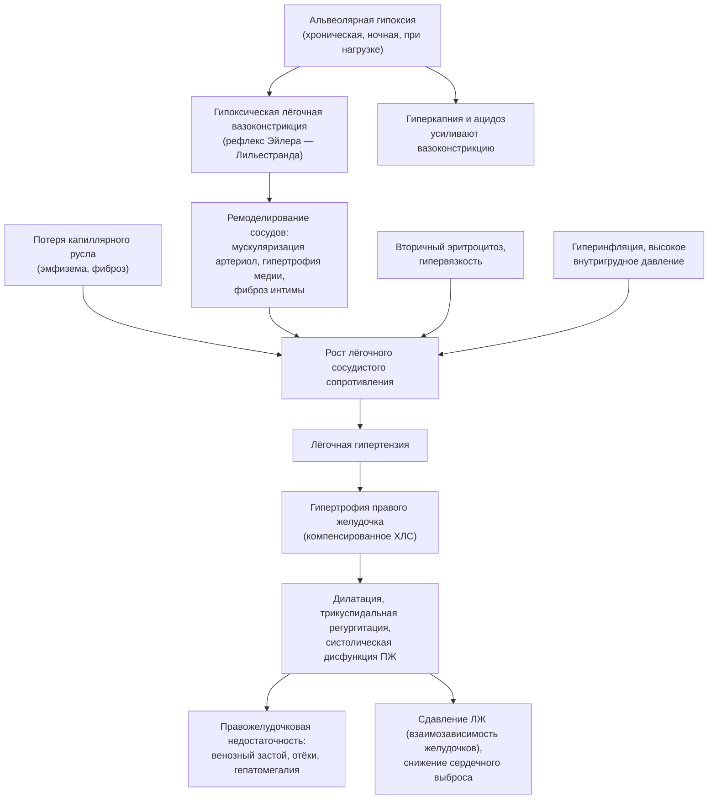

### 2.8. Лёгочная гипертензия и хроническое лёгочное сердце

Лёгочная гипертензия — самое закономерное осложнение хронической гипоксемии и одновременно главный независимый фактор, определяющий прогноз при ХДН. Эта глава находится на стыке пульмонологии и кардиологии: мы разберём терминологию современной классификации лёгочной гипертензии, патогенез перехода от альвеолярной гипоксии к правожелудочковой недостаточности, клинику и критерии диагностики.

#### 2.8.1. Ключевые понятия

##### 2.8.1.1. Прекапиллярная лёгочная гипертензия

📌 **Определение:** **лёгочная гипертензия** (ЛГ; pulmonary hypertension) — по критериям руководства ESC/ERS 2022 года, повышение среднего давления в лёгочной артерии (мСДЛА) более 20 мм рт. ст. в покое по данным катетеризации правых отделов сердца. **Прекапиллярная ЛГ** — ЛГ с давлением заклинивания лёгочной артерии ≤ 15 мм рт. ст. и лёгочным сосудистым сопротивлением (ЛСС) более 2 единиц Вуда; её источник — артериальное русло малого круга. **Посткапиллярная ЛГ** — с давлением заклинивания более 15 мм рт. ст., обусловленная патологией левых отделов сердца.

Обратите внимание на изменение порогов: до 2018 года ЛГ определялась как мСДЛА ≥ 25 мм рт. ст., а прекапиллярная — как ЛСС > 3 ед. Вуда; снижение порогов (6-й Всемирный симпозиум 2018 года, руководство 2022 года) отражает данные о том, что уже значения выше 20 мм рт. ст. ассоциированы с худшим прогнозом. При чтении литературы прошлых лет следует помнить, по каким критериям отбирались пациенты.

##### 2.8.1.2. Лёгочная гипертензия 3-й группы

Клиническая классификация ЛГ (ВОЗ) выделяет пять групп: 1 — лёгочная артериальная гипертензия; 2 — ЛГ при заболеваниях левых отделов сердца; 3 — **ЛГ, ассоциированная с заболеваниями лёгких и/или гипоксией**; 4 — ЛГ при обструкции лёгочных артерий (ХТЭЛГ и др.); 5 — ЛГ с неясными или многофакторными механизмами. Группа 3 — предмет этой главы: ЛГ при ХОБЛ, ИЗЛ, сочетании фиброза и эмфиземы, гиповентиляционных синдромах (СОГ, НМЗ, кифосколиоз), нарушениях дыхания во сне, высокогорной гипоксии, нарушениях развития лёгких. В большинстве случаев ЛГ 3-й группы лёгкая или умеренная (мСДЛА 20–35 мм рт. ст.); **тяжёлая ЛГ при заболевании лёгких** определяется руководством 2022 года как ЛСС более 5 ед. Вуда и встречается у небольшой доли пациентов, выделяясь непропорционально плохим прогнозом и требуя направления в экспертный центр (п. 2.16.8, 3.16).

##### 2.8.1.3. Хроническое лёгочное сердце

📌 **Определение:** **хроническое лёгочное сердце** (ХЛС; cor pulmonale) — по определению комитета экспертов ВОЗ (1963), гипертрофия правого желудочка, развивающаяся вследствие заболеваний, нарушающих функцию и/или структуру лёгких, за исключением случаев, когда эти изменения являются результатом первичного поражения левых отделов сердца или врождённых пороков. В современном понимании — структурно-функциональная перестройка правого желудочка (гипертрофия, дилатация, дисфункция) вследствие лёгочной гипертензии лёгочного происхождения, с правожелудочковой недостаточностью или без неё.

Термин «лёгочное сердце» остаётся в отечественной клинической практике и в МКБ-10 (рубрика I27), тогда как в международных документах его постепенно вытесняет описание через ЛГ 3-й группы и дисфункцию правого желудочка. Содержательно это одно явление, рассматриваемое с двух сторон: сосудистой (ЛГ) и миокардиальной (ХЛС).

#### 2.8.2. Определение и классификация хронического лёгочного сердца

Классическая отечественная классификация Б. Е. Вотчала (1964) делит лёгочное сердце по течению на острое (часы — дни; массивная тромбоэмболия, клапанный пневмоторакс), подострое (недели — месяцы; повторные эмболии, лимфогенный карциноматоз, тяжёлая астма) и хроническое (годы); по состоянию компенсации — на компенсированное и декомпенсированное; по этиологии — на бронхолёгочное (ХОБЛ, фиброзы, бронхоэктазы), васкулярное (первичная ЛГ, эмболии, васкулиты) и торакодиафрагмальное (кифосколиоз, ожирение, нервно-мышечные болезни). Эта трёхчастная этиологическая схема удобно накладывается на классификацию причин ХДН (глава 2.5) и на группы ЛГ. Хроническое лёгочное сердце в контексте ХДН почти всегда бронхолёгочное или торакодиафрагмальное.

Стадийность ХЛС описывают как: ЛГ без изменений правого желудочка → гипертрофия правого желудочка (компенсированное ХЛС) → дилатация и систолическая дисфункция с правожелудочковой недостаточностью (декомпенсированное ХЛС). Переход между стадиями может растягиваться на годы или происходить за дни при обострении.

#### 2.8.3. Патогенез

Патогенез ХЛС при ХДН — последовательность, изображённая на рис. 7.

**Рис. 7.** Патогенез хронического лёгочного сердца при хронической дыхательной недостаточности. Схема читается сверху вниз: от альвеолярной гипоксии через вазоконстрикцию и ремоделирование — к лёгочной гипертензии и недостаточности правого желудочка; боковые входы — потеря капилляров, гипервязкость и гиперинфляция.

##### 2.8.3.1. Гипоксическая лёгочная вазоконстрикция (рефлекс Эйлера — Лильестранда)

В 1946 году шведские физиологи Ульф фон Эйлер и Йоран Лильестранд описали у кошек повышение давления в лёгочной артерии при дыхании гипоксической смесью — реакцию, противоположную вазодилатации системных сосудов при гипоксии. **Гипоксическая лёгочная вазоконстрикция** (ГЛВ) — сокращение гладких мышц мелких лёгочных артерий (прекапиллярных артериол) в ответ на снижение альвеолярного (а не артериального) PO₂; её сенсор — сами гладкомышечные клетки, в которых гипоксия ингибирует калиевые каналы, деполяризует мембрану и открывает кальциевые каналы. Биологический смысл — перераспределение кровотока от плохо вентилируемых единиц к хорошо вентилируемым, то есть улучшение V̇A/Q̇. Ответ усиливается ацидозом и гиперкапнией, ослабляется алкалозом; он быстр (минуты) и обратим. При локальной гипоксии (пневмония, ателектаз) ГЛВ полезна; при диффузной альвеолярной гипоксии (ХОБЛ, гиповентиляция, высота) сужаются сосуды всего лёгкого, ЛСС растёт, и начинается ремоделирование. Устранение ГЛВ кислородом — главный механизм пользы длительной кислородотерапии для правого желудочка и одновременно — механизм ухудшения V̇A/Q̇ при неконтролируемой оксигенации (п. 2.17.12.1).

##### 2.8.3.2. Ремоделирование сосудов малого круга кровообращения

При хронической гипоксии функциональная вазоконстрикция переходит в структурную перестройку: появление гладкомышечного слоя в артериолах, которые в норме его не имеют (мускуляризация), гипертрофия медии, пролиферация интимы, периваскулярный фиброз, уменьшение числа мелких сосудов. В этом участвуют гипоксия-индуцируемые факторы, дисбаланс вазоактивных медиаторов (снижение оксида азота и простациклина, рост эндотелина-1), воспаление, при ХОБЛ — прямое повреждение эндотелия компонентами табачного дыма (сосудистые изменения выявляются у курильщиков ещё до развития гипоксемии). Ремоделирование частично обратимо при устранении гипоксии (поэтому кислородотерапия стабилизирует, а не только останавливает ЛГ), но на поздних стадиях становится фиксированным. При эмфиземе и фиброзе к этому добавляется механическое разрушение капиллярного русла.

##### 2.8.3.3. Гипертрофия и дилатация правого желудочка

Правый желудочек — тонкостенная камера, приспособленная к низкому давлению и большим объёмам, плохо переносящая рост постнагрузки. При медленном росте ЛСС он гипертрофируется (компенсация), при быстром или значительном — дилатируется; кольцо трикуспидального клапана растягивается, появляется регургитация, которая увеличивает объёмную нагрузку и усугубляет дилатацию. Расширенный правый желудочек через межжелудочковую перегородку сдавливает левый (взаимозависимость желудочков), нарушая его наполнение и снижая сердечный выброс; перегрузка давлением снижает коронарную перфузию правого желудочка, который в отличие от левого в норме кровоснабжается и в систолу. Гипоксемия, гиперкапния и ацидоз напрямую снижают сократимость миокарда. Так формируется правожелудочковая недостаточность — конечная стадия ХЛС.

##### 2.8.3.4. Роль вторичного эритроцитоза и гипервязкости

Рост гематокрита повышает вязкость крови, а значит, и сопротивление кровотоку в малом круге (особенно при гематокрите выше 55–60 %); эритроцитоз ассоциирован с более высоким давлением в лёгочной артерии и с тромбозами мелких лёгочных сосудов. Кроме того, при гипервязкости ухудшается микроциркуляция, что частично нивелирует выигрыш в кислородной ёмкости. Коррекция эритроцитоза (устранение гипоксемии кислородом, при необходимости — кровопускания с замещением объёма) снижает ЛСС (п. 2.16.11).

#### 2.8.4. Клинические проявления

##### 2.8.4.1. Признаки лёгочной гипертензии

Собственных симптомов у лёгкой и умеренной ЛГ при заболеваниях лёгких почти нет — они маскируются одышкой основного заболевания. Насторожить должны: одышка, непропорциональная функциональным показателям (например, выраженная одышка при ОФВ₁ 60 %); пресинкопе и синкопе при нагрузке; боли в груди при нагрузке (ишемия правого желудочка); быстрое падение сатурации при нагрузке при относительно сохранной функции лёгких. Объективно: акцент и расщепление II тона над лёгочной артерией, пульсация во II межреберье слева, систолический шум трикуспидальной регургитации у нижнего края грудины, усиливающийся на вдохе (симптом Риверо-Карвальо), диастолический шум недостаточности клапана лёгочной артерии (шум Грэма Стилла) при тяжёлой ЛГ, правожелудочковый толчок (сердечный толчок в эпигастрии или парастернально). При эмфиземе грудная клетка «глушит» аускультативные признаки.

##### 2.8.4.2. Правожелудочковая сердечная недостаточность

Декомпенсированное ХЛС проявляется венозным застоем в большом круге: набухание и пульсация шейных вен (с выраженной волной v при трикуспидальной регургитации), положительный гепатоюгулярный рефлюкс, увеличенная болезненная печень (при тяжёлой регургитации — пульсирующая), периферические отёки (голени, крестец у лежачих), асцит и гидроторакс на поздних стадиях, никтурия; при низком выбросе — слабость, холодные конечности, гипотензия. Анасарка при сохранном «лёгочном» статусе — признак того, что проблема сместилась от газообмена к гемодинамике. Декомпенсация чаще всего провоцируется обострением основного заболевания с углублением гипоксемии и гиперкапнии; её признаки (нарастание отёков, прибавка массы тела) должны быть включены в индивидуальный план действий пациента (п. 2.27.7.3).

#### 2.8.5. Функциональные классы (NYHA, ВОЗ)

Функциональная классификация ВОЗ для ЛГ (принята на Эвианском симпозиуме 1998 года, адаптирована из классификации NYHA): **I класс** — обычная физическая активность не вызывает одышки, усталости, болей или синкопе; **II класс** — лёгкое ограничение, симптомы при обычной нагрузке, комфорт в покое; **III класс** — выраженное ограничение, симптомы при нагрузке меньше обычной; **IV класс** — симптомы в покое, признаки правожелудочковой недостаточности, синкопе. Функциональный класс — один из сильнейших предикторов выживаемости при ЛГ любой группы и обязательный элемент динамического наблюдения; при ЛГ 3-й группы его интерпретация затруднена вкладом лёгочного заболевания в одышку, но для стратификации пациентов с «непропорциональной» ЛГ он сохраняет значение.

#### 2.8.6. Диагностические критерии

Диагностика ХЛС при ХДН — ступенчатая (детали методов — в п. 2.11.5).

1. **Клиническое подозрение**: признаки ЛГ и правожелудочковой недостаточности, непропорциональная одышка, десатурация, эритроцитоз, отёки.
2. **ЭКГ**: признаки гипертрофии и перегрузки правых отделов — P-pulmonale (высокий заострённый зубец P во II, III, aVF), отклонение электрической оси вправо, преобладание R в V1 (R/S > 1), глубокие S в V5–V6, блокада правой ножки пучка Гиса, инверсия T в V1–V3; чувствительность низкая (нормальная ЭКГ не исключает ХЛС), специфичность высокая.
3. **Рентгенография**: расширение ствола и главных ветвей лёгочной артерии с «обрывом» периферических ветвей, увеличение правых отделов (уменьшение ретростернального пространства в боковой проекции).
4. **Эхокардиография** — основной неинвазивный метод: расчёт систолического давления в лёгочной артерии по скорости трикуспидальной регургитации (вероятность ЛГ низкая при скорости ≤ 2,8 м/с без дополнительных признаков, высокая — при > 3,4 м/с), дилатация и гипертрофия правого желудочка (толщина свободной стенки > 5 мм), уплощение межжелудочковой перегородки (D-образный левый желудочек), снижение TAPSE (< 17 мм) и других показателей функции правого желудочка, дилатация правого предсердия и нижней полой вены без коллабирования на вдохе. Ограничение — плохое акустическое окно при эмфиземе и ожирении.
5. **Натрийуретические пептиды** (BNP, NT-proBNP) — повышены при дисфункции правого желудочка; полезны для исключения значимой дисфункции и для прогноза, но неспецифичны (левожелудочковая патология, почечная недостаточность, возраст).
6. **Катетеризация правых отделов сердца** — «золотой стандарт» измерения давления, давления заклинивания и ЛСС; при ХДН выполняется не рутинно, а при подозрении на тяжёлую ЛГ, при несоответствии ЛГ тяжести лёгочного заболевания, при подготовке к трансплантации или редукции объёма, при рассмотрении вопроса о специфической терапии.
7. **МРТ сердца** — эталон оценки объёмов и массы правого желудочка там, где доступна.

Критерии диагноза ХЛС на практике: документированная ЛГ (по ЭхоКГ или катетеризации) + признаки гипертрофии/дилатации/дисфункции правого желудочка + заболевание лёгких/гиповентиляция как причина + исключение левожелудочковой патологии и ХТЭЛГ как альтернативных объяснений.

🔬 **Углубление:** несоответствие тяжести ЛГ и тяжести лёгочного заболевания — важный диагностический сигнал. У пациента с ХОБЛ и мСДЛА 45 мм рт. ст. при ОФВ₁ 65 % должного следует подумать о сочетании фиброза и эмфиземы (относительно сохранные объёмы при очень низкой DLCO), о ХТЭЛГ (вентиляционно-перфузионная сцинтиграфия), о заболеваниях левых отделов сердца с диастолической дисфункцией (посткапиллярный компонент), о сопутствующем апноэ сна, о портопульмональной гипертензии или ЛАГ при системном заболевании соединительной ткани. Руководство ESC/ERS 2022 года рекомендует направлять таких пациентов в центр ЛГ, поскольку тактика (включая осторожное применение лёгочных вазодилататоров при тяжёлой ЛГ 3-й группы — п. 3.16) требует экспертной оценки.

#### 2.8.7. Осложнения хронического лёгочного сердца

- **Декомпенсированная правожелудочковая недостаточность** с анасаркой, застойной гепатопатией («кардиальный цирроз»), застойной нефропатией, гипоперфузией.
- **Нарушения ритма**: фибрилляция и трепетание предсердий (дилатация правого предсердия), многофокусная предсердная тахикардия (характерна для декомпенсации ХОБЛ), желудочковые аритмии при гипоксии и электролитных нарушениях; внезапная смерть.
- **Тромбозы и тромбоэмболии**: застой в правых отделах, эритроцитоз, малоподвижность — тромбоз in situ в лёгочных артериях и венозные тромбоэмболии, каждая из которых усугубляет ЛГ.
- **Синкопе** при нагрузке (невозможность увеличить выброс через фиксированное сопротивление).
- **Гипоксемия от право-левого сброса** через открытое овальное окно при росте давления в правом предсердии — рефрактерная к кислороду.
- **Снижение переносимости декомпенсаций**: при обострении ХДН правый желудочек, работающий на пределе, декомпенсируется первым; гипотензия затрудняет применение НИВЛ и диуретиков.
- **Ухудшение прогноза**: наличие ЛГ при ХОБЛ и ИЗЛ — один из сильнейших предикторов смертности независимо от функции лёгких.

#### 2.8.8. Примеры и иллюстрации: пациент с ХОБЛ и декомпенсированным лёгочным сердцем

Пациент из примера 1 (п. 2.5.12), мужчина 66 лет с ХОБЛ, через год после описанной стабильной газометрии (PaO₂ 54, PaCO₂ 52) обращается с жалобами на нарастание отёков голеней за две недели, увеличение живота, одышку в покое, снижение диуреза; за неделю до этого перенёс «простуду» с усилением кашля и гнойной мокротой. Длительную кислородотерапию ему рекомендовали, но концентратор он использовал 6–8 часов в сутки «ночью». Осмотр: цианоз губ, набухшие шейные вены в положении сидя, печень +5 см, болезненная, отёки до бёдер, асцит; частота дыхания 28 в минуту, участие вспомогательных мышц; SpO₂ 82 % на воздухе; ЧСС 112, ритм неправильный — на ЭКГ фибрилляция предсердий, P-pulmonale на предыдущих ЭКГ, R/S в V1 > 1. Газы на воздухе: PaO₂ 44, PaCO₂ 68 мм рт. ст., pH 7,28, HCO₃⁻ 31 ммоль/л. Гемоглобин 192 г/л, гематокрит 60 %. NT-proBNP значительно повышен. ЭхоКГ: правый желудочек расширен, стенка 7 мм, TAPSE 12 мм, трикуспидальная регургитация III степени, расчётное систолическое давление в лёгочной артерии около 65 мм рт. ст., нижняя полая вена 26 мм без коллабирования, левый желудочек D-образный, фракция выброса сохранена.

Разбор. Исходно у пациента имелась компенсированная ЛГ 3-й группы на фоне ХОБЛ, усугублявшаяся недостаточной кислородотерапией (ночные и дневные десатурации сохраняли ГЛВ) и эритроцитозом. Инфекционное обострение углубило гипоксемию и гиперкапнию (острый на фоне хронического респираторный ацидоз: бикарбонат 31 при ожидаемых для хронического ацидоза при PaCO₂ 68 около 34 ммоль/л), что резко повысило ЛСС; правый желудочек декомпенсировался, развилась фибрилляция предсердий, снизился сердечный выброс. Гиперкапния и гипоксемия добавили задержку натрия через почечный механизм. Тактика в порядке приоритета: контролируемая оксигенотерапия с целевой SpO₂ 88–92 %; НИВЛ (pH 7,28 — абсолютное показание) — она же улучшит правожелудочковую гемодинамику за счёт снижения гипоксической вазоконстрикции и ацидоза; лечение обострения (бронходилататоры, системные глюкокортикостероиды, антибиотик); осторожная диуретическая терапия под контролем давления, калия и КОС (риск алкалоза и гипотензии при «зависимом от преднагрузки» правом желудочке); контроль частоты желудочкового ритма (дигоксин или дилтиазем, а не бета-адреноблокатор в острой фазе); антикоагуляция по показаниям (фибрилляция предсердий; исключение тромбоэмболии); по стабилизации — пересмотр длительной кислородотерапии с режимом не менее 15 часов в сутки и оценка показаний к домашней НИВЛ через 2–4 недели.

❗ **Типичная ошибка:** лечить отёки у пациента с лёгочным сердцем возрастающими дозами диуретиков без коррекции газообмена. Диуретики не устраняют причину (гипоксическую вазоконстрикцию и гиперкапническую задержку натрия), вызывают гипокалиемию и метаболический алкалоз, угнетающий вентиляцию, и снижают преднагрузку правого желудочка, от которой зависит его выброс; результат — углубление гиперкапнии и гипотензия. Первое лечебное действие при декомпенсированном лёгочном сердце — коррекция гипоксемии и гиперкапнии.

💡 **Интересный факт:** когда в 1946 году фон Эйлер и Лильестранд описали лёгочную вазоконстрикцию в ответ на гипоксию, они сразу предположили её физиологический смысл — согласование кровотока с вентиляцией. Спустя десятилетия этот рефлекс оказался ключом сразу к трём клиническим проблемам: лёгочному сердцу при ХДН, высотному отёку лёгких и кислород-индуцированной гиперкапнии при ХОБЛ. Ульф фон Эйлер позже получил Нобелевскую премию (1970) — но за другое открытие, норадреналин как медиатор симпатической нервной системы.

📝 **Обобщение**

- Лёгочная гипертензия определяется как мСДЛА > 20 мм рт. ст.; при ХДН это прекапиллярная ЛГ 3-й группы, обычно лёгкая или умеренная; тяжёлая ЛГ (ЛСС > 5 ед. Вуда) встречается у меньшинства и требует экспертной оценки.
- Хроническое лёгочное сердце — перестройка правого желудочка вследствие лёгочной ЛГ; отечественная классификация Вотчала делит его по течению, компенсации и этиологии (бронхолёгочное, васкулярное, торакодиафрагмальное).
- Патогенетическая цепь: альвеолярная гипоксия → гипоксическая вазоконстрикция (рефлекс Эйлера — Лильестранда) → ремоделирование сосудов → рост ЛСС (плюс потеря капилляров, гипервязкость, гиперинфляция) → гипертрофия, дилатация и недостаточность правого желудочка.
- Клиника ЛГ маскируется основным заболеванием; правожелудочковая недостаточность проявляется венозным застоем; диагностика — ЭКГ, ЭхоКГ, натрийуретические пептиды, при необходимости — катетеризация; несоответствие тяжести ЛГ и лёгочного заболевания — повод искать другую причину.
- Осложнения — декомпенсация, аритмии, тромбозы, синкопе, шунт через овальное окно; ЛГ — сильный независимый предиктор смертности.

Главный вывод: лёгочное сердце при ХДН — следствие нарушенного газообмена, и его лечение начинается с коррекции гипоксемии и гиперкапнии, а не с диуретиков. В следующей главе мы рассмотрим остальные системные последствия ХДН.

❓ **Контрольные вопросы**

1. Дайте современное определение лёгочной гипертензии и прекапиллярной ЛГ; что такое ЛГ 3-й группы и тяжёлая ЛГ при заболеваниях лёгких?
2. Опишите рефлекс Эйлера — Лильестранда: на что он реагирует, в чём его физиологический смысл и как он превращается в патогенетический механизм лёгочного сердца?
3. Какие ЭКГ- и ЭхоКГ-признаки указывают на хроническое лёгочное сердце и каковы ограничения каждого метода у пациента с эмфиземой?
4. Почему у пациента с ХДН и отёками первым лечебным действием должна быть коррекция газообмена, а не увеличение дозы диуретика?
5. У пациента с ХОБЛ и ОФВ₁ 62 % должного по ЭхоКГ расчётное систолическое давление в лёгочной артерии 70 мм рт. ст. Какие альтернативные и дополнительные причины ЛГ вы будете искать и какими методами?
