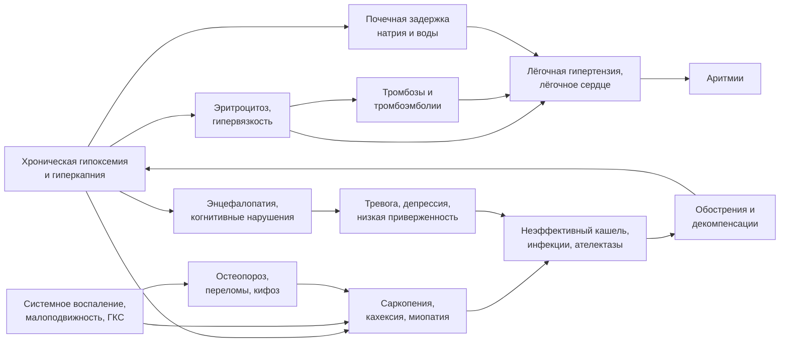

### 2.9. Другие осложнения и системные последствия

Хроническая дыхательная недостаточность — системное состояние. Помимо лёгочного сердца, хроническая гипоксемия, гиперкапния, системное воспаление, малоподвижность и лекарственная нагрузка порождают каскад осложнений, которые взаимно усиливают друг друга (см. рис. 8) и во многом определяют качество жизни и прогноз. Распознавание и лечение этих осложнений — неотъемлемая часть ведения пациента, а не «сопутствующая патология».

**Рис. 8.** Каскад системных осложнений ХДН. Схема читается слева направо; замыкающая стрелка показывает, что обострения и декомпенсации углубляют исходное нарушение газообмена.

#### 2.9.1. Вторичный эритроцитоз и синдром гипервязкости

📌 **Определение:** **вторичный эритроцитоз** (secondary erythrocytosis) при ХДН — повышение массы эритроцитов, гемоглобина и гематокрита вследствие гипоксической стимуляции выработки эритропоэтина; в отличие от истинной полицитемии (миелопролиферативное заболевание с мутацией *JAK2*) не сопровождается лейкоцитозом, тромбоцитозом, спленомегалией и имеет нормальный или повышенный уровень эритропоэтина.

Эритроцитоз повышает кислородную ёмкость крови, но при гематокрите выше 55–60 % вязкость крови растёт экспоненциально: ухудшается микроциркуляция (вплоть до снижения доставки кислорода к тканям, несмотря на рост содержания), растёт ЛСС, повышается риск тромбозов, появляются симптомы **синдрома гипервязкости** — головные боли, головокружение, шум в ушах, нарушение зрения, парестезии, сонливость, заторможенность, боли в конечностях. Клинически — багрово-цианотичная окраска лица, инъекция склер, иногда гипертензия. Эритроцитоз у пациента с ХОБЛ ассоциирован с худшим прогнозом, и исторически гематокрит > 55 % является одним из критериев назначения длительной кислородотерапии при PaO₂ 56–59 мм рт. ст. (п. 2.17.2). Лечение — коррекция гипоксемии (кислород, вентиляция); эритроцитоз обычно регрессирует за недели — месяцы; при выраженной гипервязкости с симптомами — кровопускания с замещением объёма до гематокрита около 50–52 % (п. 2.16.11). Анемия у пациента с ХДН, напротив, лишает его компенсации и также ухудшает прогноз — «нормальный» гемоглобин у гипоксемичного пациента может означать относительную анемию (дефицит железа, воспаление, почечная дисфункция).

#### 2.9.2. Тромбоэмболические осложнения

Пациенты с ХДН находятся в зоне высокого риска венозных тромбоэмболий: малоподвижность, эритроцитоз и гипервязкость, системное воспаление, венозный застой при правожелудочковой недостаточности, обострения с госпитализацией, курение, ожирение, центральные венозные катетеры при длительной госпитализации. Тромбоэмболия лёгочной артерии у пациента с ХОБЛ выявляется при углублённом обследовании у заметной части госпитализированных с «необъяснимым» обострением, и её клиника маскируется привычной одышкой. Каждая эмболия добавляет мёртвое пространство и повышает ЛСС; неразрешившиеся эмболии могут перейти в ХТЭЛГ. Практические следствия: тромбопрофилактика при каждой госпитализации и ограничении подвижности, низкий порог для исключения ТЭЛА при декомпенсации без очевидного инфекционного триггера (D-димер малоинформативен при обострении; КТ-ангиография или сцинтиграфия), оценка показаний к антикоагуляции при фибрилляции предсердий (п. 2.16.10).

#### 2.9.3. Нарушения сердечного ритма

Аритмии при ХДН — следствие гипоксемии, гиперкапнии и ацидоза, растяжения правого предсердия, электролитных нарушений (гипокалиемия и гипомагниемия на фоне диуретиков и бета-агонистов), симпатической активации, ишемии, лекарств (теофиллин, высокие дозы бета-агонистов, некоторые макролиды и фторхинолоны, удлиняющие QT). Характерные нарушения: синусовая тахикардия; **многофокусная предсердная тахикардия** — почти патогномоничная для декомпенсированной ХОБЛ (не менее трёх морфологий зубца P, нерегулярный ритм; лечится коррекцией гипоксии, электролитов и, при необходимости, верапамилом или дилтиаземом, но не кардиоверсией); фибрилляция и трепетание предсердий; предсердная и желудочковая экстрасистолия; желудочковые тахикардии при тяжёлой гипоксии и удлинении QT; брадиаритмии при апноэ сна. Внезапная сердечная смерть — значимая доля смертей при тяжёлой ХОБЛ, и ночные десатурации рассматриваются как один из её триггеров. Лечение аритмий начинается с коррекции газообмена и электролитов; выбор антиаритмиков ограничен (неселективные бета-адреноблокаторы противопоказаны при обструкции; кардиоселективные безопасны при ХОБЛ и показаны при сопутствующей ИБС и сердечной недостаточности, — п. 2.16.14).

#### 2.9.4. Гиперкапническая энцефалопатия и кома

📌 **Определение:** **гиперкапническая энцефалопатия** — нарушение функции головного мозга вследствие острого или подострого нарастания PaCO₂ с респираторным ацидозом: от головной боли, сонливости и спутанности до сопора и комы («CO₂-наркоз»).

Патогенез — внутриклеточный ацидоз нейронов (CO₂ легко проникает через гематоэнцефалический барьер) и церебральная вазодилатация с повышением внутричерепного давления; при хронической гиперкапнии бикарбонат ликвора повышен, и нейроны защищены, поэтому решающее значение имеют скорость и величина прироста PaCO₂ и pH, а не абсолютный уровень CO₂. Клинические стадии: беспокойство, бессонница или сонливость → спутанность, дезориентация, астериксис, миоклонии → сопор → кома с угнетением дыхания; возможны судороги, отёк дисков зрительных нервов. Опасность в том, что энцефалопатия выключает защитные механизмы: пациент перестаёт откашливать, аспирирует, дышит ещё поверхностнее, не может сотрудничать при НИВЛ. Нарушение сознания при гиперкапнической ОДН традиционно считалось противопоказанием к НИВЛ, но исследования показали, что у части пациентов с гиперкапнической комой НИВЛ в условиях ОРИТ с тщательным мониторингом эффективна — при готовности к немедленной интубации (п. 2.24.8). Самая частая ятрогенная причина энцефалопатии — неконтролируемая кислородотерапия и седативные препараты.

#### 2.9.5. Когнитивные нарушения

У пациентов с ХОБЛ и хронической гипоксемией когнитивные нарушения (внимание, память, исполнительные функции, скорость обработки информации) выявляются существенно чаще, чем у сверстников; их связывают с гипоксией, гиперкапнией, нарушениями сна, системным воспалением, сосудистыми факторами (общие с ХОБЛ факторы риска), малоподвижностью и депрессией. По данным наблюдательных исследований, длительная кислородотерапия частично улучшает когнитивные функции у гипоксемичных пациентов. Клиническое значение огромно: когнитивные нарушения снижают приверженность ингаляционной терапии, затрудняют обучение работе с кислородным оборудованием и вентилятором, маскируют декомпенсацию (спутанность «списывают» на деменцию), ограничивают участие в принятии решений. Скрининг когнитивных функций (MoCA, MMSE) целесообразен у пожилых пациентов с ХДН, особенно перед выпиской на домашнюю респираторную поддержку (п. 2.26.5).

#### 2.9.6. Тревога и депрессия

Тревога и депрессия — одни из самых частых и недолеченных коморбидных состояний при ХДН: по данным систематических обзоров, клинически значимая депрессия выявляется примерно у четверти — трети пациентов с тяжёлой ХОБЛ, а тревожные расстройства (включая паническое) — не реже. Механизмы: одышка как источник страха и ощущения потери контроля (паническая атака и приступ одышки взаимно индуцируют друг друга — порочный круг «одышка — тревога — гипервентиляция и гиперинфляция — одышка»), социальная изоляция, утрата роли, зависимость от оборудования, гипоксия и воспаление. Последствия: ухудшение качества жизни, снижение приверженности, более частые госпитализации, худшая выживаемость, отказ от реабилитации. Особенность лечения: бензодиазепины при ХДН опасны (угнетение дыхания, особенно во сне и при гиперкапнии), поэтому предпочтительны психотерапия (когнитивно-поведенческая), лёгочная реабилитация (сама по себе снижает тревогу и депрессию), селективные ингибиторы обратного захвата серотонина, обучение техникам контроля дыхания (п. 2.16.15, 2.22.7).

#### 2.9.7. Саркопения, кахексия и миопатия

📌 **Определение:** **саркопения** — снижение массы и силы скелетных мышц; **лёгочная кахексия** — непреднамеренная потеря массы тела с потерей безжировой массы при хроническом заболевании лёгких; **миопатия** при ХДН — структурно-функциональные изменения скелетных и дыхательных мышц (сдвиг к гликолитическим волокнам, снижение окислительной способности, атрофия) вследствие гипоксии, воспаления, бездействия, глюкокортикостероидов и недостаточности питания.

Потеря мышечной массы при ХДН — независимый предиктор смертности (ИМТ < 21 кг/м² входит в индекс BODE; индекс безжировой массы прогностически ещё информативнее). Она замыкает несколько порочных кругов: слабость периферических мышц ограничивает активность → детренированность → ещё большая слабость; слабость дыхательных мышц снижает резерв насоса и эффективность кашля; снижение потребления пищи из-за одышки при еде и раннего насыщения (гиперинфляция, сдавление желудка) при высокой энергетической стоимости дыхания создаёт отрицательный энергетический баланс. Стероидная миопатия от повторных курсов системных глюкокортикостероидов и миопатия критических состояний после ИВЛ добавляют ятрогенный компонент. Лечение — комбинация нутритивной поддержки и тренировок (глава 2.22); изолированное питание без тренировок малоэффективно.

#### 2.9.8. Остеопороз

Остеопороз при ХДН встречается значительно чаще, чем в общей популяции, и часто остаётся недиагностированным до перелома. Факторы: системные и в меньшей степени ингаляционные глюкокортикостероиды, малоподвижность, курение, дефицит витамина D, низкая масса тела, гипогонадизм, системное воспаление, гипоксия и гиперкапния (респираторный ацидоз способствует резорбции кости). Клиническое значение для ДН особое: компрессионные переломы позвонков усиливают кифоз и снижают жизненную ёмкость лёгких (каждый перелом грудного позвонка уменьшает ЖЁЛ примерно на несколько процентов), переломы рёбер ограничивают вдох и кашель, переломы бедра ведут к иммобилизации и пневмониям. Скрининг (денситометрия), профилактика (кальций, витамин D, физическая активность, минимизация системных стероидов) и лечение (бисфосфонаты и др.) должны быть частью плана ведения (п. 2.16.16).

#### 2.9.9. Повторные инфекции и ателектазы

Пациент с ХДН предрасположен к респираторным инфекциям: нарушен мукоцилиарный клиренс (ХОБЛ, бронхоэктазы), неэффективен кашель (НМЗ, слабость), присутствуют хроническая колонизация и структурные изменения (бронхоэктазы, буллы), снижен иммунный ответ (возраст, стероиды, кахексия, гипоксия), есть аспирация при бульбарных нарушениях и гастроэзофагеальном рефлюксе, при трахеостоме — прямой доступ в дыхательные пути. Ателектазы (от микроателектазов при поверхностном дыхании до долевых при обтурации секретом) ухудшают растяжимость, создают шунт и служат субстратом инфекции. Каждая инфекция у пациента с ХДН — потенциальная декомпенсация; у нервно-мышечного пациента «простуда» с задержкой секрета — самая частая причина ОДН. Профилактика — вакцинация, методы поддержки кашля и увеличения объёма (глава 2.21), лечение рефлюкса и дисфагии, гигиена дыхательных путей при трахеостоме.

#### 2.9.10. Почечные осложнения

Почки при ХДН страдают с нескольких сторон: хроническая гипоксемия и гиперкапния снижают почечный кровоток и скорость клубочковой фильтрации, активируют ренин-ангиотензин-альдостероновую систему и вазопрессин (задержка натрия и воды, гипонатриемия разведения); застойная нефропатия при правожелудочковой недостаточности; нефротоксичность препаратов (аминогликозиды, НПВП, контрасты); общие сосудистые факторы риска. Хроническая болезнь почек у пациента с ХОБЛ встречается чаще, чем предполагается по креатинину (низкая мышечная масса занижает креатинин — нужна оценка по цистатину C или расчётным формулам с осторожностью). Почечная недостаточность в свою очередь ограничивает компенсацию респираторного ацидоза (почка не может задерживать бикарбонат), добавляет метаболический ацидоз, вызывает анемию (потеря эритроцитозной компенсации) и накопление препаратов (опиоиды, некоторые антибиотики). Особые аспекты ведения — в п. 2.26.7.

#### 2.9.11. Ятрогенные осложнения лекарственной терапии

Лечение ХДН и её причин само является источником осложнений, и пациент с ХДН особенно уязвим к ним.

- **Кислород** — кислород-индуцированная гиперкапния при неконтролируемой подаче (п. 2.17.12.1); абсорбционные ателектазы при высоких FiO₂; сухость слизистых; пожары.
- **Седативные, снотворные, опиоиды** — угнетение дыхания и кашля, особенно во сне и у пациентов с гиперкапнией; делирий.
- **Системные глюкокортикостероиды** — миопатия (в том числе дыхательных мышц), остеопороз, гипергликемия, инфекции, задержка жидкости, психические нарушения; при ХОБЛ короткие курсы (5 дней) не менее эффективны, чем длительные.
- **Диуретики** — метаболический алкалоз с угнетением вентиляции, гипокалиемия и гипомагниемия (аритмии, слабость мышц), гиповолемия со снижением выброса правого желудочка.
- **Бета-агонисты в высоких дозах** — тахикардия, аритмии, гипокалиемия, тремор, преходящее ухудшение V̇A/Q̇ (вазодилатация в плохо вентилируемых зонах) с небольшим падением PaO₂.
- **Теофиллин** — узкое терапевтическое окно, аритмии, судороги, многочисленные лекарственные взаимодействия.
- **Неселективные бета-адреноблокаторы** (включая глазные капли с тимололом) — бронхоспазм.
- **Антибиотики** — аминогликозиды (нефро- и ототоксичность, нервно-мышечная блокада — опасны при миастении), фторхинолоны (удлинение QT, ухудшение миастении, тендинопатии), макролиды (QT, взаимодействия).
- **Амиодарон** — лекарственное поражение лёгких, особенно при высоких FiO₂; **нитрофурантоин, метотрексат** — пневмониты.
- **Избыточная инфузионная и нутритивная нагрузка** — отёк лёгких; избыток углеводов повышает продукцию CO₂ (дыхательный коэффициент до 1,0 и выше) — фактор, значимый при пограничной вентиляции.

Правило для каждого назначения пациенту с ХДН: спросить, не угнетает ли препарат дыхание и кашель, не ухудшает ли V̇A/Q̇, не вызывает ли алкалоз или электролитные сдвиги и как он взаимодействует с базисной терапией.

#### 2.9.12. Примеры и иллюстрации: каскад сочетанных осложнений

Проследим каскад на пациентке с торакальным вариантом ХДН (пример 2, п. 2.5.12), если бы её ночная гиповентиляция осталась нераспознанной. Хроническая ночная гипоксемия и гиперкапния → эритроцитоз (гемоглобин 175 г/л) и лёгочная гипертензия; фрагментация сна и гиперкапния → дневная сонливость, снижение концентрации, депрессивное настроение; участковый врач назначает снотворное (бензодиазепин) → углубление ночной гиповентиляции, утренние головные боли усиливаются; появляются отёки голеней (гиперкапническая задержка натрия + начинающаяся правожелудочковая недостаточность) → назначается фуросемид → гипокалиемия, метаболический алкалоз (бикарбонат 40 ммоль/л), слабость дыхательных мышц, дальнейший рост PaCO₂; малоподвижность и боли в спине → саркопения, остеопороз, компрессионный перелом Th8 → усиление кифоза, снижение ЖЁЛ ещё на несколько процентов; респираторная инфекция с неэффективным кашлем (ЖЁЛ теперь 25 % должного) → ателектаз нижней доли, пневмония → острая гиперкапническая декомпенсация с pH 7,22 и спутанностью → ОРИТ, НИВЛ; в стационаре — тромбоз глубоких вен голени (эритроцитоз, обездвиженность) и пароксизм фибрилляции предсердий.

Каждое звено этого каскада было предотвратимо: ночной мониторинг при первых симптомах и своевременная НИВЛ устранили бы гиповентиляцию и большинство её следствий; отказ от бензодиазепина и диуретика без оценки газов, профилактика остеопороза, вакцинация и обучение методам поддержки кашля прервали бы цепочку в нескольких точках. Именно так — как последовательность взаимосвязанных и предотвратимых событий — следует видеть осложнения ХДН при составлении плана ведения.

❗ **Типичная ошибка:** назначать пациенту с ХДН снотворное по поводу «бессонницы» без оценки ночного дыхания. Нарушения сна у таких пациентов чаще всего обусловлены ночной гиповентиляцией, апноэ или ортопноэ; бензодиазепины и Z-препараты углубляют гиповентиляцию, подавляют микропробуждения, которые защищали пациента от длительных десатураций, и могут стать триггером декомпенсации. Правильная последовательность: ночная оксиметрия/капнометрия → коррекция дыхания во сне → при сохраняющейся бессоннице — когнитивно-поведенческая терапия и, при необходимости, препараты с минимальным влиянием на дыхание.

💡 **Интересный факт:** многофокусная предсердная тахикардия, которую иногда называют «аритмией лёгочного сердца», настолько тесно связана с декомпенсацией ХОБЛ, что её обнаружение у пациента без известного заболевания лёгких считается поводом искать его. Она почти не поддаётся антиаритмикам и кардиоверсии, но исчезает при коррекции гипоксемии, гиперкапнии и электролитов — редкий пример аритмии, которую лечит пульмонолог.

📝 **Обобщение**

- ХДН — системное состояние: гипоксемия, гиперкапния, воспаление, малоподвижность и лекарственная нагрузка запускают каскад взаимно усиливающихся осложнений.
- Вторичный эритроцитоз компенсирует гипоксемию, но при гематокрите > 55–60 % создаёт синдром гипервязкости, повышает ЛСС и риск тромбозов; венозные тромбоэмболии и аритмии (включая многофокусную предсердную тахикардию) — частые и часто нераспознанные осложнения.
- Гиперкапническая энцефалопатия определяется скоростью прироста PaCO₂ и pH, а не абсолютным уровнем CO₂; когнитивные нарушения, тревога и депрессия снижают приверженность и маскируют декомпенсацию.
- Саркопения, кахексия и остеопороз (с кифозом и переломами) замыкают порочные круги между газообменом, мышцами и подвижностью; инфекции и ателектазы — главные триггеры декомпенсаций.
- Почки страдают от гипоксии и гиперкапнии и ограничивают компенсацию ацидоза; лекарственная терапия (кислород, седативные, стероиды, диуретики и др.) — самостоятельный источник осложнений.

Главный вывод: план ведения пациента с ХДН должен строиться как профилактика каскада — с разрывом цепочки в каждой доступной точке. Следующие главы посвящены тому, как этого пациента правильно обследовать.

❓ **Контрольные вопросы**

1. Чем вторичный эритроцитоз при ХДН отличается от истинной полицитемии и при каком уровне гематокрита польза эритроцитоза сменяется вредом?
2. Почему пациент с хронической гиперкапнией сохраняет ясное сознание при PaCO₂ 70 мм рт. ст., а пациент с острой гиперкапнией при том же значении впадает в сопор?
3. Какие порочные круги связывают саркопению, остеопороз и дыхательную недостаточность?
4. Назовите пять групп препаратов, способных спровоцировать декомпенсацию ХДН, и механизм для каждой.
5. Используя пример из п. 2.9.12, укажите не менее четырёх точек, в которых каскад осложнений можно было прервать, и какими действиями.
