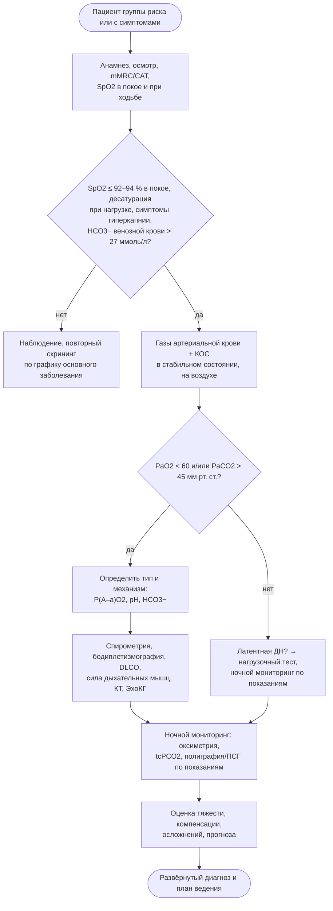

### 2.10. Диагностика: клиническая оценка и исследование газообмена

Диагностика ХДН отвечает на пять вопросов: есть ли нарушение газообмена (и какое), хроническое ли оно, каков его механизм и причина, насколько оно тяжело и компенсировано, что проявляется при нагрузке и во сне. Эта глава посвящена первым двум ступеням — клинической оценке и исследованию газообмена, то есть тому, что доступно в любом стационаре и большинстве поликлиник. Функциональные, лучевые и специальные методы рассматриваются в следующей главе, исследования сна — в главе 2.12.

#### 2.10.1. Цели и этапы обследования; диагностический маршрут

Диагностический маршрут (рис. 9) построен от простого к сложному и от скрининга к подтверждению. Его логика: отобрать пациентов из групп риска → подтвердить нарушение газообмена газометрией → определить тип и механизм (альвеолярно-артериальный градиент, функциональные тесты) → установить причину (визуализация, специальные методы) → оценить условия проявления (нагрузка, сон) → оценить тяжесть, компенсацию, осложнения и прогноз → сформулировать диагноз и план.

**Рис. 9.** Диагностический маршрут при подозрении на хроническую дыхательную недостаточность. Схема читается сверху вниз; ромбы — точки принятия решения.

#### 2.10.2. Анамнез

##### 2.10.2.1. Анамнез заболевания

Сбор анамнеза направлен на установление причины, темпа развития и наличия латентных проявлений. Ключевые вопросы: когда и с чего началась одышка, как прогрессировала (годы — ХОБЛ, ИЗЛ; месяцы — БАС; недели — подострые процессы); переносимость нагрузок в конкретных единицах (этажи, метры); кашель, мокрота, кровохарканье; эпизоды обострений и госпитализаций (с газометрией или без, применялась ли НИВЛ); ортопноэ, ночные симптомы (храп, остановки дыхания, пробуждения, утренние головные боли, сонливость днём); отёки; снижение массы тела; предшествующие диагнозы и функциональные исследования; применяемая терапия и её эффект; наличие дома кислорода или аппарата и реальное время использования. Для пациентов с установленным заболеванием важно выяснить «привычный» уровень газов крови по выпискам: без этого невозможно разграничить хроническое состояние и острое ухудшение.

##### 2.10.2.2. Курение, профессиональные и бытовые ингаляционные воздействия

Индекс курения в пачка-летах (число пачек в день × стаж в годах), возраст начала, попытки отказа, пассивное курение, другие формы потребления (кальян, электронные сигареты, нагреваемый табак). Профессиональный маршрут по всем местам работы: пыль (угольная, кремниевая, асбест, металлы, зерно, текстиль), сварка, пары и газы, органическая пыль (птицеводство, сельское хозяйство), химические производства. Бытовые воздействия: отопление и приготовление пищи на твёрдом топливе, птицы и животные дома (гиперчувствительный пневмонит), плесень, хобби (голуби, деревообработка). Проживание на высоте.

##### 2.10.2.3. Лекарственный анамнез

Три категории препаратов: вызывающие поражение лёгких (амиодарон, нитрофурантоин, метотрексат, блеомицин, иммуноонкологические препараты); угнетающие дыхание и кашель (опиоиды, бензодиазепины, снотворные, габапентиноиды в сочетании с опиоидами, миорелаксанты); ухудшающие вентиляцию или механику опосредованно (диуретики — алкалоз, неселективные бета-адреноблокаторы, системные глюкокортикостероиды — миопатия, препараты, ухудшающие нервно-мышечную передачу при миастении). Отдельно — ингаляционная терапия: что назначено, что реально применяется, техника ингаляции.

##### 2.10.2.4. Семейный и неврологический анамнез

Наследственные заболевания: мышечные дистрофии, спинальная мышечная атрофия, наследственные нейропатии, семейный БАС, дефицит альфа-1-антитрипсина, семейный лёгочный фиброз, наследственная геморрагическая телеангиэктазия, муковисцидоз, ВСЦГ. Неврологический анамнез: слабость и утомляемость мышц (конечностей, шеи, лица), затруднения при глотании и речи, поперхивание, изменение голоса, фасцикуляции, судороги в мышцах, двоение, птоз, онемение, нарушения походки, перенесённый полиомиелит, травмы позвоночника, операции на шее и грудной клетке (риск повреждения диафрагмального нерва).

#### 2.10.3. Физикальное обследование

Осмотр по системе, описанной в главе 2.7: общий вид и питание (ИМТ, мышечная масса), положение (ортопноэ, треножник), окраска кожи и слизистых, частота и паттерн дыхания (считать не менее 30 секунд), участие вспомогательных мышц, парадоксальное дыхание (в положении лёжа), форма и экскурсия грудной клетки, деформации, концевые фаланги, шейные вены, перкуссия и аускультация лёгких и сердца (акцент II тона, шум трикуспидальной регургитации), печень, отёки, неврологический осмотр (сила мышц, фасцикуляции, бульбарные функции, кашлевой толчок — попросить пациента покашлять и оценить силу и звучность). Проба с кашлем и счёт на одном выдохе (до скольких пациент досчитывает вслух после максимального вдоха — грубая оценка ЖЁЛ) полезны у нервно-мышечных пациентов при недоступности спирометрии.

#### 2.10.4. Оценка клинической стабильности

Все диагностические заключения о хронической ДН и все долгосрочные решения (длительная кислородотерапия, домашняя НИВЛ) требуют стабильного состояния. Критерии стабильности: отсутствие обострения и изменений терапии в течение последних недель (для ХОБЛ обычно не менее 4–6 недель после обострения; для решений о НИВЛ после госпитализации — реоценка через 2–4 недели), стабильные симптомы и масса тела, отсутствие признаков декомпенсации (нарастание отёков, сонливость, тахипноэ, лихорадка), отсутствие острых интеркуррентных заболеваний. Параметры, полученные при обострении, фиксируются, но пересматриваются в стабильном состоянии (п. 2.17.4).

#### 2.10.5. Оценка одышки и симптомной нагрузки

##### 2.10.5.1. Шкала mMRC

Модифицированная шкала одышки Медицинского исследовательского совета (modified Medical Research Council, mMRC) — пять градаций от 0 до 4: 0 — одышка только при интенсивной нагрузке; 1 — при быстрой ходьбе по ровной местности или подъёме на небольшое возвышение; 2 — ходит медленнее сверстников по ровной местности из-за одышки или вынужден останавливаться при ходьбе в своём темпе; 3 — останавливается через примерно 100 м или через несколько минут ходьбы по ровной местности; 4 — слишком выраженная одышка, чтобы выходить из дома, или одышка при одевании и раздевании. Шкала проста, воспроизводима, входит в GOLD (порог ≥ 2 для «высокой симптомной нагрузки») и в индекс BODE; измеряет ограничение активности, а не интенсивность ощущения.

##### 2.10.5.2. Шкала Борга

Модифицированная шкала Борга (CR10) оценивает интенсивность одышки (или усилия) в данный момент от 0 («совсем нет») до 10 («максимальная»), с вербальными якорями (0,5 — очень-очень слабая, 3 — умеренная, 5 — сильная, 7 — очень сильная). Используется при нагрузочных тестах (до и после 6-минутной ходьбы, на пике КПНТ), при реабилитации (дозирование нагрузки по целевому уровню 4–6) и для оценки острых изменений. Оригинальная шкала Борга RPE (6–20) оценивает воспринимаемое усилие.

##### 2.10.5.3. Тест CAT

Оценочный тест ХОБЛ (COPD Assessment Test, CAT) — опросник из 8 пунктов (кашель, мокрота, стеснение в груди, одышка при подъёме, ограничение активности дома, уверенность вне дома, сон, энергия), каждый от 0 до 5 баллов; сумма 0–40, порог ≥ 10 — высокая симптомная нагрузка (GOLD); минимально клинически значимое изменение — около 2 баллов. CAT шире mMRC: он отражает качество жизни и чувствителен к изменениям после реабилитации и лечения обострений. Для других нозологий используются профильные инструменты (п. 2.29.1).

#### 2.10.6. Пульсоксиметрия

##### 2.10.6.1. В покое

Пульсоксиметрия — скрининговый метод первой линии: неинвазивна, мгновенна, доступна. Правила измерения: тёплый палец без лака, покой не менее 5 минут, стабильная пульсовая волна на дисплее, совпадение частоты пульса с пальпаторной, оценка в течение 30–60 секунд, запись FiO₂ (воздух или поток кислорода). Пороги для направления на газометрию: SpO₂ ≤ 92 % (при ХОБЛ в стабильном состоянии руководства BTS и ATS используют именно этот порог для оценки показаний к кислородотерапии); у пациентов с риском гиперкапнии газометрия показана независимо от SpO₂, если есть симптомы гиповентиляции или повышенный бикарбонат.

##### 2.10.6.2. При нагрузке

Десатурация при нагрузке выявляется при тесте 6-минутной ходьбы, тесте с подъёмом по лестнице или простой ходьбе по коридору с пульсоксиметром; значимой обычно считают сатурацию ≤ 88 % или падение на ≥ 4 % (п. 2.11.3.4). Нагрузочная десатурация — ранний признак ИЗЛ и эмфиземы, предиктор прогноза, основание для оценки кислорода при нагрузке (с оговорками о доказательной базе — п. 3.8).

##### 2.10.6.3. Ограничения и погрешности

Пульсоксиметрия измеряет насыщение гемоглобина, а не PaO₂ и тем более не вентиляцию, и имеет известные источники ошибок:

- **точность** приборов — обычно ± 2–3 % при SpO₂ > 70 %, ниже 70 % — не валидирована; на плато кривой диссоциации (SpO₂ 95–100 %) значительные колебания PaO₂ не видны;
- **дисгемоглобины**: карбоксигемоглобин (курильщики, отравление CO) завышает показания (поглощает свет как оксигемоглобин), метгемоглобин «тянет» показания к 85 %;
- **пигментация кожи**: исследования 2020-х годов (в частности, анализ M. W. Sjoding и соавторов в *New England Journal of Medicine*, 2020) показали, что у пациентов с тёмной кожей скрытая гипоксемия (SaO₂ < 88 % при SpO₂ 92–96 %) встречается примерно втрое чаще, чем у светлокожих; при принятии решений у таких пациентов нужен более высокий порог для газометрии;
- **низкая перфузия, гипотермия, вазоконстрикция, движение, тремор, аритмия, лак для ногтей, яркий внешний свет** — артефакты и ложные значения;
- **сдвиги кривой диссоциации** (ацидоз, лихорадка, гипотермия) меняют соответствие SpO₂ и PaO₂;
- **на кислороде** нормальная SpO₂ не исключает гиперкапнии.

❗ **Типичная ошибка:** мониторировать пациента с риском гиповентиляции (ХОБЛ, ожирение, нервно-мышечное заболевание, послеоперационный период на опиоидах) только по пульсоксиметрии на фоне кислородотерапии. Кислород поддерживает сатурацию при любой степени гиповентиляции, и первым признаком катастрофы становится не падение SpO₂, а остановка дыхания. Такие пациенты нуждаются в контроле PaCO₂ (газометрия, транскутанная капнометрия) и в целевой сатурации 88–92 %, при которой десатурация остаётся ранним сигналом.

#### 2.10.7. Газовый состав артериальной крови

##### 2.10.7.1. Основные параметры (PaO₂, PaCO₂, pH, HCO₃⁻, BE)

Анализатор газов крови измеряет непосредственно pH, PaCO₂ и PaO₂ (электродами Северингауса и Кларка), а бикарбонат, избыток оснований (BE), стандартный бикарбонат, SaO₂ (если нет кооксиметра) рассчитывает. Современные анализаторы дополнительно измеряют лактат, электролиты, глюкозу, гемоглобин и фракции гемоглобина (кооксиметрия). Нормальные значения приведены в табл. 3; интерпретация параметров — в п. 2.10.9. При оценке обязательно фиксируются FiO₂ (воздух или поток кислорода и способ подачи), положение тела, температура пациента (анализаторы корректируют значения на введённую температуру; обычно интерпретируют при 37 °C), время после изменения FiO₂ (не менее 20–30 минут для равновесия).

##### 2.10.7.2. Условия забора и преаналитические ошибки

Стандарт — пункция лучевой артерии после оценки коллатерального кровотока (модифицированная проба Аллена; она несовершенна, но остаётся рутинной практикой), тонкой иглой (22–25 G), в предварительно гепаринизированный шприц (сухой сбалансированный гепарин; жидкий гепарин разводит пробу и занижает PaCO₂ и бикарбонат). Местная анестезия уменьшает боль и гипервентиляцию от страха, которая снижает PaCO₂ и искажает результат. Типичные ошибки: пузырьки воздуха в шприце (повышают PaO₂, снижают PaCO₂ — удалить немедленно); задержка анализа (клетки крови потребляют кислород и продуцируют CO₂ — при комнатной температуре анализ в течение 15–30 минут, иначе на льду; при выраженном лейкоцитозе или тромбоцитозе «лейкоцитарная ложная гипоксемия» развивается за минуты); венозная кровь вместо артериальной (при затруднённой пункции — низкий PaO₂ при «неожиданно» высоком PaCO₂; проверить по цвету, пульсации, сопоставить с SpO₂); забор во время или сразу после кашля, нагрузки, плача ребёнка; забор на фоне только что изменённого потока кислорода. Пункция противопоказана при отсутствии коллатерального кровотока, инфекции в месте пункции, артериовенозной фистуле на этой руке; осторожность при антикоагулянтах.

##### 2.10.7.3. Повторная газометрия в стабильном состоянии

Единичное измерение — моментальный снимок. Для диагноза ХДН и назначения длительной кислородотерапии руководства требуют подтверждения гипоксемии двумя измерениями в стабильном состоянии с интервалом (обычно не менее 3 недель); после обострения — переоценка через 4–8 недель (BTS), поскольку у значительной части пациентов, которым кислород назначен при выписке, через 1–2 месяца показания исчезают. Для решения о домашней НИВЛ при ХОБЛ — газометрия через 2–4 недели после выписки. Для пациента на длительной терапии — контрольная газометрия при каждом значимом изменении состояния и планово (п. 2.17.11).

#### 2.10.8. Газы капиллярной и венозной крови

**Артериализированная капиллярная кровь** из мочки уха (после растирания или нанесения вазодилатирующей мази) даёт pH и PCO₂, близкие к артериальным, и приемлемую оценку PO₂ в области низких значений (при PaO₂ выше 60–70 мм рт. ст. капиллярный PO₂ систематически занижен). Метод широко применяется в Европе и в педиатрии для контроля вентиляции; для диагностики гипоксемии и назначения кислорода менее надёжен, чем артериальная кровь. Капиллярная кровь из пальца хуже артериализируется и для PO₂ непригодна.

**Венозная кровь** (периферическая): pH ниже артериального примерно на 0,03–0,05, PCO₂ выше на 4–6 мм рт. ст. (при нормальной перфузии), бикарбонат практически равен артериальному; PO₂ венозной крови не информативен об оксигенации. Практическая ценность: венозный PCO₂ ≤ 45 мм рт. ст. с высокой вероятностью исключает артериальную гиперкапнию, а венозный бикарбонат — доступный скрининг хронической гиперкапнии; при шоке и тяжёлой гипоперфузии артерио-венозные различия возрастают, и венозные газы непригодны для оценки вентиляции.

#### 2.10.9. Кислотно-основное состояние

##### 2.10.9.1. Пошаговый алгоритм анализа нарушений КОС

Алгоритм (табл. 14) основан на классическом подходе с правилами компенсации (табл. 2).

**Табл. 14.** Пошаговый алгоритм анализа газов крови и КОС у пациента с подозрением на ХДН

| Шаг | Вопрос | Как ответить |
|---|---|---|
| 1 | Условия достоверны? | FiO₂, стабильность, преаналитика, соответствие SpO₂, внутренняя согласованность (pH, PaCO₂, HCO₃⁻ связаны уравнением (7)) |
| 2 | Есть гипоксемия? Какова её тяжесть? | PaO₂ с учётом возраста и FiO₂; при кислороде — PaO₂/FiO₂ |
| 3 | Каков механизм гипоксемии? | P(A–a)O₂ при дыхании воздухом (формулы 8–9): нормальный → гиповентиляция или низкий PiO₂; повышенный → лёгочный механизм; ответ на O₂ → шунт? |
| 4 | Есть гиперкапния? | PaCO₂ > 45 мм рт. ст. |
| 5 | Каково первичное нарушение КОС? | pH < 7,35 — ацидемия, > 7,45 — алкалемия; направление PaCO₂ и HCO₃⁻: респираторный ацидоз — ↑PaCO₂, ↑HCO₃⁻ (компенсаторно); метаболический ацидоз — ↓HCO₃⁻, ↓PaCO₂; и т. д. При нормальном pH с изменёнными PaCO₂ и HCO₃⁻ — компенсированное или смешанное нарушение |
| 6 | Адекватна ли компенсация? Острое или хроническое? | Сравнить фактический HCO₃⁻ (или PaCO₂) с ожидаемым по табл. 2: соответствие хроническому правилу → хронический процесс; соответствие острому → острый; промежуточное → острое на фоне хронического или смешанное нарушение |
| 7 | Есть ли второе (третье) нарушение? | HCO₃⁻ выше ожидаемого → сопутствующий метаболический алкалоз; ниже → метаболический ацидоз; анионный интервал (Na⁺ − Cl⁻ − HCO₃⁻, норма около 8–12 ммоль/л, с поправкой на альбумин) при подозрении на метаболический ацидоз; лактат |
| 8 | Клиническая интеграция | Соотнести с анамнезом (диуретики, рвота, почки, сепсис), привычными значениями пациента, клиникой; сформулировать: тип ДН, течение, компенсация, сопутствующие нарушения |

##### 2.10.9.2. Первичные и компенсаторные изменения

Отличительное правило: компенсация никогда не бывает избыточной — она приближает pH к норме, но не переводит его на противоположную сторону от 7,40. Если у пациента с гиперкапнией pH 7,46, это не «сверхкомпенсация», а сопутствующий метаболический алкалоз. Второе правило: компенсаторные изменения направлены в ту же сторону, что и первичные (при респираторном ацидозе растут и PaCO₂, и бикарбонат); разнонаправленные изменения указывают на смешанное нарушение (например, ↑PaCO₂ при ↓HCO₃⁻ — респираторный плюс метаболический ацидоз — крайне опасное сочетание с резким падением pH). Третье: респираторная компенсация метаболических нарушений у пациента с насосной ДН ограничена — он не может гипервентилировать в ответ на метаболический ацидоз, и формула Винтера даст «ожидаемый» PaCO₂, которого пациент достичь не способен; результат — быстрая глубокая ацидемия.

#### 2.10.10. Альвеолярно-артериальный градиент по кислороду

Расчёт по формулам (8) и (9) выполняется для каждой газометрии на воздухе: он разделяет внелёгочную гиповентиляцию (нормальный градиент) и лёгочные механизмы (повышенный). Ориентир верхней границы нормы — возраст/4 + 4 мм рт. ст. (для 60-летнего — около 19 мм рт. ст.). Пример: PaO₂ 58, PaCO₂ 62 мм рт. ст., дыхание воздухом на уровне моря: P_AO₂ = 150 − 62/0,8 = 72,5; градиент = 14,5 мм рт. ст. — нормальный; гипоксемия целиком обусловлена гиповентиляцией — ищем внелёгочную причину. Второй пример: PaO₂ 50, PaCO₂ 50: P_AO₂ = 87,5; градиент 37,5 — повышен; есть лёгочный компонент. Ограничения: чувствительность к точности измерения, допущение R = 0,8, рост с FiO₂ и возрастом; при кислородотерапии используют отношение PaO₂/FiO₂ (норма более 400–450 мм рт. ст.).

#### 2.10.11. Кооксиметрия

Кооксиметрия — многоволновая спектрофотометрия пробы крови, измеряющая фракции оксигемоглобина, восстановленного гемоглобина, карбоксигемоглобина и метгемоглобина, а значит — истинную SaO₂ (в отличие от расчётной по PaO₂ и от пульсоксиметрической). Показания при ХДН: расхождение SpO₂ и PaO₂; курильщики (карбоксигемоглобин у активных курильщиков может достигать 5–10 % и выше, что снижает реальное содержание кислорода и завышает SpO₂); подозрение на отравление CO (печное отопление, пожары); метгемоглобинемия (дапсон, местные анестетики, нитраты). Расчёт содержания кислорода (формула 4) и решений о кислородотерапии корректен только по измеренной SaO₂.

#### 2.10.12. Транскутанный мониторинг PCO₂

**Транскутанная капнометрия** (tcPCO₂) измеряет PCO₂, диффундирующий через нагретую (до 42–44 °C) кожу под электродом; после калибровки и стабилизации (10–15 минут) значения хорошо согласуются с PaCO₂ (смещение в пределах нескольких мм рт. ст.) и, главное, отражают тренд. Ограничения: дрейф при длительной записи (требуется проверка и коррекция), ожоги при длительном положении электрода (смена места каждые 4–8 часов в зависимости от температуры), ненадёжность при шоке и выраженных отёках, запаздывание на минуты. Применения: ночной мониторинг гиповентиляции (метод выбора вне ОРИТ — п. 2.12.7), титрация НИВЛ, контроль безопасности кислородотерапии, неинвазивный контроль у детей и при невозможности повторных пункций.

#### 2.10.13. Капнометрия и капнография

**Капнометрия** — измерение CO₂ в выдыхаемом газе; **капнография** — его графическая запись; ключевой показатель — конечно-экспираторное PCO₂ (EtCO₂). У здорового человека EtCO₂ ниже PaCO₂ на 2–5 мм рт. ст. (вклад мёртвого пространства); у пациента с ХОБЛ, эмфиземой, лёгочной гипертензией и V̇A/Q̇-неоднородностью градиент непредсказуемо растёт (до 10–20 мм рт. ст. и более), поэтому EtCO₂ **занижает** PaCO₂ и непригоден для его количественной оценки у большинства пациентов с ХДН. Полезные применения: подтверждение положения трубки, мониторинг тренда у интубированного пациента, выявление апноэ и гиповентиляции при седации (сам факт снижения вентиляции), оценка формы кривой (наклонное плато — обструкция). Для количественной оценки вентиляции у пациента с заболеванием лёгких — только газометрия или tcPCO₂.

#### 2.10.14. Лактат

Лактат артериальной (или венозной) крови — маркёр тканевой гипоксии и анаэробного метаболизма; при ХДН в стабильном состоянии он нормален (< 2 ммоль/л) благодаря компенсации. Повышение указывает на срыв доставки кислорода (декомпенсация лёгочного сердца, шок, сепсис, тяжёлая гипоксемия), на чрезмерную работу дыхательных мышц (лактат из утомлённых мышц), на передозировку бета-агонистов (небулизированный сальбутамол в высоких дозах повышает лактат без гипоксии), на печёночную недостаточность, метформин, судороги. У пациента с ХДН и острым ухудшением лактат > 2–4 ммоль/л — маркёр тяжести и показание к интенсификации терапии; динамика лактата отражает эффективность. Дополнительные маркёры тканевой оксигенации — сатурация центральной венозной крови (ScvO₂ менее 65–70 % при нормальном потреблении указывает на недостаточную доставку) и разница венозного и артериального PCO₂.

#### 2.10.15. Примеры и иллюстрации: учебные газометрические профили

В табл. 15 приведены учебные профили для отработки алгоритма из табл. 14; все измерения — на воздухе, на уровне моря, у взрослых. Разберите их самостоятельно, а затем сверьте с интерпретацией ниже.

**Табл. 15.** Учебные газометрические профили

| № | pH | PaCO₂, мм рт. ст. | PaO₂, мм рт. ст. | HCO₃⁻, ммоль/л | Контекст |
|---|---|---|---|---|---|
| 1 | 7,38 | 58 | 55 | 33 | ХОБЛ, стабилен, амбулаторно |
| 2 | 7,22 | 58 | 50 | 23 | передозировка опиоидов, доставлен в приёмное отделение |
| 3 | 7,27 | 80 | 42 | 36 | ХОБЛ, обострение, сонлив |
| 4 | 7,46 | 62 | 56 | 43 | ХОБЛ, лёгочное сердце, принимает фуросемид |
| 5 | 7,47 | 32 | 52 | 23 | ИЛФ, стабильна |
| 6 | 7,31 | 30 | 85 | 15 | диабет, тошнота, тахипноэ |
| 7 | 7,36 | 54 | 64 | 30 | кифосколиоз, утренние головные боли |
| 8 | 7,19 | 70 | 45 | 26 | ХОБЛ + сепсис, лактат 5 ммоль/л |

Интерпретация:

1. Гиперкапния, гипоксемия; pH нормальный; бикарбонат соответствует хроническому правилу (ожидаемый прирост 18/10 × 3,5–4 ≈ 6–7 → 30–31; фактически 33 — близко, возможна небольшая метаболическая алкалотическая примесь). P(A–a)O₂ = 150 − 72,5 − 55 ≈ 22 мм рт. ст. — повышен для среднего возраста умеренно. Заключение: хроническая компенсированная гиперкапническая (смешанная) ДН II степени по PaO₂, лёгочного происхождения.
2. Тот же PaCO₂, но бикарбонат нормальный и pH резко снижен: острый респираторный ацидоз. P(A–a)O₂ = 150 − 72,5 − 50 ≈ 27 — несколько повышен (возможна аспирация), но основной механизм — гиповентиляция центрального генеза. Заключение: острая гиперкапническая ДН; лечение — налоксон, поддержка вентиляции.
3. PaCO₂ 80, бикарбонат 36 (для хронического ацидоза при 80 ожидалось бы около 38–40, для острого — 28): промежуточное значение — острый ацидоз на фоне хронического; привычный PaCO₂ пациента, вероятно, около 60–65. P(A–a)O₂ = 150 − 100 − 42 = 8 — на удивление «нормальный», что говорит о том, что гипоксемия сейчас почти полностью обусловлена гиповентиляцией. Заключение: ОДН на фоне ХДН, декомпенсированный респираторный ацидоз, гиперкапническая энцефалопатия — показание к НИВЛ.
4. Гиперкапния с алкалемией: компенсация не бывает избыточной → сопутствующий метаболический алкалоз (ожидаемый бикарбонат для хронического ацидоза при 62 — около 32; фактический 43). Причина — диуретики (гипохлоремия, гипокалиемия). Алкалоз угнетает вентиляцию и усугубляет гиперкапнию. Заключение: хроническая гиперкапническая ДН + метаболический алкалоз; коррекция — калий, хлорид, пересмотр диуретиков, при необходимости ацетазоламид с осторожностью, НИВЛ.
5. Гипоксемия с гипокапнией и лёгкой алкалемией: хронический респираторный алкалоз (гипервентиляция в ответ на гипоксемию и стимуляцию J-рецепторов; бикарбонат нормальный — компенсация неполная или сочетание). P(A–a)O₂ = 150 − 40 − 52 = 58 — значительно повышен. Заключение: хроническая гипоксемическая ДН I типа, паренхиматозная, II степени; показания к кислородотерапии.
6. Ацидемия с низким бикарбонатом и низким PaCO₂: метаболический ацидоз; ожидаемый PaCO₂ по Винтеру = 1,5 × 15 + 8 = 30,5 ± 2 — фактический 30 соответствует: компенсация адекватна, чисто метаболическое нарушение (диабетический кетоацидоз). PaO₂ нормален; это не ДН — пример для дифференциальной диагностики тахипноэ (п. 2.13.7).
7. Гиперкапния, нормальный pH, бикарбонат 30 (ожидаемый для хронического при 54: 24 + 1,4 × 3,5–4 ≈ 29–30 — соответствие). P(A–a)O₂ = 150 − 67,5 − 64 ≈ 18,5 — нормальный для среднего возраста. Заключение: хроническая компенсированная гиперкапническая ДН внелёгочного (торакального) происхождения, I степени по PaO₂; показан ночной мониторинг и НИВЛ (пример 2).
8. Тяжёлая ацидемия; PaCO₂ 70 с бикарбонатом 26: для острого респираторного ацидоза ожидался бы бикарбонат около 27, но у пациента с ХОБЛ вероятна хроническая гиперкапния с исходно высоким бикарбонатом — тогда «нормальный» бикарбонат означает сопутствующий метаболический (лактат-) ацидоз, «съевший» компенсацию. Разнонаправленный анализ: респираторный ацидоз (острый на хроническом) + метаболический лактат-ацидоз (сепсис). Самое опасное сочетание: пациент не может компенсировать метаболический ацидоз гипервентиляцией. Заключение: ОДН на фоне ХДН с сепсисом и тканевой гипоксией; показана интенсивная терапия, высока вероятность интубации.

---

🎮 **Интерактивный элемент 1. Разбор газометрических профилей** (после главы 2.10; 20–25 минут, малые группы по 3–4 человека).

*Задание.* Каждая группа получает 2–3 профиля из табл. 15 (или аналогичные, составленные преподавателем) с кратким клиническим контекстом и должна, следуя алгоритму табл. 14, письменно определить: (1) наличие и тяжесть гипоксемии; (2) механизм по P(A–a)O₂; (3) наличие гиперкапнии; (4) первичное нарушение КОС и адекватность компенсации; (5) острый, хронический или острый на фоне хронического процесс; (6) сопутствующие нарушения; (7) тип, течение и компенсацию ДН в формулировке диагноза; (8) первое лечебное действие.

*Усложнение для ординаторов.* К профилям добавляются данные о FiO₂ (пациент на 2 л/мин кислорода), электролиты для расчёта анионного интервала, лактат, альбумин; требуется также оценить, какой целевой уровень PaCO₂ и pH разумен для данного пациента.

*Обсуждение.* Группы представляют заключения; преподаватель акцентирует различение острого и хронического ацидоза по бикарбонату, выявление скрытого метаболического алкалоза и опасность разнонаправленных нарушений.

---

💡 **Интересный факт:** кислородный электрод, на котором основана вся современная газометрия, Леланд Кларк разработал в 1950-х годах для контроля оксигенации в аппарате искусственного кровообращения собственной конструкции. По воспоминаниям современников, редакция физиологического журнала поначалу отклонила его статью, и метод был представлен на конференции; через несколько лет он стал стандартом каждой лаборатории. Кларку принадлежит и идея глюкозного биосенсора — потомки его электрода сегодня стоят в глюкометрах.

📝 **Обобщение**

- Диагностический маршрут идёт от скрининга групп риска (анамнез, осмотр, SpO₂ в покое и при ходьбе, бикарбонат венозной крови) к подтверждению газометрией в стабильном состоянии и далее — к определению механизма, причины, условий проявления и тяжести.
- Анамнез должен охватывать темп развития, обострения с «привычными» газами, ингаляционные воздействия, лекарства, угнетающие дыхание, семейный и неврологический фон; шкалы mMRC, Борга и CAT стандартизируют оценку симптомов.
- Пульсоксиметрия — скрининг и мониторинг с известными ограничениями (дисгемоглобины, пигментация кожи, перфузия, плато кривой, слепота к вентиляции на кислороде); диагноз ставится по газам артериальной крови с соблюдением преаналитических правил и подтверждением в стабильном состоянии.
- Алгоритм анализа КОС (табл. 14) с правилами компенсации (табл. 2) разграничивает острый, хронический и острый на фоне хронического респираторный ацидоз и выявляет скрытые метаболические нарушения; компенсация никогда не избыточна.
- Альвеолярно-артериальный градиент разделяет внелёгочную гиповентиляцию и лёгочные механизмы; кооксиметрия измеряет истинную SaO₂; tcPCO₂ — метод выбора для неинвазивного мониторинга вентиляции; EtCO₂ занижает PaCO₂ при заболеваниях лёгких; лактат — маркёр срыва доставки кислорода.

Главный вывод: газы артериальной крови с правильно проведённым анализом КОС — центральный диагностический инструмент при ХДН, а всё остальное либо отбирает на него, либо уточняет его результат. Следующая глава — о методах, устанавливающих причину и механизм.

❓ **Контрольные вопросы**

1. Какие данные анамнеза и осмотра служат основанием для направления пациента на газометрию и почему нормальная SpO₂ не является основанием от неё отказаться?
2. Перечислите преаналитические ошибки при заборе артериальной крови и укажите, как каждая из них искажает PaO₂, PaCO₂ и pH.
3. Почему конечно-экспираторное PCO₂ непригодно для количественной оценки PaCO₂ у пациента с эмфиземой, а транскутанное — пригодно?
4. Пациент с ХОБЛ: pH 7,44, PaCO₂ 60 мм рт. ст., HCO₃⁻ 40 ммоль/л, принимает фуросемид. Пройдите по алгоритму табл. 14 и сформулируйте заключение и первые действия.
5. Как изменится ваша интерпретация профиля 3 из табл. 15, если выяснится, что пациент дышал кислородом 4 л/мин через канюли? Какие параметры при этом теряют диагностическую ценность?
