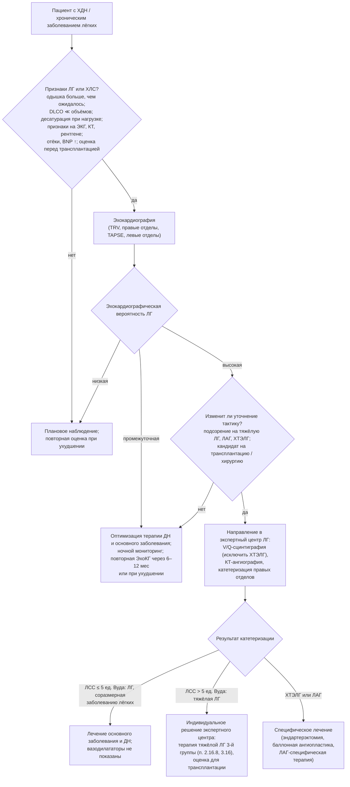

### 2.11. Диагностика: функциональные, лучевые, кардиологические и лабораторные методы

Газы крови отвечают на вопрос «есть ли дыхательная недостаточность». Методы этой главы отвечают на вопросы «почему» (какое звено системы дыхания поражено и насколько), «как это проявляется при нагрузке», «есть ли лёгочная гипертензия и лёгочное сердце» и «какие сопутствующие нарушения нужно учесть». Логика их применения задана главой 2.5: каждый метод соответствует определённому уровню поражения — функция внешнего дыхания описывает дыхательные пути, паренхиму и объёмы; тесты дыхательных мышц — насос; лучевые методы — структуру; кардиологические — сосудистое звено и правый желудочек.

#### 2.11.1. Исследование функции внешнего дыхания

##### 2.11.1.1. Спирометрия и кривая поток — объём

**Спирометрия** измеряет объёмы и потоки при форсированном выдохе (и вдохе) и является обязательным исследованием у каждого пациента с подозрением на ХДН. Основные показатели: форсированная жизненная ёмкость лёгких (ФЖЕЛ), объём форсированного выдоха за первую секунду (ОФВ₁), их отношение ОФВ₁/ФЖЕЛ, пиковая объёмная скорость выдоха, средняя объёмная скорость на участке 25–75 % ФЖЕЛ, медленная ЖЕЛ (обычно больше ФЖЕЛ при обструкции из-за воздушных ловушек при форсированном выдохе). Качество исследования определяется критериями приемлемости и воспроизводимости (стандарт ATS/ERS 2019: не менее трёх приемлемых попыток, различие двух наибольших значений ФЖЕЛ и ОФВ₁ не более 150 мл); без оценки качества интерпретация недостоверна. Кривая поток — объём (рис. 10) даёт качественную информацию: форма экспираторной части отражает механизм ограничения потока, инспираторной — проходимость верхних дыхательных путей и силу вдоха.

```svg
<svg xmlns="http://www.w3.org/2000/svg" viewBox="0 0 720 460" width="720" height="460" font-family="Arial, sans-serif" font-size="13">
  <defs>
    <marker id="fig10-arrow" viewBox="0 0 10 10" refX="9" refY="5" markerWidth="8" markerHeight="8" orient="auto">
      <path d="M0,0 L10,5 L0,10 z" fill="#333"/>
    </marker>
  </defs>
  <!-- axes -->
  <line x1="80" y1="230" x2="690" y2="230" stroke="#333" stroke-width="1.5" marker-end="url(#fig10-arrow)"/>
  <line x1="80" y1="430" x2="80" y2="30" stroke="#333" stroke-width="1.5" marker-end="url(#fig10-arrow)"/>
  <text x="640" y="250" fill="#333">Объём, л</text>
  <text x="20" y="60" fill="#333">Поток,</text>
  <text x="20" y="76" fill="#333">л/с</text>
  <text x="88" y="48" fill="#333">выдох</text>
  <text x="88" y="422" fill="#333">вдох</text>
  <!-- ticks volume -->
  <g stroke="#333" stroke-width="1">
    <line x1="180" y1="226" x2="180" y2="234"/><line x1="280" y1="226" x2="280" y2="234"/>
    <line x1="380" y1="226" x2="380" y2="234"/><line x1="480" y1="226" x2="480" y2="234"/>
    <line x1="580" y1="226" x2="580" y2="234"/>
  </g>
  <g fill="#333" font-size="12">
    <text x="176" y="248">1</text><text x="276" y="248">2</text><text x="376" y="248">3</text>
    <text x="476" y="248">4</text><text x="576" y="248">5</text>
  </g>
  <!-- ticks flow -->
  <g stroke="#333" stroke-width="1">
    <line x1="76" y1="190" x2="84" y2="190"/><line x1="76" y1="150" x2="84" y2="150"/>
    <line x1="76" y1="110" x2="84" y2="110"/><line x1="76" y1="70" x2="84" y2="70"/>
    <line x1="76" y1="270" x2="84" y2="270"/><line x1="76" y1="310" x2="84" y2="310"/>
    <line x1="76" y1="350" x2="84" y2="350"/>
  </g>
  <g fill="#333" font-size="12">
    <text x="60" y="194">2</text><text x="60" y="154">4</text><text x="60" y="114">6</text><text x="60" y="74">8</text>
    <text x="60" y="274">2</text><text x="60" y="314">4</text><text x="60" y="354">6</text>
  </g>
  <!-- A: normal -->
  <path d="M80,230 C95,90 110,70 140,70 C250,100 420,180 560,230" fill="none" stroke="#1f77b4" stroke-width="2.5"/>
  <path d="M80,230 C180,330 420,340 560,230" fill="none" stroke="#1f77b4" stroke-width="2.5"/>
  <!-- B: obstruction (COPD) -->
  <path d="M80,230 C90,150 100,140 118,140 C140,205 230,222 420,230" fill="none" stroke="#d62728" stroke-width="2.5" stroke-dasharray="7,4"/>
  <path d="M80,230 C150,300 330,305 420,230" fill="none" stroke="#d62728" stroke-width="2.5" stroke-dasharray="7,4"/>
  <!-- C: restriction -->
  <path d="M80,230 C86,120 92,100 108,100 C150,130 210,190 250,230" fill="none" stroke="#2ca02c" stroke-width="2.5"/>
  <path d="M80,230 C110,300 210,300 250,230" fill="none" stroke="#2ca02c" stroke-width="2.5"/>
  <!-- D: fixed upper airway obstruction -->
  <path d="M80,230 C84,175 90,165 110,165 L420,165 C470,165 500,200 520,230" fill="none" stroke="#9467bd" stroke-width="2.5" stroke-dasharray="2,4"/>
  <path d="M80,230 C84,285 90,295 110,295 L420,295 C470,295 500,260 520,230" fill="none" stroke="#9467bd" stroke-width="2.5" stroke-dasharray="2,4"/>
  <!-- legend -->
  <g font-size="13">
    <line x1="430" y1="60" x2="470" y2="60" stroke="#1f77b4" stroke-width="2.5"/>
    <text x="478" y="64" fill="#333">А — норма</text>
    <line x1="430" y1="84" x2="470" y2="84" stroke="#d62728" stroke-width="2.5" stroke-dasharray="7,4"/>
    <text x="478" y="88" fill="#333">Б — обструкция (эмфизема, ХОБЛ)</text>
    <line x1="430" y1="108" x2="470" y2="108" stroke="#2ca02c" stroke-width="2.5"/>
    <text x="478" y="112" fill="#333">В — рестрикция (фиброз, кифосколиоз)</text>
    <line x1="430" y1="132" x2="470" y2="132" stroke="#9467bd" stroke-width="2.5" stroke-dasharray="2,4"/>
    <text x="478" y="136" fill="#333">Г — фиксированная обструкция</text>
    <text x="478" y="152" fill="#333">верхних дыхательных путей</text>
  </g>
</svg>
```

**Рис. 10.** Качественные формы кривой поток — объём (схема; масштабы условны). А — норма: быстрый подъём к пику, почти прямолинейный спад экспираторного потока, округлая инспираторная петля. Б — обструкция: сниженный пик, вогнутая («провисающая») экспираторная кривая из-за ограничения потока и коллапса дыхательных путей; ФЖЕЛ может быть снижена за счёт воздушных ловушек. В — рестрикция: уменьшенные объёмы при сохранённых или относительно высоких потоках («узкая высокая» петля), отношение ОФВ₁/ФЖЕЛ нормальное или повышенное. Г — фиксированная обструкция верхних дыхательных путей (стеноз трахеи после интубации или трахеостомии, опухоль): плато потока на вдохе и выдохе.

##### 2.11.1.2. Бронходилатационный тест

Тест оценивает обратимость обструкции после ингаляции короткодействующего бронхолитика (например, 400 мкг сальбутамола через спейсер, измерение через 10–15 минут). По рекомендациям ATS/ERS 2022 значимым считается прирост ОФВ₁ или ФЖЕЛ более чем на 10 % от должного значения (прежний критерий — ≥ 12 % и ≥ 200 мл от исходного — остаётся в ряде руководств, включая клиническую практику по бронхиальной астме). Полная обратимость свидетельствует против ХОБЛ; выраженная обратимость при сохраняющейся обструкции — об астме или перекрёсте. Для диагноза ХОБЛ значение имеет постбронходилатационное отношение ОФВ₁/ФЖЕЛ; спирометрия после бронхолитика также лучше отражает «истинный» функциональный резерв пациента.

##### 2.11.1.3. Лёгочные объёмы и бодиплетизмография

Спирометрия не измеряет остаточный объём, а значит, и ОЕЛ. **Бодиплетизмография** (метод, основанный на законе Бойля — Мариотта, при котором пациент дышит в закрытой кабине с измерением колебаний давления) определяет внутригрудной объём газа, ФОЕ, ООЛ, ОЕЛ и сопротивление дыхательных путей; методы разведения гелия и вымывания азота дают объёмы только вентилируемых зон и при тяжёлой обструкции занижают ОЕЛ. Показания при ХДН: подтверждение рестрикции (ОЕЛ ниже нижней границы нормы), количественная оценка гиперинфляции и воздушных ловушек (ООЛ, ООЛ/ОЕЛ, ФОЕ), оценка смешанных нарушений (при обструкции снижение ФЖЕЛ может быть обусловлено ловушками, а не рестрикцией), динамика при лечении (бронхолитики уменьшают гиперинфляцию). Прогностический маркёр при ХОБЛ — отношение ёмкости вдоха к ОЕЛ (IC/TLC): значения ≤ 25 % ассоциированы с повышенной смертностью (исследование С. Casanova и соавторов, 2005).

##### 2.11.1.4. Диффузионная способность лёгких

**DLCO** измеряется методом одиночного вдоха смеси с малой концентрацией CO и инертного газа-трассера (гелий или метан) с задержкой дыхания около 10 секунд. Результат зависит от площади и толщины альвеолярно-капиллярной мембраны (мембранный компонент D_M) и от объёма капиллярной крови с её гемоглобином (компонент θ·V_c), поэтому требует коррекции на гемоглобин (при анемии DLCO занижена, при эритроцитозе завышена), на карбоксигемоглобин у курильщиков и на высоту (стандарт ATS/ERS 2017). Одновременно измеряется альвеолярный объём (VA) по разведению трассера, и вычисляется коэффициент переноса **KCO** = DLCO/VA — диффузия на единицу вентилируемого объёма.

Интерпретация пары DLCO — KCO — один из самых информативных функциональных приёмов при ХДН:

- снижение DLCO при сниженном KCO и сниженных объёмах — поражение паренхимы (ИЗЛ) или эмфизема (при эмфиземе объёмы увеличены, а DLCO резко снижена — «диссоциация»);
- снижение DLCO при повышенном KCO и сниженных объёмах — внелёгочная рестрикция (кифосколиоз, слабость мышц, плевральный выпот, резекция лёгкого): лёгкое здорово, просто его меньше или оно не расправлено, и кровь «уплотнена» в меньшем объёме;
- изолированное снижение DLCO при нормальных объёмах и спирометрии — сосудистое поражение (ЛАГ, ХТЭЛГ, васкулит), ранняя эмфизема или раннее ИЗЛ;
- повышение DLCO — лёгочное кровотечение, эритроцитоз, лево-правый шунт, ожирение, астма.

DLCO менее 40 % должного при ХОБЛ и ИЗЛ — предиктор нагрузочной десатурации и лёгочной гипертензии; динамика DLCO (снижение ≥ 15 % за год при ИЛФ) — маркёр прогрессирования.

##### 2.11.1.5. Сопротивление дыхательных путей и импульсная осциллометрия

Сопротивление дыхательных путей (Raw) и его величина, обратная удельной проводимости, измеряются при бодиплетизмографии. Импульсная осциллометрия (накладывает на спокойное дыхание колебания давления разных частот и измеряет импеданс) не требует форсированных манёвров и применима у детей, пожилых и ослабленных пациентов, у которых спирометрия некачественна; она чувствительна к поражению мелких дыхательных путей (разница сопротивлений при 5 и 20 Гц, реактанс), но её роль при ХДН пока вспомогательная.

##### 2.11.1.6. Функциональные паттерны

Табл. 16 суммирует функциональные паттерны, которые мы будем использовать при дифференциальной диагностике.

**Табл. 16.** Функциональные паттерны при основных группах причин ХДН

| Группа причин | ОФВ₁/ФЖЕЛ | ОЕЛ | ООЛ, ООЛ/ОЕЛ | DLCO | KCO | Особенности |
|---|---|---|---|---|---|---|
| ХОБЛ, эмфизема | ↓ | N или ↑ | ↑↑ | ↓ (при эмфиземе ↓↓) | ↓ | Вогнутая экспираторная кривая, ловушки, гиперинфляция; IC/TLC ↓ |
| Бронхиальная астма (тяжёлая, с ремоделированием) | ↓ | N или ↑ | ↑ | N или ↑ | N или ↑ | Частичная обратимость; DLCO сохранена — отличие от эмфиземы |
| Бронхоэктазы, муковисцидоз | ↓ | N | ↑ | N или ↓ | N | Обструкция с ловушками; при прогрессировании — смешанный паттерн |
| ИЗЛ (ИЛФ, другие фиброзы) | N или ↑ | ↓ | ↓ | ↓↓ | ↓ | Рестрикция с непропорционально низкой DLCO; CPFE — объёмы N при очень низкой DLCO |
| Кифосколиоз, деформации грудной клетки | N или ↑ | ↓ | N или ↑ | ↓ | ↑ | Внелёгочная рестрикция; KCO повышен |
| Нервно-мышечные заболевания | N или ↑ | ↓ | ↑ (неполный выдох) | ↓ | ↑ | ЖЕЛ ↓ лёжа; MIP, MEP, SNIP ↓; PCF ↓ |
| Ожирение (СОГ) | N | N или ↓ | N | N или ↑ | ↑ | Резервный объём выдоха ↓↓; ФОЕ ↓; ЖЕЛ нередко нормальна |
| Сосудистые заболевания (ЛАГ, ХТЭЛГ) | N | N | N | ↓ | ↓ | Изолированное снижение DLCO |
| Центральная гиповентиляция | N | N | N | N | N | Функция внешнего дыхания нормальна; дефект — в регуляции |

Примечание: N — норма; ↑/↓ — повышение/снижение; паттерны схематичны, у конкретного пациента часто сочетаются.

##### 2.11.1.7. Должные величины и интерпретация: z-оценки

Результаты сравниваются с должными величинами, рассчитанными по полу, возрасту, росту и этнической принадлежности. Современный стандарт — уравнения Global Lung Function Initiative (GLI 2012 для спирометрии, 2017 для DLCO, 2021 для лёгочных объёмов) и интерпретация в **z-оценках** (число стандартных отклонений от должного): нижняя граница нормы соответствует z = −1,645 (5-й процентиль). Рекомендации ATS/ERS 2022 по интерпретации отказываются от фиксированных процентов должного (которые систематически ошибочно классифицируют пожилых и низкорослых) в пользу z-оценок и градируют тяжесть снижения как лёгкую (z от −1,65 до −2,5), умеренную (от −2,51 до −4,0) и тяжёлую (ниже −4,1). Вместе с тем клинические руководства (GOLD) сохраняют фиксированное отношение ОФВ₁/ФЖЕЛ < 0,70 и градации тяжести в процентах должного ОФВ₁, поэтому врач должен понимать обе системы и указывать, какую использует. Важнейший принцип интерпретации при ХДН: изменения во времени у одного пациента (например, падение ФЖЕЛ на 10 % за год при ИЛФ или снижение ЖЕЛ при БАС) информативнее однократного сравнения с популяционной нормой.

#### 2.11.2. Оценка силы и функции дыхательных мышц

##### 2.11.2.1. Максимальные ротовые давления (MIP, MEP)

**Максимальное инспираторное давление** (MIP, PImax) измеряется при максимальном усилии вдоха из остаточного объёма против закрытого клапана с небольшой утечкой (исключает участие щёчных мышц); **максимальное экспираторное давление** (MEP, PEmax) — при максимальном выдохе от ОЕЛ. Значения зависят от пола, возраста и мотивации; ориентировочно у здоровых мужчин MIP превышает по модулю 80 см вод. ст., у женщин — 70 см вод. ст.; значения ниже 60 см вод. ст. для мужчин и 40–45 см вод. ст. для женщин указывают на слабость (стандарт ATS/ERS 2002 по тестированию дыхательных мышц; точные должные зависят от использованного уравнения). MIP выше 80 см вод. ст. практически исключает клинически значимую слабость инспираторных мышц; низкие значения требуют подтверждения другим методом из-за зависимости от техники. MEP отражает силу экспираторных (брюшных) мышц и предсказывает эффективность кашля; при бульбарных нарушениях оба теста ненадёжны (невозможно удержать загубник).

##### 2.11.2.2. Назальное давление при шмыганье (SNIP)

**SNIP** (sniff nasal inspiratory pressure) — давление, измеренное в одной ноздре заглушкой во время короткого максимального шмыганья через другую; манёвр естествен, не требует загубника и поэтому выполним при слабости мимических и бульбарных мышц. Ориентировочная норма — выше 70 см вод. ст. у мужчин и 60 см вод. ст. у женщин. При БАС SNIP — один из лучших предикторов гиперкапнии и выживаемости: значения ниже 40 см вод. ст. ассоциированы с ночной гиповентиляцией и высоким риском смерти в ближайшие месяцы; в рекомендациях NICE (2016) SNIP или MIP ниже 40 см вод. ст., а также значения ниже 65 см вод. ст. у мужчин и 55 см вод. ст. у женщин при наличии симптомов — критерии для обсуждения НИВЛ. Комбинация MIP и SNIP (берётся лучший результат) снижает число ложноположительных заключений о слабости.

##### 2.11.2.3. ЖЕЛ сидя и лёжа; пиковая скорость кашля

Снижение ЖЕЛ в положении лёжа по сравнению с положением сидя более чем на 20–25 % указывает на слабость диафрагмы (у здоровых падение не превышает 10 %; при двустороннем параличе диафрагмы достигает 30–50 %) и коррелирует с ночной гиповентиляцией — тест прост и должен выполняться у каждого нервно-мышечного пациента. При нервно-мышечных заболеваниях ЖЕЛ ниже 50 % должного — пороговое значение для оценки показаний к НИВЛ (при наличии симптомов — и ниже 80 %), ниже 30 % — высокий риск гиперкапнии и декомпенсации при инфекции; ЖЕЛ менее 1–1,5 л — критическая зона.

**Пиковая скорость кашля** (peak cough flow, PCF) измеряется пикфлоуметром или пневмотахографом через маску при максимальном кашле. У здоровых взрослых она превышает 360–400 л/мин; значения ниже 270 л/мин означают, что при респираторной инфекции (когда сила снижается) кашель станет неэффективным, — порог для обучения методам поддержки кашля; ниже 160 л/мин — кашель неэффективен уже сейчас (критерии J. R. Bach). Измерение PCF с помощью мануальной или механической поддержки позволяет сразу оценить эффективность вмешательства (глава 2.21).

##### 2.11.2.4. Диагностика дисфункции диафрагмы

Подозрение на дисфункцию диафрагмы возникает при ортопноэ, парадоксальном дыхании лёжа, падении ЖЕЛ лёжа > 20–25 %, высоком стоянии купола на рентгенограмме. Методы подтверждения:

- **рентгеноскопия с пробой шмыганья (sniff-тест)** — парадоксальное движение парализованного купола вверх при резком вдохе; информативна при одностороннем параличе, при двустороннем может давать ложноотрицательный результат (пациент компенсирует движением брюшных мышц);
- **ультразвуковое исследование диафрагмы** — метод выбора у постели больного: по подрёберному доступу измеряют экскурсию купола (норма при спокойном дыхании около 1,5–2 см, при глубоком — более 4–5 см; парадоксальное движение при шмыганье), по зоне прилегания к грудной стенке — толщину и **фракцию утолщения** (отношение прироста толщины на вдохе к толщине на выдохе; значения менее 20 % указывают на паралич или выраженную слабость; толщина менее 2 мм на выдохе — атрофия); УЗИ также помогает оценивать восстановление после повреждения нерва и прогнозировать успех отлучения от ИВЛ;
- **трансдиафрагмальное давление (Pdi)** — разность желудочного и пищеводного давлений, измеренная баллонными катетерами при максимальном шмыганье (sniff Pdi; норма у мужчин обычно выше 100 см вод. ст., у женщин — выше 70 см вод. ст.) или при электрической либо магнитной стимуляции диафрагмальных нервов (twitch Pdi; не зависит от воли пациента; значения ниже 10 см вод. ст. соответствуют тяжёлой слабости; [⚠️ Требуется верификация: точные пороги нормы twitch Pdi варьируют по лабораториям]) — эталонный метод, доступный в специализированных лабораториях;
- **исследование проводимости диафрагмального нерва и ЭМГ диафрагмы** — разграничивают нейропатию (увеличение латентности, снижение амплитуды М-ответа) и миопатию; важны при решении о электростимуляции диафрагмы (требует сохранности нерва — п. 2.20.11).

##### 2.11.2.5. Электромиография и нейрофизиология

При подозрении на нервно-мышечное заболевание как причину ХДН игольчатая ЭМГ, исследование нервной проводимости, ритмическая стимуляция (миастения), а также биопсия мышцы и генетическое тестирование уточняют диагноз; эти методы определяют не степень ДН, а её причину и прогноз, и пациент должен быть направлен к неврологу, специализирующемуся на нервно-мышечных болезнях.

#### 2.11.3. Нагрузочные тесты

##### 2.11.3.1. Цели

Нагрузочные тесты выявляют латентную ДН (десатурацию при нагрузке), объективизируют переносимость нагрузки и её ограничивающий фактор (вентиляция, газообмен, кровообращение, периферические мышцы, детренированность), дают прогностическую информацию, служат основой назначения и оценки реабилитации и кислорода при нагрузке, используются при отборе на хирургическое лечение и трансплантацию.

##### 2.11.3.2. Кардиопульмональное нагрузочное тестирование

**Кардиопульмональное нагрузочное тестирование** (КПНТ) — ступенчато возрастающая нагрузка на велоэргометре или тредмиле с анализом газов выдоха («дыхание за дыханием»), ЭКГ, АД, SpO₂ и, при необходимости, газов артериальной крови. Ключевые параметры: пиковое потребление кислорода (V̇O₂peak, в мл/кг/мин и в процентах должного) — интегральный показатель физической работоспособности и прогноза; анаэробный (лактатный) порог; вентиляционный эквивалент по CO₂ (наклон V̇E/V̇CO₂ — повышен при неэффективной вентиляции из-за мёртвого пространства: ЛГ, ХОБЛ, ИЗЛ, сердечная недостаточность); **дыхательный резерв** (разность максимальной произвольной вентиляции и пиковой минутной вентиляции; резерв менее 11 л/мин или менее 15–20 % максимальной произвольной вентиляции указывает на вентиляционное ограничение — характерный признак лёгочной, а не сердечной причины); динамика ёмкости вдоха в ходе нагрузки (снижение — динамическая гиперинфляция); десатурация; пульс кислорода (V̇O₂/ЧСС — суррогат ударного объёма); кислородный долг и кинетика восстановления. КПНТ позволяет различить причины одышки неясного генеза, количественно оценить динамическую гиперинфляцию и обосновать режим тренировок (стандарты ATS/ACCP 2003, ERS 2019).

##### 2.11.3.3. Тесты с ходьбой

**Тест с 6-минутной ходьбой** (6MWT) — самостоятельно дозируемая ходьба по ровному коридору длиной 30 м в течение 6 минут с измерением пройденной дистанции, SpO₂ и ЧСС, одышки и усталости по шкале Борга до и после (технический стандарт ERS/ATS 2014). Минимально клинически значимое изменение дистанции — около 30 м (25–35 м по разным нозологиям); дистанция менее 350 м при ХОБЛ и ИЗЛ ассоциирована с худшей выживаемостью; тест входит в индекс BODE (градации > 350, 250–349, 150–249, ≤ 149 м). Инспираторный и пространственный стандарт важен: пациент должен выполнить тест после ознакомительной попытки, по стандартной инструкции, без «сопровождения» в темпе исследователя, с непрерывной пульсоксиметрией (одномоментная запись «до и после» пропускает надир сатурации, который часто наступает на 3–5-й минуте и восстанавливается к концу). Тест с кислородом сравнивается с тестом без кислорода для оценки ответа на кислород при нагрузке.

**Челночный тест с возрастающей нагрузкой** (incremental shuttle walk test, ISWT, по S. J. Singh и соавторам, 1992) — ходьба между конусами на отрезке 10 м с нарастающим темпом, задаваемым звуковыми сигналами, до невозможности поддерживать темп; он ближе к максимальному тесту, лучше воспроизводим и позволяет рассчитать нагрузку для **челночного теста с постоянной нагрузкой** (ESWT, 85 % от достигнутой), который наиболее чувствителен к эффектам реабилитации и бронхолитиков.

##### 2.11.3.4. Нагрузочная десатурация

Критерии значимой десатурации не вполне унифицированы: чаще всего применяются надир SpO₂ ≤ 88 % (критерий BODE и показаний к кислороду при нагрузке в ряде руководств) и падение на ≥ 4 % от исходного (ATS/ERS); снижение до < 90 % часто рассматривается как пороговое при ИЗЛ. Десатурация при ходьбе — независимый предиктор смертности при ИЛФ и ХОБЛ, ранний маркёр лёгочной гипертензии и показание к ночному мониторингу (пациенты, десатурирующие при нагрузке, часто десатурируют и во сне). Интерпретация требует учёта артефактов (движение рук, холодные пальцы — предпочтителен датчик на лбу или мочке уха при ходьбе) и состояния гемоглобина (при анемии десатурация может быть меньше при той же тканевой гипоксии). Вопрос о том, улучшает ли коррекция изолированной нагрузочной десатурации исходы, — дискуссионный (п. 3.8).

##### 2.11.3.5. Простые тесты

Тест с подъёмом по лестнице (число пролётов, SpO₂, время), тест «встать — сесть» за 1 минуту (число повторений; коррелирует с 6MWT и прогнозом при ХОБЛ и ИЗЛ), 4-метровый тест скорости ходьбы — применимы в условиях поликлиники и на дому, пригодны для мониторинга динамики, но не заменяют стандартизированные тесты при принятии решений о кислороде.

#### 2.11.4. Лучевые методы

##### 2.11.4.1. Рентгенография органов грудной клетки

Рентгенография — базовое исследование: выявляет гиперинфляцию (уплощение и низкое стояние куполов диафрагмы, увеличение ретростернального пространства, вертикальное сердце, обеднение сосудистого рисунка, буллы), признаки фиброза (ретикулярные изменения, уменьшение объёма, сотовое лёгкое), деформации грудной клетки и позвоночника, высокое стояние купола (паралич диафрагмы), плевральные изменения, инфильтраты и ателектазы, признаки лёгочной гипертензии и лёгочного сердца (расширение ствола и главных ветвей лёгочной артерии с «обрывом» периферических сосудов, увеличение правого желудочка — сглаживание талии в прямой проекции и заполнение ретростернального пространства в боковой, расширение правого предсердия). Чувствительность рентгенографии для ранних стадий низка; нормальная рентгенограмма не исключает ни ИЗЛ, ни эмфизему, ни лёгочную гипертензию.

##### 2.11.4.2. Компьютерная томография

**КТ высокого разрешения** (тонкие срезы, алгоритм высокого пространственного разрешения, сканирование на вдохе и выдохе, при подозрении на ИЗЛ — и в положении лёжа на животе для исключения гравитационных артефактов) — главный метод характеристики паренхимы: тип и распространённость эмфиземы (центрилобулярная, панлобулярная, парасептальная; количественная оценка по доле вокселов плотностью ниже −950 HU), паттерн ИЗЛ (обычная интерстициальная пневмония с сотовым лёгким и тракционными бронхоэктазами, неспецифическая интерстициальная пневмония, гиперчувствительный пневмонит с мозаичностью и воздушными ловушками), бронхоэктазы, воздушные ловушки на выдохе, трахеобронхомаляция (динамическое исследование), объёмные образования. **КТ-ангиография лёгочных артерий** исключает ТЭЛА и выявляет признаки ХТЭЛГ (пристеночные тромбы, перетяжки, мозаичная перфузия). КТ даёт косвенные признаки лёгочной гипертензии: диаметр ствола лёгочной артерии более 29 мм или отношение диаметров лёгочной артерии и восходящей аорты более 1 (последнее при ХОБЛ ассоциировано с частотой обострений — исследование J. M. Wells и соавторов в *New England Journal of Medicine*, 2012), расширение правых отделов, рефлюкс контраста в печёночные вены. КТ также даёт информацию о сопутствующих находках, важных для ХДН: саркопении (площадь мышц на уровне позвонков), коронарном кальцинозе, компрессионных переломах позвонков, раке лёгкого (пациенты с ХОБЛ — группа скрининга).

##### 2.11.4.3. Вентиляционно-перфузионная сцинтиграфия

Планарная или ОФЭКТ-сцинтиграфия с перфузионными макроагрегатами альбумина и вентиляционным газом или аэрозолем сохраняет роль метода скрининга ХТЭЛГ (нормальная перфузионная сцинтиграмма практически исключает ХТЭЛГ, тогда как КТ-ангиография может пропустить дистальные поражения), оценки раздельной функции лёгких перед резекцией и трансплантацией, количественной оценки распределения вентиляции и перфузии перед эндоскопической редукцией объёма лёгких.

##### 2.11.4.4. Ультразвуковое исследование и МРТ

УЗИ лёгких и плевры выявляет выпот, консолидацию, пневмоторакс, интерстициальный синдром (B-линии) и широко применяется для оценки диафрагмы (п. 2.11.2.4); МРТ лёгких (включая методики с гиперполяризованными газами) остаётся преимущественно исследовательским методом, но МРТ сердца — эталон оценки объёмов и функции правого желудочка при лёгочной гипертензии.

#### 2.11.5. Кардиологическое обследование и диагностика лёгочной гипертензии

##### 2.11.5.1. Электрокардиография

ЭКГ-признаки перегрузки правых отделов: P-pulmonale (заострённый зубец P амплитудой более 2,5 мм в отведениях II, III, aVF), отклонение электрической оси вправо (более +90–110°), высокий R или отношение R/S > 1 в V₁, глубокие S в V₅–V₆, блокада правой ножки пучка Гиса, инверсия T в правых грудных отведениях, тип S₁S₂S₃; при эмфиземе — низкий вольтаж, вертикальная ось, плохое нарастание R в грудных отведениях. Чувствительность ЭКГ для лёгочной гипертензии низка (нормальная ЭКГ не исключает ЛГ), специфичность признаков гипертрофии правого желудочка высока. ЭКГ также выявляет аритмии (п. 2.9.3), ишемию, удлинение QT, признаки гипокалиемии.

##### 2.11.5.2. Эхокардиография

Эхокардиография — метод первой линии при подозрении на ЛГ и лёгочное сердце. Оцениваются: пиковая скорость трикуспидальной регургитации (TRV) и расчётное систолическое давление в лёгочной артерии (4·TRV² + давление в правом предсердии, оценённое по диаметру и коллабированию нижней полой вены); размеры правого желудочка и предсердия (отношение базальных диаметров ПЖ/ЛЖ > 1), толщина стенки ПЖ (> 5 мм), систолическая функция ПЖ — TAPSE (< 17 мм), тканевая допплеровская скорость S′ (< 9,5 см/с), фракция изменения площади (< 35 %), индекс эксцентричности межжелудочковой перегородки (D-образный ЛЖ), форма потока в выносящем тракте ПЖ (время ускорения < 105 мс, среднесистолическая зазубрина), диаметр лёгочной артерии (> 25 мм), перикардиальный выпот; одновременно — функция левых отделов и клапаны (исключение посткапиллярной ЛГ). Рекомендации ESC/ERS 2022 градируют **эхокардиографическую вероятность ЛГ**: низкая (TRV ≤ 2,8 м/с без дополнительных признаков), промежуточная (TRV ≤ 2,8 м/с с дополнительными признаками или TRV 2,9–3,4 м/с без них), высокая (TRV > 3,4 м/с или 2,9–3,4 м/с с признаками). Ограничения при заболеваниях лёгких: плохое акустическое окно при гиперинфляции и ожирении (измерение невозможно у 10–30 % пациентов с тяжёлой ХОБЛ), неточность расчётного давления (ошибка ± 10–20 мм рт. ст. в обе стороны; при тяжёлой трикуспидальной регургитации давление занижается), поэтому эхокардиография определяет вероятность ЛГ и функцию ПЖ, но не ставит диагноз ЛГ самостоятельно.

##### 2.11.5.3. Катетеризация правых отделов сердца

Катетеризация — эталонный метод: прямое измерение давления в правом предсердии, правом желудочке, лёгочной артерии (систолическое, диастолическое, среднее), давления заклинивания лёгочной артерии, сердечного выброса (термодилюция или метод Фика), расчёт ЛСС, сатурации смешанной венозной крови; при необходимости — вазореактивный тест (при ЛАГ, но не при ЛГ 3-й группы), нагрузочная или объёмная проба для выявления скрытой левожелудочковой недостаточности. При заболеваниях лёгких катетеризация показана, когда её результат изменит тактику: подозрение на тяжёлую ЛГ (несоразмерную тяжести лёгочного заболевания), предполагаемая ЛАГ или ХТЭЛГ, обследование перед трансплантацией лёгких или хирургической редукцией объёма, включение в клинические исследования, диагностическая неясность (сочетание с левожелудочковой патологией). Процедура безопасна в опытных руках (летальность около 0,05 %), но выполняется только в экспертных центрах, желательно в стабильном состоянии и после оптимизации терапии ДН (измерения во время обострения и выраженной гипоксемии отражают не базовое состояние, а преходящую вазоконстрикцию).

##### 2.11.5.4. Натрийуретические пептиды и другие биомаркёры

BNP и NT-proBNP повышаются при перегрузке правого желудочка так же, как левого, и при ЛГ 3-й группы коррелируют с тяжестью и прогнозом; они входят в стратификацию риска при ЛАГ (ESC/ERS 2022: NT-proBNP < 300, 300–1100, > 1100 пг/мл для низкого, промежуточного и высокого риска) и могут служить триггером для углублённого обследования, но неспецифичны (возраст, почечная недостаточность, фибрилляция предсердий, левожелудочковая дисфункция повышают уровень; ожирение снижает). Тропонин повышается при остром правожелудочковом напряжении (ТЭЛА, декомпенсация) и имеет прогностическое значение.

##### 2.11.5.5. Алгоритм диагностики ЛГ при хронических заболеваниях лёгких



**Рис. 11.** Алгоритм диагностики лёгочной гипертензии у пациента с хроническим заболеванием лёгких (на основе рекомендаций ESC/ERS 2022). Схема читается сверху вниз.

#### 2.11.6. Лабораторные исследования

Лабораторный минимум при ХДН и его обоснование:

- **общий анализ крови** — эритроцитоз (гематокрит > 55 % — критерий кислородотерапии при пограничной гипоксемии), анемия (ухудшает доставку кислорода; требует поиска причины), лейкоцитоз (инфекция, стероиды), эозинофилы (фенотип ХОБЛ с ответом на ингаляционные стероиды — порог ≥ 300 клеток/мкл по GOLD), тромбоциты;
- **электролиты и КОС венозной крови** — бикарбонат (скрининг хронической гиперкапнии), калий и магний (аритмии, слабость мышц), хлорид (гипохлоремический алкалоз), натрий (гипонатриемия при лёгочном сердце — плохой прогноз), фосфат (гипофосфатемия ослабляет диафрагму);
- **креатинин и расчётная СКФ, мочевина** — почечная функция с поправкой на мышечную массу; цистатин C при саркопении;
- **альбумин, преальбумин, общий белок** — нутритивный статус (с учётом воспаления);
- **печёночные тесты** — застойная гепатопатия при лёгочном сердце, лекарственные поражения;
- **глюкоза, HbA1c** — диабет (стероиды, ожирение), гипергликемия ухудшает прогноз обострений;
- **ТТГ** — гипотиреоз (причина гиповентиляции, миопатии, апноэ), гипертиреоз (слабость мышц);
- **креатинфосфокиназа** — миопатии, в том числе стероидная;
- **альфа-1-антитрипсин** — GOLD рекомендует однократное определение у всех пациентов с ХОБЛ (с фенотипированием при снижении);
- **ферритин, трансферрин, сывороточное железо** — дефицит железа частый и корригируемый фактор снижения толерантности к нагрузке при ЛГ и сердечной недостаточности;
- **витамин D** — дефицит частый при ХДН, связан с остеопорозом и миопатией;
- **BNP/NT-proBNP, тропонин** — по показаниям (п. 2.11.5.4);
- **D-димер** — ограниченная ценность при обострении, но нормальный уровень исключает ТЭЛА при низкой претестовой вероятности;
- **СРБ, прокальцитонин** — при обострениях (прокальцитонин — для решения об антибиотиках в части протоколов);
- **иммунологические исследования при ИЗЛ** — антинуклеарные антитела, ревматоидный фактор, антитела к циклическому цитруллинированному пептиду, антисинтетазные и другие миозит-специфические антитела, ANCA, преципитины к антигенам гиперчувствительного пневмонита;
- **антитела к ацетилхолиновым рецепторам и MuSK** при подозрении на миастению; **генетическое тестирование** — ген *SMN1* (СМА), *DMD* (дистрофия Дюшенна), *PHOX2B* (ВСЦГ), *SERPINA1* (дефицит альфа-1-антитрипсина), *CFTR* (муковисцидоз) и потовая проба; гены, ассоциированные с семейным лёгочным фиброзом, при соответствующем анамнезе.

#### 2.11.7. Специальные и инвазивные методы

**Бронхоскопия** с бронхоальвеолярным лаважем (клеточный состав при ИЗЛ: лимфоцитоз при гиперчувствительном пневмоните и саркоидозе, эозинофилия, геморрагический лаваж), трансбронхиальной и криобиопсией, эндобронхиальным УЗИ; оценка трахеобронхомаляции и стеноза трахеи после интубации или трахеостомии (у пациентов на длительной вентиляции), санация при задержке секрета. **Хирургическая биопсия лёгкого** — при неопределённом паттерне ИЗЛ после обсуждения на мультидисциплинарном консилиуме (пульмонолог, рентгенолог, патолог), с учётом риска у пациентов с тяжёлой ДН (острое обострение ИЛФ после биопсии). **Полисомнография и респираторная полиграфия** — глава 2.12. **Исследование регуляции дыхания** (вентиляционный ответ на гиперкапнию методом возвратного дыхания, на гипоксию; давление окклюзии P₀.₁) — в специализированных лабораториях при подозрении на центральную гиповентиляцию и при научных исследованиях. **Оценка глотания** (видеофлюороскопия, эндоскопическая оценка) — при бульбарных нарушениях и подозрении на аспирацию.

🔬 **Углубление: интеграция функциональных данных в «физиологический диагноз».** У пациента с ХДН редко бывает один механизм, и комплексное функциональное исследование позволяет разложить одышку и гипоксемию на составляющие. Пример: пациент с ХОБЛ, ОФВ₁ 35 %, DLCO 30 %, но при этом ЖЕЛ лёжа падает на 30 %, MIP 35 см вод. ст., ИМТ 19 кг/м² — помимо обструкции и эмфиземы у него выраженная слабость дыхательных мышц (кахексия, стероиды), и это меняет тактику: нутритивная поддержка, тренировка, пересмотр стероидов, ранняя НИВЛ. Другой пример: пациентка с ИЛФ, ФЖЕЛ 65 %, но DLCO 28 % и десатурация до 80 % при ходьбе — непропорциональное снижение DLCO указывает на сочетание с эмфиземой (CPFE) или лёгочной гипертензией, что требует ЭхоКГ и, возможно, катетеризации, и объясняет, почему её гипоксемия тяжелее, чем предсказывает ФЖЕЛ. При КПНТ исчерпание дыхательного резерва при низкой нагрузке с десатурацией и ростом V̇E/V̇CO₂ указывает на вентиляционное и газообменное ограничение; нормальный дыхательный резерв с низким пульсом кислорода и ранним анаэробным порогом — на сердечную или периферическую причину одышки у пациента, которого «списывали» на лёгкие. Такой физиологический диагноз должен быть сформулирован рядом с нозологическим (п. 2.13.15).

#### 2.11.8. Примеры и иллюстрации: обследование пациентов 1 и 2

**Пример 1** (ХОБЛ, п. 2.5.12). Спирометрия после бронхолитика: ОФВ₁ 0,82 л (27 % должного), ФЖЕЛ 2,6 л (62 %), ОФВ₁/ФЖЕЛ 0,32; прирост ОФВ₁ после сальбутамола 90 мл (4 % должного — незначимый). Бодиплетизмография: ОЕЛ 128 %, ООЛ 230 %, ООЛ/ОЕЛ 62 %, IC/TLC 22 % — выраженная гиперинфляция. DLCO 38 %, KCO 45 % — эмфизема. MIP −55 см вод. ст. (сниженный; гиперинфляция ставит диафрагму в невыгодное положение). 6MWT: 310 м, SpO₂ с 91 % до 83 % (надир на 4-й минуте), Борг 6. КТ: распространённая центрилобулярная и парасептальная эмфизема верхних долей (доля вокселов < −950 HU — 32 %), диаметр лёгочной артерии 33 мм, отношение к аорте 1,05. ЭКГ: P-pulmonale, ось +105°, неполная блокада правой ножки. ЭхоКГ: TRV 3,2 м/с, расчётное систолическое давление около 50 мм рт. ст., ПЖ 44 мм, TAPSE 16 мм, левые отделы без патологии — промежуточная вероятность ЛГ с дополнительными признаками (высокая вероятность по сумме), соразмерная тяжести ХОБЛ; катетеризация не показана, пока результат не изменит тактику. Лаборатория: гемоглобин 172 г/л, гематокрит 53 %, эозинофилы 120/мкл, альфа-1-антитрипсин в норме, NT-proBNP 380 пг/мл, бикарбонат 30 ммоль/л. Физиологический диагноз: тяжёлая обструкция с гиперинфляцией, эмфизематозное поражение с нарушением диффузии, умеренная слабость инспираторных мышц, нагрузочная десатурация, вероятная ЛГ 3-й группы, соразмерная заболеванию.

**Пример 2** (кифосколиоз). Спирометрия: ЖЕЛ 1,05 л (32 % должного), ОФВ₁ 0,88 л, ОФВ₁/ФЖЕЛ 0,84. Бодиплетизмография: ОЕЛ 45 %, ООЛ 70 %, ООЛ/ОЕЛ 48 %. DLCO 52 %, KCO 128 % — внелёгочная рестрикция. MIP −48 см вод. ст., MEP 60 см вод. ст., SNIP 45 см вод. ст. — умеренная слабость, отчасти из-за механически невыгодного положения мышц. ЖЕЛ лёжа 0,92 л (падение 12 % — диафрагма сохранна). PCF 280 л/мин. 6MWT: 380 м, SpO₂ с 94 % до 89 %. Рентгенография и КТ: правосторонний грудной сколиоз 110°, ротация позвонков, сдавление правого лёгкого, участки дистелектаза в базальных отделах, без фиброза и эмфиземы. ЭхоКГ: TRV 2,6 м/с, ПЖ не расширен — низкая вероятность ЛГ. Лаборатория: гемоглобин 158 г/л, бикарбонат 31 ммоль/л, ТТГ в норме. Физиологический диагноз: тяжёлая внелёгочная рестрикция с сохранённой паренхимой, умеренная слабость дыхательных мышц, хроническая альвеолярная гиповентиляция; требуется ночной мониторинг (глава 2.12).

❗ **Типичная ошибка:** заключать о рестрикции по снижению ФЖЕЛ при спирометрии без измерения ОЕЛ. У пациента с обструкцией ФЖЕЛ снижается из-за воздушных ловушек, и такой «смешанный» по спирометрии паттерн часто оказывается чистой обструкцией с гиперинфляцией по бодиплетизмографии; обратная ошибка — пропустить нервно-мышечную слабость у пациента с «нормальной» спирометрией сидя, не измерив ЖЕЛ лёжа и давления дыхательных мышц.

❗ **Типичная ошибка:** считать нормальную эхокардиограмму исключением лёгочной гипертензии, а расчётное давление по ЭхоКГ — диагнозом. При гиперинфляции и ожирении окно плохое, трикуспидальная регургитация может не регистрироваться, а погрешность расчёта достигает 20 мм рт. ст. Эхокардиография оценивает вероятность ЛГ и состояние правого желудочка; диагноз ставится катетеризацией, когда он изменит тактику.

💡 **Интересный факт:** тест с 6-минутной ходьбой — упрощённый потомок 12-минутного теста бега Кеннета Купера, предложенного в 1968 году для оценки физической формы военнослужащих. В 1976 году К. МакГэвин и соавторы адаптировали его как 12-минутную ходьбу для пациентов с хроническим бронхитом, а затем Р. Батлэнд и соавторы (1982) показали, что 6 минут дают почти ту же информацию и легче переносятся. Сегодня дистанция 6-минутной ходьбы — одна из самых цитируемых конечных точек в пульмонологии и кардиологии.

📝 **Обобщение**

- Функция внешнего дыхания (спирометрия с бронходилатационным тестом, бодиплетизмография, DLCO и KCO) устанавливает функциональный паттерн — обструктивный, рестриктивный (лёгочный или внелёгочный), сосудистый, нормальный при центральной гиповентиляции (табл. 16); интерпретация ведётся в z-оценках с учётом динамики во времени.
- Силу и функцию дыхательных мышц оценивают MIP, MEP, SNIP, ЖЕЛ лёжа и сидя, пиковая скорость кашля; дисфункцию диафрагмы подтверждают УЗИ (экскурсия, фракция утолщения), sniff-тест, Pdi и нейрофизиологические методы.
- Нагрузочные тесты (КПНТ, 6MWT, челночные тесты) выявляют латентную ДН и десатурацию (≤ 88 % или падение ≥ 4 %), определяют ограничивающий фактор и прогноз, служат основой реабилитации и оценки кислорода при нагрузке.
- Лучевые методы (рентгенография, КТ высокого разрешения, КТ-ангиография, V/Q-сцинтиграфия, УЗИ) характеризуют структуру паренхимы, сосудов и диафрагмы и дают косвенные признаки ЛГ.
- Диагностика ЛГ ступенчата: ЭКГ и ЭхоКГ (вероятность, функция ПЖ) → экспертный центр с V/Q-сцинтиграфией и катетеризацией, когда результат изменит тактику; лабораторный минимум включает гематокрит, бикарбонат, электролиты, почечные показатели, ТТГ, альфа-1-антитрипсин, маркёры питания и железа.

Главный вывод: результаты этих методов складываются в «физиологический диагноз», который объясняет тяжесть ДН у конкретного пациента и должен быть сформулирован рядом с нозологическим. Один аспект обследования — ночной — настолько важен для ХДН, что ему посвящена отдельная глава.

❓ **Контрольные вопросы**

1. По каким функциональным показателям можно отличить внелёгочную рестрикцию от рестрикции при интерстициальном заболевании лёгких, а эмфизему — от астмы?
2. Какие тесты позволяют заподозрить и подтвердить слабость диафрагмы у постели больного и в лаборатории? Какие пороги указывают на высокий риск гиповентиляции при БАС?
3. Почему при тесте 6-минутной ходьбы необходима непрерывная пульсоксиметрия и какие критерии нагрузочной десатурации приняты?
4. Опишите алгоритм диагностики ЛГ у пациента с ХОБЛ: когда достаточно ЭхоКГ, а когда показана катетеризация правых отделов сердца?
5. Пациент с ХОБЛ, ОФВ₁ 40 %, но PaO₂ 48 мм рт. ст. и DLCO 25 %. Какие дополнительные исследования объяснят несоответствие тяжести гипоксемии степени обструкции и какие находки вы ожидаете?
