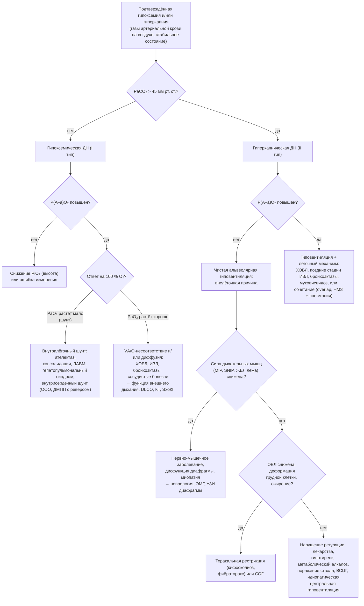

### 2.13. Дифференциальная диагностика и формулировка диагноза

Собранные в главах 2.10–2.12 данные нужно превратить в диагноз, который объясняет состояние пациента и определяет лечение. Это требует ответа на несколько дифференциально-диагностических вопросов: действительно ли перед нами дыхательная недостаточность (а не имитирующее её состояние или ошибка измерения), хроническая ли она, лёгочного или внелёгочного происхождения, какова её причина (или причины), какие из них обратимы. В конце главы мы сформулируем диагнозы наших учебных пациентов по единой схеме.

#### 2.13.1. Принципы и общий алгоритм

##### 2.13.1.1. Три последовательных вопроса

Первый вопрос — **есть ли нарушение газообмена и достоверно ли оно измерено**: гипоксемия и гиперкапния должны быть подтверждены артериальной газометрией в известных условиях (FiO₂, стабильность, преаналитика). Второй — **хроническое ли это состояние**: ответ дают анамнез, «привычные» значения газов, признаки компенсации (бикарбонат, эритроцитоз, лёгочное сердце) и клиническая стабильность (п. 2.13.2). Третий — **каков механизм и уровень поражения**: альвеолярно-артериальный градиент разделяет внелёгочную гиповентиляцию и лёгочные механизмы, а функциональные, лучевые и специальные методы указывают на конкретное звено (глава 2.5, табл. 16). Только после этого ставится вопрос о причине в нозологических терминах и о сопутствующих состояниях.

##### 2.13.1.2. Алгоритм по альвеолярно-артериальному градиенту

**Рис. 13.** Алгоритм дифференциальной диагностики ХДН по типу нарушения газообмена и альвеолярно-артериальному градиенту. Схема читается сверху вниз.

Важная оговорка: градиент «нормальный» или «повышенный» — непрерывная величина с погрешностью, и у пациента с длительной гиповентиляцией нередко присоединяются микроателектазы и V̇A/Q̇-нарушения, умеренно повышающие градиент. Поэтому алгоритм даёт направление поиска, а не окончательный вердикт: умеренно повышенный градиент при явной слабости дыхательных мышц не отменяет нервно-мышечного диагноза.

#### 2.13.2. Острая, хроническая и острая на фоне хронической ДН

Разграничение описано в п. 2.3.1 (табл. 5); здесь — практические ключи. В пользу хронического процесса: анамнез прогрессирующей одышки и известного заболевания; предшествующие газометрии с гиперкапнией; бикарбонат, соответствующий хронической компенсации (прирост около 3,5–4 ммоль/л на каждые 10 мм рт. ст. PaCO₂), и pH, близкий к норме; эритроцитоз; признаки лёгочного сердца; изменения концевых фаланг; ночные симптомы. В пользу острого ухудшения на фоне хронического: быстрое (часы — дни) нарастание одышки, появление спутанности или сонливости, pH < 7,35 при бикарбонате, превышающем ожидаемый для острого процесса, но не достигающем ожидаемого для хронического (промежуточное положение), триггер (инфекция, лекарство, ТЭЛА, пневмоторакс, сердечная недостаточность). Чисто острая ДН у ранее здорового: нормальный бикарбонат, отсутствие компенсаторных признаков, очевидная причина. Ошибка в любую сторону опасна: принять хроническую компенсированную гиперкапнию за острую — значит необоснованно интубировать или «нормализовать» CO₂ с развитием алкалоза; принять острое ухудшение за «привычное состояние» — значит пропустить момент для НИВЛ.

#### 2.13.3. Сердечная недостаточность и дыхательная недостаточность

Сердечная и лёгочная причины одышки сосуществуют у значительной части пациентов с ХДН, и вопрос чаще звучит не «что из двух», а «сколько каждого». Признаки, смещающие баланс в пользу сердечной причины: ортопноэ с быстрым развитием (при ДН ортопноэ тоже бывает — п. 2.7.4, но при левожелудочковой недостаточности оно сопровождается пароксизмальной ночной одышкой), влажные хрипы в базальных отделах, третий тон, повышение NT-proBNP (с поправкой на возраст, почки, ФП; значения < 125 пг/мл в стабильном состоянии и < 300 пг/мл при остром ухудшении делают сердечную недостаточность маловероятной), систолическая или диастолическая дисфункция и повышение давления наполнения левого желудочка по ЭхоКГ, B-линии при УЗИ лёгких, венозный застой и интерстициальный отёк на рентгенограмме, быстрый ответ на диуретики. В пользу лёгочной причины: обструкция или рестрикция по функции внешнего дыхания, низкая DLCO с сохранённой функцией левых отделов, повышение P(A–a)O₂ при нормальном давлении заклинивания, десатурация при нагрузке с исчерпанием дыхательного резерва при КПНТ (сердечная причина — низкий пульс кислорода, ранний анаэробный порог при сохранённом дыхательном резерве). Особые ситуации: сердечная недостаточность с сохранённой фракцией выброса у пациента с ХОБЛ — частая и трудная для диагностики (нормальная фракция выброса не исключает сердечную причину); дыхание Чейна — Стокса ночью указывает на сердечную недостаточность; у пациента с лёгочным сердцем отёки и застой — следствие правожелудочковой недостаточности, и диуретики требуют осторожности (п. 2.8.7). Катетеризация с измерением давления заклинивания (в покое и при нагрузке или объёмной пробе) разрешает неясные случаи.

#### 2.13.4. Дифференциальная диагностика обструктивных заболеваний

ХОБЛ, бронхиальная астма, бронхоэктазы, облитерирующий бронхиолит и муковисцидоз дают обструктивный паттерн, но различаются по анамнезу (курение и экспозиции; атопия и вариабельность симптомов; хронический гнойный кашель; трансплантация или ингаляционные повреждения; раннее начало с панкреатической недостаточностью), обратимости обструкции и эозинофилии (астма), DLCO (при астме сохранена, при эмфиземе снижена), КТ (эмфизема; расширение бронхов; мозаичность и ловушки при бронхиолите), потовой пробе и генетике. Для ХДН различение значимо: при астме с ХДН акцент на противовоспалительной терапии и исключении ошибочного диагноза; при бронхоэктазах — на клиренсе и микробиологии; при дефиците альфа-1-антитрипсина — на заместительной терапии и семейном скрининге. Обструкция верхних дыхательных путей (стеноз трахеи после интубации, опухоль, паралич голосовых складок, трахеомаляция) маскируется под «тяжёлую ХОБЛ» или «астму», но выдаёт себя плато на инспираторной и экспираторной частях кривой поток — объём (рис. 10, Г), стридором и непропорционально низкой пиковой скоростью выдоха при относительно сохранном ОФВ₁.

#### 2.13.5. Дифференциальная диагностика рестриктивных состояний

Рестрикция (снижение ОЕЛ) разделяется на лёгочную и внелёгочную по KCO и клиническим данным (п. 2.11.1.4). Лёгочная рестрикция — ИЗЛ: дальнейшая дифференциация по КТ-паттерну, анамнезу экспозиций и лекарств, аутоиммунным маркёрам, лаважу и биопсии на мультидисциплинарном консилиуме; значимость — в наличии специфической терапии (антифибротики при ИЛФ и прогрессирующем фиброзе, иммуносупрессия при воспалительных ИЗЛ, элиминация антигена при гиперчувствительном пневмоните). Внелёгочная рестрикция — деформации грудной клетки, плевральные процессы (фиброторакс, выпот), ожирение, нервно-мышечная слабость, состояние после резекции лёгкого; разделяются осмотром, рентгенографией, тестами дыхательных мышц, ЖЕЛ лёжа. Ловушка — сочетание: пациент с кифосколиозом и фиброзом нижней доли после туберкулёза, пациент с миопатией и аспирационным поражением лёгких.

#### 2.13.6. Гиперкапния при нормальной функции лёгких: «не может» или «не дышит»

Гиперкапния у пациента без значимого заболевания лёгких ставит вопрос: насос слаб (не может), механика невыгодна (ожирение, деформация) или регуляция нарушена (не дышит, хотя может)? Табл. 18 суммирует ключи. Практический приём — проба с произвольной гипервентиляцией: пациент с центральной гиповентиляцией или СОГ способен по команде нормализовать PaCO₂ (или EtCO₂) за 1–2 минуты, пациент с выраженной слабостью мышц или тяжёлой рестрикцией — нет.

**Табл. 18.** Дифференциальная диагностика хронической гиперкапнии при нормальной или почти нормальной спирометрии

| Признак | Нервно-мышечное заболевание | Синдром ожирения-гиповентиляции | Центральная гиповентиляция (ВСЦГ, поражение ствола, идиопатическая) | Лекарственная / метаболическая гиповентиляция |
|---|---|---|---|---|
| Анамнез | Прогрессирующая слабость, дисфагия, фасцикуляции, семейный анамнез | ИМТ ≥ 30 кг/м², храп, сонливость | С рождения (ВСЦГ) или после инсульта, травмы, энцефалита, операции; одышки нет | Опиоиды, бензодиазепины, алкоголь; гипотиреоз; диуретики (алкалоз) |
| ЖЕЛ, ОЕЛ | ↓, ЖЕЛ лёжа ↓ > 20 % | N или умеренно ↓, РОвыд ↓↓ | N | N |
| MIP, MEP, SNIP | ↓ | N или умеренно ↓ | N | N (при гипотиреозе — умеренно ↓) |
| Произвольная гипервентиляция | Не нормализует PaCO₂ | Нормализует | Нормализует | Нормализует |
| Вентиляционный ответ на CO₂ | N или ↓ (вторично) | ↓ | ↓↓ или отсутствует | ↓ |
| Сон | REM-гиповентиляция; ИАГ обычно < 15 | Тяжёлое ОАС у ~70 % + гиповентиляция | Гиповентиляция в NREM больше, чем в REM (ВСЦГ); нет апноэ | Центральные апноэ, атактическое дыхание (опиоиды) |
| Дополнительно | ЭМГ, УЗИ диафрагмы, КФК, генетика | Бикарбонат ≥ 27 ммоль/л, лептин ↑ | Ген *PHOX2B*; МРТ ствола; отсутствие ощущения одышки при нагрузке | ТТГ ↑; уровень препаратов; HCO₃⁻, Cl⁻ |
| Лечение | НИВЛ, поддержка кашля | CPAP / НИВЛ + снижение массы тела | НИВЛ/ИВЛ (особенно во сне), стимуляция диафрагмы | Отмена препарата; левотироксин; коррекция алкалоза |

#### 2.13.7. Тахипноэ и гипервентиляция без дыхательной недостаточности

Учащённое и глубокое дыхание не равно дыхательной недостаточности, а гипокапния — её противоположность. Состояния, при которых пациент «задыхается» с нормальным или высоким PaO₂ и низким PaCO₂: метаболический ацидоз любой природы (диабетический кетоацидоз, лактат-ацидоз, уремия, отравления — дыхание Куссмауля — профиль 6 в табл. 15); сепсис и лихорадка; ТЭЛА (гипокапния с гипоксемией и повышенным градиентом); анемия; тиреотоксикоз; беременность (прогестерон); печёночная недостаточность; салицилаты (респираторный алкалоз + метаболический ацидоз); боль, тревога и паническое расстройство; **гипервентиляционный синдром** и дисфункциональное дыхание (диагноз исключения: эпизодическая одышка с невозможностью «вдохнуть полностью», вздохи, парестезии, головокружение, тетания при гипокапнии; нормальная функция лёгких и газообмен при нагрузке; положительный опросник Наймегена). Клиническая задача — не пропустить органическую причину (ТЭЛА и ацидоз прежде всего) и не назначить кислород или седативные там, где нужны инсулин, антикоагулянт или психотерапия. У пациента с ХДН тахипноэ при обострении, напротив, может сочетаться с нарастающей гиперкапнией — признак того, что частое дыхание неэффективно (мёртвое пространство) и наступает утомление.

#### 2.13.8. Гипоксемия при нормальной функции лёгких: шунты и сосудистые причины

Гипоксемия с нормальной спирометрией, нормальными объёмами и снижением DLCO или без него требует исключить: сосудистые заболевания лёгких (ЛАГ, ХТЭЛГ — изолированное снижение DLCO, ЭхоКГ, V/Q-сцинтиграфия); внутрилёгочные шунты — лёгочные артериовенозные мальформации (наследственная геморрагическая телеангиэктазия; КТ, контрастная ЭхоКГ с пузырьками: появление пузырьков в левых отделах через 3–8 сердечных циклов) и **гепатопульмональный синдром** при циррозе (дилатация внутрилёгочных сосудов, ортодеоксия — падение PaO₂ в положении стоя, контрастная ЭхоКГ); внутрисердечные шунты справа налево — открытое овальное окно с право-левым сбросом (при ЛГ, после пневмонэктомии, при параличе диафрагмы — **синдром платипноэ-ортодеоксии**), дефекты перегородок с реверсом (синдром Эйзенменгера); гипоксемию при низком сердечном выбросе с резким снижением сатурации смешанной венозной крови. Ключ — проба с 100 % кислородом: при анатомическом шунте PaO₂ растёт незначительно (п. 2.1.8.3).

#### 2.13.9. Псевдодыхательная недостаточность: ошибки измерения и дисгемоглобинемии

Прежде чем ставить диагноз, нужно исключить артефакты: венозная кровь вместо артериальной (низкий PaO₂ с высоким PaCO₂ у пациента без одышки — сопоставить с SpO₂); пузырьки воздуха и задержка анализа; лейкоцитарная ложная гипоксемия при гиперлейкоцитозе; пункция во время гипервентиляции от боли (низкий PaCO₂); забор у пациента, только что снявшего кислород или, наоборот, только что начавшего его дышать; ошибки пульсоксиметрии (п. 2.10.6.3) — низкая SpO₂ при нормальном PaO₂ при метгемоглобинемии (измерить кооксиметрией; причина — дапсон, местные анестетики, нитраты, врождённая), нормальная SpO₂ при отравлении CO (карбоксигемоглобин), ложная десатурация при плохой перфузии, лаке, движении. Отдельная категория — лабораторные нормы на высоте: в высокогорных городах «низкий» PaO₂ нормален для местной популяции, и диагноз ДН требует местных должных значений.

#### 2.13.10. Лёгочная гипертензия: 3-я группа или другая?

У пациента с заболеванием лёгких и ЛГ нужно решить, объясняется ли ЛГ лёгочным заболеванием (3-я группа) или имеется другая причина, требующая иного лечения: левожелудочковая патология (2-я группа — повышенное давление заклинивания; самая частая сопутствующая причина у пожилых); ХТЭЛГ (4-я группа — V/Q-сцинтиграфия; излечима хирургически); ЛАГ (1-я группа — при лёгком заболевании лёгких и тяжёлой ЛГ, особенно при системных заболеваниях соединительной ткани, портальной гипертензии, ВИЧ, приёме анорексигенов, наследственности); 5-я группа (саркоидоз, гистиоцитоз, гемолитические анемии, миелопролиферативные заболевания). Критерии несоразмерности (п. 2.8.5) — лёгкое или умеренное нарушение функции лёгких (ОФВ₁ > 60 %, ФЖЕЛ > 70 % должного) при тяжёлой ЛГ (ЛСС > 5 ед. Вуда), DLCO, непропорционально низкая по отношению к объёмам, выраженная десатурация при нагрузке при умеренном лёгочном поражении — показание к экспертной оценке (рис. 11).

#### 2.13.11. Одышка при нормальных газах крови

У части пациентов с установленным заболеванием лёгких одышка несоразмерна функциональным нарушениям, а газы крови нормальны. Причины: детренированность и периферическая миопатия (самая частая; КПНТ показывает ранний анаэробный порог при сохранённом дыхательном резерве; лечится реабилитацией); ожирение; анемия; сердечная причина; динамическая гиперинфляция при нормальных газах (одышка через механику, а не через газообмен — ответ на бронхолитики); дисфункциональное дыхание; тревога и депрессия (п. 2.9.6); ЛГ ранних стадий; латентная ДН, проявляющаяся только при нагрузке или во сне. Нормальные газы покоя у симптомного пациента — показание к нагрузочному тесту и ночному мониторингу, а не повод закрыть вопрос.

#### 2.13.12. Причины ночной гипоксемии

Ночная десатурация у пациента с ХДН имеет три главных дифференциальных варианта — гиповентиляция (устойчивое снижение SpO₂ с ростом tcPCO₂, особенно в REM), апноэ (циклические десатурации с быстрым восстановлением, храп, дыхательные усилия при обструктивных событиях) и «простое» углубление дневной гипоксемии (умеренное плавное снижение без апноэ и значимого роста CO₂ у пациента на крутой части кривой диссоциации), а также их сочетания; добавочные причины — ортопноэ при сердечной недостаточности (дыхание Чейна — Стокса), лекарства, алкоголь, положение тела. Разграничение — по данным полиграфии с капнометрией (глава 2.12); от него зависит выбор между кислородом, CPAP и НИВЛ.

#### 2.13.13. Обратимые и усугубляющие факторы

Независимо от основного диагноза при каждой оценке пациента с ХДН следует искать потенциально обратимые факторы, усугубляющие ДН: нелеченное или недолеченное основное заболевание (неадекватная ингаляционная терапия, техника ингаляции), текущее курение, инфекция, сердечная недостаточность и аритмии, ТЭЛА, анемия, ожирение, гипотиреоз, метаболический алкалоз и электролитные нарушения, седативные и опиоиды, неселективные бета-блокаторы, гастроэзофагеальный рефлюкс и аспирация, плевральный выпот, апноэ сна, плохая приверженность кислороду или НИВЛ, недостаточность питания и саркопения, депрессия. Их коррекция нередко улучшает газообмен больше, чем любое «специфическое» вмешательство, и должна предшествовать решениям о долгосрочной респираторной поддержке (п. 2.15.3).

#### 2.13.14. Многофакторная дыхательная недостаточность

📌 **Определение:** **многофакторная (мультифакторная) ХДН** — дыхательная недостаточность, обусловленная сочетанием двух и более причин, каждая из которых в отдельности недостаточна для её развития или объясняет лишь часть тяжести.

Это не редкий, а, у пожилых пациентов, типичный вариант. Распознать его помогает принцип несоответствия: тяжесть ДН не объясняется ведущим диагнозом (ОФВ₁ 55 %, но PaCO₂ 58 мм рт. ст.; ЖЕЛ 70 %, но ночная гиповентиляция). Подход — «инвентаризация» компонентов с оценкой вклада каждого и его обратимости: обструкция (ОФВ₁, гиперинфляция) + ожирение и апноэ (ИМТ, полиграфия) + слабость мышц (MIP, ЖЕЛ лёжа) + сердечная недостаточность (NT-proBNP, ЭхоКГ) + лекарства + метаболический алкалоз. Тактика складывается из воздействий на каждый компонент: бронхолитики и реабилитация, положительное давление с учётом апноэ, нутритивная и тренировочная поддержка мышц, лечение сердечной недостаточности, отмена седативных, коррекция алкалоза. Формулировка диагноза должна отражать многофакторность, иначе каждый специалист будет лечить «своё» заболевание, а ДН останется без объяснения (п. 2.25.16).

#### 2.13.15. Формулировка клинического диагноза

##### 2.13.15.1. Принципы

В отечественной традиции ХДН в диагнозе — осложнение основного заболевания; формулировка строится по схеме: основное заболевание (с его формой, стадией, тяжестью, фенотипом) → осложнения, среди которых ХДН с указанием течения, типа (с ведущим механизмом при необходимости), степени, компенсации и условий проявления (ночная, при нагрузке), затем лёгочная гипертензия и хроническое лёгочное сердце с функциональным классом и стадией сердечной недостаточности, другие осложнения (эритроцитоз, энцефалопатия) → сопутствующие заболевания; при многофакторной ДН все причины указываются как основные (конкурирующие или сочетанные), а ДН — как общее осложнение. Указывается проводимая респираторная поддержка (длительная кислородотерапия с потоком и временем, НИВЛ с режимом и параметрами, трахеостома), поскольку она определяет статус пациента. Кодирование по МКБ-10: J96.1 — хроническая респираторная недостаточность (в обновлённых версиях МКБ-10 ВОЗ предусмотрены пятые знаки для типа: J96.10 — I тип, J96.11 — II тип, J96.19 — неуточнённый; [⚠️ Требуется верификация: применимость этих подрубрик в конкретной национальной версии МКБ-10]), J96.2 — острая на фоне хронической; I27.8/I27.9 — другие уточнённые/неуточнённые формы лёгочно-сердечной недостаточности (хроническое лёгочное сердце), I27.2 — другая вторичная лёгочная гипертензия; Z99.1 — зависимость от респиратора, Z99.8 — зависимость от других вспомогательных средств (кислород); Z93.0 — наличие трахеостомы. В статистике смертности причиной смерти кодируется основное заболевание, а не ДН (п. 2.4.1).

##### 2.13.15.2. Примеры формулировок

**Пример 1.** Хроническая обструктивная болезнь лёгких, тяжёлое течение (GOLD 4, группа E), эмфизематозный фенотип, частые обострения (3 за год, 1 госпитализация), вне обострения. Осложнения: хроническая дыхательная недостаточность, смешанная (гипоксемическая и гиперкапническая, II тип), II степени, компенсированная (PaO₂ 54 мм рт. ст., PaCO₂ 52 мм рт. ст., pH 7,38), с десатурацией при нагрузке; лёгочная гипертензия 3-й группы, вероятная по ЭхоКГ (расчётное СДЛА около 50 мм рт. ст.), хроническое лёгочное сердце, компенсированное, ФК III (ВОЗ); вторичный эритроцитоз (гематокрит 53 %). Длительная кислородотерапия 2 л/мин в покое, 3 л/мин при нагрузке, ≥ 15 ч/сут (с указанием даты начала). Сопутствующие: ишемическая болезнь сердца, стенокардия напряжения II ФК; артериальная гипертензия 2-й степени, риск 4; остеопороз. Через год (п. 2.8.8) — тот же основной диагноз с осложнением: «острая дыхательная недостаточность на фоне хронической, гиперкапническая, декомпенсированный респираторный ацидоз (pH 7,28, PaCO₂ 68 мм рт. ст.), гиперкапническая энцефалопатия I–II стадии; декомпенсация хронического лёгочного сердца, ФК IV, с застойной сердечной недостаточностью (отёки, гепатомегалия); пароксизм фибрилляции предсердий; вторичный эритроцитоз (гематокрит 60 %)» и указанием на низкую приверженность кислородотерапии.

**Пример 2.** Идиопатический правосторонний грудной кифосколиоз IV степени (угол Кобба 110°). Осложнения: хроническая дыхательная недостаточность, гиперкапническая (II тип), внелёгочная (торакально-диафрагмальная), I степени по гипоксемии (PaO₂ 62 мм рт. ст., PaCO₂ 55 мм рт. ст.), компенсированная, с гиповентиляцией во сне (tcPCO₂ до 68 мм рт. ст. в REM). Начало длительной неинвазивной вентиляции (режим, давления, частота — п. 2.19.5) с датой. Лёгочная гипертензия не выявлена (ЭхоКГ: низкая вероятность).

**Пациентка В.** Идиопатический лёгочный фиброз (паттерн обычной интерстициальной пневмонии по КТ), прогрессирующее течение, антифибротическая терапия (препарат, доза). Осложнения: хроническая дыхательная недостаточность, гипоксемическая (I тип), лёгочная (паренхиматозная), II степени (PaO₂ 54 мм рт. ст., PaCO₂ 34 мм рт. ст.), с выраженной десатурацией при нагрузке (SpO₂ 93 → 81 %); длительная кислородотерапия (параметры). Лёгочная гипертензия — требует оценки.

**Пациент Г.** Ожирение III степени (ИМТ 48 кг/м²). Синдром ожирения-гиповентиляции с тяжёлым синдромом обструктивного апноэ сна (ИАГ 48 в час) и гиповентиляцией во сне. Осложнения: хроническая дыхательная недостаточность, гиперкапническая (II тип), внелёгочная, I степени (PaO₂ 58 мм рт. ст., PaCO₂ 56 мм рт. ст.), компенсированная; вторичный эритроцитоз (гемоглобин 185 г/л); хроническое лёгочное сердце (при подтверждении). CPAP-терапия (давление) с датой начала. Сопутствующие: артериальная гипертензия, сахарный диабет 2-го типа.

Такой диагноз сразу сообщает любому врачу тип и тяжесть нарушения газообмена, его механизм, компенсацию, осложнения и зависимость пациента от респираторной поддержки — всё, что нужно для безопасного ведения, включая целевую сатурацию при кислородотерапии и настороженность в отношении седативных препаратов.

🔬 **Углубление: несоразмерность как диагностический сигнал.** Самый продуктивный дифференциально-диагностический приём при ХДН — поиск несоответствий между уровнями описания: функцией и газами, газами и симптомами, днём и ночью, объёмами и диффузией, лёгочным заболеванием и ЛГ. Гиперкапния при ОФВ₁ > 50 % должного при ХОБЛ встречается редко и должна заставить искать второй механизм (ожирение, апноэ, слабость мышц, седативные, алкалоз). DLCO, сниженная сильнее объёмов, — сигнал эмфиземы, сосудистого компонента или CPFE. Тяжёлая одышка при нормальных газах и функции — сигнал детренированности, сердечной причины или дисфункционального дыхания. Выраженная ЛГ при умеренном лёгочном заболевании — сигнал ХТЭЛГ, ЛАГ или левожелудочковой патологии. Нормальный pH при PaCO₂ 70 мм рт. ст. у сонливого пациента — сигнал сопутствующего метаболического алкалоза. Привычка формулировать «что здесь не сходится» защищает от главной ошибки в этой области — остановиться на первом объяснении.

❗ **Типичная ошибка:** объяснять всю тяжесть ДН первым установленным диагнозом. Пациент с ХОБЛ и ОФВ₁ 60 %, ИМТ 38 кг/м², храпом и PaCO₂ 60 мм рт. ст. получает диагноз «ХОБЛ с хронической дыхательной недостаточностью» и ингаляторы, тогда как его гиперкапния обусловлена главным образом СОГ и апноэ и требует положительного давления. Несоразмерность между степенью обструкции и степенью гиперкапнии — обязательный повод к поиску второго механизма.

💡 **Интересный факт:** термин «синдром платипноэ-ортодеоксии» описывает парадоксальную одышку и десатурацию в вертикальном положении, облегчающиеся лёжа, — противоположность ортопноэ. Он впервые был описан в 1949 году у пациента после пневмонэктомии и объясняется тем, что в вертикальном положении поток из нижней полой вены направляется через открытое овальное окно в левое предсердие. Диагноз ставится контрастной эхокардиографией в положении сидя, а закрытие окна устраняет гипоксемию — один из немногих примеров полностью излечимой «дыхательной недостаточности» с нормальными лёгкими.

📝 **Обобщение**

- Дифференциальная диагностика ХДН отвечает последовательно на три вопроса: достоверно ли нарушение газообмена, хроническое ли оно, каков механизм и уровень поражения; альвеолярно-артериальный градиент разделяет внелёгочную гиповентиляцию и лёгочные механизмы (рис. 13).
- Острое ухудшение на фоне хронического распознаётся по темпу, pH и «промежуточному» бикарбонату; сердечная и лёгочная причины одышки чаще сосуществуют, и задача — оценить вклад каждой (NT-proBNP, ЭхоКГ, КПНТ, при необходимости катетеризация).
- Гиперкапния при нормальной спирометрии требует разграничения слабости насоса, невыгодной механики (ожирение, деформация) и нарушения регуляции (табл. 18); проба с произвольной гипервентиляцией — простой ключ.
- Тахипноэ с гипокапнией (ацидоз, сепсис, ТЭЛА, гипервентиляционный синдром), гипоксемия при нормальных лёгких (шунты, сосудистые болезни), артефакты измерения и дисгемоглобинемии — состояния, имитирующие или маскирующие ДН.
- Многофакторная ХДН — типичный вариант у пожилых; распознаётся по несоразмерности тяжести ДН ведущему диагнозу и требует «инвентаризации» компонентов; диагноз формулируется как осложнение основного заболевания с указанием течения, типа, механизма, степени, компенсации, условий проявления, осложнений и проводимой респираторной поддержки.

Главный вывод: правильно сформулированный диагноз ХДН — это краткая запись патофизиологического анализа, из которой вытекает тактика; его невозможно построить без ответа на вопрос «что здесь не сходится». Следующая глава переводит диагноз в оценку тяжести и прогноза.

❓ **Контрольные вопросы**

1. Изложите алгоритм дифференциальной диагностики ХДН по типу нарушения газообмена и альвеолярно-артериальному градиенту; почему умеренно повышенный градиент не исключает нервно-мышечную причину?
2. Какие признаки позволяют разграничить сердечную и лёгочную одышку у пациента с ХОБЛ и какие исследования разрешают неясные случаи?
3. Пациент 45 лет без заболеваний лёгких, PaCO₂ 58 мм рт. ст., спирометрия нормальна. Какие три группы причин вы рассмотрите, какие тесты их разграничат и как поможет проба с произвольной гипервентиляцией?
4. Перечислите состояния, имитирующие дыхательную недостаточность по данным пульсоксиметрии или газометрии, и способы их исключения.
5. Сформулируйте полный клинический диагноз для пациента: ХОБЛ, ОФВ₁ 45 %, ИМТ 39 кг/м², ИАГ 32 в час, PaO₂ 55, PaCO₂ 60 мм рт. ст., pH 7,37, HCO₃⁻ 34 ммоль/л, СДЛА по ЭхоКГ 48 мм рт. ст., гематокрит 56 %; отразите многофакторность и предполагаемую респираторную поддержку.
