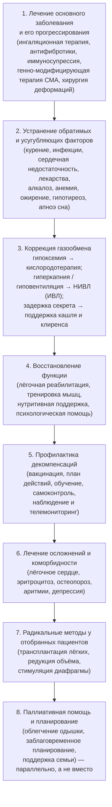

### 2.15. Общая стратегия лечения

Лечение ХДН — это не одно вмешательство, а долгосрочная программа, которая складывается из воздействия на причину, устранения усугубляющих факторов, коррекции газообмена, восстановления функции, профилактики декомпенсаций и — в конечном счёте — поддержки в терминальной фазе. Эта глава задаёт общую рамку, в которую укладываются конкретные методы следующих глав: как ставить цели, в каком порядке действовать, как выбирать между кислородом и вентиляцией, кто и как ведёт пациента.

#### 2.15.1. Цели лечения

Цели лечения ХДН нужно формулировать явно, потому что они не совпадают при разных заболеваниях и на разных стадиях и потому что от них зависит выбор методов:

- **увеличение продолжительности жизни** — доказано для ограниченного числа вмешательств (п. 2.15.9);
- **уменьшение симптомов**, прежде всего одышки, нарушений сна, утренних головных болей, утомляемости;
- **сохранение и восстановление функции** — переносимости нагрузок, самостоятельности, участия в жизни семьи и общества, работы;
- **улучшение качества жизни** — интегральный показатель, который пациент оценивает сам;
- **предотвращение декомпенсаций и госпитализаций** — цель, значимая и для пациента, и для системы;
- **замедление прогрессирования** основного заболевания и осложнений (ЛГ, лёгочного сердца, саркопении);
- **безопасность** — предотвращение ятрогенных осложнений;
- **соответствие предпочтениям пациента** — цели формулируются вместе с пациентом, и для одного главным будет продление жизни любой ценой, для другого — отсутствие одышки и пребывание дома.

Для пациента с ХОБЛ и тяжёлой гипоксемией на первом месте стоят выживаемость (кислородотерапия) и предотвращение обострений; для пациента с БАС — качество жизни, облегчение одышки и сохранение общения; для ребёнка со СМА — рост и развитие, профилактика деформаций и инфекций; для пациента с кифосколиозом — полное восстановление вентиляции с возвращением к работе. Один и тот же метод (НИВЛ) служит разным целям, и его параметры, режим применения и критерии успеха различаются.

#### 2.15.2. Иерархия вмешательств

**Рис. 15.** Иерархия вмешательств при ХДН. Нумерация отражает логический порядок рассмотрения, а не очерёдность во времени: на практике уровни применяются одновременно, а паллиативный компонент сопровождает все остальные.

Логика иерархии: вмешательства более высоких уровней (кислород, вентиляция) эффективны и безопасны только при условии выполнения нижних (оптимальная терапия заболевания, устранение обратимых факторов); пропуск нижних уровней — самая частая причина «неэффективности» респираторной поддержки.

#### 2.15.3. Устранение обратимых и усугубляющих факторов

Перед любым решением о долгосрочной респираторной поддержке и при каждом ухудшении следует пройти по перечню потенциально обратимых факторов (п. 2.13.13), поскольку их коррекция может изменить показания: пациент с ХОБЛ и гиперкапнией на фоне бензодиазепина и фуросемид-индуцированного алкалоза после их отмены может оказаться нормокапничным; пациент с ожирением и апноэ — не нуждаться в НИВЛ после CPAP; пациент с некорригированным гипотиреозом — восстановить драйв на левотироксине. Перечень для проверки: статус курения и воздействий; адекватность и техника базисной терапии; активная инфекция или колонизация; сердечная недостаточность, ишемия, аритмии; ТЭЛА; анемия или, напротив, выраженный эритроцитоз; ожирение и апноэ сна; гипотиреоз; электролитные нарушения и метаболический алкалоз; препараты, угнетающие дыхание, и бета-блокаторы; гастроэзофагеальный рефлюкс и аспирация; плевральный выпот, пневмоторакс; боль и ограничение подвижности; недостаточность питания; депрессия и тревога; приверженность и доступность уже назначенных вмешательств (пациент «не отвечает на кислород», которым пользуется 4 часа в сутки). Коррекция этих факторов — не альтернатива респираторной поддержке, а её предпосылка; при декомпенсации она ведётся параллельно с поддержкой.

#### 2.15.4. Мишени лечения: гипоксемия, гиперкапния, одышка, прогноз

Четыре мишени требуют разных инструментов, и важно понимать, на что именно направлено каждое назначение:

- **гипоксемия** корригируется кислородом (если она обусловлена V̇A/Q̇-несоответствием, диффузией, гиповентиляцией) или вентиляцией (если обусловлена гиповентиляцией — тогда кислород без вентиляции опасен); при шунте кислород малоэффективен; цель — SpO₂ ≥ 90 % (88–92 % при риске гиперкапнии), а не 100 %;
- **гиперкапния и гиповентиляция** корригируются только увеличением альвеолярной вентиляции — вентиляционной поддержкой, устранением угнетающих факторов, снижением нагрузки (бронхолитики, снижение массы тела), в ограниченной степени — дыхательными стимуляторами; кислород гиперкапнию не лечит;
- **одышка** — многофакторный симптом; её уменьшают бронхолитики (гиперинфляция), реабилитация (эффективность мышц, десенситизация), кислород (у гипоксемичных; у негипоксемичных эффект не превосходит поток воздуха — п. 3.9), НИВЛ (разгрузка мышц), опиоиды в низких дозах (паллиативно), вентилятор-направленный поток воздуха на лицо, техники дыхания, лечение тревоги;
- **прогноз** — улучшается вмешательствами с доказанным влиянием на выживаемость (п. 2.15.9), и это не всегда те же вмешательства, что улучшают симптомы.

Правило: лечить пациента, а не число. Нормализация SpO₂ до 98 % у пациента с гиперкапнией вредна; снижение PaCO₂ до 40 мм рт. ст. у пациента с привычными 55 мм рт. ст. вызовет алкалоз; «идеальная» спирометрия не нужна, если пациент не может пройти 100 м из-за слабости мышц.

#### 2.15.5. Выбор вида респираторной поддержки

Выбор между кислородотерапией, НИВЛ, их сочетанием и инвазивной вентиляцией определяется типом ДН и его механизмом (табл. 22), а также прогнозом, предпочтениями пациента и доступностью. Общее правило: при гипоксемической ДН с сохранённой вентиляцией — кислород; при гиперкапнической ДН вследствие насосной недостаточности — вентиляция (кислород добавляется при сохраняющейся гипоксемии на фоне адекватной вентиляции); при гиперкапнической ДН при ХОБЛ — кислород при тяжёлой гипоксемии плюс НИВЛ при персистирующей выраженной гиперкапнии; при невозможности НИВЛ (бульбарные нарушения, зависимость от вентилятора более 16–20 часов в сутки, неэффективность кашля, несмотря на поддержку) — трахеостомическая вентиляция, если она соответствует целям пациента.

**Табл. 22.** Соответствие проблем, вмешательств и целей при ХДН (с указанием уровня доказательности влияния на ключевые исходы)

| Проблема | Основное вмешательство | Цель и критерий успеха | Доказательность по исходам |
|---|---|---|---|
| Тяжёлая хроническая гипоксемия (PaO₂ ≤ 55 мм рт. ст. или 56–59 с осложнениями) при ХОБЛ | Длительная кислородотерапия ≥ 15 ч/сут | PaO₂ ≥ 60 мм рт. ст. / SpO₂ ≥ 90 % без роста PaCO₂ | Снижение смертности — РКИ (NOTT 1980, MRC 1981) |
| Умеренная гипоксемия в покое или изолированная при нагрузке/ночью при ХОБЛ | Кислородотерапия | Симптомы, переносимость нагрузки | Не влияет на смертность и госпитализации — РКИ (LOTT 2016, INOX 2020) |
| Персистирующая гиперкапния (PaCO₂ ≥ 52 мм рт. ст.) после обострения ХОБЛ или стабильная ≥ 52–55 | Домашняя НИВЛ (высокоинтенсивная) + кислород | Снижение PaCO₂, уменьшение повторных госпитализаций | Снижение смертности и повторных госпитализаций — РКИ (Köhnlein 2014, HOT-HMV 2017); рекомендации ERS 2019, ATS 2020 |
| Гиповентиляция при НМЗ и торакальных заболеваниях (дневная гиперкапния или ночная гиповентиляция с симптомами) | Домашняя НИВЛ | Нормализация ночного и дневного PaCO₂, устранение симптомов | Продление жизни и улучшение качества жизни — РКИ при БАС (Bourke 2006), когорты при Дюшенне, кифосколиозе; РКИ Ward 2005 (предотвращение дневной ДН) |
| СОГ | CPAP (при тяжёлом ОАС) или НИВЛ; снижение массы тела | PaCO₂ < 45 мм рт. ст., устранение апноэ и десатураций | Улучшение газообмена, симптомов — РКИ (Pickwick); смертность — наблюдательные данные; ATS 2019 |
| Неэффективный кашель (PCF < 270 л/мин) | Мануальная/механическая поддержка кашля, air stacking | PCF с поддержкой > 270 л/мин; меньше инфекций и госпитализаций | Когорты и небольшие РКИ; консенсусы (CHEST 2023, ENMC) |
| Одышка, детренированность, слабость мышц | Лёгочная реабилитация | Увеличение 6MWT ≥ 30 м, снижение CAT ≥ 2, mMRC | Снижение госпитализаций и улучшение качества жизни — многочисленные РКИ; смертность — после обострений (наблюдательные данные) |
| Обострения и декомпенсации | Оптимальная ингаляционная терапия, вакцинация, план действий, самоменеджмент | Снижение частоты обострений и госпитализаций | РКИ (ингаляционная терапия, вакцины, программы самоменеджмента с планом действий) |
| Тяжёлая эмфизема верхних долей с низкой переносимостью нагрузки | Хирургическая или эндоскопическая редукция объёма | Увеличение ОФВ₁, 6MWT, качества жизни | РКИ (NETT 2003; клапаны — LIBERATE 2018 и др.); выживаемость — в подгруппе NETT |
| Терминальная стадия ХОБЛ, ИЛФ, муковисцидоза у отобранных пациентов | Трансплантация лёгких | Выживаемость, качество жизни | Регистры ISHLT; выживаемость улучшается при ИЛФ и муковисцидозе, при ХОБЛ — спорно (п. 3.19) |
| Рефрактерная одышка | Низкие дозы опиоидов, поток воздуха, техники | Снижение одышки по шкале Борга/ВАШ | РКИ и метаанализы для морфина (умеренный эффект); вентилятор — РКИ |

Примечание: РКИ — рандомизированное контролируемое исследование. Детали, источники и оговорки — в соответствующих главах.

#### 2.15.6. Индивидуализация: фенотипы и стадии

Внутри каждой нозологии стратегия зависит от фенотипа и стадии. При ХОБЛ выделяются пациенты с частыми обострениями (акцент на профилактике — тройная терапия, рофлумиласт, азитромицин, реабилитация), с преобладанием эмфиземы и гиперинфляции (бронхолитики, редукция объёма), гиперкапнические (НИВЛ), с эозинофильным воспалением (ингаляционные стероиды), с кахексией (питание, тренировки), с коморбидностью (кардиологическая терапия). При нервно-мышечных заболеваниях решающим является бульбарный статус (определяет возможность НИВЛ и безопасность глотания), темп прогрессирования (БАС против Дюшенна) и наличие болезнь-модифицирующей терапии (СМА — нусинерсен, рисдиплам, генная терапия; Дюшенн — глюкокортикостероиды и новые препараты; миастения — иммунотерапия; болезнь Помпе — ферментозаместительная терапия). При СОГ — наличие и тяжесть ОАС (CPAP против НИВЛ) и возможность бариатрического лечения. При ИЗЛ — наличие антифибротической или противовоспалительной терапии, кандидатура на трансплантацию. Стадия определяет интенсивность: на латентной стадии — профилактика и наблюдение; на манифестной — поддержка; на терминальной — приоритет комфорта.

#### 2.15.7. Мультидисциплинарная команда и роль пациента

Ведение пациента с ХДН по определению мультидисциплинарно: пульмонолог (координатор, респираторная поддержка), врач первичного звена (непрерывность, коморбидность, маршрутизация), специалист по респираторной поддержке (в разных системах — респираторный терапевт, медсестра по домашней вентиляции, инженер; подбор и обслуживание оборудования, обучение, визиты на дом), физиотерапевт/инструктор ЛФК (реабилитация, методы клиренса), невролог (НМЗ), кардиолог (лёгочное сердце, коморбидность), диетолог, психолог или психиатр, социальный работник, врач паллиативной помощи, специалист по сну, хирург/трансплантолог по показаниям, а также поставщик оборудования и служба экстренной помощи. Центральная фигура — сам пациент и его семья: от их понимания болезни, навыков (ингаляционная техника, работа с концентратором и вентилятором, распознавание декомпенсации) и приверженности зависит результат больше, чем от любого отдельного назначения. **Совместное принятие решений** (shared decision-making) — обсуждение вариантов с их пользой, рисками и неопределённостью и выбор с учётом ценностей пациента — особенно важно при решениях о трахеостомии, инвазивной вентиляции, трансплантации и об ограничении поддержки.

#### 2.15.8. Этапность и переходы

Течение ХДН — чередование стабильных периодов и кризисов, и стратегия должна предусматривать переходы: из стационара домой (выписка на кислороде или НИВЛ требует обучения, оборудования, плана наблюдения и контроля через 2–4 недели — п. 2.17.4, 2.19.7), от обострения к стабильности (пересмотр показаний, отмена временных назначений), от стабильной стадии к прогрессированию (пересмотр целей, обсуждение НИВЛ, трансплантации, паллиативной помощи), от педиатрической к взрослой службе (п. 2.26.1), от активной терапии к преимущественно паллиативной. Каждый переход — точка риска (потеря наблюдения, несогласованность назначений) и требует явной передачи ответственности и информации. Модель хронической помощи (Chronic Care Model) с проактивным наблюдением, регистром пациентов, обучением самоконтролю и поддержкой принятия решений показала преимущество перед реактивной моделью «обращение — госпитализация» при ХОБЛ и других хронических заболеваниях.

#### 2.15.9. Что доказано влияет на выживаемость

Полезно знать короткий список вмешательств, для которых доказано (или убедительно показано) влияние на продолжительность жизни при ХДН и её причинах, поскольку именно они должны быть обеспечены в первую очередь:

- отказ от курения при ХОБЛ (исследование Lung Health Study и его долгосрочное наблюдение);
- длительная кислородотерапия при тяжёлой гипоксемии при ХОБЛ (NOTT, MRC);
- домашняя НИВЛ при персистирующей гиперкапнии при ХОБЛ (Köhnlein 2014 — снижение годичной смертности; HOT-HMV — снижение комбинированной точки повторной госпитализации или смерти);
- НИВЛ при БАС без тяжёлых бульбарных нарушений (Bourke 2006) и, по когортным данным, при миодистрофии Дюшенна, СМА, кифосколиозе, постполиомиелитном синдроме;
- трансплантация лёгких при ИЛФ и муковисцидозе (регистры);
- хирургическая редукция объёма лёгких у пациентов с эмфиземой верхних долей и низкой переносимостью нагрузки (подгруппа NETT);
- антифибротическая терапия при ИЛФ (снижение смертности в объединённых анализах);
- болезнь-модифицирующая терапия при СМА (драматическое изменение естественного течения);
- вакцинация против гриппа (снижение госпитализаций и, по наблюдательным данным, смертности); 
- лёгочная реабилитация после обострения ХОБЛ (снижение смертности по данным метаанализов, преимущественно наблюдательных);
- CPAP/НИВЛ при СОГ и overlap-синдроме (наблюдательные данные о выживаемости).

Вмешательства, улучшающие симптомы и качество жизни без доказанного влияния на выживаемость (бронхолитики при ХОБЛ — с оговоркой о сигнале снижения смертности при тройной терапии в исследованиях IMPACT и ETHOS; кислород при умеренной гипоксемии; опиоиды при одышке), не менее важны — но пациент и врач должны понимать, какую цель преследует назначение.

#### 2.15.10. Безопасность и принцип «не навреди»

Пациент с ХДН особенно уязвим к ятрогении (п. 2.9.11), поэтому стратегия включает активный пересмотр назначений: контролируемая кислородотерапия с целевой сатурацией; отказ от седативных и снотворных или замена на безопасные альтернативы; минимизация системных глюкокортикостероидов; осторожность с диуретиками и контроль электролитов и КОС; пересмотр бета-блокаторов (кардиоселективные при показаниях допустимы и полезны); обоснованность антибиотиков; оценка взаимодействий; депрескрайбинг у пожилых с полипрагмазией; письменные указания для других врачей (целевая SpO₂, противопоказанные препараты) в выписке и в документах пациента («паспорт пациента с риском гиперкапнии» — п. 2.27.7).

🔬 **Углубление: суррогатные и клинические конечные точки в оценке вмешательств при ХДН.** Значительная часть доказательной базы в этой области построена на суррогатных точках — PaCO₂, PaO₂, ОФВ₁, 6MWT, индексе апноэ, а связь суррогата с клиническим исходом не всегда прямая. Пример: НИВЛ при ХОБЛ низкой интенсивности в ранних исследованиях (Casanova 2000, Clini 2002, McEvoy 2009) не снижала PaCO₂ существенно и не улучшала выживаемость, а высокоинтенсивная НИВЛ с целевым снижением PaCO₂ (Köhnlein 2014) — снизила смертность; суррогат оказался валидным, но только при его реальном достижении. Обратный пример: кислород при умеренной гипоксемии (LOTT) повышал PaO₂, но не влиял ни на смертность, ни на госпитализации, ни на качество жизни. Поэтому при чтении исследований важно спрашивать: достигнуто ли изменение суррогата; связан ли суррогат с исходом в данной популяции; измерены ли исходы, важные для пациента (симптомы, функция, госпитализации, качество жизни, выживаемость). Современные рекомендации (ERS 2019, ATS 2020) всё чаще указывают, на какие исходы влияет вмешательство, и это должно войти в язык обсуждения с пациентом.

#### 2.15.11. Примеры и иллюстрации: стратегия для учебных пациентов

**Пример 1** (ХОБЛ). Уровень 1: оптимизация ингаляционной терапии (двойная бронходилатация длительного действия; добавление ингаляционного стероида не показано при эозинофилах 120/мкл, несмотря на обострения — обсуждение с учётом частоты обострений), проверка техники ингаляции, рассмотрение рофлумиласта или азитромицина при продолжении обострений, скрининг рака лёгкого. Уровень 2: подтверждение статуса некурящего, контроль ИБС и гипертензии, исключение апноэ сна (храп?), оценка нутритивного статуса, остеопороза, депрессии. Уровень 3: длительная кислородотерапия ≥ 15 ч/сут с целевой SpO₂ 88–92 %, подбор потока в покое, при нагрузке и ночью; контроль PaCO₂ на кислороде; оценка показаний к домашней НИВЛ при PaCO₂ ≥ 52 мм рт. ст. в стабильном состоянии (сейчас 52 — пограничное значение; при нарастании или после обострения — показана). Уровень 4: лёгочная реабилитация (8–12 недель), затем поддерживающие тренировки. Уровень 5: вакцинация (грипп, пневмококк, COVID-19, РСВ, коклюш по показаниям), письменный план действий, обучение распознаванию декомпенсации, регулярное наблюдение. Уровень 6: ведение ЛГ 3-й группы (без вазодилататоров), контроль гематокрита, остеопороз. Уровень 7: оценка кандидатуры на эндоскопическую редукцию объёма (эмфизема верхних долей, гиперинфляция — потенциальный кандидат при отсутствии коллатеральной вентиляции); трансплантация — возраст и коморбидность ограничивают. Уровень 8: разговор о целях помощи и предпочтениях при декомпенсации (НИВЛ — да; интубация — обсудить), с документированием.

**Пример 2** (кифосколиоз). Уровень 1: хирургическая коррекция у взрослой пациентки с таким углом и ДН не улучшит функцию дыхания (п. 2.23.6) — не показана. Уровень 2: исключение гипотиреоза, анемии, апноэ (ИАГ 6 — не значим), нормальная масса тела. Уровень 3: НИВЛ в ночное время (режим с контролем давления/объёма и резервной частотой, титрация под контролем tcPCO₂) — основное вмешательство, ожидаемый эффект — нормализация дневного PaCO₂ и исчезновение симптомов; кислород не показан (гипоксемия разрешится при коррекции вентиляции); обучение air stacking для поддержания растяжимости и подготовки к инфекциям. Уровень 4: тренировки общей выносливости, тренировка инспираторных мышц (обсуждается). Уровень 5: вакцинация, план действий при инфекции (ранняя антибиотикотерапия, усиление НИВЛ, поддержка кашля), контроль через 1, 3, 6 месяцев, затем каждые 6–12 месяцев с ночной записью. Уровень 6–8: контроль ЭхоКГ раз в 1–2 года; прогноз благоприятный, паллиативный компонент не актуален, но планы при беременности, операциях и авиаперелётах должны быть обсуждены.

❗ **Типичная ошибка:** начинать с «верхних» уровней иерархии, пропуская нижние, — назначить кислород или НИВЛ пациенту, который продолжает курить, неправильно пользуется ингалятором, принимает снотворное и не прошёл реабилитацию. Респираторная поддержка в такой ситуации менее эффективна, а её «неэффективность» ошибочно приписывается методу.

❗ **Типичная ошибка:** ставить целью лечения нормализацию показателей, а не состояние пациента: добиваться SpO₂ 97 % у пациента с гиперкапнией, PaCO₂ 40 мм рт. ст. у пациента с хронической компенсированной гиперкапнией, «идеальных» цифр на дисплее вентилятора при непереносимости интерфейса.

💡 **Интересный факт:** на протяжении почти трёх десятилетий — с публикации исследований NOTT и MRC в начале 1980-х годов — длительная кислородотерапия и отказ от курения оставались единственными вмешательствами с доказанным влиянием на выживаемость при ХОБЛ; все новые препараты улучшали функцию, симптомы и частоту обострений, но не продолжительность жизни. Лишь в 2010-е годы к этому короткому списку добавились домашняя НИВЛ при персистирующей гиперкапнии и — с оговорками — тройная ингаляционная терапия у пациентов с частыми обострениями.

📝 **Обобщение**

- Цели лечения ХДН (выживаемость, симптомы, функция, качество жизни, предотвращение декомпенсаций, безопасность, соответствие предпочтениям) различаются по нозологиям и стадиям и должны формулироваться явно и совместно с пациентом.
- Иерархия вмешательств: лечение причины → устранение обратимых факторов → коррекция газообмена (кислород при гипоксемии, вентиляция при гиповентиляции, поддержка кашля) → реабилитация → профилактика → лечение осложнений → радикальные методы → паллиативная помощь, сопровождающая все уровни (рис. 15).
- Гипоксемия, гиперкапния, одышка и прогноз — разные мишени с разными инструментами; кислород не лечит гиперкапнию, вентиляция — основной метод коррекции гиповентиляции; лечить следует пациента, а не число.
- Выбор респираторной поддержки определяется типом и механизмом ДН, прогнозом и предпочтениями (табл. 22); доказанное влияние на выживаемость имеют отказ от курения, кислородотерапия при тяжёлой гипоксемии, НИВЛ при персистирующей гиперкапнии (ХОБЛ) и при насосной недостаточности (НМЗ, торакальные), трансплантация, редукция объёма у отобранных, антифибротики, терапия СМА.
- Ведение мультидисциплинарно, с центральной ролью пациента и семьи, совместным принятием решений, явным управлением переходами и активной профилактикой ятрогении.

Главный вывод: стратегия лечения ХДН — это программа, а не назначение; её эффективность определяется полнотой выполнения всех уровней и ясностью целей. Начнём с нижнего уровня — лечения основного заболевания и фармакотерапии.

❓ **Контрольные вопросы**

1. Перечислите цели лечения ХДН и приведите примеры заболеваний, при которых приоритеты целей различаются.
2. Объясните, почему при гиперкапнической ДН вследствие нервно-мышечного заболевания кислородотерапия без вентиляции не только неэффективна, но и опасна, и как это отражено в иерархии вмешательств.
3. Какие вмешательства при ХОБЛ с ХДН имеют доказанное влияние на выживаемость, а какие улучшают только симптомы? Почему это различие важно для разговора с пациентом?
4. Составьте перечень обратимых факторов, которые нужно проверить у пациента с ХОБЛ перед решением о домашней НИВЛ, и укажите, как каждый из них может изменить показания.
5. Пациентка с БАС, бульбарные нарушения умеренные, ЖЕЛ 55 %, SNIP 38 см вод. ст., утренние головные боли. Сформулируйте цели лечения и первые три уровня стратегии с обоснованием.
