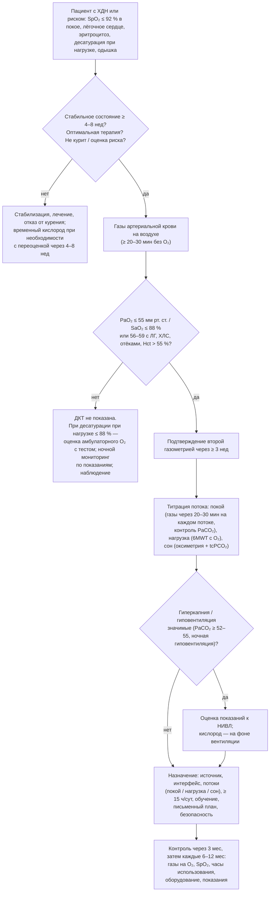

### 2.17. Длительная кислородотерапия

Длительная кислородотерапия (ДКТ; long-term oxygen therapy, LTOT) — первый метод лечения ХДН, для которого было доказано влияние на выживаемость, и до сих пор самый распространённый вид домашней респираторной поддержки. Вместе с тем это метод с чётко очерченными показаниями, за пределами которых он не приносит пользы, и с реальными рисками — от кислород-индуцированной гиперкапнии до пожаров. В этой главе мы разберём доказательную базу, показания, подбор, оборудование, безопасность и наблюдение.

📌 **Определение:** **длительная кислородотерапия** — назначение кислорода для дыхания в домашних условиях не менее 15 часов в сутки (включая ночь) пациентам с хронической тяжёлой гипоксемией с целью увеличения продолжительности жизни и уменьшения осложнений гипоксемии. От неё отличают **амбулаторную (портативную) кислородотерапию** — кислород во время физической активности вне дома, **ночную кислородотерапию** — только во время сна, **паллиативную** — для облегчения одышки без критериев гипоксемии, и **кратковременную «по требованию»** (short-burst) — при эпизодах одышки.

#### 2.17.1. История и доказательная база

Два рандомизированных исследования, опубликованные с интервалом в год, остаются фундаментом ДКТ. **Nocturnal Oxygen Therapy Trial (NOTT, США, 1980)** сравнил у 203 пациентов с ХОБЛ и PaO₂ ≤ 55 мм рт. ст. (или ≤ 59 с отёками, эритроцитозом или признаками лёгочного сердца) непрерывную кислородотерапию (фактически в среднем около 18 часов в сутки) с ночной (около 12 часов): смертность за 12 месяцев составила 11,9 % против 20,6 %, за 24 месяца — 22,4 % против 40,8 %. **Исследование Medical Research Council (Великобритания, 1981)** сравнило у 87 пациентов кислород не менее 15 часов в сутки с отсутствием кислородотерапии: 5-летняя смертность — 45 % против 67 %. Совместная интерпретация: кислород продлевает жизнь пациентам с тяжёлой гипоксемией, и чем дольше в сутки он используется, тем больше эффект; механизмы — замедление прогрессирования ЛГ, уменьшение эритроцитоза, аритмий и ночной гипоксемии, улучшение когнитивных функций и, вероятно, снижение сердечно-сосудистой смертности.

Последующие исследования очертили границы: у пациентов с ХОБЛ и умеренной гипоксемией (PaO₂ 56–65 мм рт. ст.) кислород не улучшал выживаемость (D. Górecka и соавторы, 1997); при изолированной ночной десатурации — не влиял на выживаемость и прогрессирование ЛГ (A. Chaouat и соавторы, 1999; INOX, 2020 — п. 2.12.4); **Long-Term Oxygen Treatment Trial (LOTT, США, 2016)** — крупнейшее исследование (738 пациентов с ХОБЛ и умеренной десатурацией в покое, SpO₂ 89–93 %, или умеренной десатурацией при нагрузке) — не выявило различий во времени до смерти или первой госпитализации, частоте обострений, качестве жизни, функции и дистанции ходьбы между группами с кислородом и без него. У пациентов без гипоксемии кислород не уменьшал одышку больше, чем поток воздуха через канюли (A. P. Abernethy и соавторы, 2010). Таким образом, доказательная база поддерживает ДКТ при тяжёлой гипоксемии и не поддерживает её при умеренной, изолированной ночной или нагрузочной, а также при одышке без гипоксемии; при других заболеваниях (ИЗЛ, муковисцидоз, ЛГ, НМЗ) рандомизированных данных о выживаемости нет, и показания экстраполируются (ATS 2020: сильная рекомендация ДКТ при тяжёлой гипоксемии покоя при ИЗЛ).

#### 2.17.2. Показания

##### 2.17.2.1. Длительная кислородотерапия при ХОБЛ

Критерии, единые для основных руководств (GOLD; ATS 2020; BTS 2015; национальные рекомендации), в стабильном состоянии при дыхании воздухом, подтверждённые дважды с интервалом не менее 3 недель:

- PaO₂ ≤ 55 мм рт. ст. (7,3 кПа) или SaO₂ ≤ 88 % — независимо от наличия осложнений;
- PaO₂ 56–59 мм рт. ст. (7,4–7,8 кПа) или SaO₂ 89 % при наличии признаков лёгочной гипертензии, лёгочного сердца (периферические отёки), эритроцитоза (гематокрит > 55 %); ряд руководств включает ночную гипоксемию.

При PaO₂ ≥ 60 мм рт. ст. ДКТ при ХОБЛ не показана. Гиперкапния не является противопоказанием (большинство пациентов NOTT и MRC были гиперкапничны), но требует контроля PaCO₂ и pH на подобранном потоке и является дополнительным основанием для оценки показаний к НИВЛ.

##### 2.17.2.2. Длительная кислородотерапия при других заболеваниях

Те же газометрические пороги применяются при ИЗЛ (где гипоксемия часто прогрессирует быстро и нагрузочная десатурация выражена сильнее, чем в покое), муковисцидозе и бронхоэктазах, ЛГ, муковисцидозе, нервно-мышечных и торакальных заболеваниях — с принципиальной оговоркой: при гиповентиляционных формах ДН кислород назначается только на фоне адекватной вентиляционной поддержки (НИВЛ), если гипоксемия сохраняется после коррекции гиповентиляции; изолированный кислород при насосной недостаточности маскирует гиповентиляцию и ускоряет декомпенсацию. При сердечной недостаточности с центральным апноэ и при ЛАГ показания индивидуальны. У детей — п. 2.26.1.

##### 2.17.2.3. Кислород при физической нагрузке

Амбулаторная кислородотерапия назначается: пациентам, получающим ДКТ, для продолжения терапии вне дома и во время активности (с подбором потока при нагрузке); пациентам без тяжёлой гипоксемии покоя, но с выраженной десатурацией при нагрузке (SpO₂ ≤ 88 %) — как условная рекомендация ATS 2020 при ХОБЛ и ИЗЛ (на основании краткосрочных исследований, показывающих увеличение переносимости нагрузки и уменьшение одышки, при отсутствии данных о выживаемости), а по BTS 2015 — только если при тесте с кислородом продемонстрировано клинически значимое улучшение (прирост дистанции или снижение одышки) и пациент готов использовать портативный источник. У пациентов с умеренной нагрузочной десатурацией (LOTT) амбулаторный кислород не улучшал исходов. При ИЛФ кислород при нагрузке в перекрёстном исследовании AmbOx (2018) улучшал качество жизни. Практический вывод: кислород при нагрузке — симптоматическое вмешательство с индивидуальной оценкой эффекта, а не лечение, продлевающее жизнь.

##### 2.17.2.4. Ночная кислородотерапия

Ночной кислород показан как часть ДКТ (с подбором ночного потока); как изолированная терапия при ночной десатурации без дневной гипоксемии при ХОБЛ — не рекомендуется (INOX, Chaouat); при ночной десатурации у пациентов с гиповентиляцией — только вместе с вентиляцией; при ОАС — только как дополнение к CPAP/НИВЛ при сохраняющейся гипоксемии. При ИЗЛ и сердечной недостаточности — индивидуально при отсутствии надёжных данных.

##### 2.17.2.5. Паллиативная и кратковременная кислородотерапия

Паллиативный кислород у пациентов с одышкой без гипоксемии (PaO₂ > 55–60 мм рт. ст.) не превосходит поток воздуха (Abernethy, 2010) и не рекомендуется; одышку таких пациентов облегчают вентилятор, направленный на лицо, опиоиды, техники дыхания и лечение тревоги (глава 2.30). У гипоксемичных пациентов в терминальной стадии кислород назначается по симптомам. Кратковременная кислородотерапия «по требованию» (short-burst) перед нагрузкой или после неё для облегчения одышки не имеет доказательств эффективности и не рекомендуется (BTS 2015).

#### 2.17.3. Цели кислородотерапии

Цель — устранение тяжёлой гипоксемии, а не нормализация оксигенации: PaO₂ ≥ 60 мм рт. ст. (8 кПа) или SpO₂ ≥ 90 % в покое при дыхании подобранным потоком; у пациентов с риском гиперкапнии целевой диапазон SpO₂ 88–92 %; при нагрузке и во сне — SpO₂ ≥ 90 % (допускается ≥ 88 %) без значимого роста PaCO₂. Продолжительность — не менее 15 часов в сутки, включая ночь; оптимально — максимально близко к круглосуточной (NOTT), с перерывами лишь на время, когда пациент не может пользоваться источником. Избыточная оксигенация (SpO₂ > 94–96 %) при ХДН не имеет пользы и несёт риск гиперкапнии.

#### 2.17.4. Оценка и подтверждение показаний в стабильном состоянии

Решение о ДКТ принимается только в стабильном состоянии: не ранее чем через 4–8 недель после обострения (BTS — 8 недель), при оптимальной терапии, без признаков декомпенсации, по данным артериальной газометрии (не пульсоксиметрии) при дыхании воздухом не менее 20–30 минут после прекращения подачи кислорода; критерии подтверждаются вторым исследованием через ≥ 3 недели. Пациентам, которым кислород назначен при выписке после обострения (что оправдано при сохраняющейся гипоксемии), показана обязательная переоценка через 4–8 недель: у 30–50 % из них к этому времени критерии ДКТ отсутствуют, и терапия должна быть отменена с последующим контролем. Пульсоксиметрия служит для отбора на газометрию: при SpO₂ ≤ 92 % в стабильном состоянии показана газометрия; при SpO₂ > 92–94 % ДКТ маловероятна. Исключение из правила «только в стабильном состоянии» — пациенты с быстро прогрессирующими заболеваниями (ИЛФ, БАС) и терминальной стадией, у которых ожидание стабильности невозможно.

**Рис. 16.** Алгоритм назначения длительной кислородотерапии. Схема читается сверху вниз.

#### 2.17.5. Титрация потока

Поток подбирается отдельно для трёх состояний. **В покое**: начиная с 1–2 л/мин через назальные канюли, с измерением газов артериальной крови через 20–30 минут на каждом потоке до достижения PaO₂ ≥ 60 мм рт. ст. (SpO₂ 90–92 %) с контролем PaCO₂ и pH; прирост PaCO₂ более чем на 5–10 мм рт. ст. или падение pH ниже 7,35 требует снижения потока до минимально достаточного и оценки показаний к НИВЛ (гиперкапния при этом не повод отказываться от кислорода). **При нагрузке**: тест с ходьбой на подобранном потоке с последующим увеличением на 1 л/мин до достижения SpO₂ ≥ 90 % (≥ 88 %) на пике нагрузки; необходимо тестирование с тем портативным устройством и в том режиме (непрерывный или пульсирующий), которые пациент будет использовать, поскольку «ступени» пульсирующих концентраторов не эквивалентны литрам в минуту и при тахипноэ часто недостаточны. **Во сне**: ночная оксиметрия на дневном потоке; при SpO₂ < 90 % значимую часть ночи поток увеличивают (традиционная практика — на 1 л/мин к дневному) с контролем tcPCO₂ или утренних газов; при выявлении гиповентиляции или апноэ — не увеличивать кислород, а решать вопрос о вентиляции. Фракция кислорода при назальных канюлях приблизительно оценивается как

$$
FiO_2 \approx 0{,}21 + 0{,}03\text{–}0{,}04 \times \dot V_{O_2}\ (\text{л/мин}), \tag{12}
$$

где V̇O₂ — поток кислорода; оценка верна лишь для спокойного дыхания через нос с нормальным дыхательным объёмом и частотой: при тахипноэ и дыхании ртом реальная FiO₂ ниже, при поверхностном дыхании — выше, что является одной из причин колебаний оксигенации при фиксированном потоке.

#### 2.17.6. Источники кислорода

**Табл. 24.** Источники кислорода для домашней кислородотерапии

| Источник | Принцип и характеристики | Преимущества | Ограничения | Типичное применение |
|---|---|---|---|---|
| Стационарный концентратор | Молекулярные сита (цеолит) выделяют O₂ из воздуха; концентрация 87–96 %; поток обычно до 5 л/мин (модели до 8–10 л/мин) | Неограниченный ресурс, низкая стоимость эксплуатации, безопасность | Зависимость от электричества (нужен резервный баллон), шум, тепло, вес 15–25 кг, снижение концентрации при высоких потоках и износе сит | Основной источник ДКТ дома |
| Портативный концентратор | Аккумуляторный; пульсирующая подача (болюс в начале вдоха, «ступени» 1–6) или непрерывная до 2–3 л/мин | Мобильность, разрешён в самолётах, автономность 2–8 ч | Ступени ≠ л/мин; пульсирующая подача ненадёжна при тахипноэ, дыхании ртом, во сне; ограниченный максимальный эквивалентный поток | Нагрузка вне дома, путешествия у пациентов с умеренной потребностью |
| Сжатый газообразный кислород (баллоны) | Баллоны под давлением 150–200 атм различного объёма; с регулятором или кислородсберегающим клапаном | Не зависит от электричества, 100 % O₂, резерв | Ограниченный ресурс (баллон 2 л при 200 атм ≈ 400 л газа — около 3 ч при 2 л/мин), тяжесть, логистика доставки, риск при падении | Резерв на случай отключения электричества; портативные малые баллоны |
| Жидкий кислород | Стационарный резервуар (−183 °C) с заправкой переносного сосуда; 1 л жидкости ≈ 860 л газа | Высокие потоки (до 15 л/мин), лёгкие переносные сосуды на несколько часов, бесшумность | Высокая стоимость и логистика заправок, испарение при неиспользовании, холодовые ожоги | Пациенты с высокой потребностью при нагрузке (> 3 л/мин) и активные пациенты (ATS 2020 — предпочтителен в этой группе) |
| Домашняя высокопоточная назальная терапия | Генератор потока 20–60 л/мин с увлажнением и смешиванием O₂ | Вымывание мёртвого пространства, небольшое ПДКВ, увлажнение, снижение работы дыхания | Стоимость, электричество, обучение; данные о долгосрочных исходах ограничены | Гиперкапническая ХОБЛ при непереносимости НИВЛ, бронхоэктазы с задержкой секрета (п. 2.17.7) |

Концентратор — стандарт для дома; выбор портативного источника определяется потребностью при нагрузке (пульсирующий портативный концентратор подходит при потребности до 2–3 л/мин эквивалента; при большей — жидкий кислород или баллоны), активностью пациента и доступностью в системе здравоохранения. Пациент на ДКТ должен иметь резервный источник на случай отключения электроэнергии и письменную инструкцию.

#### 2.17.7. Системы доставки

**Назальные канюли** — стандарт для потоков 0,5–6 л/мин: удобны, позволяют говорить и есть, FiO₂ приблизительно 24–44 % (формула 12); при потоках более 4 л/мин сушат слизистую — требуется увлажнение (при ≤ 4 л/мин увлажнитель не нужен). **Маски Вентури** обеспечивают фиксированную FiO₂ (24, 28, 31, 35, 40, 60 %) независимо от паттерна дыхания за счёт подсоса воздуха и являются средством выбора при риске гиперкапнии в стационаре (п. 2.24.7), но дома неудобны. **Простые маски** требуют потока ≥ 5 л/мин (иначе повторное вдыхание CO₂) и дают нестабильную FiO₂ 35–55 %; **маски с резервуаром** — для неотложных ситуаций. **Кислородсберегающие устройства**: резервуарные канюли (накапливают кислород в выдохе и отдают в начале вдоха; экономия в 2–4 раза), пульсирующие дозаторы (подача болюса по сигналу вдоха), **транстрахеальный катетер** (исторически — экономия до 50 %, косметика; осложнения — слизистые пробки, инфекция; сегодня применяется редко). **Домашняя высокопоточная назальная терапия** (нагретая увлажнённая смесь 20–40 л/мин с FiO₂ по потребности) у пациентов с гиперкапнической ХОБЛ на ДКТ снижала частоту обострений и улучшала качество жизни в рандомизированных исследованиях (B. Storgaard и соавторы, 2018; K. Nagata и соавторы, 2022) и рассматривается как альтернатива при непереносимости НИВЛ, а при бронхоэктазах и муковисцидозе — как средство увлажнения и клиренса; её место в руководствах пока определяется.

#### 2.17.8. Обучение пациента и приверженность

Эффект ДКТ зависит от часов использования, а реальная приверженность часто ниже 15 часов: по данным наблюдательных исследований, значительная часть пациентов использует кислород менее 12 часов в сутки. Причины — непонимание цели («кислород для одышки, а одышки сейчас нет»), стигма и страх зависимости, неудобство трубок и канюль, сухость и носовые кровотечения, шум концентратора, отсутствие портативного источника (пациент снимает кислород, выходя из дома, — именно когда потребность выше), стоимость электроэнергии, депрессия, когнитивные нарушения. Обучение должно включать: цель терапии (продление жизни и защита сердца, а не только облегчение одышки), почему важны ночь и нагрузка, назначенные потоки для каждой ситуации и запрет их самостоятельно повышать, уход за оборудованием (фильтры, канюли, увлажнитель), действия при отключении электричества и при ухудшении состояния, безопасность. Полезны письменное назначение в доступной форме, счётчик часов концентратора для объективного контроля, телемониторинг, вовлечение семьи, подбор удобного интерфейса и портативного источника, лечение побочных эффектов (солевые спреи, гели на водной основе).

#### 2.17.9. Безопасность

Кислород не горит сам, но резко усиливает горение: в обогащённой кислородом среде (одежда, волосы, постель, пропитанные кислородом) искра от сигареты, свечи, газовой плиты, электроприбора вызывает вспышку с тяжёлыми ожогами лица и дыхательных путей. **Курение при кислородотерапии** — главная причина пожаров, ожогов и смертей, связанных с домашним кислородом; BTS 2015 рекомендует не назначать кислород активным курильщикам без формальной оценки риска, информирования пациента и семьи и, по возможности, отказа от курения; в ряде стран используются термопредохранители на кислородной линии. Правила безопасности: запрет курения (включая электронные сигареты) и открытого огня в помещении и в радиусе не менее 2–3 м от источника; дистанция от газовых плит, обогревателей, свечей; отказ от масел и кремов на нефтяной основе на лице (вазелин) в пользу водных; баллоны хранить вертикально закреплёнными, вдали от тепла, не ронять; жидкий кислород — защита от холодовых ожогов при заправке, не наклонять сосуд; электробезопасность концентратора; не удлинять трубки сверх рекомендованных (обычно до 15 м — иначе поток падает); профилактика падений из-за трубок; информирование пожарной службы и соседей о наличии кислорода; детектор дыма. Клинические риски — п. 2.17.12.

#### 2.17.10. Путешествия и авиаперелёты

Пациент на ДКТ может путешествовать при планировании: портативный концентратор (разрешён большинством авиакомпаний при предварительном уведомлении; необходимы батареи на 150 % времени полёта), заказ кислорода в месте назначения, медицинская справка с параметрами. В салоне самолёта давление соответствует высоте до 2438 м, и у пациента на кислороде поток обычно увеличивают на 1–2 л/мин; пациентам без ДКТ, но с ХДН или SpO₂ ≤ 95 % с факторами риска показана оценка — гипоксический тест с дыханием смесью с 15 % кислорода (hypoxic challenge test): при PaO₂ < 50 мм рт. ст. (6,6 кПа) или SpO₂ < 85 % в тесте рекомендуется кислород в полёте (BTS 2022 с обновлёнными порогами). Высокогорные поездки, длительные автомобильные путешествия, морские круизы требуют отдельного планирования (п. 2.26.10).

#### 2.17.11. Наблюдение и контроль

После начала ДКТ первый контроль — через 4–12 недель (BTS: через 3 месяца), затем каждые 6–12 месяцев и при любом значимом изменении состояния. Содержание визита: часы использования (счётчик, расспрос), симптомы, SpO₂ в покое на воздухе и на кислороде, газы артериальной (или капиллярной — для PaCO₂) крови на подобранном потоке (контроль гиперкапнии), при необходимости — на воздухе для переоценки показаний, SpO₂ при нагрузке с портативным источником, оксиметрия во сне при показаниях, состояние оборудования и интерфейса, побочные эффекты, статус курения, приверженность, переоценка потребности в НИВЛ, обучение. Отмена ДКТ рассматривается, если при стабильном состоянии PaO₂ на воздухе устойчиво ≥ 60 мм рт. ст. (после обострения, снижения массы тела, начала НИВЛ или модуляторов CFTR) — с контролем через несколько недель; у пациентов, использующих кислород менее 15 часов и не желающих менять режим, обсуждается польза и риски продолжения. Визиты на дом специалиста по респираторной поддержке повышают приверженность и выявляют проблемы безопасности, невидимые в клинике.

#### 2.17.12. Осложнения и риски кислородотерапии

##### 2.17.12.1. Кислород-индуцированная гиперкапния

📌 **Определение:** **кислород-индуцированная гиперкапния** — нарастание PaCO₂ при подаче кислорода пациенту с хронической гиперкапнией или риском её развития (ХОБЛ, СОГ, НМЗ, кифосколиоз, муковисцидоз, бронхоэктазы), способное привести к респираторному ацидозу, энцефалопатии и остановке дыхания.

Традиционное объяснение — «устранение гипоксического драйва» — является лишь одним из механизмов и, по данным физиологических исследований (M. Aubier и соавторы, 1980; T. D. Robinson и соавторы, 2000), не главным: при подаче кислорода пациентам с обострением ХОБЛ минутная вентиляция снижается лишь на 10–20 % и частично восстанавливается, тогда как PaCO₂ продолжает расти. Основные механизмы: (1) **ухудшение V̇A/Q̇** — кислород снимает гипоксическую вазоконстрикцию в плохо вентилируемых зонах, перераспределяя кровоток туда, где CO₂ не удаляется, и увеличивая физиологическое мёртвое пространство; (2) **эффект Холдейна** — оксигенированный гемоглобин хуже связывает CO₂, и при фиксированной вентиляции PaCO₂ растёт (на несколько мм рт. ст.); (3) **снижение вентиляции** за счёт уменьшения стимуляции периферических хеморецепторов — реальный, но меньший вклад; (4) абсорбционные ателектазы при высоких FiO₂. Клиническое значение доказано: в рандомизированном догоспитальном исследовании M. A. Austin и соавторов (*BMJ*, 2010) титрованная кислородотерапия с целевой SpO₂ 88–92 % у пациентов с предполагаемым обострением ХОБЛ снизила смертность по сравнению с высокопоточным кислородом (относительный риск около 0,4 в общей группе и около 0,2 у пациентов с подтверждённой ХОБЛ). Отсюда правила: целевая SpO₂ 88–92 % у всех пациентов с риском гиперкапнии; минимальный достаточный поток; контроль газов через 30–60 минут после начала или изменения; при нарастании PaCO₂ с ацидозом — не отменять кислород (гипоксемия убивает быстрее), а снижать поток до минимально достаточного и начинать НИВЛ; информирование пациента и всех медицинских работников («паспорт риска гиперкапнии»). Ошибка в противоположную сторону — оставить пациента с SpO₂ 80 % без кислорода «из страха гиперкапнии» — не менее опасна.

##### 2.17.12.2. Другие осложнения

Абсорбционные ателектазы (при высоких FiO₂ азот вымывается из альвеол, и при закрытии дыхательных путей альвеолы спадаются) — значимы при FiO₂ > 0,5 и в послеоперационном периоде, при ДКТ низким потоком редки; токсичность кислорода (повреждение эпителия активными формами кислорода) — при FiO₂ > 0,5–0,6 более суток, при ДКТ не актуальна; сухость и раздражение слизистых, носовые кровотечения, дерматит и пролежни от канюль (за ушами, на щеках), инфицирование увлажнителей при неправильном уходе; ограничение мобильности, социальная стигма, психологическая зависимость; у недоношенных — ретинопатия (в другой возрастной группе и при иных FiO₂). Регулярный осмотр мест контакта, подбор мягких канюль, водные гели и уход за оборудованием предупреждают большинство местных проблем.

#### 2.17.13. Кислородотерапия при остром ухудшении пациента на ДКТ

При обострении потребность в кислороде растёт, и пациент или родственники часто увеличивают поток «до комфорта» — путь к гиперкапнической коме. План действий должен содержать: допустимое повышение потока (обычно не более чем на 1 л/мин сверх назначенного при наличии пульсоксиметра и целевой SpO₂ 88–92 %), запрет дальнейшего повышения без медицинской оценки, критерии вызова помощи (SpO₂ ниже целевой несмотря на коррекцию, сонливость, спутанность, усиление одышки в покое). В стационаре — контролируемая кислородотерапия через маску Вентури или канюли с титрацией по SpO₂ 88–92 % и газами крови через 30–60 минут; при респираторном ацидозе — НИВЛ (п. 2.24.7).

#### 2.17.14. Оформление назначения

Назначение ДКТ — рецепт на оборудование и режим, который должен содержать: диагноз и обоснование (газы крови с датами); источник (концентратор стационарный/портативный, баллоны, жидкий кислород) и резервный источник; интерфейс; поток в покое, при нагрузке, во сне (для пульсирующего источника — ступень с указанием протестированной модели); продолжительность в сутки (≥ 15 ч, с ночью); целевую SpO₂ и предупреждение о риске гиперкапнии; увлажнение; дату начала и дату переоценки; обучение (кто, когда) и контакт службы. В большинстве систем здравоохранения ДКТ финансируется государством или страховщиком при соответствии критериям (п. 2.28.2), и качество оформления определяет доступ пациента к терапии.

#### 2.17.15. Примеры и иллюстрации

**Пример 1** (ХОБЛ). Критерии: PaO₂ 54 мм рт. ст. дважды в стабильном состоянии, гематокрит 53 %, вероятная ЛГ — ДКТ показана. Титрация: на 1 л/мин PaO₂ 58, PaCO₂ 53; на 2 л/мин PaO₂ 66 мм рт. ст., PaCO₂ 54, pH 7,37 — поток покоя 2 л/мин. При 6MWT на 2 л/мин через портативный концентратор в пульсирующем режиме (ступень 2) SpO₂ падает до 85 % — на ступени 4 надир 89 %; с баллоном в непрерывном режиме 3 л/мин — 90 %. Ночь: на 2 л/мин SpO₂ < 90 % 25 % времени, tcPCO₂ максимум 59 мм рт. ст.; на 2,5 л/мин — T90 6 %, tcPCO₂ максимум 61 — приемлемо, но гиперкапния подчёркивает необходимость оценки НИВЛ. Назначение: стационарный концентратор 2 л/мин в покое, 2,5 л/мин во сне; портативный концентратор ступень 4 (или баллон 3 л/мин) при нагрузке; ≥ 15 ч/сут (цель — 18–20); резервный баллон; целевая SpO₂ 88–92 %; контроль через 3 месяца. Через год выяснилось, что пациент использовал кислород 6–8 часов в сутки, в основном ночью, и не брал портативный источник из дома («стесняюсь»); на фоне инфекции семья повысила поток до 5 л/мин «потому что задыхался» — в приёмное отделение доставлен с PaCO₂ 68 мм рт. ст., pH 7,28 и сонливостью (п. 2.8.8). Оба фактора — низкая приверженность и неконтролируемое повышение потока — были предотвратимы обучением, портативным источником и письменным планом.

**Пациентка В** (ИЛФ). PaO₂ 54 мм рт. ст. в покое — ДКТ показана; в покое 2 л/мин достаточно (SpO₂ 93 %); при нагрузке десатурация до 81 % на воздухе, на 4 л/мин через канюли — 87 %, на 6 л/мин непрерывного потока — 90 %. Портативный пульсирующий концентратор не обеспечивает такой потребности; выбор — жидкий кислород с переносным сосудом (ATS 2020) или высокопоточные портативные баллоны с кислородсберегающим устройством и ограничением активности по расписанию заправок. PaCO₂ 34 мм рт. ст. — риск гиперкапнии минимален, целевая SpO₂ ≥ 90 %. Прогрессирование ИЛФ потребует увеличения потоков; обсуждение трансплантации — немедленно (п. 2.25.5).

**Пример 2** (кифосколиоз). PaO₂ 62 мм рт. ст. — критериев ДКТ нет; гипоксемия обусловлена гиповентиляцией, лечение — НИВЛ; кислород не назначается; после титрации НИВЛ ожидается PaO₂ > 65 мм рт. ст. без кислорода.

🔬 **Углубление: почему LOTT был отрицательным и что это значит.** LOTT планировался как подтверждение пользы кислорода при умеренной гипоксемии и был самым масштабным исследованием в истории домашней кислородотерапии; его отрицательный результат по всем конечным точкам вызвал споры. Критика касалась приверженности (медиана использования около 12–13 часов), отсутствия «слепоты», исключения пациентов с тяжёлой десатурацией при нагрузке, разнородности группы; защитники указывали, что исследование отражает реальную практику и что физиологическое обоснование пользы при умеренной гипоксемии изначально было слабым (при PaO₂ 60–65 мм рт. ст. содержание кислорода почти не отличается от нормы). Важнее другое: LOTT не отменяет NOTT и MRC — порог тяжёлой гипоксемии (PaO₂ ≤ 55 мм рт. ст.) находится на крутой части кривой диссоциации, где кислород резко повышает содержание O₂ и снимает стимул для ЛГ и эритроцитоза, а умеренная гипоксемия — на плато. Это ещё один пример того, как физиология объясняет результаты клинических исследований и почему пороги в руководствах не следует «смягчать» из сочувствия.

❗ **Типичная ошибка:** назначать ДКТ по пульсоксиметрии при выписке из стационара после обострения без последующей переоценки. Половина таких пациентов через 2 месяца не соответствует критериям и годами пользуется ненужной терапией, тогда как часть других — с истинной тяжёлой гипоксемией — остаётся без неё, потому что «SpO₂ 90 % — вроде нормально».

❗ **Типичная ошибка:** разрешать пациенту или родственникам повышать поток кислорода «по самочувствию». Одышка при обострении связана не только с гипоксемией, и повышение потока до 4–6 л/мин у пациента с гиперкапнией приводит к сонливости, которую семья принимает за «успокоился», — до комы.

💡 **Интересный факт:** первый домашний кислородный концентратор появился в 1970-х годах как побочный продукт технологии разделения газов методом короткоцикловой адсорбции, разработанной для промышленности; до этого домашняя кислородотерапия означала тяжёлые баллоны с частой доставкой. Концентратор сделал исследование NOTT практически реализуемым и превратил ДКТ из экзотики в массовую терапию: сегодня в мире на домашнем кислороде находятся миллионы пациентов, и концентратор остаётся самым распространённым медицинским прибором в их домах.

📝 **Обобщение**

- Доказательная база ДКТ — исследования NOTT (1980) и MRC (1981): кислород ≥ 15 часов в сутки продлевает жизнь пациентам с ХОБЛ и тяжёлой гипоксемией (PaO₂ ≤ 55 мм рт. ст. или 56–59 с лёгочным сердцем, ЛГ, эритроцитозом); при умеренной гипоксемии (LOTT), изолированной ночной (INOX) и нагрузочной десатурации, одышке без гипоксемии кислород не улучшает исходов.
- Показания подтверждаются двумя газометриями в стабильном состоянии (≥ 4–8 недель после обострения, интервал ≥ 3 недели); кислород, назначенный при выписке, подлежит обязательной переоценке; при гиповентиляционных формах ДН кислород — только на фоне вентиляции.
- Поток титруется отдельно для покоя, нагрузки и сна до SpO₂ ≥ 90 % (88–92 % при риске гиперкапнии) с контролем PaCO₂; портативные пульсирующие устройства требуют тестирования; источники — концентратор (стандарт), портативный концентратор, баллоны, жидкий кислород (при высокой потребности), домашняя высокопоточная терапия у отдельных групп.
- Эффект зависит от часов использования; обучение, портативный источник, лечение побочных эффектов и наблюдение (через 3 месяца, затем каждые 6–12 месяцев с газами на кислороде) повышают приверженность и безопасность; курение при кислородотерапии — главная причина ожогов и пожаров.
- Кислород-индуцированная гиперкапния обусловлена прежде всего ухудшением V̇A/Q̇ и эффектом Холдейна, а не только снижением драйва; титрованная оксигенация с целью 88–92 % снижает смертность при обострениях (Austin, 2010); при нарастании гиперкапнии кислород не отменяют, а минимизируют и начинают НИВЛ.

Главный вывод: длительная кислородотерапия — лечение тяжёлой гипоксемии с доказанным влиянием на выживаемость, эффективное ровно настолько, насколько правильно подобраны показания, поток и часы использования; она не лечит гиповентиляцию — для этого существует вентиляционная поддержка, к которой мы переходим.

❓ **Контрольные вопросы**

1. Сформулируйте критерии назначения ДКТ при ХОБЛ и объясните, почему порог установлен на уровне PaO₂ 55 мм рт. ст., с точки зрения кривой диссоциации оксигемоглобина.
2. Какие исследования определили границы пользы кислородотерапии (умеренная гипоксемия, ночная десатурация, одышка без гипоксемии) и каковы их основные результаты?
3. Опишите процедуру титрации потока кислорода в покое, при нагрузке и во сне и объясните, почему «ступень 2» портативного концентратора не равна 2 л/мин.
4. Перечислите механизмы кислород-индуцированной гиперкапнии в порядке значимости и сформулируйте правила безопасной оксигенации пациента с риском гиперкапнии.
5. Пациенту при выписке после обострения ХОБЛ назначен концентратор 3 л/мин по SpO₂ 86 % на воздухе. Составьте план дальнейших действий на ближайшие 3 месяца с обоснованием каждого шага.
