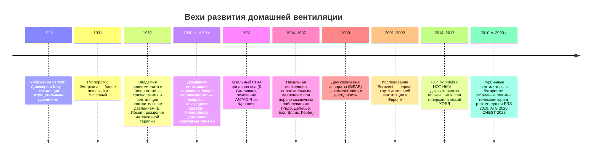

### 2.18. Домашняя механическая вентиляция: общие положения

Если кислородотерапия корригирует гипоксемию, то гиповентиляцию — главную проблему насосной ХДН — корригирует только вентиляционная поддержка. За последние сорок лет домашняя вентиляция прошла путь от редкого и технически сложного метода для немногих пациентов до стандартного компонента помощи при десятках заболеваний. В этой главе — определения, история, физиологические основы, классификация, оборудование и организационные принципы; детали неинвазивной и инвазивной домашней вентиляции рассматриваются в главах 2.19 и 2.20.

#### 2.18.1. Определения и место метода

📌 **Определение:** **домашняя механическая вентиляция** (ДМВ; home mechanical ventilation, HMV) — длительная (как правило, пожизненная или многомесячная) вентиляционная поддержка, проводимая вне стационара — дома или в учреждении длительного ухода — пациентам с хронической дыхательной недостаточностью, с помощью портативного вентилятора через неинвазивный интерфейс (маска, мундштук) или трахеостому.

📌 **Определение:** **неинвазивная вентиляция лёгких** (НИВЛ; non-invasive ventilation, NIV) — вентиляционная поддержка положительным давлением без искусственных дыхательных путей (интубационной трубки или трахеостомы), через маску, назальные подушки, мундштук или шлем. **Инвазивная домашняя вентиляция** — вентиляция через трахеостомическую канюлю.

📌 **Определение:** **зависимость от вентилятора** (ventilator dependence) — состояние, при котором пациент не может поддерживать адекватную вентиляцию без аппарата в течение значимого времени; **жизнеобеспечивающая вентиляция** (life-support ventilation) — вентиляция у пациента, который без неё не выживет в течение часов (на практике — потребность более 16 часов в сутки или невозможность самостоятельного дыхания более нескольких часов); она требует аппарата с внутренней батареей, системой тревог, резервного аппарата и круглосуточной поддержки.

ДМВ отличают от CPAP (постоянного положительного давления в дыхательных путях), который не является вентиляцией: он поддерживает проходимость верхних дыхательных путей и увеличивает ФОЕ, но не обеспечивает вдох и не увеличивает альвеолярную вентиляцию напрямую (при СОГ с тяжёлым апноэ он тем не менее эффективен, устраняя обструктивный компонент гиповентиляции). Также различают **ночную** (во время сна), **частичную дневную** и **круглосуточную** вентиляцию, а также **плановую хроническую** и **паллиативную** (для облегчения одышки в терминальной стадии).

#### 2.18.2. История домашней вентиляции

**Рис. 17.** Хронология развития домашней вентиляции (временная шкала).

##### 2.18.2.1. От «железного лёгкого» к Копенгагену 1952 года

Первым практичным аппаратом длительной вентиляции стал «танковый респиратор» Филипа Дринкера и Луиса Шоу (Гарвард, 1928) — герметичная камера, в которой тело пациента (кроме головы) подвергалось циклическому отрицательному давлению, расширяющему грудную клетку, — **«железное лёгкое»**. Удешевлённая модель Джона Эмерсона (1931) и эпидемии полиомиелита 1930–1950-х годов сделали его символом эпохи: в палатах стояли ряды «железных лёгких», а часть пациентов с постоянным параличом дыхательных мышц проводила в них годы — в том числе дома. Переломным событием стала эпидемия полиомиелита в Копенгагене в 1952 году (п. 2.2.2): анестезиолог Бьёрн Ибсен предложил трахеостомию и ручную вентиляцию положительным давлением мешком, которую круглосуточно посменно проводили около полутора тысяч студентов-медиков и стоматологов; летальность среди пациентов с бульбарно-респираторным параличом снизилась с 80–90 % до 25–40 % [⚠️ Требуется верификация: точные значения различаются по источникам]. Этот опыт породил и первые отделения интенсивной терапии (Копенгаген, 1953), и первые механические вентиляторы положительного давления (Энгстрём и др.), и — поскольку многие выжившие остались зависимыми от вентиляции — первые программы длительной вентиляции на дому. В 1950–1970-е годы домашняя вентиляция выживших после полиомиелита проводилась преимущественно отрицательным давлением (кюирас — жёсткий панцирь на грудную клетку, пончо-респиратор, качающаяся кровать, использующая смещение органов брюшной полости, пневмопояс для дневной вентиляции сидя) и у меньшинства — через трахеостому; в США центры (например, Goldwater Memorial Hospital в Нью-Йорке) и во Франции региональные ассоциации, объединённые с 1981 года в ANTADIR, создали модель организации, которая существует до сих пор.

##### 2.18.2.2. Эра неинвазивной вентиляции

Второй перелом произошёл в 1980-е годы. В 1981 году Колин Салливан описал назальный CPAP при обструктивном апноэ сна, создав удобную назальную маску; в 1984–1987 годах группы во Франции (И. Ридо, А. Делобье — у пациентов с миодистрофией Дюшенна), в США (Дж. Бах), в Австралии (Э. Эллис) и Великобритании продемонстрировали, что ночная вентиляция положительным давлением через назальную маску корригирует гиповентиляцию при нервно-мышечных и торакальных заболеваниях не хуже вентиляции через трахеостому — без её осложнений. Появление в 1990 году компактных двухуровневых аппаратов, изначально созданных для апноэ сна, но быстро приспособленных для вентиляции, резко снизило стоимость и порог применения; к концу 1990-х НИВЛ стала основным методом домашней вентиляции, а исследование Eurovent (2001–2002) зафиксировало её распространение в Европе с огромными различиями между странами (п. 2.4.6). В 2000–2010-е годы НИВЛ при ХОБЛ прошла путь от разочарования (отрицательные исследования низкоинтенсивной вентиляции) к доказанной пользе высокоинтенсивной вентиляции при персистирующей гиперкапнии (Köhnlein 2014, HOT-HMV 2017), а современные турбинные вентиляторы с внутренними батареями, гибридными режимами с целевым объёмом, встроенной регистрацией данных и телемониторингом расширили домашнюю вентиляцию на пациентов, которым прежде требовался стационар.

#### 2.18.3. Физиологические основы: как ночная вентиляция улучшает дневной газообмен

Факт, на котором держится вся концепция домашней НИВЛ: вентиляция только во время сна (6–8 часов) улучшает дневные газы крови, симптомы и выживаемость, хотя днём пациент дышит сам. Этому есть три взаимодополняющих объяснения, подтверждённых в разной степени:

- **разгрузка и отдых дыхательных мышц**: вентилятор берёт на себя работу дыхания, устраняя хроническое утомление (индекс «напряжение — время» выше порога, п. 2.6.4); после ночи отдохнувшие мышцы обеспечивают большую дневную вентиляцию; данные о росте силы мышц после НИВЛ противоречивы, но снижение нагрузки и электромиографической активности во время вентиляции доказано;
- **восстановление чувствительности дыхательного центра к CO₂**: устранение ночной гиперкапнии снижает бикарбонат (почки выводят избыток за несколько суток), «установочная точка» PaCO₂ смещается вниз, и днём пациент дышит интенсивнее при том же усилии; эта гипотеза лучше всего подтверждена при нервно-мышечных и торакальных заболеваниях (дневной PaCO₂ снижается параллельно с бикарбонатом в первые недели НИВЛ);
- **улучшение механики**: расправление микроателектазов, увеличение растяжимости лёгких и грудной стенки, уменьшение V̇A/Q̇-неоднородности, у пациентов с ХОБЛ — снижение гиперинфляции при адекватном контроле выдоха.

К этому добавляются улучшение структуры сна (устранение микропробуждений и десатураций), уменьшение ночной симпатической активации, снижение давления в лёгочной артерии и эритроцитоза, улучшение когнитивных функций и качества жизни. При ХОБЛ механизм пользы сложнее и зависит от интенсивности вентиляции (п. 2.19.1.1).

#### 2.18.4. Классификация домашней вентиляции

ДМВ классифицируют по нескольким осям:

- **по интерфейсу** — неинвазивная (маска назальная, ороназальная, полнолицевая, назальные подушки, мундштук) и инвазивная (трахеостома);
- **по продолжительности** — ночная (< 8–10 ч), частичная дневная (8–16 ч), круглосуточная (> 16–20 ч, жизнеобеспечивающая);
- **по способу управления вдохом** — вентиляция с контролем по давлению (pressure-controlled / pressure support), по объёму (volume-controlled), гибридная (давление с целевым объёмом — AVAPS, iVAPS и аналоги);
- **по запуску вдоха** — спонтанный (S), спонтанно-принудительный с резервной частотой (S/T), принудительный с контролируемым временем (T, PC);
- **по контуру** — одноконтурная с преднамеренной утечкой (vented) или с клапаном выдоха, двухконтурная;
- **по цели** — лечебная (коррекция ХДН), профилактическая (предотвращение прогрессирования при ночной гиповентиляции), паллиативная;
- **по контексту начала** — плановая (амбулаторно или в стационаре в стабильном состоянии) и после эпизода ОДН (невозможность отлучения, персистирующая гиперкапния).

#### 2.18.5. Общие показания, условия и ограничения

Показания к ДМВ определяются заболеванием и физиологическими критериями (детали — главы 2.19, 2.20, 2.25); в общем виде кандидаты — пациенты с хронической гиповентиляцией (дневная гиперкапния с симптомами) или с ночной гиповентиляцией с симптомами при прогрессирующих заболеваниях насоса; с персистирующей выраженной гиперкапнией после обострения ХОБЛ; с невозможностью отлучения от вентиляции после ОДН; с центральными гиповентиляциями. Необходимые условия — не менее важные, чем критерии: информированное согласие пациента (или законного представителя) с пониманием целей и ограничений; мотивация и когнитивная способность (или наличие ухаживающих) к использованию аппарата; безопасное домашнее окружение (электричество, пространство, гигиена, доступность экстренной помощи); обученные ухаживающие при зависимости от вентилятора; программа наблюдения и техническая служба; при НИВЛ — сохранность бульбарных функций, достаточная для защиты дыхательных путей и удержания интерфейса, и управляемая секреция (с поддержкой кашля). Относительные ограничения НИВЛ: тяжёлые бульбарные нарушения с аспирацией, неконтролируемая секреция, невозможность подбора интерфейса (деформации лица, клаустрофобия), выраженные когнитивные нарушения без ухода, отсутствие ощутимой пользы при повторных попытках; в этих случаях обсуждаются инвазивная вентиляция или отказ от вентиляции в пользу паллиативной помощи — в соответствии с предпочтениями пациента.

#### 2.18.6. Оборудование

##### 2.18.6.1. Вентиляторы

**Табл. 25.** Типы аппаратов для домашней вентиляции

| Класс аппарата | Характеристики | Применение | Ограничения |
|---|---|---|---|
| Двухуровневые аппараты без функций жизнеобеспечения (bilevel, «домашние» НИВЛ-аппараты) | Турбина; режимы S, S/T, PC, гибридные с целевым объёмом; одноконтурная система с утечкой; давления до 25–30 см вод. ст.; базовые тревоги; внутренней батареи нет или она кратковременна | Ночная и частичная дневная НИВЛ у пациентов, не зависящих от вентилятора (ХОБЛ, СОГ, кифосколиоз, медленно прогрессирующие НМЗ на ранней стадии) | Непригодны при зависимости > 12–16 ч; ограниченные тревоги и давления; компенсация утечек зависит от модели |
| Вентиляторы жизнеобеспечения (life-support) | Турбина; внутренняя и внешняя батареи (суммарно часы работы); режимы давления и объёма, гибридные, мундштучная вентиляция; одноконтурные (с утечкой или клапаном) и двухконтурные системы; полная система тревог (отсоединение, апноэ, низкий объём, давление, питание); мониторинг и регистрация | Зависимость от вентилятора, инвазивная вентиляция через трахеостому, дневная мундштучная вентиляция, дети, БАС на поздних стадиях, высокие спинальные повреждения | Стоимость, вес (2–5 кг), необходимость обучения; при зависимости > 16 ч требуется второй аппарат |
| Аппараты CPAP (в том числе авто-CPAP) | Постоянное давление 4–20 см вод. ст. | ОАС; СОГ с тяжёлым ОАС (первая линия по ATS 2019) | Не является вентиляцией; не корригирует гиповентиляцию без обструктивного компонента |
| Аппараты вентиляции отрицательным давлением (кюирас, пончо) и абдоминальные (пневмопояс) | Внешняя работа без интерфейса на лице | Исторически — полиомиелит; сегодня — редкие случаи непереносимости масок, дневная вентиляция сидя пневмопоясом | Индуцируют обструкцию верхних дыхательных путей во сне, громоздки, малая эффективность при снижении растяжимости |
| Устройства, не являющиеся вентиляторами, но входящие в систему: механический инсуффлятор-экссуффлятор, аспиратор, пульсоксиметр, увлажнитель, резервный источник питания, мешок Амбу | — | Обязательный комплект при зависимости от вентилятора и при неэффективном кашле | — |

Современные аппараты регистрируют использование, утечки, дыхательный объём, частоту, долю вдохов, инициированных аппаратом, остаточный индекс апноэ-гипопноэ и передают данные дистанционно (телемониторинг), что стало основой контроля качества вентиляции (п. 2.19.8).

##### 2.18.6.2. Контуры, клапаны выдоха, увлажнение, фильтры

Одноконтурная система **с преднамеренной утечкой** (отверстия в маске или в коннекторе) требует постоянного потока и поддержания экспираторного давления (обычно ≥ 4 см вод. ст.) для вымывания CO₂ — иначе происходит повторное вдыхание; это стандарт для двухуровневых аппаратов. Одноконтурная система **с активным клапаном выдоха** и двухконтурная система позволяют точно измерять выдыхаемый объём и использовать режимы по объёму; они применяются при инвазивной вентиляции и у пациентов с высокой зависимостью. **Увлажнение**: подогреваемый увлажнитель уменьшает сухость, заложенность носа и утечку через рот (сухость слизистой повышает сопротивление носа) и обязателен при трахеостоме (альтернатива — тепловлагообменник); **фильтры** — на входе воздуха в аппарат (пыль) и, при необходимости, бактериальные; трубки и маски требуют регулярной очистки и замены по графику поставщика.

##### 2.18.6.3. Электропитание, тревоги, резерв

Пациент, зависящий от вентилятора, должен иметь: аппарат с внутренней батареей и внешнюю батарею (суммарно на 8–12 часов и более), второй аппарат (при зависимости > 16 ч/сут — требование большинства программ), мешок Амбу с маской/коннектором к трахеостоме и обученного пользователя, источник бесперебойного питания или генератор при ненадёжном электроснабжении, уведомление энергоснабжающей организации о зависимости от электричества, пульсоксиметр, план действий при отказе оборудования. Система тревог настраивается индивидуально (слишком чувствительные тревоги игнорируются; недостаточные — опасны); для пациентов с ночной НИВЛ без зависимости тревоги минимальны.

#### 2.18.7. Интерфейсы: обзор

Выбор интерфейса — один из главных определителей успеха НИВЛ (подробно — п. 2.19.4): назальные маски и назальные подушки (комфорт, речь, меньше клаустрофобии и аспирационного риска, но утечка через рот), ороназальные маски (контроль утечки через рот, стандарт при ОДН и у многих пациентов с ХОБЛ), полнолицевые маски (при непереносимости давления на переносицу), гибридные (ороназальные без опоры на переносицу), индивидуально изготовленные маски (дети, деформации), мундштук с держателем для дневной вентиляции (mouthpiece ventilation — позволяет пациентам с НМЗ получать круглосуточную НИВЛ без трахеостомы), трахеостомические канюли различных типов (п. 2.20.4). Чередование интерфейсов (разные маски ночью и днём) предупреждает пролежни и расширяет время переносимой вентиляции.

#### 2.18.8. Организация программы домашней вентиляции

ДМВ эффективна и безопасна только как **программа**, а не как выдача аппарата. Компоненты программы (детали — глава 2.27): специализированный центр (стационарный или амбулаторный), инициирующий и титрующий вентиляцию; структурированное обучение пациента и ухаживающих с проверкой навыков (надевание маски, включение, действия при тревогах, уход, при трахеостоме — санация, смена канюли, экстренная замена); письменная документация (параметры, план действий, контакты); поставщик оборудования с сервисом и заменой в течение часов при зависимости; плановое наблюдение (через 1–3 месяца после начала, затем каждые 3–12 месяцев в зависимости от заболевания) с оценкой эффективности (газы, ночная запись, данные аппарата) и приверженности; круглосуточная линия поддержки; визиты на дом; координация с первичным звеном, неврологом, паллиативной службой; переходы (детская — взрослая служба). Вентиляция, начатая в стационаре при ОДН, требует особого внимания к переходу домой: именно на этом этапе теряется до трети пациентов.

#### 2.18.9. Эпидемиология домашней вентиляции

Распространённость ДМВ растёт во всех странах с доступными данными: от 6,6 на 100 000 в Европе в начале 2000-х (Eurovent, с разбросом от 0,1 до 17 между странами) до десятков на 100 000 в 2010–2020-е годы во Франции, Швейцарии, Австралии, Канаде, странах Северной Европы [⚠️ Требуется верификация: точные современные значения по странам]. Структура показаний сместилась: если в эпоху полиомиелита и первых программ преобладали нервно-мышечные и торакальные заболевания, то сегодня в большинстве регистров доминируют ХОБЛ и СОГ (вместе более половины), доля инвазивной вентиляции снизилась до 5–15 %, а средний возраст пациентов вырос. Различия между странами отражают не заболеваемость, а финансирование, организацию и традиции (п. 2.28.1, 3.22).

#### 2.18.10. Правовые и этические рамки

ДМВ — жизнеподдерживающее лечение, и его начало, продолжение и прекращение регулируются теми же этическими принципами, что и в интенсивной терапии: информированное согласие (включая право отказа), автономия и предварительные распоряжения, соразмерность пользы и бремени, справедливость доступа. Особенности домашнего контекста: нагрузка на семью (круглосуточный уход при инвазивной вентиляции), вопросы дееспособности при прогрессирующих заболеваниях (БАС с когнитивными нарушениями), права детей и решения родителей, юридический статус отключения вентилятора по желанию пациента (в большинстве юрисдикций — правомерный отказ от лечения, не эвтаназия), ответственность за оборудование и его отказ. Эти вопросы рассматриваются в главе 2.30; здесь важно подчеркнуть, что разговор о них должен состояться до начала жизнеобеспечивающей вентиляции, а не в момент кризиса.

🔬 **Углубление: «гипотеза установочной точки» в цифрах.** У пациента с ночной гиповентиляцией почка удерживает бикарбонат, и хеморецепторный ответ смещается: при бикарбонате 32 ммоль/л нормальный pH 7,40 достигается при PaCO₂ ≈ 53 мм рт. ст. (уравнение Гендерсона — Гассельбальха), и дыхательный центр «удовлетворён» этим уровнем. После нескольких ночей эффективной НИВЛ ночной PaCO₂ нормализуется, почка выводит избыток бикарбоната (период полуснижения — около 1–3 суток, полная нормализация — 1–2 недели), и при бикарбонате 26 ммоль/л тот же pH требует PaCO₂ ≈ 43 мм рт. ст. — центр «переустанавливается», и днём пациент без аппарата поддерживает более низкий PaCO₂, пока ночная вентиляция сохраняет новую точку. Это объясняет, почему эффект НИВЛ при НМЗ проявляется через 1–2 недели, почему пропуск нескольких ночей возвращает гиперкапнию, почему ацетазоламид (снижающий бикарбонат) может временно имитировать эффект и почему контроль бикарбоната — простой способ оценить эффективность домашней вентиляции между визитами.

❗ **Типичная ошибка:** рассматривать домашнюю вентиляцию как выдачу прибора («назначить BiPAP»). Без титрации, обучения, подбора интерфейса, плана действий и наблюдения аппарат либо не используется, либо используется неэффективно; данные регистров показывают, что значительная часть «неудач» НИВЛ связана с организацией, а не с методом.

❗ **Типичная ошибка:** выписывать пациента, зависящего от вентилятора, с одним аппаратом без батареи, без резервного питания и без обученного ухаживающего. Отключение электроэнергии или отказ аппарата становятся смертельно опасными.

💡 **Интересный факт:** «железные лёгкие» не исчезли полностью с появлением вакцины против полиомиелита: отдельные пациенты, парализованные в 1950-е годы, прожили в них десятилетия. Американец Пол Александер, заболевший полиомиелитом в 1952 году в возрасте шести лет, провёл в «железном лёгком» более 70 лет, получил юридическое образование, работал адвокатом и умер в 2024 году — дольше всех в истории пользуясь аппаратом, созданным за четверть века до его рождения.

📝 **Обобщение**

- Домашняя механическая вентиляция — длительная вентиляционная поддержка вне стационара, неинвазивная (маска, мундштук) или инвазивная (трахеостома); отличается от CPAP, который не является вентиляцией; жизнеобеспечивающая вентиляция (> 16 ч/сут) требует особого оборудования и организации.
- История: «железное лёгкое» (1928), Копенгаген 1952 года (вентиляция положительным давлением, рождение интенсивной терапии и домашней вентиляции), домашняя вентиляция выживших после полиомиелита, назальная НИВЛ при НМЗ (1980-е), двухуровневые аппараты (1990), доказательство пользы при ХОБЛ (2014–2017), современные турбинные вентиляторы и телемониторинг.
- Ночная вентиляция улучшает дневной газообмен через разгрузку мышц, восстановление чувствительности центра к CO₂ (снижение бикарбоната и «переустановка» точки PaCO₂) и улучшение механики; при ХОБЛ механизм зависит от интенсивности вентиляции.
- Классификация — по интерфейсу, продолжительности, способу управления вдохом, контуру, цели; показания определяются заболеванием и физиологическими критериями, но реализуемы только при согласии, мотивации, безопасном окружении, обученных ухаживающих и программе наблюдения; тяжёлые бульбарные нарушения и неуправляемая секреция ограничивают НИВЛ.
- Оборудование: двухуровневые аппараты для пациентов без зависимости, вентиляторы жизнеобеспечения с батареями и тревогами при зависимости (второй аппарат при > 16 ч/сут), контуры с утечкой или клапаном, увлажнение, инсуффлятор-экссуффлятор и аспиратор; ДМВ — программа, а не прибор.

Главный вывод: домашняя вентиляция сделала возможной жизнь вне стационара для пациентов, которые ещё полвека назад умирали или оставались в палатах; её успех зависит от организации не меньше, чем от техники. Следующая глава — о самом распространённом её виде, длительной неинвазивной вентиляции.

❓ **Контрольные вопросы**

1. Дайте определения домашней механической вентиляции, НИВЛ, зависимости от вентилятора и жизнеобеспечивающей вентиляции; чем CPAP отличается от вентиляции?
2. Какие события 1952 и 1980-х годов определили современную домашнюю вентиляцию и почему?
3. Объясните три механизма, благодаря которым ночная НИВЛ улучшает дневные газы крови; какой из них лучше всего подтверждён при нервно-мышечных заболеваниях и как это можно проверить по бикарбонату?
4. Чем аппарат жизнеобеспечения отличается от двухуровневого аппарата для ночной НИВЛ и какие требования к оборудованию и организации предъявляет зависимость от вентилятора более 16 часов в сутки?
5. Какие условия, помимо газометрических критериев, необходимы для начала домашней вентиляции, и что следует предложить пациенту, у которого они невыполнимы?
