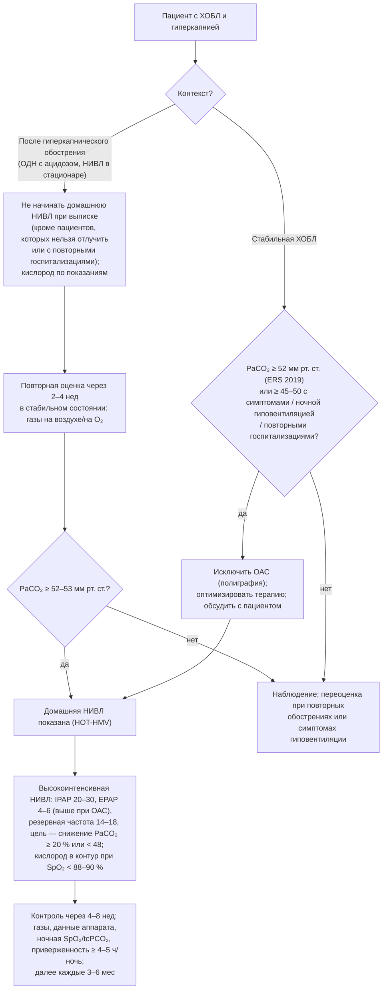

### 2.19. Длительная неинвазивная вентиляция лёгких

Длительная НИВЛ — основной метод коррекции хронической гиповентиляции и самый быстрорастущий вид домашней респираторной поддержки. Её успех зависит от правильного отбора пациентов (показания различаются по нозологиям), грамотной титрации (параметры при ХОБЛ и при нервно-мышечном заболевании почти противоположны), подбора интерфейса, обучения и систематического контроля эффективности. В этой главе мы последовательно разберём доказательную базу, показания, начало, параметры, мониторинг, проблемы и особые ситуации.

#### 2.19.1. Доказательная база по группам заболеваний

##### 2.19.1.1. ХОБЛ: от разочарования к высокоинтенсивной вентиляции

История НИВЛ при стабильной гиперкапнической ХОБЛ поучительна. Ранние рандомизированные исследования (C. Casanova, 2000; E. Clini, 2002; R. D. McEvoy, 2009) с «низкоинтенсивной» вентиляцией (инспираторное давление 12–18 см вод. ст., низкая резервная частота, минимальное снижение PaCO₂) не показали улучшения выживаемости, а в австралийском исследовании McEvoy небольшое улучшение выживаемости сопровождалось ухудшением качества жизни. Исследование RESCUE (M. L. Struik, 2014), начинавшее НИВЛ непосредственно при выписке после гиперкапнического обострения, также было отрицательным — у многих пациентов гиперкапния разрешилась сама. Поворот обеспечила концепция **высокоинтенсивной НИВЛ** (W. Windisch и соавторы, Германия, 2000-е годы): инспираторные давления 20–30 см вод. ст. с резервной частотой, близкой к спонтанной или выше неё (контролируемая вентиляция), с целью максимального снижения PaCO₂; перекрёстное исследование M. Dreher (2010) показало её превосходство над низкоинтенсивной по газообмену, одышке и качеству сна, а исследование P. B. Murphy (2012) — что решающее значение имеет давление, а не высокая частота. Два ключевых РКИ:

- **T. Köhnlein и соавторы (*Lancet Respiratory Medicine*, 2014)**: 195 пациентов со стабильной ХОБЛ и PaCO₂ ≥ 51,9 мм рт. ст. (7 кПа); НИВЛ титровалась до снижения PaCO₂ не менее чем на 20 % или ниже 48,1 мм рт. ст. (среднее IPAP около 22 см вод. ст., резервная частота 16); годичная смертность — 12 % против 33 % в контроле;
- **HOT-HMV (P. B. Murphy и соавторы, *JAMA*, 2017)**: 116 пациентов с персистирующей гиперкапнией (PaCO₂ > 53 мм рт. ст.) через 2–4 недели после разрешения ацидоза при обострении; домашняя НИВЛ (медианы IPAP 24, EPAP 4 см вод. ст., частота 14) + кислород против одного кислорода; 12-месячный риск повторной госпитализации или смерти — 63,4 % против 80,4 %, медиана времени до события — 4,3 против 1,4 месяца.

На этой основе рекомендации ERS (2019) и ATS (2020) предлагают домашнюю НИВЛ пациентам со стабильной хронической гиперкапнической ХОБЛ и пациентам с персистирующей гиперкапнией после обострения (с оценкой через 2–4 недели, а не при выписке), с титрацией до нормализации или значимого снижения PaCO₂, в режиме с фиксированным давлением (а не авто-титрующимся), с предварительным исключением ОАС и без обязательной полисомнографической титрации. Механизм пользы при ХОБЛ, по современным данным, включает снижение гиперинфляции и работы дыхания при контролируемой вентиляции с адекватным EPAP, разгрузку мышц, снижение бикарбоната и восстановление драйва, уменьшение ночной гиперкапнии и, возможно, уменьшение частоты обострений за счёт меньшей задержки секрета и лучшего сна; при низкоинтенсивной вентиляции эти эффекты не достигаются — что и объясняет отрицательные ранние исследования.

**Рис. 18.** Алгоритм принятия решения о домашней НИВЛ при ХОБЛ (на основе рекомендаций ERS 2019 и ATS 2020). Схема читается сверху вниз.

##### 2.19.1.2. Нервно-мышечные заболевания

При НМЗ рандомизированные исследования немногочисленны по этическим причинам (эффект очевиден), но доказательная база убедительна: при миодистрофии Дюшенна внедрение ночной НИВЛ изменило медиану выживаемости с 19 до 25–30 лет и более (Eagle, 2002; когорты Франции, Дании, Великобритании); при БАС РКИ S. C. Bourke (2006) показало увеличение выживаемости в среднем примерно на 7 месяцев и улучшение качества жизни у пациентов без тяжёлых бульбарных нарушений (при тяжёлых бульбарных нарушениях — улучшение качества сна без влияния на выживаемость); при СМА, других миопатиях, последствиях полиомиелита, высоких спинальных повреждениях — когортные данные о многолетней выживаемости и улучшении качества жизни. Исследование S. Ward (2005) обосновало начало НИВЛ на стадии ночной гиповентиляции с симптомами до развития дневной гиперкапнии. Рекомендации CHEST (2023) и консенсусы ENMC и ERS определяют критерии начала, предпочтение НИВЛ перед инвазивной вентиляцией и обязательность поддержки кашля.

##### 2.19.1.3. Торакальные заболевания

При кифосколиозе, фибротораксе, последствиях торакопластики НИВЛ даёт наиболее драматичный и устойчивый эффект: нормализация газов крови, исчезновение симптомов, регресс лёгочной гипертензии и эритроцитоза, 5-летняя выживаемость порядка 80 % (A. K. Simonds и M. W. Elliott, 1995: 79 % при кифосколиозе против 43 % при ХОБЛ в той же программе [⚠️ Требуется верификация: точные значения]). Без НИВЛ пациенты с кифосколиозом и дневной гиперкапнией имели плохой прогноз даже на кислороде.

##### 2.19.1.4. Синдром ожирения-гиповентиляции

Испанская серия исследований Pickwick (J. F. Masa и соавторы, 2015–2020) показала, что при СОГ с тяжёлым ОАС (ИАГ ≥ 30) CPAP и НИВЛ дают сопоставимые долгосрочные результаты (госпитализации, газы, смертность), а при СОГ без тяжёлого ОАС НИВЛ эффективнее изменения образа жизни по газообмену и симптомам. Отсюда рекомендации ATS 2019: CPAP как первая линия при СОГ с тяжёлым ОАС (около 70 % пациентов), НИВЛ — при СОГ без тяжёлого ОАС, при неэффективности CPAP (сохранение гиперкапнии, десатураций), при выписке после ОДН до планового обследования (в течение 3 месяцев).

##### 2.19.1.5. Другие состояния

При центральных гиповентиляциях (ВСЦГ, поражения ствола) вентиляция во сне обязательна и эффективна; при overlap-синдроме и сердечной недостаточности с гиперкапнией — по механизму (п. 2.25.6); при муковисцидозе и бронхоэктазах с гиперкапнией — улучшение симптомов и газов, мост к трансплантации; при ИЗЛ НИВЛ не влияет на прогноз и применяется только паллиативно или как мост к трансплантации у отобранных пациентов; при сердечной недостаточности с центральным апноэ адаптивная сервовентиляция противопоказана при фракции выброса ≤ 45 % (исследование SERVE-HF, 2015 — повышение сердечно-сосудистой смертности).

#### 2.19.2. Показания по группам заболеваний

**Табл. 26.** Критерии начала длительной НИВЛ по группам заболеваний (обобщение рекомендаций ERS 2019, ATS 2019/2020, CHEST 2023, национальных руководств; пороги указаны для стабильного состояния)

| Группа | Критерии (достаточно одного при наличии симптомов или в сочетаниях, указанных в рекомендациях) | Комментарии |
|---|---|---|
| ХОБЛ | Стабильная хроническая гиперкапния PaCO₂ ≥ 52 мм рт. ст. (ERS); PaCO₂ ≥ 45 с симптомами и ночной гиповентиляцией / повторными госпитализациями (ATS; национальные руководства — ≥ 50); персистирующая гиперкапния ≥ 52–53 через 2–4 нед после обострения с ОДН; ≥ 2 госпитализаций с гиперкапническим ацидозом за год; невозможность отлучения от НИВЛ в стационаре | Исключить ОАС; высокоинтенсивные параметры; кислород в контур; цель — снижение PaCO₂ |
| Нервно-мышечные заболевания (медленно прогрессирующие: Дюшенн, СМА, миопатии, постполиомиелит; спинальные повреждения) | Симптомы гиповентиляции + любой из: PaCO₂ ≥ 45 мм рт. ст. днём; ночная гиповентиляция по tcPCO₂ (критерии AASM) или SpO₂ ≤ 88 % ≥ 5 мин; ЖЕЛ < 50 % должного (или < 80 % с симптомами при Дюшенне и БАС); MIP < 60 см вод. ст. или SNIP < 40 см вод. ст.; ортопноэ | Начинать на стадии ночной гиповентиляции; одновременно — поддержка кашля (PCF < 270 л/мин) и обучение; полисомнография не обязательна |
| БАС | Те же критерии, плюс ортопноэ как самостоятельный критерий; SNIP < 40 или < 65 (мужчины) / 55 (женщины) см вод. ст. с симптомами; падение ЖЕЛ > 10 % за 3 мес; ЖЕЛ < 50 % | Начинать рано; при бульбарных нарушениях — попытка НИВЛ с тщательным подбором интерфейса; обсуждение трахеостомии и предпочтений заранее |
| Кифосколиоз, деформации грудной клетки, фиброторакс | Симптомы + PaCO₂ ≥ 45 мм рт. ст. или ночная гиповентиляция; ЖЕЛ < 1–1,5 л / < 50 %; ЛГ, эритроцитоз, госпитализация с ОДН | Высокие инспираторные давления из-за низкой растяжимости; обычно пожизненно, отличный прогноз |
| СОГ | PaCO₂ ≥ 45 мм рт. ст.: при ИАГ ≥ 30 — CPAP (первая линия), при неэффективности или ИАГ < 30 — НИВЛ; после ОДН — выписка на НИВЛ с переоценкой | Контроль PaCO₂ и бикарбоната через 1–3 мес; снижение массы тела параллельно |
| Центральные гиповентиляции (ВСЦГ, поражения ствола, идиопатическая) | Любая гиповентиляция во сне; при ВСЦГ — с рождения, часто инвазивная вентиляция в раннем детстве с переходом на НИВЛ | Резервная частота обязательна (контролируемая вентиляция); тщательный мониторинг — отсутствует ощущение одышки |
| Муковисцидоз, бронхоэктазы | Гиперкапния с симптомами; невозможность отлучения; мост к трансплантации | Сочетание с методами клиренса; увлажнение |

#### 2.19.3. Где и как начинать НИВЛ

Традиционно НИВЛ начинали в стационаре (2–5 дней с титрацией и ночным контролем); альтернативы — дневной стационар/амбулаторная инициация с ночной записью дома и **домашняя инициация** с телемониторингом, которая в РКИ при НМЗ и торакальных заболеваниях (A. Hazenberg, 2014) и при ХОБЛ (M. L. Duiverman, 2020) оказалась не хуже стационарной по эффективности и дешевле. Выбор зависит от тяжести (декомпенсированные и зависимые пациенты — стационар), сложности (бульбарные нарушения, дети, сопутствующее ОАС — стационар или лаборатория сна), доступности телемониторинга и выездной службы. Общие принципы первого контакта с НИВЛ: объяснение и демонстрация; подбор интерфейса с примеркой нескольких; начало с низких давлений (IPAP 8–10, EPAP 4) в бодрствовании с постепенным повышением до целевых за часы — дни по переносимости; обучение надеванию и снятию маски самостоятельно; первая ночь под наблюдением (SpO₂, tcPCO₂, по возможности полиграфия) с коррекцией; критерии готовности к дому — пациент/ухаживающий самостоятельно надевает маску, запускает аппарат, знает действия при проблемах, параметры дают приемлемый ночной газообмен, план наблюдения определён.

#### 2.19.4. Интерфейсы

**Табл. 27.** Интерфейсы для длительной НИВЛ

| Интерфейс | Преимущества | Недостатки | Предпочтительное применение |
|---|---|---|---|
| Назальная маска | Комфорт, речь, откашливание, меньше аэрофагии и клаустрофобии, меньше мёртвое пространство, ниже риск аспирации при рвоте | Утечка через рот (снижает эффективность, сушит слизистую), давление на переносицу | Первый выбор при НМЗ, торакальных заболеваниях, многих пациентах с СОГ; длительная вентиляция |
| Назальные подушки (канюли) | Минимальный контакт с лицом, нет давления на переносицу, обзор, очки | Утечка через рот, раздражение ноздрей при высоких давлениях, ограничение по давлению | Чередование с маской; пациенты с пролежнем переносицы; низкие — средние давления |
| Ороназальная маска | Контроль утечки через рот, эффективна при дыхании ртом и высоких давлениях | Клаустрофобия, аэрофагия, мёртвое пространство, риск при рвоте и невозможности снять самостоятельно (НМЗ), затруднение речи и откашливания, пролежни переносицы | ХОБЛ, СОГ, ОДН, пациенты с выраженной утечкой через рот |
| Полнолицевая (тотальная) маска | Нет давления на переносицу, равномерное распределение давления | Большой объём, клаустрофобия, стоимость | Непереносимость других масок, пролежни |
| Гибридная маска (ороназальная с назальными подушками) | Нет контакта с переносицей, контроль рта | Ограниченный выбор размеров | Альтернатива ороназальной при пролежнях |
| Индивидуальная маска (слепок, 3D-печать) | Точное прилегание при деформациях, у детей | Стоимость, время изготовления | Дети, краниофациальные аномалии, длительная круглосуточная НИВЛ |
| Мундштук с держателем | Дневная вентиляция без маски, речь, еда, независимость | Требует сохранных бульбарных функций и контроля губ; не для сна | Круглосуточная НИВЛ при НМЗ (п. 2.19.11) |

Правила: примерка нескольких масок с измерением; маска должна сидеть без чрезмерного натяжения ремней (между ремнём и щекой проходят два пальца); для длительной вентиляции предпочтительны назальные интерфейсы с подбородочным ремнём при утечке через рот; при использовании ороназальной маски у пациента, не способного снять её самостоятельно, — только при наличии ухаживающего и тревог; чередование двух интерфейсов при вентиляции > 12 ч; защита кожи (прокладки, гидроколлоидные повязки) при первых признаках покраснения; осмотр кожи при каждом визите; замена масок по износу (обычно каждые 6–12 месяцев).

#### 2.19.5. Режимы и параметры

Основной режим длительной НИВЛ — вентиляция с поддержкой/контролем давления с резервной частотой (S/T, PC, PSV с резервной частотой) на двухуровневом аппарате или вентиляторе жизнеобеспечения; принципы подбора параметров различаются по заболеваниям (табл. 28).

##### 2.19.5.1. Экспираторное давление (EPAP, PEEP)

EPAP выполняет четыре функции: вымывание CO₂ из одноконтурной системы с утечкой (минимум 4 см вод. ст.); поддержание проходимости верхних дыхательных путей во сне (при сопутствующем ОАС и СОГ титруется до устранения обструктивных событий — нередко 8–12 см вод. ст. и выше); противодействие auto-PEEP при ХОБЛ (уменьшает работу запуска вдоха и неэффективные попытки; ориентир — около 80 % внутреннего ПДКВ, на практике 4–6 см вод. ст., при признаках неэффективных попыток — повышение); увеличение ФОЕ и расправление ателектазов. При НМЗ и торакальных заболеваниях без ОАС EPAP держат низким (3–5 см вод. ст.), поскольку он увеличивает работу выдоха у пациента со слабыми экспираторными мышцами и сокращает поддержку давлением при ограниченном IPAP. Избыточный EPAP снижает разницу давлений (поддержку), увеличивает утечку и аэрофагию.

##### 2.19.5.2. Инспираторное давление и дыхательный объём

Поддержка давлением (разница IPAP − EPAP) определяет дыхательный объём; целевой объём выдоха — 8–10 мл/кг идеальной массы тела (при ХОБЛ и рестрикции — ближе к 8; при НМЗ — до 10, при мундштучной вентиляции — больше). При ХОБЛ в высокоинтенсивном режиме IPAP составляет 20–30 см вод. ст. (поддержка 16–24), при кифосколиозе — 18–26 (низкая растяжимость грудной стенки), при СОГ — 18–24 с высоким EPAP, при НМЗ — часто достаточно поддержки 8–14 см вод. ст. (высокая растяжимость, слабые мышцы), но по мере прогрессирования давление растёт. Давление повышают постепенно (за дни — недели) до переносимого максимума, при котором достигается цель по CO₂; высокие давления переносятся лучше, чем ожидают, если наращивать их медленно и объяснять цель.

##### 2.19.5.3. Резервная частота и контролируемая вентиляция

Резервная частота при ХОБЛ в высокоинтенсивном режиме устанавливается близко к спонтанной (14–18 в минуту) или выше, так что значительная часть вдохов инициируется аппаратом — «контролируемая» вентиляция, полностью разгружающая мышцы и уменьшающая неэффективные попытки; при НМЗ и торакальных заболеваниях — 12–16 в минуту (во сне драйв снижен, и без резервной частоты возникают центральные апноэ и гиповентиляция); при центральных гиповентиляциях — обязательна, часто в режиме с контролируемым временем. При СОГ с преобладанием ОАС на CPAP резервная частота не нужна, при переходе на НИВЛ — устанавливается.

##### 2.19.5.4. Время вдоха, скорость нарастания давления, триггеры и переключение

При ХОБЛ время вдоха короткое (0,8–1,2 с; соотношение вдох/выдох 1 : 2–1 : 3 для полного выдоха), скорость нарастания давления быстрая, переключение на выдох — при относительно высокой доле пикового потока (чтобы избежать запаздывающего переключения из-за утечки и длинной постоянной времени); при НМЗ и рестрикции время вдоха длиннее (1,2–1,6 с), нарастание медленнее — комфорт; при низкой силе мышц триггер вдоха чувствительный (но не до автотриггирования при утечке); установка минимального и максимального времени вдоха (Ti min/max) защищает от аномального переключения при утечках. Асинхронии (п. 2.19.9) часто устраняются именно коррекцией этих параметров.

##### 2.19.5.5. Гибридные режимы с целевым объёмом

Режимы с автоматической подстройкой поддержки давлением под целевой дыхательный объём или альвеолярную вентиляцию (AVAPS, iVAPS и аналоги; с опцией автоматического EPAP) обеспечивают объём при изменении растяжимости, положения тела, стадии сна и прогрессировании болезни; в РКИ они были не хуже (но не лучше) фиксированного давления по газообмену и переносимости при ХОБЛ и СОГ; полезны при НМЗ с прогрессированием, у пациентов с выраженной вариабельностью, при трудностях с частыми визитами; риски — рост давления при утечке, колебания давления, нарушающие сон, затруднённая интерпретация данных. ERS 2019 при ХОБЛ предпочитает фиксированное давление; авто-титрующиеся режимы допустимы при наблюдении.

##### 2.19.5.6. Вентиляция по объёму

Контроль по объёму (гарантированный объём независимо от сопротивления и растяжимости) используется при инвазивной вентиляции, при мундштучной вентиляции (большой объём для накопления воздуха и речи), у пациентов, нуждающихся в накоплении вдохов (air stacking) и при неэффективности давления; недостатки — отсутствие компенсации утечки (объём теряется), менее комфортный профиль потока, невозможность в одноконтурных системах с утечкой.

**Табл. 28.** Ориентировочные стартовые и целевые параметры длительной НИВЛ по группам заболеваний (индивидуальная титрация обязательна)

| Параметр | ХОБЛ (высокоинтенсивная) | Кифосколиоз / торакальная рестрикция | НМЗ (медленно прогрессирующие, БАС) | СОГ (НИВЛ) |
|---|---|---|---|---|
| Режим | PC / S/T с высокой резервной частотой | S/T или PC | S/T, PC; при круглосуточной — + мундштучная по объёму | S/T, часто с целевым объёмом и авто-EPAP |
| IPAP, см вод. ст. | 20–30 (старт 12–14, повышение за дни) | 18–26 | 12–20 (поддержка 8–14) | 18–24 |
| EPAP, см вод. ст. | 4–6 (выше при ОАС или неэффективных попытках) | 4–5 | 3–5 | 8–12 (устранение обструктивных событий) |
| Резервная частота, мин⁻¹ | 14–18 (≥ спонтанной) | 12–16 | 12–16 | 12–16 |
| Время вдоха, с | 0,8–1,2 | 1,2–1,5 | 1,2–1,6 | 1,0–1,4 |
| Нарастание давления | Быстрое | Среднее | Медленное — среднее | Среднее |
| Целевой объём выдоха | ≈ 8 мл/кг ИМТ | 8–10 мл/кг ИМТ | 8–10 мл/кг ИМТ | 8–10 мл/кг ИМТ |
| Кислород | В контур 1–3 л/мин при SpO₂ < 88–90 % | Обычно не нужен | Обычно не нужен (гипоксемия → искать причину) | При сохранении десатураций на адекватной вентиляции |
| Цели по CO₂ | Снижение PaCO₂ ≥ 20 % или < 48 мм рт. ст. | Нормализация ночного tcPCO₂ и дневного PaCO₂ | Нормализация ночного tcPCO₂, дневной PaCO₂ < 45 | Дневной PaCO₂ < 45, HCO₃⁻ < 27 |

Примечание: ИМТ здесь — идеальная масса тела.

#### 2.19.6. Титрация и критерии эффективности

Титрация проводится под контролем ночной записи (SpO₂ + tcPCO₂ минимум; полиграфия с сигналами давления/потока аппарата — желательно; полисомнография — при сложных случаях, ОАС, детях) и дневных газов. Критерии адекватной вентиляции: устранение ночной гиповентиляции (tcPCO₂ < 50 мм рт. ст. большую часть ночи или снижение ≥ 10 мм рт. ст. от исходного — цели различаются), SpO₂ ≥ 90 % не менее 90 % времени записи без кислорода (или с минимальным кислородом), остаточный индекс событий < 5–10 в час, непреднамеренная утечка в допустимых пределах (ориентир — ниже 24 л/мин по 95-му процентилю для аппаратов с утечкой; главное — отсутствие её влияния на вентиляцию), доля вдохов, инициированных аппаратом, соответствующая стратегии (при ХОБЛ высокая, при НМЗ — достаточная для предотвращения центральных событий), отсутствие значимых асинхроний, приемлемая структура сна и субъективный комфорт; днём — снижение PaCO₂ и бикарбоната через 2–6 недель, уменьшение симптомов (утренние головные боли исчезают в первые дни). Если на адекватной вентиляции сохраняется гипоксемия (SpO₂ < 88–90 %), добавляют кислород в контур (1–3 л/мин через порт маски или коннектор у аппарата — место ввода влияет на FiO₂), не увеличивая его вместо коррекции вентиляции. При непереносимости целевых давлений — компромисс в пользу переносимости и приверженности с последующей эскалацией.

#### 2.19.7. Переход домой и первые месяцы

Первые 4–8 недель решают судьбу терапии: именно в этот период формируется приверженность или происходит отказ. Условия успешного перехода: пациент выписан с письменными параметрами, контактами, планом действий; поставщик установил аппарат и увлажнитель дома и проверил работу; телефонный контакт через 2–7 дней; визит (или телемониторинг) через 2–4 недели для коррекции проблем (утечка, сухость, пролежни, аэрофагия, непереносимость давления, тревоги); очный контроль через 4–8 недель с газами крови (артериальными или капиллярными) днём, данными аппарата и ночной записью SpO₂/tcPCO₂ на дому или в стационаре. Целевая приверженность: при ХОБЛ ≥ 4–5 часов за ночь (в HOT-HMV медиана около 4,7 часа была достаточна), при НМЗ и торакальных — весь сон (≥ 6–7 часов) и дневные периоды по потребности; использование менее 4 часов требует активного поиска причин, а не констатации. На этом этапе также выявляется потребность в дневной вентиляции, в поддержке кашля, в коррекции интерфейса.

#### 2.19.8. Мониторинг эффективности и данные аппарата

Современные аппараты сохраняют и передают: часы использования по дням (приверженность), непреднамеренную утечку (медиана и 95-й процентиль), дыхательный объём и минутную вентиляцию, частоту дыхания, долю вдохов, инициированных аппаратом, давления (при авто-режимах), остаточный индекс апноэ-гипопноэ (оцениваемый алгоритмически — различается между производителями и менее надёжен при вентиляции, чем при CPAP), кривые потока и давления (при детальной выгрузке). Эти данные позволяют дистанционно выявлять типичные проблемы: низкое использование, высокую утечку (неподходящая маска, рот), низкий объём (недостаточное давление, утечка, прогрессирование), высокую долю спонтанных вдохов при ХОБЛ (неэффективная «контролируемая» стратегия), остаточные обструктивные события (недостаточный EPAP), высокую частоту дыхания (дискомфорт, боль, инфекция), центральные события (избыточная поддержка, закрытие голосовой щели при НМЗ). Однако аппарат не измеряет газообмен: оценка эффективности требует периодической ночной записи SpO₂ и tcPCO₂ (не реже раза в год и при любом изменении состояния или параметров) и дневных газов или бикарбоната. Типичная периодичность наблюдения: 1–2 месяца после начала, затем при ХОБЛ и СОГ — каждые 3–6 месяцев в первый год и 6–12 месяцев далее; при БАС — каждые 2–3 месяца (быстрое прогрессирование, рост потребности в вентиляции и поддержке кашля); при стабильных торакальных и медленно прогрессирующих НМЗ — каждые 6–12 месяцев; телемониторинг позволяет перераспределить визиты по потребности. Группа экспертов SomnoNIV (J.-P. Janssens и соавторы, 2011) предложила систематический подход к интерпретации ночных записей при НИВЛ, выделяя паттерны утечки, обструкции верхних дыхательных путей (с усилиями и без), асинхроний и недостаточной поддержки.

#### 2.19.9. Проблемы, побочные эффекты и их решение

**Табл. 29.** Типичные проблемы длительной НИВЛ и подходы к их решению

| Проблема | Причины | Решения |
|---|---|---|
| Непреднамеренная утечка (через рот, по периметру маски) | Неподходящий размер/тип маски, перетянутые или слабые ремни, дыхание ртом (заложенность носа, высокое давление, сон), выраженная слабость мимических мышц | Переподбор маски, подбородочный ремень или ороназальная маска, лечение заложенности носа (увлажнение, назальные стероиды), снижение избыточного EPAP, защита кожи; оценка влияния утечки на вентиляцию |
| Сухость, заложенность носа, ринорея, носовые кровотечения | Поток сухого воздуха, утечка через рот | Подогреваемое увлажнение, солевые спреи/гели, назальные стероиды, устранение утечки |
| Пролежень переносицы, кожные повреждения | Давление маски, натяжение ремней, влажность, длительная вентиляция | Ослабление ремней, прокладки/повязки, чередование интерфейсов (подушки, полнолицевая, гибридная), ранняя реакция на покраснение |
| Аэрофагия, вздутие живота, отрыжка | Высокие давления, открытие пищевода (особенно при слабости), положение | Снижение давления до переносимого, медленное нарастание, положение с приподнятым изголовьем, симетикон, лечение запора; при НМЗ — иногда переход на мундштучную вентиляцию днём |
| Клаустрофобия, непереносимость маски | Тревога, тип маски, слишком быстрый старт | Назальные подушки/маска, постепенная адаптация в бодрствовании, десенситизация, психологическая поддержка, низкий старт давлений |
| Асинхронии: неэффективные попытки вдоха | Auto-PEEP при ХОБЛ, избыточная поддержка/объём, утечка, нечувствительный триггер | Повышение EPAP, снижение поддержки/времени вдоха, устранение утечки, более чувствительный триггер |
| Асинхронии: автотриггирование | Утечка, чувствительный триггер, сердечные осцилляции, вода в контуре | Устранение утечки, снижение чувствительности, слив конденсата |
| Асинхронии: запаздывающее или преждевременное переключение | Утечка (запаздывание), обструктивная механика, неверный порог переключения, Ti min/max | Коррекция порога переключения, установка Ti max/min, устранение утечки |
| Центральные апноэ и закрытие голосовой щели на НИВЛ | Избыточная поддержка (гипокапния), высокая резервная частота при НМЗ, закрытие голосовой щели в ответ на поток при БАС и других НМЗ | Снижение поддержки/объёма, подбор частоты, более медленное нарастание давления, увлажнение; при БАС — индивидуальная настройка |
| Повторное вдыхание CO₂ | EPAP < 4 в системе с утечкой, закрытые вентиляционные отверстия, большое мёртвое пространство маски | EPAP ≥ 4, проверка отверстий, маска с меньшим мёртвым пространством, клапан выдоха |
| Сохраняющаяся гиповентиляция | Недостаточная поддержка, утечка, низкое использование, прогрессирование болезни, ОАС, интеркуррентное заболевание | Поэтапное повышение давлений, коррекция утечки, режим с целевым объёмом, увеличение времени использования, добавление дневной вентиляции |
| Сохраняющаяся гипоксемия при нормализации CO₂ | Лёгочная патология, ЛГ, ателектазы, анемия | Поиск причины; кислород в контур |
| Шум, конденсат, дискомфорт партнёра | Аппарат, утечка, температура в комнате | Современный тихий аппарат, подогреваемая трубка, чехол |
| Низкая приверженность | Любое из перечисленного + непонимание цели, депрессия, отсутствие ощутимого эффекта (ХОБЛ), социальные факторы | Систематическое выявление причины по данным аппарата и расспросу; обучение; вовлечение семьи; при ХОБЛ — объяснение цели (уменьшение госпитализаций, не «одышка») |

Серьёзные осложнения (пневмоторакс, аспирация, гипотензия при высоких давлениях и гиповолемии, пневмоцефалия после операций на основании черепа) при длительной НИВЛ редки.

#### 2.19.10. Приверженность и качество жизни

Качество жизни на длительной НИВЛ при НМЗ, торакальных заболеваниях и СОГ улучшается значительно и устойчиво (сон, энергия, головные боли, когнитивные функции, участие), и приверженность в этих группах высока (пациент ощущает эффект каждое утро). При ХОБЛ субъективный эффект меньше и наступает позже, маска усиливает ощущение болезни, а результат измеряется в «отсутствии госпитализаций» — поэтому приверженность ниже, и обучение должно опираться на понятные цели; в HOT-HMV качество жизни по профильным шкалам улучшалось к 6 неделям — 3 месяцам [⚠️ Требуется верификация: детали по шкалам]. Валидированные инструменты оценки — респираторные опросники (SRI — Severe Respiratory Insufficiency Questionnaire, специально разработанный для домашней вентиляции; S3-NIV — краткий опросник симптомов и побочных эффектов НИВЛ), общие (SF-36, EQ-5D) — п. 2.29.1. Предикторы приверженности: ощутимый эффект в первые недели, отсутствие побочных эффектов, качество обучения и ранней поддержки, поддержка семьи, отсутствие депрессии и когнитивных нарушений.

#### 2.19.11. Дневная и круглосуточная НИВЛ; мундштучная вентиляция

При прогрессировании насосной недостаточности (Дюшенн, СМА, БАС, высокие спинальные повреждения) потребность в вентиляции распространяется на день: сначала дневной сон и отдых, затем большую часть суток. Круглосуточная НИВЛ без трахеостомы возможна у пациентов с сохранными бульбарными функциями при сочетании ночной масочной вентиляции с **дневной мундштучной вентиляцией**: мундштук на гибком держателе у рта (на инвалидном кресле), аппарат жизнеобеспечения в режиме по объёму (700–1500 мл; большой объём позволяет накапливать воздух для речи и кашля) или по давлению без PEEP, с отключёнными или адаптированными тревогами низкого давления и специальным триггером; пациент берёт вдох по потребности, продолжая говорить и есть. Метод (развитый Дж. Бахом и соавторами) позволяет пациентам с Дюшенном и СМА десятилетиями избегать трахеостомии при нулевой ЖЕЛ; обязательное условие — эффективная поддержка кашля. Переход к круглосуточной НИВЛ требует аппарата с батареей, второго аппарата, обученных ухаживающих и пересмотра плана действий; при неудаче мундштучной вентиляции (бульбарные нарушения, невозможность удержать мундштук) обсуждается трахеостомия (глава 2.20).

#### 2.19.12. Особые ситуации

**БАС с бульбарными нарушениями**: НИВЛ переносится хуже (слюнотечение, закрытие голосовой щели, утечка, невозможность удержать маску), влияние на выживаемость не доказано, но у части пациентов улучшает сон и симптомы; показана попытка с тщательным подбором (назальная маска, медленное нарастание, лечение сиалореи — холинолитики, ботулотоксин, аспиратор), с поддержкой кашля и обсуждением трахеостомии и предпочтений заранее (п. 2.25.8). **ИЗЛ**: НИВЛ не улучшает исходов, применяется паллиативно (одышка) и как мост к трансплантации у листированных пациентов; высокие потоки кислорода часто предпочтительнее. **Сердечная недостаточность с центральным апноэ**: адаптивная сервовентиляция противопоказана при ФВ ≤ 45 % (SERVE-HF); НИВЛ с резервной частотой — при сопутствующей гиперкапнии. **Беременность** при ХДН — п. 2.26.9; **дети** — п. 2.26.1; **периоперационный период** — п. 2.26.8; **путешествия** — п. 2.26.10. **Интеркуррентная инфекция** у пациента на НИВЛ: увеличение времени использования (вплоть до круглосуточного), поддержка кашля, ранний антибиотик, контроль SpO₂ с низким порогом госпитализации — план действий (п. 2.27.7.3).

#### 2.19.13. Прекращение НИВЛ

Отмена возможна при обратимых причинах: СОГ после значительного снижения массы тела (бариатрическая хирургия) с подтверждением нормализации ночного и дневного CO₂ без вентиляции; миастения и воспалительные миопатии после иммунотерапии; гипотиреоз; после трансплантации лёгких; при ХОБЛ — при отсутствии эффекта через 3–6 месяцев адекватных попыток и низкой приверженности (с обсуждением). Критерии: нормальные газы и ночная запись без НИВЛ при стабильном состоянии, отсутствие симптомов; контроль через 1–3 месяца. Прекращение НИВЛ по желанию пациента в терминальной стадии (БАС) — п. 2.30.8.

#### 2.19.14. Примеры и иллюстрации

**Пример 2** (кифосколиоз). Начало в дневном стационаре: назальная маска среднего размера; режим S/T, старт IPAP 12/EPAP 4, за 3 дня повышение до IPAP 22/EPAP 4, резервная частота 14, время вдоха 1,3 с, среднее нарастание; дыхательный объём выдоха около 420 мл (8,5 мл/кг идеальной массы). Первая ночная запись дома: tcPCO₂ максимум 56 мм рт. ст. (было 68), T90 4 %, утечка 95-й процентиль 18 л/мин, доля вдохов аппарата 45 %. Коррекция: IPAP 24, частота 15 — на второй записи tcPCO₂ максимум 49, T90 1 %. Через 6 недель: использование 7,4 ч/ночь, PaCO₂ днём 44 мм рт. ст. (было 55), HCO₃⁻ 26 ммоль/л (было 31), PaO₂ 72 мм рт. ст. без кислорода, головные боли и сонливость исчезли, вернулась к работе. Далее — контроль каждые 6–12 месяцев с ночной записью, обучение air stacking, план действий при инфекции.

**Пример 1** (ХОБЛ, через год). После эпизода ОДН с НИВЛ в стационаре (п. 2.24.11) через 3 недели в стабильном состоянии PaCO₂ 58 мм рт. ст., pH 7,39 — критерии HOT-HMV выполнены; полиграфия: ИАГ 8 — ОАС нет. Домашняя НИВЛ: ороназальная маска (дышит ртом), режим PC, IPAP 24/EPAP 5, резервная частота 16, время вдоха 1,0 с, быстрое нарастание, кислород 2 л/мин в контур; начато в стационаре за 4 дня, переносимость удовлетворительная после медленного наращивания. Через 2 месяца: использование 5,2 ч/ночь, доля вдохов аппарата 78 %, утечка приемлема, дневной PaCO₂ 49 мм рт. ст. (снижение на 16 % — близко к цели; IPAP повышен до 26), HCO₃⁻ 29; за следующие 12 месяцев — одна госпитализация вместо трёх. Параллельно восстановлена ДКТ (≥ 16 ч/сут с портативным источником) и пройдена реабилитация.

**Пациент Г** (СОГ). CPAP 14 см вод. ст. устранил апноэ (остаточный индекс 3), сонливость уменьшилась (Эпворт 7), но через 3 месяца PaCO₂ 50 мм рт. ст., HCO₃⁻ 30 ммоль/л, ночной tcPCO₂ до 56 — гиповентиляция сохраняется при хорошей приверженности (6,8 ч). Переход на НИВЛ: режим с целевым объёмом (AVAPS), EPAP 12 (устранение обструкции), IPAP 18–26, резервная частота 14, целевой объём 650 мл; через 3 месяца PaCO₂ 43 мм рт. ст., HCO₃⁻ 26, гемоглобин 162 г/л; параллельно снижение массы на 11 кг на агонисте ГПП-1/ГИП и подготовка к бариатрической операции.

🔬 **Углубление: почему при ХОБЛ нужна «контролируемая» высокоинтенсивная вентиляция, а при НМЗ — нет.** У пациента с ХОБЛ ограничение потока на выдохе и гиперинфляция делают каждый спонтанный вдох дорогим: нужно преодолеть auto-PEEP, диафрагма уплощена, а короткий выдох не позволяет лёгким опустошиться. Низкая поддержка давлением (IPAP 12–15) с низкой резервной частотой оставляет пациента «работать» с аппаратом: он запускает каждый вдох (часть попыток неэффективна), сохраняет собственную частоту и объём, и ни разгрузки мышц, ни снижения CO₂ не происходит. Высокое давление (20–30 см вод. ст.) с адекватным EPAP и резервной частотой выше спонтанной переводит пациента в пассивную вентиляцию: исчезают неэффективные попытки, уменьшается электромиографическая активность диафрагмы, увеличивается дыхательный объём и удлиняется выдох при более медленной управляемой частоте, снижается гиперинфляция (в исследованиях Windisch — рост ОФВ₁ и снижение ООЛ после недель вентиляции), PaCO₂ падает на 10–15 мм рт. ст. — и только тогда появляются клинические эффекты. При НМЗ лёгкие и дыхательные пути здоровы: растяжимость высокая, сопротивление нормальное, и умеренная поддержка (8–14 см вод. ст.) даёт полноценный объём; главное — резервная частота (центральные апноэ во сне) и синхронность; высокие давления здесь лишь увеличивают утечку и аэрофагию. Два заболевания — два противоположных подхода при одном и том же аппарате; это главная причина, по которой «универсальные настройки» недопустимы.

❗ **Типичная ошибка:** назначать домашнюю НИВЛ при ХОБЛ с «комфортными» давлениями 12/4 без резервной частоты и без контроля PaCO₂. Это низкоинтенсивная вентиляция, которая в РКИ не улучшала исходов; пациент носит маску без пользы, а метод дискредитируется. При ХОБЛ давление титруется до снижения PaCO₂, и переносимость достигается постепенным наращиванием, а не низким давлением.

❗ **Типичная ошибка:** увеличивать поток кислорода в контур при сохраняющейся ночной десатурации на НИВЛ, не проверив, адекватна ли вентиляция (утечка, недостаточное давление, остаточные обструктивные события). Кислород маскирует неэффективность вентиляции и усугубляет гиперкапнию; сначала — коррекция вентиляции по данным аппарата и tcPCO₂, затем — кислород при истинной остаточной гипоксемии.

💡 **Интересный факт:** испанские исследования НИВЛ и CPAP при синдроме ожирения-гиповентиляции получили название «Pickwick» в честь Джо, толстого и вечно спящего слуги из «Посмертных записок Пиквикского клуба» Чарльза Диккенса (1836–1837), чьё описание послужило Бервеллу в 1956 году поводом назвать синдром «пиквикским». Так литературный персонаж XIX века дал имя серии рандомизированных исследований XXI века, определивших выбор между CPAP и НИВЛ для сотен тысяч пациентов.

📝 **Обобщение**

- При ХОБЛ домашняя НИВЛ эффективна только в высокоинтенсивном варианте (IPAP 20–30, резервная частота ≥ спонтанной, цель — снижение PaCO₂ ≥ 20 % или < 48 мм рт. ст.) у пациентов со стабильной гиперкапнией ≥ 52 мм рт. ст. или персистирующей гиперкапнией через 2–4 недели после обострения (Köhnlein 2014, HOT-HMV 2017; ERS 2019, ATS 2020); при выписке с обострения НИВЛ не начинают (RESCUE), ОАС исключают.
- При НМЗ и торакальных заболеваниях НИВЛ начинают на стадии ночной гиповентиляции с симптомами (ЖЕЛ < 50 %, SNIP < 40, MIP < 60, PaCO₂ ≥ 45, SpO₂ ≤ 88 % ≥ 5 мин) с умеренной поддержкой и обязательной резервной частотой, одновременно с поддержкой кашля; при СОГ — CPAP при тяжёлом ОАС, НИВЛ в остальных случаях и при неэффективности CPAP (Pickwick, ATS 2019).
- Интерфейс выбирается индивидуально (назальный предпочтителен при длительной вентиляции; ороназальный — при утечке через рот и ХОБЛ; мундштук — днём при круглосуточной НИВЛ) с чередованием и защитой кожи; параметры противоположны при ХОБЛ (высокое давление, короткий вдох, контролируемая вентиляция) и НМЗ (умеренное давление, длинный вдох, синхронность).
- Титрация и контроль ведутся по ночной записи SpO₂/tcPCO₂, данным аппарата (использование, утечка, объём, доля аппаратных вдохов, остаточные события) и дневным газам; первые 4–8 недель решают приверженность; наблюдение — каждые 3–6 месяцев (ХОБЛ, СОГ, БАС — чаще) с ежегодной ночной записью.
- Типичные проблемы (утечка, сухость, пролежни, аэрофагия, асинхронии, центральные события, сохраняющаяся гиповентиляция) имеют систематические решения; домашняя инициация с телемониторингом не уступает стационарной; НИВЛ может быть отменена при обратимых причинах и прекращена по желанию пациента.

Главный вывод: длительная НИВЛ — метод с доказанной пользой при насосной недостаточности и при гиперкапнической ХОБЛ, но её эффект определяется не аппаратом, а правильным отбором, титрацией под цель и систематическим контролем. Когда НИВЛ невозможна или недостаточна, встаёт вопрос об инвазивной вентиляции.

❓ **Контрольные вопросы**

1. Почему ранние исследования НИВЛ при ХОБЛ были отрицательными, а Köhnlein 2014 и HOT-HMV 2017 — положительными? Сформулируйте критерии отбора и целевые параметры по этим исследованиям.
2. Сравните стартовые параметры НИВЛ при ХОБЛ и при миодистрофии Дюшенна (IPAP, EPAP, резервная частота, время вдоха) и объясните физиологически каждое различие.
3. Какие данные встроенного программного обеспечения аппарата вы проанализируете при жалобе пациента на отсутствие эффекта и какие из них требуют дополнения ночной записью tcPCO₂?
4. Пациентка с СОГ на CPAP: апноэ устранены, но через 3 месяца PaCO₂ 51 мм рт. ст. Каков алгоритм дальнейших действий и какие параметры НИВЛ вы предложите?
5. Опишите функции EPAP при длительной НИВЛ и укажите, как его оптимальный уровень различается при ХОБЛ, СОГ и нервно-мышечном заболевании без апноэ.
