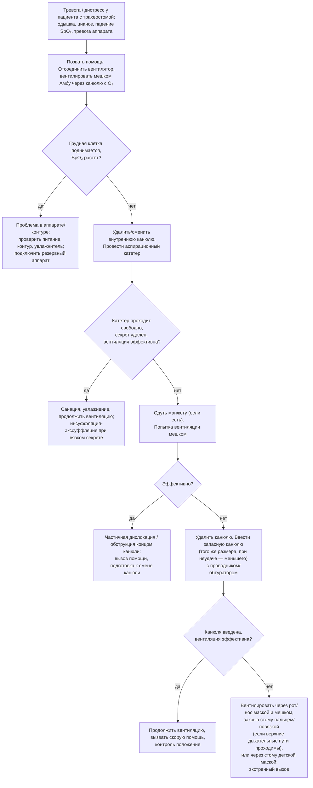

### 2.20. Длительная инвазивная вентиляция

Инвазивная домашняя вентиляция через трахеостому — исторически первый способ длительной вентиляции и сегодня — метод для меньшинства пациентов, у которых НИВЛ невозможна или недостаточна. Она обеспечивает надёжный доступ к дыхательным путям, возможность санации и круглосуточной вентиляции, но ценой осложнений трахеостомы, утраты части функций (речь, глотание требуют особых условий), зависимости от круглосуточного ухода и значительной нагрузки на семью и систему здравоохранения. Решение о ней — одно из самых ответственных в ведении ХДН и всегда должно приниматься с участием пациента, с ясным пониманием целей и альтернатив.

#### 2.20.1. Место инвазивной вентиляции в современной практике

Доля инвазивной вентиляции среди всех пациентов на домашней вентиляции в европейских регистрах снизилась с 20–30 % в 1990-е годы до 5–15 % в настоящее время благодаря НИВЛ, мундштучной вентиляции и поддержке кашля; при этом абсолютное число пациентов не уменьшилось. Основные группы: дети с врождённым синдромом центральной гиповентиляции, СМА I типа (до эры болезнь-модифицирующей терапии), бронхолёгочной дисплазией, пороками развития дыхательных путей; взрослые с высокими повреждениями шейного отдела спинного мозга (C1–C4); пациенты с БАС, выбравшие инвазивную вентиляцию (доля сильно зависит от страны: в Японии — около трети пациентов, в большинстве европейских стран — менее 5–10 % [⚠️ Требуется верификация: современные значения]); пациенты с миодистрофиями и другими НМЗ при неудаче круглосуточной НИВЛ; пациенты после эпизода ОДН (ХОБЛ, сепсис, хирургия), которых не удалось отлучить от вентилятора в отделении интенсивной терапии и специализированных отделениях отлучения; пациенты с обструкцией верхних дыхательных путей (трахеомаляция, стенозы, опухоли).

#### 2.20.2. Показания и условия

Показания к переходу на инвазивную вентиляцию (или к её продолжению после ОДН):

- невозможность эффективной НИВЛ из-за тяжёлых бульбарных нарушений с аспирацией и невозможностью защитить дыхательные пути;
- неконтролируемая секреция, несмотря на оптимальную поддержку кашля (механическая инсуффляция-экссуффляция, аспирация);
- зависимость от вентиляции более 16–20 часов в сутки при невозможности мундштучной вентиляции (бульбарная дисфункция, когнитивные нарушения, младенческий возраст);
- повторные неудачи экстубации или невозможность отлучения в стационаре при сохранении показаний к длительной вентиляции;
- анатомическая обструкция верхних дыхательных путей или невозможность подбора неинвазивного интерфейса;
- повторные эпизоды ОДН с аспирацией на НИВЛ;
- выбор пациента (с полным информированием о бремени и альтернативах).

Обязательные условия: информированное решение пациента (или законного представителя ребёнка) с обсуждением прогноза заболевания, ожидаемого качества жизни, нагрузки на семью, альтернатив (включая отказ от продления жизни с паллиативной помощью); наличие минимум двух обученных ухаживающих (при круглосуточной зависимости — круглосуточное присутствие обученного человека); обеспечение оборудованием (два вентилятора, батареи, аспиратор, инсуффлятор-экссуффлятор, увлажнитель, мониторинг, расходные материалы) и его сервисом; программа наблюдения, визиты на дом, план действий, доступ к экстренной помощи; жилищные условия. При отсутствии условий рассматриваются учреждения длительного ухода с вентиляционной поддержкой.

#### 2.20.3. Трахеостомия

Трахеостомия выполняется хирургически (открытая, предпочтительна при анатомических трудностях, у детей, при плановой длительной вентиляции с формированием стойкой стомы) или пункционно-дилатационно (в отделении интенсивной терапии под бронхоскопическим контролем; быстрее и с меньшей частотой раневой инфекции, но с большей зависимостью от сформированности канала при ранней смене канюли). Время трахеостомии при ОДН: раннее (до 4–7 дней) и позднее (после 10 дней) не различались по смертности в исследовании TracMan (2013), поэтому решение принимается по прогнозу отлучения и предпочтениям. Плановая трахеостомия у пациента с НМЗ, переходящего на инвазивную вентиляцию, предпочтительнее экстренной при ОДН: она позволяет подготовить семью, оборудование и ранний переход домой. После формирования стомы первая смена канюли выполняется через 7–10 дней (хирургическая) или позже (дилатационная), затем — по графику.

#### 2.20.4. Трахеостомические канюли

**Табл. 30.** Типы трахеостомических канюль и их применение при домашней вентиляции

| Признак | Варианты | Применение и комментарии |
|---|---|---|
| Манжета | С манжетой (низкого давления, высокого объёма; пенные манжеты); без манжеты | Манжета герметизирует дыхательные пути (эффективная вентиляция, защита от массивной аспирации — но не от микроаспирации); раздувается до давления 20–30 см вод. ст. с контролем манометром; **безманжетная канюля** — предпочтительна дома у пациентов с сохранным глотанием и у детей (речь, глотание, меньше травм трахеи); утечка компенсируется параметрами вентиляции |
| Внутренняя канюля | С внутренней канюлей (съёмной для очистки); без неё | Внутренняя канюля позволяет быстро устранить обтурацию без смены всей канюли — предпочтительна дома у взрослых; уменьшает просвет |
| Фенестрация | Фенестрированная (окно на дуге для прохождения воздуха к гортани) | Облегчает речь и дыхание через верхние пути при пробном закрытии; при вентиляции — риск утечки и образования грануляций у окна; требует нефенестрированной внутренней канюли при вентиляции |
| Материал | ПВХ (термопластичный), силикон, армированные | Силиконовые — мягче, дольше служат; ПВХ — жёстче, дешевле; выбор по переносимости и срокам замены (ориентировочно каждые 4–12 недель [⚠️ Требуется верификация: по инструкции производителя и локальным протоколам]) |
| Длина и форма | Стандартные, удлинённые (проксимально — при толстой шее, дистально — при трахеомаляции), регулируемой длины, детские | Подбор по анатомии; неправильная длина — причина обструкции концом канюли о стенку трахеи |
| Дополнительные каналы | Канал надманжеточной аспирации | Уменьшает аспирацию секрета, скопившегося над манжетой; у пациентов с высоким риском пневмонии |
| Речевые устройства | Односторонний речевой клапан (вдох через канюлю, выдох через гортань) | Только при полностью сдутой манжете или безманжетной канюле и проходимых верхних дыхательных путях; клапаны для использования в контуре вентилятора существуют |

Размер подбирается так, чтобы при сдутой манжете или безманжетной канюле оставался достаточный просвет вокруг для выдоха через гортань (речь) — обычно канюля занимает не более двух третей просвета трахеи; у постели должны находиться запасная канюля того же размера и канюля на размер меньше.

#### 2.20.5. Режимы, параметры и оборудование

Инвазивная домашняя вентиляция проводится вентилятором жизнеобеспечения через двухконтурную систему или одноконтурную с клапаном выдоха. Режимы: вентиляция по объёму с вспомогательным контролем (гарантия объёма при изменении секреции и сопротивления; при безманжетной канюле объём устанавливают с запасом на утечку, нередко 10–15 мл/кг идеальной массы, контролируя адекватность по SpO₂, tcPCO₂ и комфорту) или по давлению (лучшая компенсация утечки, ограничение пикового давления); ПДКВ 0–5 см вод. ст. (при безманжетной вентиляции часто 0); частота 12–16 (у детей выше); FiO₂ — воздух, кислород добавляется при необходимости. Увлажнение обязательно: подогреваемый увлажнитель (особенно ночью и у детей) и/или тепловлагообменник (днём, при мобильности; добавляет мёртвое пространство и сопротивление, требует смены ежедневно и при загрязнении). Тревоги: отсоединение/низкое давление (главная — дислокация и разгерметизация), высокое давление (обструкция), апноэ, низкий объём, питание; у безманжетной вентиляции тревога низкого давления настраивается с учётом утечки. Комплект оборудования дома: два вентилятора (при зависимости > 16 ч), внутренние и внешние батареи, аспиратор (сетевой и портативный с батареей), механический инсуффлятор-экссуффлятор, увлажнитель, пульсоксиметр (желательно с тревогами при круглосуточной вентиляции), мешок Амбу с коннектором, набор для экстренной замены канюли, расходные материалы (катетеры, канюли, фильтры, трубки), источник резервного питания.

#### 2.20.6. Речь, глотание, питание

Трахеостома и манжета нарушают речь (воздух не проходит через гортань) и глотание (фиксация гортани, снижение чувствительности, давление манжеты на пищевод). Решения для речи: безманжетная канюля или сдувание манжеты во время вентиляции с «утечковой речью» (выдох через гортань при вдохе аппарата — требует подстройки параметров: увеличение объёма, удлинение вдоха, ПДКВ, которое направляет поток через гортань); речевой клапан в контуре или при спонтанном дыхании (только при сдутой манжете); электрогортань и альтернативная коммуникация при невозможности. Глотание оценивается клинически и инструментально (видеофлюороскопия, эндоскопическая оценка); при безопасном глотании пациент ест через рот (часто со сдутой манжетой — вопреки интуиции, раздутая манжета не защищает от аспирации и ухудшает глотание); при небезопасном — гастростомия (при БАС её выполняют заблаговременно, пока ЖЕЛ > 50 %, — п. 2.25.8). Логопед — обязательный член команды.

#### 2.20.7. Уход за трахеостомой и профилактика осложнений

Ежедневный уход: осмотр и обработка стомы, смена повязки и фиксирующей ленты (с защитой от дислокации — один человек держит канюлю), очистка или смена внутренней канюли (2–3 раза в сутки и при необходимости), контроль давления в манжете (манометр; избыточное давление → ишемия, трахеомаляция, стеноз, свищи; недостаточное → аспирация), санация трахеи (по потребности, а не по расписанию; чистая техника дома допустима; глубина — до конца канюли плюс 0,5–1 см, не «до упора», чтобы не травмировать карину; преоксигенация при необходимости; при НМЗ — предпочтительно инсуффляция-экссуффляция через канюлю вместо глубокой санации), увлажнение, смена канюли по графику, гигиена рук и оборудования (контуры и увлажнитель — по инструкции; стерильность в домашних условиях не требуется, но чистота обязательна). Осложнения: ранние (кровотечение, подкожная эмфизема, пневмоторакс, дислокация до формирования канала), поздние — обтурация канюли секретом или кровью (самая частая причина катастроф дома), грануляции (кровоточивость, обструкция; лечение — лазер, прижигание, подбор канюли), инфекции стомы и трахеобронхит, пневмония (колонизация *P. aeruginosa*, *S. aureus* почти неизбежна — лечить инфекцию, а не колонизацию), трахеомаляция и стеноз (на уровне манжеты, стомы, конца канюли), трахеопищеводный свищ, трахео-брахиоцефальный свищ (редко, массивное кровотечение — «сторожевое» кровотечение требует немедленной госпитализации), дисфагия и аспирация, кожные повреждения.

#### 2.20.8. Неотложные ситуации дома

**Рис. 19.** Алгоритм действий ухаживающего при остром нарушении вентиляции у пациента с трахеостомой на дому (по принципам Национального проекта безопасности трахеостомии, Великобритания). Схема читается сверху вниз; обучение алгоритму с отработкой на манекене — обязательная часть подготовки семьи.

Другие неотложные ситуации: отключение электроэнергии (переход на батареи, уведомление службы, план эвакуации); отказ аппарата (резервный аппарат, мешок Амбу); массивное кровотечение из трахеостомы (раздуть манжету, прямое давление, экстренная госпитализация — подозрение на трахео-брахиоцефальный свищ); случайная деканюляция (немедленное введение канюли или, при неудаче, вентиляция по алгоритму); аспирация и пневмония (план действий, ранняя госпитализация при зависимости от вентиляции).

#### 2.20.9. Обучение ухаживающих и организация ухода

Перед выпиской не менее двух ухаживающих проходят структурированное обучение с подтверждением навыков по контрольному перечню: работа с вентилятором и тревогами, смена контура и фильтров, увлажнение, санация, уход за стомой, смена канюли (плановая и экстренная), пользование мешком Амбу, инсуффлятором-экссуффлятором, пульсоксиметром, действия при неотложных ситуациях (с симуляцией), распознавание инфекции и декомпенсации, питание через гастростому, позиционирование и профилактика пролежней, базовые реанимационные мероприятия. Практикуется «пробная ночь» в стационаре, когда семья полностью берёт уход на себя под наблюдением. Дома объём профессионального ухода зависит от системы здравоохранения: от круглосуточного сестринского поста (дети, зависимые взрослые в ряде стран) до визитов несколько раз в неделю; в любом случае необходимы передышка (respite care) для семьи, психологическая поддержка, координатор и круглосуточная телефонная линия. Бремя ухода — главный фактор, ограничивающий домашнюю инвазивную вентиляцию (п. 2.28.3).

#### 2.20.10. Качество жизни и исходы

Исследования качества жизни пациентов на инвазивной вентиляции (высокие спинальные повреждения, НМЗ, ВСЦГ) последовательно показывают, что сами пациенты оценивают его существенно выше, чем предполагают медицинские работники и даже их родственники («парадокс инвалидности»); ключевые факторы удовлетворённости — возможность общения, мобильность (кресло с вентилятором), участие в семейной и общественной жизни, контроль над своей ситуацией, отсутствие боли и одышки. При БАС инвазивная вентиляция продлевает жизнь на годы, но прогрессирование приводит к утрате всех движений, включая глазодвигательные, у части пациентов (состояние «полной изоляции», totally locked-in state; по японским данным — у 10–20 % пациентов после 5 и более лет вентиляции [⚠️ Требуется верификация]), что требует обсуждения до трахеостомии и предварительных распоряжений об условиях прекращения вентиляции. Выживаемость на инвазивной домашней вентиляции определяется заболеванием и качеством ухода: при спинальных повреждениях и НМЗ — многолетняя, при ХОБЛ после неудачного отлучения — ограниченная (медиана порядка 1–2 лет [⚠️ Требуется верификация]); основные причины смерти — пневмония, обтурация канюли и дислокация, сердечно-сосудистые события, прогрессирование болезни.

#### 2.20.11. Стимуляция диафрагмы

📌 **Определение:** **стимуляция диафрагмы** (diaphragm pacing) — электрическая стимуляция диафрагмальных нервов (имплантированными электродами на нервах в шее или грудной клетке — phrenic nerve pacing) или самой диафрагмы в зоне входа нервов (внутримышечные электроды, устанавливаемые лапароскопически) для обеспечения вентиляции без механического вентилятора.

Метод применим только при сохранных диафрагмальных нервах (нижние мотонейроны C3–C5) и диафрагме, то есть при поражении выше этого уровня: высокие повреждения шейного отдела спинного мозга (C1–C3), ВСЦГ, другие центральные гиповентиляции, редкие стволовые поражения. Стимуляция диафрагмальных нервов разработана У. Гленном в 1960–1970-е годы; внутримышечная стимуляция (Р. Ондерс, 2000-е годы) менее инвазивна. После имплантации проводится «кондиционирование» диафрагмы (постепенное увеличение времени стимуляции в течение недель — месяцев, так как атрофированная при вентиляции диафрагма утомляется); у значительной части пациентов со спинальными повреждениями достигается круглосуточная или дневная независимость от вентилятора. Преимущества: физиологическое отрицательное давление вдоха (лучше V̇A/Q̇), свобода от вентилятора и шума, речь и обоняние, мобильность, меньше инфекций по ряду данных, снижение стоимости ухода в долгосрочной перспективе; недостатки — хирургия, стоимость, невозможность при повреждении нервов, сохранение трахеостомы у большинства (обструкция верхних дыхательных путей при стимуляции во сне, потребность в санации, резерв), необходимость резервного вентилятора. Принципиально: при БАС стимуляция диафрагмы **противопоказана** — рандомизированные исследования DiPALS (Великобритания, 2015) и RespiStimALS (Франция, 2016) показали укорочение выживаемости в группах стимуляции (вероятно, из-за ускорения дегенерации мотонейронов при стимуляции).

#### 2.20.12. Деканюляция и отлучение от длительной вентиляции

📌 **Определение:** **длительная (пролонгированная) механическая вентиляция** — вентиляция в течение 21 дня и более не менее 6 часов в сутки (консенсус NAMDRC, 2005); пациенты, не отлучённые к этому сроку, образуют особую группу с высокой смертностью (годичная — порядка 50–60 % по метаанализам [⚠️ Требуется верификация]) и потребностью в специализированных отделениях отлучения.

Деканюляция возможна, когда устранена причина зависимости (восстановление после критического состояния, нейропатии/миопатии критических состояний, разрешение обострения) или когда вентиляцию и санацию можно обеспечить неинвазивно. Критерии: стабильное состояние; потребность в вентиляции отсутствует или может быть покрыта НИВЛ (включая круглосуточную мундштучную); эффективный кашель — PCF с поддержкой > 160 л/мин (протокол Дж. Баха для перевода пациентов с НМЗ с трахеостомы на НИВЛ + инсуффляцию-экссуффляцию); адекватное глотание без значимой аспирации; проходимость верхних дыхательных путей (эндоскопия, проба с закрытием канюли — «кэппинг» — при сдутой манжете в течение 24–72 часов); сохранное сознание и кооперация (или надёжный уход). Процесс: уменьшение размера канюли → безманжетная/фенестрированная → проба закрытия → удаление с окклюзионной повязкой; стома закрывается самостоятельно за дни — недели. Для пациентов с ХОБЛ и другими заболеваниями после ОДН специализированные отделения отлучения (с протоколами постепенного увеличения спонтанного дыхания, НИВЛ после деканюляции, реабилитацией, нутритивной поддержкой) обеспечивают успешное отлучение у 30–60 % пациентов, которых считали «неотлучаемыми» в ОРИТ [⚠️ Требуется верификация].

#### 2.20.13. Примеры и иллюстрации

**Пациент Д**, 34 года, травма шейного отдела позвоночника на уровне C2 после дорожно-транспортного происшествия, тетраплегия, полная зависимость от вентилятора. После стабилизации — трахеостомия, вентиляция по объёму (безманжетная канюля, объём 1100 мл с утечкой, частота 12, ПДКВ 0 — «утечковая речь» освоена за 2 недели), гастростомия не потребовалась (глотание сохранено). Диафрагмальные нервы проходимы по данным стимуляции, диафрагма реагирует — выполнена имплантация системы стимуляции диафрагмы; кондиционирование 4 месяца; через 6 месяцев — полная дневная независимость от вентилятора при стимуляции, ночью — вентилятор (обструкция верхних дыхательных путей при стимуляции во сне); трахеостома сохранена для санации и резерва. Проживает дома с женой и дневным помощником; работает удалённо; за 3 года — одна пневмония.

**Пациентка Е**, 58 лет, БАС с бульбарным дебютом; НИВЛ начата при SNIP 35 см вод. ст. и ортопноэ; через 8 месяцев — слюнотечение, аспирация, утечка, невозможность вентиляции более 3 часов подряд, PaCO₂ 62 мм рт. ст. на НИВЛ, гастростома установлена ранее. На протяжении 6 месяцев с пациенткой и семьёй обсуждались варианты: трахеостомическая вентиляция (продление жизни, вероятно, на годы; круглосуточный уход; прогрессирование до полной обездвиженности; условия, при которых она хотела бы прекратить вентиляцию) и паллиативный путь (опиоиды и седация при нарастании одышки, отказ от вентиляции). Пациентка выбрала трахеостомию при условии письменного распоряжения о прекращении вентиляции при утрате возможности общения; муж и дочь прошли обучение; выполнена плановая трахеостомия; дома — вентиляция по давлению с манжетой, раздуваемой ночью, днём — сдутая манжета с речевым клапаном (речь сохранялась ещё 5 месяцев), затем — коммуникация с помощью айтрекера. Через 2,5 года при утрате глазодвигательного контроля в соответствии с распоряжением вентиляция была прекращена под паллиативной седацией дома (п. 2.30.8).

**Ребёнок Ж**, 3 месяца, ВСЦГ (мутация *PHOX2B*, 20/27 повторов), гиповентиляция во сне и при бодрствовании в период новорождённости — трахеостомия и вентиляция по давлению круглосуточно; к 2 годам — вентиляция только во сне; родители обучены; к 6 годам планируется оценка перехода на НИВЛ или стимуляцию диафрагмы с деканюляцией (п. 2.26.1).

🔬 **Углубление: безманжетная вентиляция и компенсация утечки.** Традиция интенсивной терапии требует раздутой манжеты, но при длительной домашней вентиляции у пациентов с сохранным глотанием безманжетная канюля (или постоянно сдутая манжета) имеет преимущества: отсутствие ишемии стенки трахеи (стеноз, трахеомаляция, свищи), сохранение потока воздуха через гортань (речь, кашель, обоняние, очищение верхних дыхательных путей), лучшее глотание. Цена — утечка части вдоха через гортань, переменная и зависящая от положения головы, фазы глотания и речи. Компенсация: в объёмном режиме устанавливают объём с запасом (контроль адекватности по tcPCO₂ и SpO₂ во сне, а не по заданному числу), в режиме по давлению аппарат сам увеличивает поток; тревога низкого давления настраивается ниже обычного, а тревога отсоединения — по минутной вентиляции или времени; ПДКВ обычно 0 (оно увеличивает утечку и аэрофагию, хотя небольшое ПДКВ при речи направляет поток через гортань). Если во сне при расслаблении глотки утечка становится чрезмерной (десатурация, рост tcPCO₂), допустимо раздувать манжету только на ночь. Этот подход, развитый в программах домашней вентиляции для пациентов с НМЗ и спинальными повреждениями, требует обученной команды и ночного мониторинга при каждой смене параметров — и именно он во многом определяет качество жизни на инвазивной вентиляции.

❗ **Типичная ошибка:** устанавливать речевой клапан при раздутой (или не полностью сдутой) манжете. Клапан пропускает воздух только на вдох, выдох должен идти через гортань — при раздутой манжете выдох невозможен, и за секунды развиваются гиперинфляция, баротравма и асфиксия. Правило: сдуть манжету полностью — проверить выдох через рот и нос — только затем надеть клапан; при любом дистрессе клапан снять.

❗ **Типичная ошибка:** реагировать на тревогу высокого давления или десатурацию у пациента с трахеостомой увеличением FiO₂ или параметров вентилятора. Первая причина катастрофы дома — обтурация или дислокация канюли; алгоритм начинается с ручной вентиляции мешком, внутренней канюли и катетера, а не с настроек аппарата.

💡 **Интересный факт:** одним из первых пациентов, получивших внутримышечную систему стимуляции диафрагмы, был актёр Кристофер Рив, парализованный после травмы шейного отдела позвоночника в 1995 году: в 2003 году ему имплантировали электроды в Кливленде, и он смог часами дышать без вентилятора и вновь ощущать запахи. Его публичность во многом способствовала известности метода и финансированию исследований спинальной травмы.

📝 **Обобщение**

- Инвазивная домашняя вентиляция через трахеостому показана, когда НИВЛ невозможна или недостаточна (тяжёлые бульбарные нарушения с аспирацией, неконтролируемая секреция, зависимость > 16–20 ч без возможности мундштучной вентиляции, неудача отлучения, обструкция верхних дыхательных путей) или по информированному выбору пациента; она требует двух обученных ухаживающих, дублированного оборудования, программы наблюдения и плана действий.
- Канюля подбирается по задачам: безманжетная или со сдутой манжетой — для речи и глотания у пациентов с сохранной защитой дыхательных путей; внутренняя канюля — для быстрого устранения обтурации; давление манжеты контролируется (20–30 см вод. ст.); речевой клапан — только при полностью сдутой манжете.
- Вентиляция ведётся аппаратом жизнеобеспечения по объёму или давлению с обязательным увлажнением, настроенными тревогами и резервом; уход включает санацию по потребности, уход за стомой, плановую смену канюли и профилактику осложнений (обтурация, грануляции, стеноз, свищи, пневмония); алгоритм неотложных действий (мешок Амбу → внутренняя канюля → катетер → сдуть манжету → сменить канюлю → вентиляция маской/через стому) отрабатывается с семьёй.
- Качество жизни на инвазивной вентиляции пациенты оценивают выше, чем ожидают врачи; при БАС необходимы обсуждение состояния полной изоляции и предварительные распоряжения; стимуляция диафрагмы даёт независимость от вентилятора при высоких спинальных повреждениях и ВСЦГ, но противопоказана при БАС (DiPALS, RespiStimALS).
- Деканюляция возможна при устранении причины зависимости или переводе на НИВЛ с поддержкой кашля (PCF с поддержкой > 160 л/мин, безопасное глотание, проходимость дыхательных путей); специализированные отделения отлучения возвращают к самостоятельному дыханию значительную часть «неотлучаемых» пациентов.

Главный вывод: инвазивная вентиляция — не «последняя мера», а метод с собственными показаниями, техникой и этикой, способный обеспечить многолетнюю жизнь достойного качества при правильной организации; её безопасность дома держится на обученной семье и на управлении секретом — теме следующей главы.

❓ **Контрольные вопросы**

1. Сформулируйте показания к переходу от НИВЛ к инвазивной домашней вентиляции и перечислите условия, без которых выписка такого пациента домой недопустима.
2. Почему при длительной домашней вентиляции у пациента с сохранным глотанием предпочтительна безманжетная канюля и как компенсируется утечка? Каково единственное условие безопасного применения речевого клапана?
3. Воспроизведите алгоритм действий ухаживающего при внезапном дистрессе пациента с трахеостомой и объясните порядок шагов.
4. При каких заболеваниях применима стимуляция диафрагмы и почему она противопоказана при БАС?
5. Пациент с миодистрофией Дюшенна, 24 года, на круглосуточной НИВЛ (ночью маска, днём мундштук), PCF с поддержкой 190 л/мин, глотание сохранено, перенёс пневмонию с интубацией; в ОРИТ предлагают трахеостомию. Какие аргументы за и против вы приведёте и какой план предложите?

---

🎮 **Интерактивный элемент 2. Кейс-конференция «Выбор респираторной поддержки»** (после главы 2.20; 40–45 минут; 3–4 группы, каждая получает один кейс и роль докладчика на мультидисциплинарном консилиуме; остальные группы — оппоненты и «семья пациента»).

*Кейсы.*

1. Мужчина 71 года, ХОБЛ, ОФВ₁ 31 %, вторая госпитализация с гиперкапническим ацидозом за год; через 3 недели после выписки PaO₂ 52, PaCO₂ 57 мм рт. ст., pH 7,38; ИМТ 34 кг/м², храп; живёт один, курит 10 сигарет в день. Вопросы: кислород? НИВЛ? CPAP? В каком порядке и при каких условиях? Какие обследования необходимы до решения? Как быть с курением и одиночеством?
2. Женщина 46 лет, БАС, бульбарный дебют 14 месяцев назад; ЖЕЛ 48 %, SNIP 30 см вод. ст., ортопноэ, PaCO₂ 50 мм рт. ст., слюнотечение, PCF 180 л/мин, гастростома установлена; замужем, двое детей-подростков; хочет «жить, пока могу общаться». Вопросы: НИВЛ — как и с какими ожиданиями? Поддержка кашля? Когда и как обсуждать трахеостомию? Что документировать?
3. Юноша 19 лет, миодистрофия Дюшенна, ночная НИВЛ 5 лет, в последние 3 месяца одышка днём, ЖЕЛ 0,6 л, PaCO₂ днём 52 мм рт. ст. после сна с НИВЛ, PCF 150 л/мин, глотание сохранено, кардиомиопатия (ФВ 38 %); учится в университете. Вопросы: расширение НИВЛ на день — как? Мундштучная вентиляция? Инсуффляция-экссуффляция? Трахеостомия — когда обсуждать? Какое оборудование и обучение нужны?
4. Женщина 63 лет, ИМТ 52 кг/м², госпитализирована с ОДН (PaCO₂ 78, pH 7,24), НИВЛ в стационаре эффективна; при выписке PaCO₂ 54 мм рт. ст., бикарбонат 34 ммоль/л, полиграфия не выполнена; диабет, гипертензия, сердечная недостаточность с сохранённой фракцией выброса. Вопросы: на чём выписать — CPAP или НИВЛ? Когда и какое исследование сна? Критерии перехода между методами? Роль снижения массы тела и бариатрической хирургии?

*Задание группам.* Подготовить за 15 минут заключение консилиума: цели лечения с позиции пациента; выбранный вид поддержки с параметрами и обоснованием (ссылки на исследования и рекомендации); необходимые обследования; оборудование и обучение; план наблюдения на 3 месяца; альтернативные сценарии и условия пересмотра; что будет сказано пациенту и семье. Доклад — 5 минут, обсуждение — 5 минут; «семья пациента» задаёт вопросы о бремени и качестве жизни.

*Акценты преподавателя.* Различие целей поддержки по нозологиям; порядок «обследование → обратимые факторы → поддержка»; критерии ERS 2019/ATS 2020 (ХОБЛ), ATS 2019 (СОГ), CHEST 2023 (НМЗ); невозможность решить вопрос о трахеостомии при БАС «в момент кризиса»; роль поддержки кашля; организационные условия как часть медицинского решения.

---
