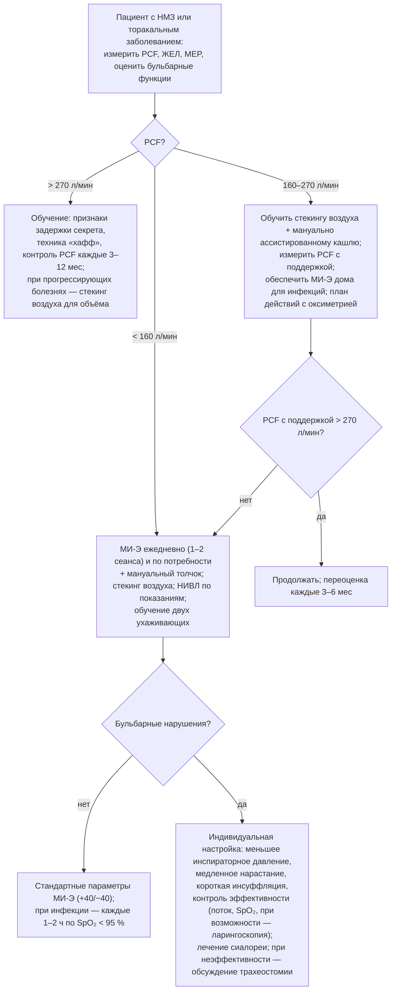

### 2.21. Поддержка бронхиального клиренса и кашля

Удаление секрета из дыхательных путей — функция, без которой любая вентиляция, самостоятельная или аппаратная, рано или поздно терпит неудачу. При ХДН клиренс нарушается с двух сторон: избыточная или изменённая продукция секрета (ХОБЛ, бронхоэктазы, муковисцидоз) и неэффективный кашель (нервно-мышечные заболевания, слабость, деформации, трахеостома). Задержка секрета — самая частая причина пневмоний, ателектазов и острых декомпенсаций у пациентов с ХДН и самая частая причина неудач НИВЛ и трахеостомии у нервно-мышечных пациентов. Методы этой главы просты, недороги и спасают жизни, но остаются недоиспользованными.

#### 2.21.1. Физиология кашля и мукоцилиарного клиренса

Кашель состоит из трёх фаз: **инспираторной** (глубокий вдох до 85–90 % ОЕЛ, который растягивает экспираторные мышцы и расширяет дыхательные пути), **компрессионной** (закрытие голосовой щели на ≈ 0,2 с с сокращением экспираторных мышц — внутригрудное давление достигает 100–300 см вод. ст.) и **экспульсивной** (открытие голосовой щели с взрывным выдохом; пиковая скорость потока у здоровых взрослых 6–14 л/с, то есть 360–840 л/мин; динамическое сжатие дыхательных путей увеличивает линейную скорость потока и сдвиговые силы, срывающие секрет). Для эффективного кашля необходимы: достаточный объём вдоха (инспираторные мышцы, растяжимость), функционирующая гортань (бульбарные функции), сила экспираторных мышц (брюшные, межрёберные), проходимые дыхательные пути. Мукоцилиарный клиренс обеспечивает фоновое удаление секрета с периферии к крупным бронхам (скорость транспорта в трахее около 5–20 мм/мин) и зависит от реологии слизи, функции ресничек, гидратации перицилиарного слоя; он нарушается при курении, ХОБЛ, бронхоэктазах, муковисцидозе, первичной цилиарной дискинезии, инфекции, обезвоживании, сухом газе (кислород без увлажнения, трахеостома в обход носа), седативных и антихолинергических препаратах.

#### 2.21.2. Механизмы нарушения клиренса при ХДН

- **ХОБЛ**: гиперсекреция (гиперплазия бокаловидных клеток), вязкая слизь, цилиарная дисфункция, динамический коллапс дыхательных путей при кашле (эмфизема) — кашель становится неэффективным при сохранённой силе, а частые кашлевые усилия увеличивают гиперинфляцию и одышку.
- **Бронхоэктазы, муковисцидоз, первичная цилиарная дискиnезия**: порочный круг «инфекция — воспаление — повреждение — задержка секрета — инфекция»; большие объёмы гнойной мокроты.
- **Нервно-мышечные заболевания**: слабость инспираторных мышц (малый объём вдоха), экспираторных (низкое давление), бульбарная дисфункция (невозможность закрыть голосовую щель — отсутствует компрессионная фаза, аспирация слюны); пиковая скорость кашля падает ниже 160–270 л/мин; при инфекции сила снижается дополнительно, и обычная простуда становится угрозой жизни.
- **Торакальные деформации, ожирение**: малые объёмы, неэффективная механика экспираторных мышц.
- **Трахеостома**: обход носа (сухой холодный воздух), невозможность закрыть голосовую щель (при раздутой манжете кашель — это только экспираторный поток через канюлю), механическое раздражение, колонизация.
- **Общие факторы**: обезвоживание, седативные препараты, боль (переломы рёбер, операции), постельный режим, когнитивные нарушения, гастроэзофагеальный рефлюкс и аспирация.

#### 2.21.3. Оценка эффективности кашля и клиренса

Ключевой показатель — **пиковая скорость кашля** (PCF, п. 2.11.2.3): > 270 л/мин — эффективный кашель с резервом; 160–270 л/мин — недостаточный резерв (при инфекции станет неэффективным) — порог обучения методам поддержки; < 160 л/мин — неэффективный кашель уже в стабильном состоянии — постоянное применение поддержки. Дополнительно: MEP (< 45–60 см вод. ст. ассоциировано с неэффективным кашлем), ЖЕЛ (< 1,5 л — недостаточный инспираторный объём), максимальная ёмкость инсуффляции (п. 2.21.7), оценка бульбарных функций (голос, глотание, слюнотечение, способность закрыть рот и надуть щёки, проба с глотком воды), объём и характер мокроты (суточный объём, гнойность — шкала цвета), аускультация и SpO₂ до и после процедур клиренса, рентгенография/КТ при подозрении на ателектаз, микробиология мокроты при бронхоэктазах. У пациентов с НМЗ оценка PCF должна повторяться при каждом визите, поскольку снижение нередко опережает жалобы.

#### 2.21.4. Методы клиренса при гиперсекреции

**Табл. 31.** Методы поддержки бронхиального клиренса при гиперсекреторных заболеваниях

| Метод | Механизм | Применение | Доказательная база и комментарии |
|---|---|---|---|
| Активный цикл дыхательных техник (ACBT): контроль дыхания → упражнения на расширение грудной клетки → форсированный выдох («хафф») | Мобилизация секрета из периферии с помощью глубоких вдохов и форсированных выдохов с открытой голосовой щелью при разных объёмах лёгких | Бронхоэктазы, муковисцидоз, ХОБЛ с мокротой; самостоятельно 1–2 раза в день и при обострении | Основа большинства программ; эквивалентен другим методам по объёму мокроты; не требует оборудования |
| Аутогенный дренаж | Контролируемое дыхание на разных уровнях лёгочного объёма (от низкого к высокому) для «сбора» и выведения секрета без форсированного выдоха | Пациенты с коллапсом дыхательных путей, гиперреактивностью | Требует обучения; сопоставим с ACBT |
| Позиционный (постуральный) дренаж (модифицированный, без положения головой вниз) | Гравитационный отток из сегментов | Локализованные бронхоэктазы, при переносимости | Положения головой вниз провоцируют рефлюкс и десатурацию; современные протоколы используют модифицированные положения |
| Перкуссия, вибрация грудной клетки | Механическое смещение секрета | Как дополнение, у детей, при невозможности активных техник | Доказательства слабые; дискомфорт |
| Устройства положительного экспираторного давления (ПЭД-маска/мундштук) | Выдох против сопротивления (10–20 см вод. ст.) предотвращает коллапс, открывает коллатеральные пути, продвигает секрет | Бронхоэктазы, муковисцидоз, ХОБЛ | Сопоставимы с другими методами; удобны для самостоятельного применения |
| Осциллирующие ПЭД-устройства (Flutter, Acapella, Aerobika и аналоги) | ПЭД + колебания потока (осцилляции) снижают вязкость слизи и усиливают транспорт | Те же группы; при ХОБЛ — снижение обострений в отдельных РКИ | Простота; при ХОБЛ после обострения — умеренные доказательства пользы |
| Высокочастотная осцилляция грудной стенки (жилет, HFCWO) | Внешние осцилляции 5–20 Гц через надувной жилет | Муковисцидоз, бронхоэктазы, НМЗ при невозможности активных техник | При муковисцидозе не превосходит другие методы; при ХОБЛ и НМЗ доказательства низкого качества; высокая стоимость |
| Интрапульмональная перкуссионная вентиляция (IPV) | Высокочастотные мини-вдохи через мундштук/трахеостому с аэрозолем | Ателектазы, задержка секрета при НМЗ, трахеостома | Небольшие исследования; доступность ограничена |
| Ингаляции гипертонического раствора (3–7 %), маннитола | Осмотическая гидратация секрета, стимуляция кашля | Муковисцидоз (снижение обострений), бронхоэктазы (данные противоречивы) | Предварительная ингаляция бронхолитика; бронхоспазм у части пациентов |
| Муколитики (N-ацетилцистеин, карбоцистеин, эрдостеин), дорназа альфа | Разрушение дисульфидных связей / ДНК в гнойной мокроте | ХОБЛ (снижение обострений в высоких дозах), муковисцидоз (дорназа); при бронхоэктазах без муковисцидоза дорназа альфа противопоказана (увеличение обострений) | Умеренные эффекты; дорназа альфа — только при муковисцидозе |
| Увлажнение, высокопоточная назальная терапия | Восстановление мукоцилиарного транспорта, разжижение секрета | Трахеостома, бронхоэктазы, ХОБЛ с вязкой мокротой | Физиологически обоснованы; при бронхоэктазах — снижение обострений в небольших исследованиях |
| Физическая активность, лёгочная реабилитация | Увеличение вентиляции и осцилляций, стимуляция кашля | Все группы | Дополняет, но не заменяет специальные техники при большом объёме мокроты |

Принципы программы: ежедневно (1–2 раза, при обострении чаще), после бронхолитика и до ингаляционных антибиотиков, в сочетании с достаточной гидратацией, индивидуальный выбор метода по предпочтению и переносимости (лучший метод — тот, который пациент выполняет), обучение физиотерапевтом с периодической проверкой, лечение рефлюкса, вакцинация.

#### 2.21.5. Методы поддержки кашля при слабости (нервно-мышечные и торакальные заболевания)

При слабости мышц методы клиренса гиперсекреторного типа бесполезны без восстановления трёх фаз кашля; стратегия — усилить вдох (увеличить объём), усилить выдох (внешняя сила) или заменить обе фазы аппаратом.

- **Усиление инспираторной фазы**: стекинг воздуха (п. 2.21.7), глубокий вдох с помощью вентилятора или мешка, глоссофарингеальное дыхание.
- **Усиление экспираторной фазы — мануально ассистированный кашель**: синхронный с кашлевым усилием пациента толчок помощника в эпигастрии (вверх и внутрь) или с боков нижней части грудной клетки; увеличивает PCF на 10–30 %; противопоказания — полный желудок (ждать 1–1,5 часа после еды), остеопороз рёбер, беременность, травмы живота; в сочетании со стекингом воздуха эффект суммируется (PCF может превысить 270 л/мин у пациента с собственным кашлем 120 л/мин).
- **Механическая инсуффляция-экссуффляция** (МИ-Э; аппараты типа CoughAssist и аналоги): через маску, мундштук или трахеостому аппарат подаёт положительное давление (вдох, +30…+50 см вод. ст., 2–3 с), затем быстро переключается на отрицательное (выдох, −30…−50 см вод. ст., 2–3 с), создавая поток, имитирующий кашель (пиковый экспираторный поток 6–10 л/с); обычно 4–6 циклов в серии, 3–5 серий с паузами, в сочетании с мануальным толчком на фазе выдоха; показана при PCF < 270 л/мин (обучение и наличие дома для инфекций) и постоянно при PCF < 160 л/мин, при трахеостоме у пациентов с НМЗ (вместо глубокой санации), при ателектазах; эффективнее других методов по приросту PCF у пациентов с НМЗ (M. Chatwin и соавторы, 2003) и, по когортным данным, снижает частоту госпитализаций и потребность в трахеостомии; побочные эффекты — вздутие живота, рефлюкс, дискомфорт, редко пневмоторакс (осторожность при буллёзной эмфиземе, недавнем пневмотораксе, нестабильной гемодинамике); при бульбарном БАС — закрытие гортани в ответ на инсуффляцию (🔬 ниже).
- **Глоссофарингеальное дыхание** («лягушачье дыхание»): пациент языком и глоткой «проглатывает» порции воздуха (60–100 мл) в лёгкие, накапливая объём, — позволяет пациентам с нулевой ЖЕЛ дышать без аппарата минуты — часы (резерв при отказе вентилятора) и накапливать объём для кашля и громкой речи; требует сохранных бульбарных функций и обучения.
- **Протокол с обратной связью по оксиметрии** (Дж. Бах): пациент с НМЗ измеряет SpO₂; падение ниже 95 % при дыхании воздухом означает задержку секрета (или гиповентиляцию) и требует МИ-Э (и/или ассистированного кашля) до восстановления SpO₂ ≥ 95 % и усиления НИВЛ; кислород без клиренса не назначается (маскирует проблему).

**Рис. 20.** Алгоритм выбора методов поддержки кашля при слабости дыхательных мышц по пиковой скорости кашля (PCF) и бульбарному статусу. Схема читается сверху вниз.

#### 2.21.6. Аспирация секрета

Аспирация катетером через трахеостому — необходимая, но ограниченная процедура: катетер достигает трахеи и чаще правого главного бронха, не удаляет секрет из периферии, травмирует слизистую, вызывает кашель, десатурацию, брадикардию; выполняется по потребности (слышимый секрет, рост пикового давления, десатурация, беспокойство), с преоксигенацией при необходимости, чистой техникой дома, ограниченной глубиной и продолжительностью (10–15 с), с увлажнением; у пациентов с НМЗ МИ-Э через трахеостому эффективнее и менее травматична, чем глубокая санация. Назотрахеальная аспирация у нетрахеостомированных пациентов болезненна, малоэффективна и используется лишь в экстренных ситуациях; ротоглоточная аспирация полезна при сиалорее и бульбарных нарушениях.

#### 2.21.7. Рекрутирование объёма лёгких и стекинг воздуха

📌 **Определение:** **стекинг воздуха** (air stacking, «накопление вдохов») — метод, при котором пациент последовательно, без выдоха, получает несколько порций воздуха (с помощью ручного дыхательного мешка с односторонним клапаном и мундштуком/маской, объёмного вентилятора или глоссофарингеального дыхания), удерживая их закрытой голосовой щелью, до достижения **максимальной ёмкости инсуффляции** (maximum insufflation capacity, MIC) — наибольшего объёма, который можно удержать; **рекрутирование объёма лёгких** (lung volume recruitment, LVR) — регулярная (обычно 2 раза в день по 3–5 манёвров) практика таких глубоких инсуффляций.

Цели и эффекты: увеличение объёма вдоха перед кашлем (PCF после стекинга выше, чем после максимального самостоятельного вдоха, иногда на 50–100 %); поддержание растяжимости лёгких и грудной стенки и профилактика контрактур грудной клетки и микроателектазов при хронически малых объёмах (разница между MIC и ЖЕЛ отражает «резерв» растяжимости — при её утрате даже аппарат не может раздуть лёгкие); громкая речь (длинные фразы на накопленном объёме); подготовка к инфекции. Техника требует закрытия голосовой щели (бульбарные функции); при их утрате используется пассивная инсуффляция с удержанием клапаном или инсуффлятором (ёмкость пассивной инсуффляции, LIC). Данные о замедлении снижения ЖЕЛ при регулярном LVR получены в наблюдательных исследованиях при миодистрофии Дюшенна (D. A. McKim и соавторы, 2012); рандомизированное исследование у детей с Дюшенном (STACK, S. L. Katz и соавторы, 2022) не показало замедления снижения ФЖЕЛ за 2 года [⚠️ Требуется верификация: детали результатов], поэтому главная доказанная польза метода — немедленное увеличение эффективности кашля и объёма, а также подготовка к острой ситуации; он рекомендуется руководствами (CHEST 2023, ENMC) у пациентов с НМЗ при ЖЕЛ < 60–70 % должного или PCF < 270 л/мин.

#### 2.21.8. Клиренс у пациентов с трахеостомой

Трахеостома требует системы: постоянное увлажнение (подогреваемое ночью, тепловлагообменник днём), системная гидратация, МИ-Э через канюлю (у пациентов с НМЗ — основной метод; давления подбираются с учётом сопротивления канюли; манжету на время процедуры сдувают, чтобы удалять секрет и из верхних дыхательных путей, или оставляют раздутой при аспирационном риске), аспирация по потребности, надманжеточная аспирация при соответствующей канюле, позиционирование и мобилизация, небулизация физиологического или гипертонического раствора при вязком секрете (с осторожностью), лечение рефлюкса; при рецидивирующих обтурациях — пересмотр увлажнения, канюли (внутренняя канюля, размер), гидратации, инфекции.

#### 2.21.9. Бронхоскопическая санация

Бронхоскопия для удаления секрета показана при долевом или сегментарном ателектазе, не разрешившемся после 24–48 часов интенсивного клиренса (МИ-Э, позиционирование, НИВЛ), при обтурации канюли сгустками, подозрении на инородное тело или опухоль, для забора материала при неясной инфекции; у пациента с ХДН она сопряжена с риском десатурации и гиперкапнии (седация!) и должна выполняться под НИВЛ/высокопоточной терапией с мониторингом; рутинная «санационная бронхоскопия» при задержке секрета не заменяет неинвазивные методы и не должна быть первым шагом.

#### 2.21.10. Ведение инфекции у пациента с неэффективным кашлем

Респираторная инфекция у пациента с PCF < 270 л/мин — неотложная ситуация, даже если выглядит как простуда. План действий (составляется заранее, п. 2.27.7.3): при первых симптомах — усиление клиренса (МИ-Э каждые 1–2 часа днём и по потребности ночью при SpO₂ < 95 %, ассистированный кашель), увеличение времени НИВЛ вплоть до круглосуточной (при появлении одышки, десатурации, усталости), контроль SpO₂ несколько раз в день, ранняя антибиотикотерапия (многие программы выдают пациенту «антибиотик в запас» с инструкцией), гидратация, отказ от седативных и противокашлевых препаратов, отказ от кислорода без одновременного клиренса и вентиляции (SpO₂ при инфекции у пациента с НМЗ падает из-за секрета и гиповентиляции, кислород лишь маскирует их), низкий порог госпитализации (SpO₂ < 92–95 % несмотря на меры, нарастание одышки, невозможность откашлять, спутанность, невозможность обеспечить уход). В стационаре — тот же протокол с расширением (НИВЛ, МИ-Э персоналом, при необходимости интубация с ранней экстубацией на НИВЛ и МИ-Э, а не трахеостомией). Исследования программ, сочетающих НИВЛ и МИ-Э, показывают резкое снижение частоты госпитализаций и трахеостомий у пациентов с Дюшенном и СМА.

#### 2.21.11. Фармакологическая поддержка клиренса

Муколитики при ХОБЛ и бронхоэктазах (п. 2.16.1, 2.16.5); гипертонический раствор и дорназа альфа при муковисцидозе; бронхолитик перед сеансом клиренса; при сиалорее и слюнотечении (БАС, дети с НМЗ) — антихолинергические препараты (гликопирроний, атропин сублингвально, скополаминовый пластырь), инъекции ботулотоксина в слюнные железы, лучевая терапия желёз (при неэффективности); при вязкой слюне — увлажнение, снижение антихолинергических препаратов, ананасовый сок/папаин (эмпирически); лечение рефлюкса (ингибиторы протонной помпы при симптомном рефлюксе, положение, питание); отхаркивающие препараты без доказательств; противокашлевые средства при продуктивном кашле противопоказаны; избегать препаратов, сушащих секрет (антигистаминные I поколения, избыток антихолинергиков) у пациентов с вязкой мокротой.

#### 2.21.12. Обучение и организация

Методы клиренса эффективны, если выполняются ежедневно и правильно: обучение физиотерапевтом (респираторным терапевтом) с демонстрацией и обратной связью, письменные инструкции с рисунками, видео, проверка техники при каждом визите; обеспечение оборудованием (осциллирующие устройства, мешок с клапаном для стекинга, МИ-Э с запасным контуром и масками; финансирование различается по странам — п. 2.28.2); обучение минимум двух ухаживающих мануальному кашлю, стекингу, МИ-Э и аспирации с подтверждением навыков; включение параметров (давления МИ-Э, частота сеансов, пороги SpO₂) в план действий; периодическая переоценка PCF и параметров при прогрессировании.

#### 2.21.13. Примеры и иллюстрации

**Пример 2** (кифосколиоз). PCF 280 л/мин — над порогом неэффективности, но без резерва на инфекцию. Обучена стекингу воздуха мешком с односторонним клапаном (MIC 1,9 л при ЖЕЛ 1,05 л — хороший резерв растяжимости): PCF после стекинга 340 л/мин, со стекингом и мануальным толчком мужа — 390 л/мин; LVR 2 раза в день по 5 манёвров; дома — пульсоксиметр и план действий; МИ-Э не требуется постоянно, но программа обеспечивает его на время инфекций по заявке.

**Пациентка Е** (БАС, бульбарная форма; п. 2.20.13). PCF 180 л/мин, с мануальной поддержкой 210 — недостаточно. МИ-Э через назально-ротовую маску: при стандартных +40/−40 см вод. ст. — ощущение «перекрытия», поток выдоха низкий (признак закрытия гортани на инсуффляции); после снижения инспираторного давления до +25, замедления нарастания и укорочения инсуффляции до 1,5 с с экссуффляцией −40 — эффективная эвакуация секрета (поток 4–5 л/с), SpO₂ стабильна; сеансы 3 раза в день и по потребности, гликопирроний при слюнотечении; дочь и муж обучены. При прогрессировании бульбарных нарушений эффективность снижалась — один из факторов решения о трахеостомии.

**Пример 1** (ХОБЛ). Хронический продуктивный кашель (30–40 мл мокроты в сутки), при обострениях — вязкая гнойная мокрота с нарастанием одышки при кашле. Обучен ACBT с «хаффом» и осциллирующему ПЭД-устройству (2 раза в день при обострении, 1 раз — в стабильном состоянии), N-ацетилцистеин; подогреваемое увлажнение при НИВЛ уменьшило вязкость утренней мокроты; эффективность оценена по уменьшению эпизодов «залипания» мокроты и десатурации при кашле.

🔬 **Углубление: гортань и механическая инсуффляция-экссуффляция при БАС.** Долгое время считалось, что МИ-Э при бульбарном БАС неэффективна из-за «коллапса верхних дыхательных путей на выдохе». Исследования с транс-назальной ларингоскопией во время МИ-Э (T. Andersen и соавторы, 2017) показали иную картину: у пациентов с бульбарными нарушениями на фазе инсуффляции возникает парадоксальное приведение голосовых складок и надгортанника (гортань «защищается» от быстрого потока) — воздух не попадает в лёгкие, и экссуффляция становится бесполезной; на фазе экссуффляции — сужение на уровне надскладочных структур и корня языка. Практические следствия: меньшее инспираторное давление, медленное нарастание (постепенная инсуффляция), короткая инсуффляция с удлинённой экссуффляцией, ручная поддержка нижней челюсти и языка, положение, подбор по видимому эффекту (поток, движение секрета, SpO₂), а не по «стандартным» ±40 см вод. ст. У части пациентов с тяжёлым бульбарным синдромом МИ-Э остаётся неэффективной — и это один из объективных аргументов при обсуждении трахеостомии.

❗ **Типичная ошибка:** назначать кислород пациенту с нервно-мышечным заболеванием при десатурации во время респираторной инфекции без клиренса и вентиляции. Десатурация у него вызвана секретом и гиповентиляцией; кислород восстанавливает SpO₂, устраняя единственный доступный пациенту сигнал тревоги, и декомпенсация развивается «внезапно» на фоне «нормальной сатурации».

❗ **Типичная ошибка:** откладывать обучение методам поддержки кашля до первого эпизода пневмонии. Порог PCF 270 л/мин существует именно потому, что при инфекции кашель станет неэффективным; к этому моменту пациент и семья должны уже владеть стекингом, ассистированным кашлем и МИ-Э, а оборудование — быть дома.

💡 **Интересный факт:** глоссофарингеальное дыхание открыли не врачи, а пациенты: в начале 1950-х годов в реабилитационном центре Ранчо-Лос-Амигос (Калифорния) парализованные полиомиелитом пациенты, лишённые возможности дышать вне «железного лёгкого», самостоятельно научились «заглатывать» воздух языком и глоткой; врач Клэренс Дейл описал метод в 1951 году и назвал его «лягушачьим дыханием». Некоторые пациенты могли таким образом дышать часами, а один из них, как сообщалось, даже плавал под водой — при нулевой жизненной ёмкости лёгких.

📝 **Обобщение**

- Эффективный кашель требует объёма вдоха, закрытия голосовой щели и силы выдоха; пиковая скорость кашля — ключевой показатель: > 270 л/мин — резерв есть, 160–270 — нужна подготовка к инфекции, < 160 — постоянная поддержка; задержка секрета — главная причина декомпенсаций и неудач вентиляции при НМЗ.
- При гиперсекреции (ХОБЛ, бронхоэктазы, муковисцидоз) применяются техники дыхания (ACBT, аутогенный дренаж), ПЭД- и осциллирующие устройства, модифицированный позиционный дренаж, увлажнение, гипертонический раствор и муколитики по показаниям (дорназа альфа — только при муковисцидозе), ежедневно и с усилением при обострениях.
- При слабости кашля (НМЗ, торакальные болезни) — стекинг воздуха и рекрутирование объёма, мануально ассистированный кашель, механическая инсуффляция-экссуффляция (±30–50 см вод. ст., с мануальным толчком; при бульбарных нарушениях — индивидуальная настройка из-за закрытия гортани), глоссофарингеальное дыхание; аспирация через трахеостому — по потребности и не вместо МИ-Э.
- Инфекция у пациента с неэффективным кашлем ведётся по заранее составленному плану: клиренс по обратной связи от оксиметрии, усиление НИВЛ, ранний антибиотик, отказ от изолированного кислорода и седативных, низкий порог госпитализации; программы НИВЛ + МИ-Э резко снижают число госпитализаций и трахеостомий.
- Успех зависит от обучения пациента и двух ухаживающих, обеспечения оборудованием и регулярной переоценки PCF и техники.

Главный вывод: управление секретом — условие эффективности всех остальных методов лечения ХДН; оно должно быть организовано заранее, а не в момент пневмонии. Следующая глава посвящена восстановлению функции — лёгочной реабилитации и немедикаментозным методам.

❓ **Контрольные вопросы**

1. Опишите три фазы кашля и укажите, какие заболевания нарушают каждую из них; почему при бульбарных нарушениях кашель неэффективен даже при сохранной силе экспираторных мышц?
2. Какие пороговые значения пиковой скорости кашля определяют тактику и какие вмешательства соответствуют каждому диапазону?
3. Сравните методы клиренса при бронхоэктазах и при миодистрофии Дюшенна: почему осциллирующее ПЭД-устройство бесполезно во втором случае, а инсуффлятор-экссуффлятор — в первом?
4. Объясните технику и цели стекинга воздуха; что такое максимальная ёмкость инсуффляции и почему её разница с ЖЕЛ имеет значение?
5. Составьте план действий при респираторной инфекции для пациента с БАС (PCF 200 л/мин, на ночной НИВЛ) с указанием порогов SpO₂, частоты МИ-Э, критериев госпитализации и запрещённых действий.
