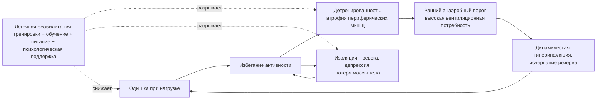

### 2.22. Лёгочная реабилитация и немедикаментозные методы

Лёгочная реабилитация — самое недооценённое вмешательство при ХДН. Она не изменяет функцию лёгких, но изменяет функцию пациента: переносимость нагрузки, одышку, тревогу и депрессию, частоту госпитализаций и, после обострений, выживаемость. Её эффект сопоставим с эффектом лучших лекарств, а стоимость — ниже; при этом её получает лишь малая часть нуждающихся. В этой главе — физиологическое обоснование, доказательная база, компоненты программы, особенности при ХДН, нутритивная поддержка и техники контроля одышки.

#### 2.22.1. Определение и обоснование

📌 **Определение:** **лёгочная реабилитация** — комплексное вмешательство, основанное на тщательной оценке пациента и включающее индивидуально подобранные компоненты — физические тренировки, обучение и изменение поведения, — направленное на улучшение физического и психологического состояния людей с хроническими заболеваниями органов дыхания и на формирование долгосрочной приверженности поведению, укрепляющему здоровье (определение ATS/ERS, 2013).

Обоснование лежит в системном характере ХДН (глава 2.9): одышка заставляет пациента избегать нагрузок, бездействие приводит к детренированности и атрофии периферических мышц (сдвиг волокон от окислительного I типа к гликолитическому II типу, снижение капилляризации и митохондриальной функции), детренированные мышцы раньше переходят на анаэробный метаболизм — лактат и углекислота требуют большей вентиляции при той же работе, вентиляционная потребность упирается в ограниченный резерв, одышка усиливается, активность снижается ещё больше; добавляются социальная изоляция, тревога, депрессия, потеря массы тела. Тренировки разрывают эту спираль со стороны периферии: тренированные мышцы требуют меньшей вентиляции при той же нагрузке (ниже лактат, ниже V̇E, медленнее дыхание — меньше динамическая гиперинфляция), пациент выполняет больше работы при тех же лёгких; обучение и психологическая поддержка снижают страх одышки и повышают самоэффективность.

**Рис. 21.** Спираль детренированности при ХДН и точки приложения лёгочной реабилитации. Схема читается по стрелкам; пунктир — воздействие реабилитации.

#### 2.22.2. Доказательная база

При **ХОБЛ** реабилитация — одно из наиболее доказанных вмешательств: систематические обзоры Cochrane показывают клинически значимое увеличение переносимости нагрузки (дистанция 6MWT в среднем на 40–50 м при минимально значимом изменении 30 м), уменьшение одышки и улучшение качества жизни (все домены профильных опросников выше порога значимости), уменьшение тревоги и депрессии; реабилитация, начатая в течение 3–4 недель после госпитализации по поводу обострения, снижает частоту повторных госпитализаций и — по данным метаанализа M. A. Puhan и соавторов (2016) с оговорками о гетерогенности — смертность; крупные наблюдательные когорты (США, 2020) подтверждают связь ранней реабилитации после выписки со снижением годичной смертности. Рекомендации ATS (2023) дают сильную рекомендацию реабилитации при стабильной ХОБЛ и после госпитализации, условные — при ИЗЛ и ЛГ, допускают телереабилитацию как альтернативу центровым программам. При **ИЗЛ** реабилитация улучшает дистанцию ходьбы, одышку и качество жизни, хотя эффекты менее стойкие из-за прогрессирования; при **ЛГ** — тренировки под наблюдением безопасны и увеличивают переносимость нагрузки (многоцентровое РКИ E. Grünig и соавторов, 2021); при **бронхоэктазах, муковисцидозе, после трансплантации, после COVID-19** — польза подтверждена; при **нервно-мышечных заболеваниях** данные ограничены: умеренные субмаксимальные аэробные тренировки безопасны и полезны при медленно прогрессирующих заболеваниях, тогда как интенсивные и эксцентрические нагрузки при дистрофинопатиях могут повреждать мышцы. Пациенты с тяжёлой ХДН, на кислороде и НИВЛ, получают от реабилитации не меньшую пользу, чем менее тяжёлые, — тяжесть не является противопоказанием, а аргументом за адаптацию программы.

#### 2.22.3. Показания, противопоказания, отбор

Показания: симптомные пациенты с хроническим заболеванием органов дыхания (mMRC ≥ 2, ограничение активности, снижение качества жизни) независимо от стадии; после госпитализации по поводу обострения (начало в течение 2–4 недель после выписки); перед и после хирургических вмешательств (редукция объёма, трансплантация, резекция лёгкого — преабилитация); при ЛГ в стабильном состоянии на оптимальной терапии; после критического состояния. Противопоказания немногочисленны и в основном относительны: нестабильная стенокардия, недавний инфаркт, неконтролируемые аритмии, тяжёлый аортальный стеноз, декомпенсированная сердечная недостаточность, неконтролируемая гипертензия, тяжёлые ортопедические или неврологические ограничения, делающие тренировку невозможной (но не ограничивающие обучение), выраженные когнитивные нарушения без сопровождения, активная инфекция. Зависимость от кислорода, гиперкапния, НИВЛ, трахеостома, лёгочное сердце в стабильном состоянии, пожилой возраст и хрупкость — не противопоказания. Перед включением — оценка (функция, газы, нагрузочный тест с SpO₂ и ЭКГ при показаниях, ЭхоКГ при ЛГ, нутритивный и психологический статус, коморбидность, цели пациента).

#### 2.22.4. Компоненты программы

**Табл. 32.** Компоненты программы лёгочной реабилитации

| Компонент | Содержание и параметры | Комментарии при ХДН |
|---|---|---|
| Оценка | Функция, нагрузочный тест (6MWT, ISWT, КПНТ), одышка, качество жизни, тревога/депрессия, нутритивный статус, сила мышц (квадрицепс, хват), баланс, коморбидность, цели | Определяет индивидуальную программу и исходную точку для оценки эффекта |
| Тренировка выносливости | Ходьба, велоэргометр, тредмил; 60–80 % максимальной мощности или по целевой одышке/усилию 4–6 по Боргу; 20–60 мин, 3–5 раз в неделю (из них ≥ 2 под наблюдением), не менее 8 недель | При тяжёлой одышке — интервальная тренировка (30–60 с нагрузки / 30–60 с отдыха) даёт тот же эффект при лучшей переносимости; кислород и НИВЛ при показаниях |
| Силовая тренировка | Крупные группы мышц ног и рук; 2–3 подхода по 8–12 повторений, 60–70 % одного максимального повторения, 2–3 раза в неделю | Особенно важна при саркопении, у пожилых; меньше провоцирует одышку, чем аэробная |
| Тренировка верхних конечностей | Эргометр для рук, свободные веса, функциональные движения | Повседневная активность рук (одевание, бытовые дела) при гиперинфляции особенно затруднена |
| Тренировка инспираторных мышц (IMT) | Пороговый тренажёр, нагрузка ≥ 30–50 % MIP, 15–30 мин/день или 2 × 15 мин, 5–7 дней в неделю | Дополнительная польза к тренировкам скромна; наиболее оправдана при MIP < 60 см вод. ст. и у пациентов, не способных к общим тренировкам; при НМЗ — с осторожностью |
| Нейромышечная электростимуляция | Стимуляция четырёхглавых мышц у пациентов, не способных тренироваться (тяжёлая одышка, постельный режим, после ОРИТ) | Увеличивает силу и дистанцию ходьбы у самых тяжёлых пациентов |
| Обучение и самоменеджмент | Болезнь и лечение, ингаляционная техника, кислород/НИВЛ, план действий при обострении, экономия энергии, техники дыхания, питание, сон, сексуальная функция, путешествия, отказ от курения | Эффективно в сочетании с тренировками и с планом действий; изолированное «просвещение» слабо влияет на исходы |
| Психологическая поддержка | Скрининг тревоги/депрессии, когнитивно-поведенческие техники, управление паникой, релаксация, группы | Реабилитация сама снижает тревогу и депрессию; при выраженных расстройствах — специалист |
| Нутритивная поддержка | Оценка и коррекция (п. 2.22.6) | Обязательна при ИМТ < 21, потере массы, низкой безжировой массе — и при ожирении (СОГ) |
| Эрготерапия | Экономия энергии, адаптация быта, вспомогательные средства (ходунки-роллаторы, душевые сиденья) | Роллатор уменьшает одышку при ходьбе (опора рук, наклон вперёд) и увеличивает дистанцию |
| Поддерживающая фаза | Домашние тренировки, общественные группы, телемониторинг, повторные курсы | Без поддержки эффект угасает за 6–12 месяцев |

Продолжительность программы — не менее 8 недель (оптимально 8–12; более длительные программы дают больший и более стойкий эффект), с последующей поддерживающей фазой. Критерии эффективности: прирост 6MWT ≥ 30 м, снижение CAT ≥ 2 баллов или профильного опросника на пороговую величину, уменьшение mMRC, улучшение показателей тревоги/депрессии, сила мышц, индекс BODE.

#### 2.22.5. Особенности реабилитации при хронической дыхательной недостаточности

- **Кислород во время тренировки** назначается пациентам на ДКТ (поток при нагрузке, подобранный по SpO₂ ≥ 88–90 %) и пациентам с нагрузочной десатурацией ≤ 88 % — для безопасности и возможности тренироваться интенсивнее; у пациентов без десатурации кислород не улучшает результатов реабилитации.
- **НИВЛ во время тренировки** у пациентов с тяжёлой гиперкапнической ХОБЛ позволяет достичь большей интенсивности и, по данным небольших РКИ, большего прироста переносимости нагрузки; технически сложна (интерфейс, утечка при тахипноэ, портативность) и применяется в специализированных центрах; ночная НИВЛ, добавленная к реабилитации, улучшала результаты у пациентов с гиперкапнией. Высокопоточная назальная терапия во время тренировок — альтернатива, изучаемая активно.
- **Интервальная тренировка и тренировка с роллатором** — для пациентов с тяжёлой одышкой.
- **При ИЗЛ** — выраженная десатурация требует высоких потоков кислорода (до 6–10 л/мин и более через канюли или высокопоточную систему), интервального режима, контроля SpO₂ непрерывно; программы должны начинаться рано, пока прогрессирование не ограничило возможности.
- **При ЛГ** — только под наблюдением, на фоне оптимальной терапии, с исключением проб Вальсальвы и тяжёлых силовых нагрузок, с контролем SpO₂ и ЧСС, прекращением при головокружении, боли в груди, аритмии.
- **При НМЗ** — субмаксимальные аэробные нагрузки (50–60 % максимума), избегать эксцентрических и «до отказа» (риск перегрузочной слабости при дистрофинопатиях), акцент на функции, растяжке, профилактике контрактур, дыхательных упражнениях (стекинг воздуха — п. 2.21.7), тренировке баланса; при БАС — поддерживающие упражнения без утомления.
- **У пациентов на НИВЛ и с трахеостомой** — тренировка с портативным вентилятором и батареей, с кислородом в контур при необходимости; реабилитация после ОДН начинается с мобилизации в палате.
- **У пожилых и хрупких** — акцент на силе, балансе, профилактике падений, простых функциональных тестах (встать — сесть, скорость ходьбы).

#### 2.22.6. Нутритивная оценка и поддержка

##### 2.22.6.1. Оценка

Нутритивный статус оценивается у каждого пациента с ХДН: ИМТ (при ХОБЛ ИМТ < 21 кг/м² — неблагоприятный прогноз; ≥ 30 — отдельная проблема при СОГ), непреднамеренная потеря массы (≥ 5 % за 6 месяцев или ≥ 10 % за год — критерий кахексии вместе со снижением безжировой массы), **индекс безжировой массы** (биоимпедансометрия, DXA; < 16 кг/м² у мужчин и < 15 кг/м² у женщин — саркопения, независимый предиктор смертности; **саркопеническое ожирение** — низкая мышечная масса при нормальном или высоком ИМТ — часто пропускается), сила хвата и сила четырёхглавой мышцы, скорость ходьбы, скрининговые шкалы (MUST, NRS-2002, MNA у пожилых), пищевой дневник, альбумин и преальбумин (с поправкой на воспаление), витамин D, железо, у пациентов с НМЗ — глотание (скрининг дисфагии, время приёма пищи > 30–45 минут, поперхивание, потеря массы), у детей — кривые роста.

##### 2.22.6.2. Причины недостаточности питания при ХДН

Повышенные энергозатраты (работа дыхания — до 10–20 % основного обмена при тяжёлой ХОБЛ против 1–3 % в норме; системное воспаление; бета-агонисты), сниженное потребление (одышка при еде и после неё — наполненный желудок ограничивает диафрагму при гиперинфляции, раннее насыщение, усталость при жевании, депрессия, одиночество, бедность, дисфагия при НМЗ, тошнота от лекарств), нарушение анаболизма (гипоксия, гиперкапния, стероиды, гипогонадизм, бездействие).

##### 2.22.6.3. Вмешательства

**Табл. 33.** Нутритивная поддержка при основных фенотипах ХДН

| Фенотип | Цели | Вмешательства |
|---|---|---|
| Кахексия / низкая безжировая масса при ХОБЛ, ИЗЛ, муковисцидозе | Остановить потерю, увеличить безжировую массу; энергия ≈ 30–35 ккал/кг/сут (или 1,3–1,5 × расчётный основной обмен), белок 1,2–1,5 г/кг/сут | Дробное питание (5–6 раз), энергетически плотные продукты, пероральные питательные смеси (400–600 ккал/сут дополнительно, между приёмами пищи), обязательно в сочетании с силовыми тренировками (иначе прирост — жировая масса); витамин D при дефиците; коррекция одышки при еде (кислород, отдых, бронхолитик перед едой, малые порции); лечение депрессии; при муковисцидозе — ферменты, высококалорийная диета |
| Саркопеническое ожирение / ожирение при ХОБЛ | Сохранить мышцы при умеренном снижении жировой массы | Силовые тренировки, достаточный белок (≥ 1,2 г/кг), умеренный дефицит энергии; избегать быстрых потерь массы |
| СОГ | Устойчивое снижение массы на 25–30 % | Структурированная программа, фармакотерапия ожирения, бариатрическая хирургия у отобранных (п. 2.16.18); при этом — сохранение мышечной массы и белка |
| НМЗ с дисфагией (БАС, бульбарные формы) | Предотвратить потерю массы и аспирацию | Модификация консистенции, позиционирование, логопед; гастростомия заблаговременно (при БАС — при потере ≥ 10 % массы, выраженной дисфагии, пока ЖЕЛ > 50 % должного или под защитой НИВЛ при более низкой); питание через гастростому с сохранением удовольствия от еды при возможности |
| Дети с НМЗ, ВСЦГ, БЛД | Рост и развитие | Регулярная оценка кривых роста, диетолог, зондовое питание при необходимости; у детей с Дюшенном на стероидах — профилактика ожирения, затем — кахексии |
| Пациенты на длительной вентиляции | Адекватное, не избыточное питание | Избегать перекармливания (избыток энергии, особенно углеводов, повышает продукцию CO₂); контроль фосфата, калия, магния при возобновлении питания (синдром возобновлённого питания) |

Вопрос о «низкоуглеводной диете для снижения продукции CO₂» при ХДН исторически обсуждался на основании дыхательного коэффициента:

$$
RQ = \frac{\dot V_{CO_2}}{\dot V_{O_2}}, \tag{13}
$$

который составляет около 1,0 при окислении углеводов, 0,7 — жиров, 0,8 — белков (и превышает 1,0 при липогенезе из избытка углеводов). Клинически значимое влияние состава пищи на PaCO₂ наблюдается лишь при перекармливании и у пациентов на грани декомпенсации; при обычном питании общее количество энергии важнее соотношения макронутриентов, а строгие низкоуглеводные диеты ухудшают переносимость и приверженность. Фармакологические стимуляторы аппетита и анаболики (мегестрол, тестостерон при подтверждённом гипогонадизме, нандролон в исследованиях) имеют ограниченные показания и побочные эффекты; основа — питание плюс тренировки.

#### 2.22.7. Техники дыхания и контроля одышки

- **Дыхание через сжатые губы** (pursed-lip breathing): медленный выдох через полусомкнутые губы создаёт положительное давление в дыхательных путях, препятствуя их динамическому коллапсу, замедляет частоту дыхания, увеличивает дыхательный объём и SpO₂, уменьшает динамическую гиперинфляцию; многие пациенты с эмфиземой осваивают его спонтанно; эффективно при одышке в покое и при восстановлении после нагрузки, во время нагрузки — индивидуально.
- **Положения, облегчающие дыхание**: наклон вперёд с опорой рук на колени, стол или роллатор (фиксация плечевого пояса позволяет вспомогательным мышцам работать на вдох, улучшает длину — натяжение диафрагмы при гиперинфляции, уменьшает одышку) — основа техники «передышки» при нагрузке.
- **Диафрагмальное («брюшное») дыхание**: традиционно рекомендовалось, но у пациентов с тяжёлой гиперинфляцией оно может увеличивать асинхронию грудной клетки и живота, работу дыхания и одышку; не следует назначать рутинно при тяжёлой ХОБЛ; полезно для релаксации у пациентов с гипервентиляционным синдромом и при умеренных нарушениях.
- **Координация дыхания с движением и темп**: выдох на усилии (подъём, наклон), остановки до наступления тяжёлой одышки, дробление задач, планирование дня («экономия энергии», pacing), использование вспомогательных средств.
- **Поток воздуха на лицо** (ручной вентилятор, открытое окно): стимуляция рецепторов тройничного нерва уменьшает ощущение одышки — доказано в РКИ (S. Galbraith и соавторы, 2010) и не уступает кислороду у негипоксемичных пациентов; простое и безопасное средство для домашнего применения.
- **Управление паникой и релаксация**: распознавание цикла «одышка — страх — гипервентиляция», техники контроля дыхания и внимания, когнитивно-поведенческие приёмы, прогрессивная мышечная релаксация, при необходимости — работа с психологом.
- **Пение, игра на духовых инструментах, йога, тайцзи, цигун** — программы «пения для здоровья лёгких» и восточные практики показали в небольших исследованиях улучшение качества жизни и контроля дыхания и могут служить формой поддерживающей активности.
- **При нервно-мышечных заболеваниях** техники для ХОБЛ малоприменимы; акцент — на стекинге воздуха, глоссофарингеальном дыхании, позиционировании и своевременной НИВЛ.

#### 2.22.8. Долгосрочность, поддерживающие программы и физическая активность

Эффект реабилитации без поддержки угасает в течение 6–12 месяцев — не потому что тренировки «перестают работать», а потому что пациенты прекращают заниматься. Поддерживающие стратегии: домашние тренировки с письменным планом, общественные группы, повторные курсы после обострений или ежегодно, телемониторинг с обратной связью, шагомеры и трекеры активности с целями (повседневная физическая активность — независимый предиктор госпитализаций и смертности при ХОБЛ; увеличение числа шагов — самостоятельная цель), вовлечение семьи. Важно различать тренировку (структурированная нагрузка для прироста функции) и повседневную активность (сохранение достигнутого) — нужны обе.

#### 2.22.9. Доступность, домашние и дистанционные программы

Главная проблема реабилитации — доступность: по оценкам, в большинстве стран её проходят лишь единицы процентов нуждающихся пациентов с ХОБЛ [⚠️ Требуется верификация: оценки варьируют от 1–2 % до 10 %], а после госпитализации — ещё меньше; причины — нехватка программ, транспорт, одышка, незнание врачей, непонимание пациентов, отсутствие финансирования. Альтернативы центровым программам: домашние программы с минимальным оборудованием и дистанционной поддержкой (РКИ A. E. Holland и соавторов, 2017: домашняя программа не уступала центровой по 6MWT и качеству жизни), **телереабилитация** (видеозанятия в группе, приложения; систематический обзор Cochrane 2021: эквивалентные результаты по дистанции и качеству жизни при более высокой доле завершивших), гибридные модели. Для пациентов с ХДН домашние форматы особенно актуальны (транспорт с кислородом, зависимость от НИВЛ), но требуют безопасности (SpO₂-мониторинг, инструкции о прекращении нагрузки, доступ кислорода).

#### 2.22.10. Другие немедикаментозные вмешательства

Отказ от курения (п. 2.16.2); вакцинация (п. 2.31.7); гигиена сна и лечение бессонницы без снотворных (когнитивно-поведенческая терапия бессонницы); консультирование по сексуальной функции (одышка, кислород, позиции, страх — частая и редко обсуждаемая проблема); вопросы вождения (гиперкапния, сонливость, кислород в автомобиле), работы и социальной поддержки (п. 2.27.14, 2.28); уменьшение воздействия загрязнителей дома и на улице (приготовление пищи, отопление, дни с высоким загрязнением — ограничение выходов); профилактика падений; контроль массы тела; уход за полостью рта (снижение риска пневмонии); управление стрессом; группы взаимопомощи пациентов.

#### 2.22.11. Реабилитация в особых ситуациях

После эпизода ОДН с пребыванием в ОРИТ (слабость критических состояний, постреанимационный синдром) — ранняя мобилизация в ОРИТ, постепенная программа с акцентом на силу и функцию, когнитивная и психологическая поддержка (п. 2.24.12); перед трансплантацией лёгких (преабилитация улучшает исходы и является условием листирования во многих центрах) и после неё (восстановление периферических мышц, подавленных болезнью и иммуносупрессией); перед редукцией объёма (обязательный компонент протокола NETT); у детей — игровые формы, участие семьи, интеграция в школу; при паллиативном ведении — реабилитация, ориентированная на симптомы и функцию в повседневных задачах, без цели прироста показателей.

#### 2.22.12. Примеры и иллюстрации

**Пример 1** (ХОБЛ). Направлен на 10-недельную амбулаторную программу (2 занятия в центре + 2 дома в неделю) после стабилизации на ДКТ. Исходно: 6MWT 310 м, CAT 24, mMRC 3, BODE 6, сила четырёхглавой мышцы 65 % должной, MIP −55 см вод. ст., ИМТ 23, индекс безжировой массы 16,4 кг/м² (пограничный). Программа: интервальная тренировка на велоэргометре с кислородом 3 л/мин (SpO₂ ≥ 88 %), ходьба с роллатором, силовые упражнения для ног и рук, IMT 30 % MIP с прогрессией, обучение (план действий, ингаляционная техника — выявлена ошибка, техника «передышки» и дыхание через сжатые губы), белковая добавка 2 раза в день, занятия по управлению тревогой. Через 10 недель: 6MWT 365 м (+55), CAT 18 (−6), mMRC 2, BODE 4, MIP −70, безжировая масса +0,8 кг, шкала HADS-тревога 11 → 7. Поддерживающая фаза: домашние тренировки 3 раза в неделю, шагомер с целью 4000 шагов/день (исходно 1800), групповые занятия раз в неделю. После декомпенсации через год — повторный курс, начатый на 2-й неделе после выписки, уже на фоне НИВЛ.

**Пациентка В** (ИЛФ). Реабилитация начата сразу после установления показаний к ДКТ: тренировки с кислородом через высокопоточную систему 10 л/мин (SpO₂ при нагрузке ≥ 88 %), интервальный режим, силовые упражнения, обучение экономии энергии; прирост 6MWT 42 м, уменьшение одышки; параллельно — обследование для трансплантации, где функциональный статус и реабилитация — условие листирования.

**Пациент Г** (СОГ). Программа снижения массы тела интегрирована с реабилитацией: ходьба и велоэргометр (с CPAP/НИВЛ ночью одышка при нагрузке снизилась), силовые тренировки для сохранения мышечной массы при дефиците энергии, диетолог (белок 1,3 г/кг идеальной массы), агонист ГПП-1/ГИП; за 6 месяцев −14 кг, 6MWT 380 → 470 м.

🔬 **Углубление: почему переносимость нагрузки растёт без изменения функции лёгких.** Кардиопульмональное тестирование до и после реабилитации показывает механизм: при той же субмаксимальной нагрузке после тренировок ниже лактат и V̇CO₂, ниже минутная вентиляция (на 10–20 %), ниже частота дыхания при большем дыхательном объёме, выше ёмкость вдоха на пике (меньше динамическая гиперинфляция), ниже частота сердечных сокращений и одышка; ОФВ₁ и DLCO не изменяются. Таким образом, реабилитация «покупает» резерв на стороне потребности: детренированные мышцы требовали вентиляции, которую лёгкие не могли дать, тренированные — требуют меньше. Это объясняет, почему эффект реабилитации не зависит от тяжести обструкции, почему она эффективна при ИЗЛ и ЛГ и почему её нельзя заменить бронхолитиком: лекарство увеличивает предложение, реабилитация уменьшает спрос. Биопсии мышц подтверждают структурные изменения: рост доли окислительных волокон, капилляризации, активности митохондриальных ферментов — обратимость «миопатии ХОБЛ» при достаточной интенсивности и продолжительности тренировок.

❗ **Типичная ошибка:** не направлять на реабилитацию пациентов с тяжёлой ХДН («слишком тяжёл для тренировок»), на кислороде, НИВЛ или с лёгочным сердцем. Именно эти пациенты получают наибольший абсолютный выигрыш; программа адаптируется (интервальный режим, кислород, НИВЛ, силовые упражнения, электростимуляция), а не отменяется.

❗ **Типичная ошибка:** назначать всем пациентам с ХОБЛ «диафрагмальное дыхание» и низкоуглеводную диету. Первое при тяжёлой гиперинфляции усиливает одышку и асинхронию; вторая не влияет на PaCO₂ при обычном питании и ухудшает питание кахектичного пациента. Техники дыхания и диета подбираются индивидуально.

💡 **Интересный факт:** в середине XX века пациентам с эмфиземой предписывали покой и избегание нагрузок — считалось, что усилие «изнашивает» больные лёгкие. Нью-йоркский врач Элван Барак в 1950-е годы первым систематически применил тренировки ходьбой (в том числе с кислородом) у таких пациентов и описал улучшение переносимости нагрузки, а Томас Петти в Денвере в 1960-е годы создал первую комплексную амбулаторную программу, из которой выросло понятие «лёгочная реабилитация», официально определённое Американской коллегией торакальных врачей в 1974 году. Потребовалось ещё четверть века, чтобы рандомизированные исследования и метаанализы окончательно похоронили «лечение покоем».

📝 **Обобщение**

- Лёгочная реабилитация — комплексное вмешательство (тренировки, обучение, изменение поведения, питание, психологическая поддержка), разрывающее спираль детренированности; она улучшает переносимость нагрузки, одышку, качество жизни, тревогу и депрессию, снижает госпитализации и — после обострений — смертность (Cochrane; ATS 2023), не меняя функцию лёгких, а уменьшая вентиляционную потребность.
- Показана всем симптомным пациентам независимо от тяжести, особенно после госпитализаций (начало в течение 2–4 недель); зависимость от кислорода, НИВЛ, трахеостома и лёгочное сердце — не противопоказания, а основания для адаптации (кислород и НИВЛ при тренировке, интервальный режим, силовые упражнения, электростимуляция).
- Программа длится не менее 8 недель и включает тренировку выносливости и силы, тренировку верхних конечностей, по показаниям — инспираторных мышц, обучение и самоменеджмент, психологическую и нутритивную поддержку, поддерживающую фазу; домашние и дистанционные форматы не уступают центровым и расширяют доступ.
- Нутритивная поддержка строится по фенотипу: при кахексии — энергия и белок (1,2–1,5 г/кг) с силовыми тренировками, при СОГ — снижение массы с сохранением мышц, при дисфагии — заблаговременная гастростомия; состав макронутриентов влияет на CO₂ лишь при перекармливании.
- Техники контроля одышки — дыхание через сжатые губы, положения с опорой рук, координация дыхания и темпа, поток воздуха на лицо, управление паникой; диафрагмальное дыхание при тяжёлой гиперинфляции не рекомендуется.

Главный вывод: реабилитация возвращает пациенту с ХДН функцию, которую не может вернуть ни одно лекарство, и должна быть предложена каждому — в той форме, которая ему доступна. Для части пациентов существуют и радикальные методы — хирургические и интервенционные, о которых пойдёт речь далее.

❓ **Контрольные вопросы**

1. Дайте определение лёгочной реабилитации (ATS/ERS 2013) и объясните, почему она увеличивает переносимость нагрузки, не меняя ОФВ₁ и DLCO.
2. Какие исходы улучшает реабилитация при ХОБЛ по данным систематических обзоров и в какой клинической ситуации показано её влияние на смертность и госпитализации?
3. Как адаптировать программу реабилитации для пациента с гиперкапнической ХОБЛ на ДКТ и ночной НИВЛ, для пациентки с ИЛФ и десатурацией до 80 % и для подростка с миодистрофией Дюшенна?
4. Опишите нутритивную оценку пациента с ХДН и сформулируйте план поддержки при кахексии; почему изолированное питание без тренировок малоэффективно и почему низкоуглеводная диета не рекомендуется рутинно?
5. Какие техники контроля одышки вы обучите пациента с эмфиземой и какую — не рекомендуете? Обоснуйте физиологически.
