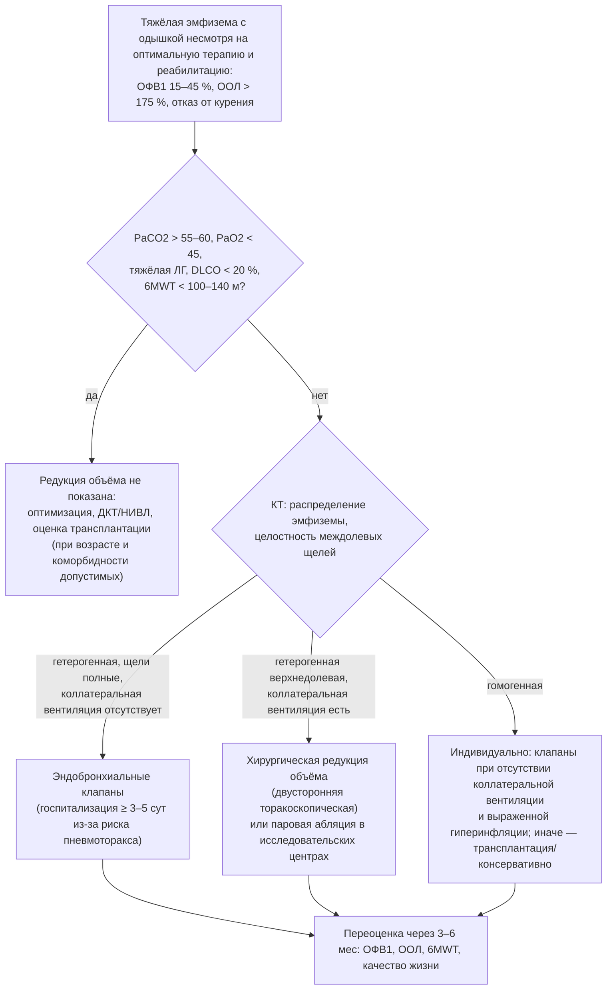

### 2.23. Хирургические и интервенционные методы

Хирургия при ХДН занимает две противоположные позиции: с одной стороны, для отдельных пациентов она единственный способ радикально изменить траекторию — устранить причину (эндартерэктомия при ХТЭЛГ, бариатрическая операция при СОГ), уменьшить механический дефект (редукция объёма при эмфиземе, пликация диафрагмы) или заменить орган (трансплантация); с другой — сама ХДН делает любую операцию опасной, а некоторые вмешательства при установившейся ДН уже бесполезны. Эта глава — о том, кому, когда и что предлагать, и о том, какие ограничения накладывает ДН.

#### 2.23.1. Общие принципы отбора

Хирургическое или интервенционное лечение рассматривается, когда исчерпаны или недостаточны консервативные методы, существует анатомически или физиологически определённый «субстрат», устранение которого улучшит функцию, и ожидаемая польза превышает периоперационный риск с учётом прогноза заболевания. Факторы риска, специфичные для ХДН: гиперкапния (PaCO₂ > 50–60 мм рт. ст. — противопоказание или фактор высокого риска для редукции объёма, относительный — для других операций), тяжёлая гипоксемия, лёгочная гипертензия и дисфункция правого желудочка (главный предиктор периоперационной смертности), низкая переносимость нагрузки (6MWT < 140–150 м, V̇O₂max < 10–12 мл/кг/мин), кахексия или морбидное ожирение, коморбидность (ИБС, почечная недостаточность), продолжающееся курение, низкая приверженность и отсутствие социальной поддержки (критично для трансплантации). Решения принимаются мультидисциплинарной командой (пульмонолог, торакальный хирург/интервенционный пульмонолог, анестезиолог, реабилитолог, при необходимости кардиолог, диетолог, психолог) с участием пациента, информированного о реалистичных ожиданиях; реабилитация до операции — обязательный компонент большинства протоколов (п. 2.22.11). Общие аспекты периоперационного ведения пациента с ХДН при любой операции рассматриваются в п. 2.26.8.

#### 2.23.2. Редукция объёма лёгких при эмфиземе

##### 2.23.2.1. Физиологическое обоснование

При эмфиземе потеря эластической тяги и гиперинфляция ставят диафрагму в невыгодное положение, увеличивают работу дыхания и ограничивают поток; удаление или выключение наиболее разрушенных участков (обычно верхних долей) восстанавливает эластическую тягу оставшейся ткани, уменьшает остаточный объём и гиперинфляцию, улучшает длину — натяжение диафрагмы и перераспределяет вентиляцию в более сохранные зоны; ОФВ₁ возрастает умеренно (на 10–30 %), а одышка, переносимость нагрузки и качество жизни — существенно; эффект сохраняется 2–5 лет и постепенно убывает по мере прогрессирования.

##### 2.23.2.2. Хирургическая редукция объёма (LVRS)

Исследование NETT (National Emphysema Treatment Trial, 2003; 1218 пациентов) определило показания и границы: в целом операция не улучшала выживаемость, но увеличивала переносимость нагрузки и качество жизни; подгруппа с преимущественно верхнедолевой эмфиземой и низкой исходной переносимостью нагрузки имела преимущество в выживаемости, тогда как у пациентов высокого риска (ОФВ₁ ≤ 20 % должного в сочетании с гомогенной эмфиземой или DLCO ≤ 20 %) 30-дневная смертность достигала 16 % при нулевой в группе консервативной терапии; критериями исключения были PaCO₂ > 60 мм рт. ст. и PaO₂ < 45 мм рт. ст. на уровне моря, а также тяжёлая ЛГ. Современные показания: гетерогенная (верхнедолевая) эмфизема, ОФВ₁ 20–45 %, остаточный объём > 150–175 % (гиперинфляция), DLCO > 20 %, PaCO₂ < 55–60 мм рт. ст., отсутствие тяжёлой ЛГ (СДЛА < 45–50 мм рт. ст.), отказ от курения ≥ 4–6 месяцев, завершённая реабилитация; метод — двусторонняя торакоскопическая резекция; периоперационная смертность в опытных центрах 2–5 %, длительная утечка воздуха — самое частое осложнение.

##### 2.23.2.3. Эндоскопическая (бронхоскопическая) редукция объёма

Менее инвазивные методы: **эндобронхиальные клапаны** (односторонние, выпускающие воздух и секрет из целевой доли, но не впускающие — доля коллабирует) — эффективны только при отсутствии коллатеральной вентиляции между долями (полная междолевая щель по КТ, подтверждение системой измерения коллатерального потока); РКИ (STELVIO 2015, IMPACT, TRANSFORM, LIBERATE 2018) показали прирост ОФВ₁ (на 15–20 % у половины пациентов), 6MWT и качества жизни при гетерогенной и части гомогенной эмфиземы; главное осложнение — пневмоторакс (у 20–30 %, чаще в первые 3 дня — поэтому госпитализация ≥ 3–5 суток), преимущество — обратимость (клапаны можно удалить); критерии: ОФВ₁ 15–45 %, остаточный объём ≥ 175 %, отсутствие коллатеральной вентиляции, PaCO₂ обычно < 50–55 мм рт. ст., 6MWT ≥ 100–140 м; гиперкапния и тяжёлая ЛГ — относительные противопоказания, требующие индивидуального решения в экспертном центре. **Спирали** (независимы от коллатеральной вентиляции; РКИ RENEW 2016 — скромный эффект при заметной частоте осложнений; применение ограничено), **термическая паровая абляция** (сегментарная, при верхнедолевой эмфиземе с коллатеральной вентиляцией; данные ограничены), биологические герметики — исследуются. Руководство GOLD включает эндоскопическую редукцию в рекомендации для отобранных пациентов с тяжёлой гиперинфляцией.

**Рис. 22.** Алгоритм выбора метода редукции объёма лёгких при тяжёлой эмфиземе. Схема читается сверху вниз; ООЛ — остаточный объём лёгких.

##### 2.23.2.4. Буллэктомия

Удаление гигантской буллы (занимающей > ⅓ гемиторакса и сдавливающей относительно сохранную лёгочную ткань) — отдельное показание с хорошими функциональными результатами при сохранной окружающей паренхиме; при диффузной эмфиземе без сдавления эффект сомнителен.

#### 2.23.3. Трансплантация лёгких

##### 2.23.3.1. Показания и сроки направления

Трансплантация рассматривается у пациентов с терминальной стадией заболевания лёгких, ожидаемой выживаемостью без трансплантации < 2 лет (вероятность > 50 %), высокой вероятностью пережить 90 дней после операции и 5-летней выживаемостью с приемлемой функцией при отсутствии противопоказаний (консенсус ISHLT, 2021). **Направление** в центр должно предшествовать **включению в лист ожидания** на месяцы — годы, поскольку обследование и подготовка занимают время, а при ИЛФ прогрессирование непредсказуемо. Ориентиры: **ХОБЛ** — направление при BODE 5–6, ОФВ₁ < 25 %, PaCO₂ > 50 или PaO₂ < 60 мм рт. ст., прогрессировании несмотря на терапию, включение в лист — при BODE ≥ 7, ОФВ₁ < 20 %, обострениях с гиперкапнической ОДН, ЛГ, хронической гиперкапнии; **ИЛФ и другие фиброзирующие ИЗЛ** — направление при установлении диагноза ИЛФ (или ФЖЕЛ < 80 %, DLCO < 40 %, потребности в кислороде), включение — при снижении ФЖЕЛ ≥ 10 % за 6 месяцев или DLCO ≥ 15 %, десатурации < 88 % при 6MWT, ЛГ, госпитализации с ухудшением; **муковисцидоз и бронхоэктазы** — ОФВ₁ < 30 % или быстрое снижение, частые обострения, пневмоторакс, кровохарканье, гиперкапния, ЛГ; **ЛГ** — функциональный класс III–IV на тройной терапии, признаки правожелудочковой недостаточности; при **ХТЭЛГ** — трансплантация лишь при невозможности эндартерэктомии/ангиопластики.

##### 2.23.3.2. Противопоказания и факторы риска

Абсолютные (по консенсусу 2021 с индивидуализацией): недавнее злокачественное новообразование с высоким риском рецидива, необратимая тяжёлая дисфункция другого органа без возможности комбинированной трансплантации, острая нестабильность (сепсис, шок), неконтролируемая инфекция, активный туберкулёз, значимая деформация грудной клетки/позвоночника, прогрессирующие когнитивные нарушения, неприверженность, отсутствие социальной поддержки, продолжающееся употребление табака/веществ, ИМТ ≥ 35 кг/м² [⚠️ Требуется верификация: точная формулировка критериев 2021 года]; факторы повышенного риска — возраст > 65–70 лет, ИМТ 30–35 или < 17, остеопороз с переломами, ИБС, колонизация резистентными микроорганизмами, предшествующие торакальные операции, ИВЛ или ЭКМО перед трансплантацией (при этом «мост» на ЭКМО у бодрствующих пациентов в опытных центрах даёт приемлемые результаты). Гиперкапния, зависимость от НИВЛ и кислорода не являются противопоказаниями — это признаки тяжести, которые, наоборот, обосновывают листирование.

##### 2.23.3.3. Результаты

Медиана выживаемости после трансплантации лёгких по регистру ISHLT ≈ 6–7 лет (при двусторонней — больше, чем при односторонней), 1-летняя ≈ 85–90 %, 5-летняя ≈ 55–60 %; главные ограничения — первичная дисфункция трансплантата, инфекции, хроническая дисфункция трансплантата (облитерирующий бронхиолит, рестриктивный синдром) после 3–5 лет, осложнения иммуносупрессии (почки, злокачественные опухоли). Преимущество в выживаемости наиболее убедительно при ИЛФ и муковисцидозе; при ХОБЛ оно дискуссионно (зависит от исходного прогноза — п. 3.19), но качество жизни улучшается резко. Для пациента на ДКТ и НИВЛ трансплантация означает возвращение к жизни без аппаратов, однако с пожизненной иммуносупрессией, частыми визитами и новым набором рисков; это решение требует подробного информированного обсуждения.

##### 2.23.3.4. «Мост» к трансплантации

НИВЛ (включая дневную через мундштук), высокопоточная терапия, кислород, реабилитация, нутритивная поддержка — стандартные компоненты поддержки в листе ожидания; при остром ухудшении — ЭКМО у бодрствующего, мобилизуемого пациента предпочтительнее интубации (сохранение мышечной массы и функционального статуса); пациент с ХДН, рассматриваемый для трансплантации, нуждается в заранее согласованном плане на случай декомпенсации (объём интенсивной терапии, контакт с центром).

#### 2.23.4. Лёгочная эндартерэктомия и баллонная ангиопластика при ХТЭЛГ

ХТЭЛГ (п. 2.5) — единственная форма ЛГ, потенциально излечимая хирургически. **Лёгочная эндартерэктомия** (удаление организованного тромботического материала с интимой из лёгочных артерий в условиях искусственного кровообращения и глубокой гипотермии с остановкой кровообращения) у пациентов с проксимальным (доступным) поражением нормализует или резко снижает лёгочное сосудистое сопротивление у большинства; госпитальная летальность в экспертных центрах 2–5 %, 5-летняя выживаемость > 80 %, 10-летняя ≈ 70 % [⚠️ Требуется верификация: точные значения по регистрам]; операбельность определяется консилиумом экспертного центра по данным КТ-ангиографии, вентиляционно-перфузионной сцинтиграфии, катетеризации с ангиографией — направление в такой центр обязательно для каждого пациента с ХТЭЛГ. **Баллонная лёгочная ангиопластика** (этапная дилатация дистальных поражений, методика усовершенствована в Японии) — для неоперабельных пациентов и при резидуальной ЛГ после операции; улучшает гемодинамику и функциональный статус; осложнения — реперфузионный отёк, повреждение сосуда. **Медикаментозная терапия** (риоцигуат — единственный препарат с доказанной эффективностью при неоперабельной/резидуальной ХТЭЛГ; пожизненная антикоагуляция) дополняет, но не заменяет вмешательства. Для пациента с ХДН на фоне ХТЭЛГ успешная эндартерэктомия может означать отмену кислорода и устранение ДН — редкий пример полного излечения в этой лекции.

#### 2.23.5. Бариатрическая хирургия при синдроме ожирения-гиповентиляции

Устойчивое снижение массы тела на 25–30 % разрешает гиповентиляцию у большинства пациентов с СОГ (нормализация PaCO₂, уменьшение или исчезновение апноэ, отмена НИВЛ/CPAP у части — п. 2.19.11); такой результат достижим главным образом при бариатрической хирургии (гастрошунтирование, рукавная гастропластика) и у части пациентов — при современной фармакотерапии ожирения; рекомендации ATS 2019 предлагают обсуждать бариатрическую операцию у пациентов с СОГ и ИМТ ≥ 35–40 кг/м² при неэффективности консервативных мер. Периоперационный риск при СОГ повышен (гипоксемия, гиперкапния, ЛГ, тромбоэмболии, трудные дыхательные пути): требуется предоперационная стабилизация на CPAP/НИВЛ не менее нескольких недель, продолжение терапии положительным давлением сразу после экстубации, мониторинг CO₂, осторожность с опиоидами, ранняя мобилизация, профилактика тромбоза; через 6–12 месяцев после операции — переоценка (ПСГ, газы) для решения об отмене или изменении режима вентиляции.

#### 2.23.6. Хирургия деформаций грудной клетки, позвоночника и диафрагмы

- **Сколиоз.** У детей раннего возраста прогрессирующие деформации формируют **синдром торакальной недостаточности** (грудная клетка не способна обеспечить нормальное дыхание и рост лёгких); «растущие» конструкции (вертикально расширяемые рёберные протезы, растущие стержни, магнитно-управляемые системы) позволяют сохранить рост грудной клетки и лёгких и предотвратить ХДН; у подростков коррекция больших углов (> 50–60°) останавливает прогрессирование и предупреждает рестрикцию. У **взрослых с уже установившейся ДН** на фоне тяжёлого кифосколиоза корригирующая операция не улучшает функцию лёгких существенно (жёсткость, сформированное лёгкое), сопряжена с высоким риском и не показана для лечения ДН; методом выбора остаётся НИВЛ (п. 2.19.4), а операция обсуждается лишь по ортопедическим и неврологическим показаниям с полноценной респираторной подготовкой.
- **Воронкообразная грудь** (операция Nuss) — показания преимущественно косметические и кардиальные; функция дыхания улучшается незначительно; не является лечением ДН.
- **Пликация диафрагмы** при односторонней парализации/эвентрации (идиопатической, после кардиохирургических вмешательств, травмы) у симптомных пациентов улучшает ЖЕЛ на 10–20 %, ортопноэ и одышку (устраняется парадоксальное движение купола); при двусторонней слабости менее эффективна; выполняется торакоскопически или лапароскопически после исключения восстановления функции нерва (наблюдение 6–12 месяцев).
- **Стимуляция диафрагмального нерва** — п. 2.20.11; **стимуляция подъязычного нерва** при ОАС — для пациентов с непереносимостью CPAP при умеренном ожирении, не является методом лечения ХДН.

#### 2.23.7. Хирургия и интервенции на дыхательных путях

Стенозы трахеи после интубации или трахеостомии (п. 2.20.7) — дилатация, лазерная резекция, стентирование как временная мера, циркулярная резекция с анастомозом (радикально, в специализированных центрах); трахеобронхомаляция тяжёлой степени — стентирование (диагностическое, временное) и трахеобронхопластика; обструкция опухолью — реканализация, стентирование (паллиативно); тяжёлая трахеомаляция у детей — аортопексия. Хирургия ОАС (увулопалатофарингопластика, челюстно-лицевые операции) при ХДН имеет ограниченное место и не заменяет терапию положительным давлением; бариатрическая хирургия — п. 2.23.5.

#### 2.23.8. Вмешательства при бронхоэктазах, кровохарканье, пневмотораксе

Резекция локализованных бронхоэктазов с рецидивирующими обострениями при сохранной остальной функции; эмболизация бронхиальных артерий при массивном или рецидивирующем кровохарканье (бронхоэктазы, муковисцидоз, аспергиллома) — метод первой линии; спонтанный пневмоторакс при эмфиземе или муковисцидозе — дренирование, при рецидиве или длительной утечке — торакоскопия с плевродезом (у кандидатов на трансплантацию — минимальный плевродез по согласованию с центром); при ХДН любая из этих процедур требует респираторной подготовки и готовности к НИВЛ.

#### 2.23.9. Сердечно-сосудистые вмешательства у пациентов с ХДН

Коморбидная сердечно-сосудистая патология нередко требует вмешательств, и ДН меняет выбор метода: транскатетерная имплантация аортального клапана предпочтительнее открытой операции при тяжёлой ХОБЛ; чрескожные коронарные вмешательства — предпочтительнее шунтирования при выраженной обструкции и гиперкапнии; катетерная абляция ФП возможна, но её эффективность при тяжёлом ЛС ниже; закрытие дефектов перегородок при значимой ЛГ требует оценки операбельности в экспертном центре (риск усугубления ЛГ); имплантируемые устройства (кардиостимуляторы, дефибрилляторы) — по общим показаниям с учётом прогноза. Открытая кардиохирургия у пациента с ОФВ₁ < 1 л, гиперкапнией и ЛГ сопряжена с высокой летальностью и длительной ИВЛ; решение принимается командой с респираторной подготовкой и планом ранней экстубации на НИВЛ.

#### 2.23.10. Экстракорпоральная поддержка газообмена

**Веновенозная ЭКМО** — мост к трансплантации у пациентов в листе ожидания с декомпенсацией (у бодрствующих, мобилизуемых пациентов результаты лучше, чем на ИВЛ) и, редко, мост к восстановлению при потенциально обратимых состояниях; не является методом длительного лечения ХДН и вне программы трансплантации у пациента с терминальной ХДН не показана (отсутствие «выхода»). **Экстракорпоральное удаление CO₂** (ECCO₂R; низкопоточные системы) изучается при гиперкапнической ОДН у пациентов с ХОБЛ для предотвращения интубации или ускорения отлучения; доказательства пользы на исходы пока отсутствуют, осложнения (кровотечения, тромбозы) значимы, применение ограничено исследованиями и экспертными центрами [⚠️ Требуется верификация: статус текущих РКИ].

#### 2.23.11. Обзор методов

**Табл. 34.** Хирургические и интервенционные методы при ХДН: показания, ограничения, ожидаемые эффекты

| Метод | Основное показание | Ключевые ограничения при ХДН | Ожидаемый эффект |
|---|---|---|---|
| Хирургическая редукция объёма | Гетерогенная верхнедолевая эмфизема, гиперинфляция, низкая переносимость нагрузки | PaCO₂ > 55–60, PaO₂ < 45, DLCO ≤ 20 %, гомогенная эмфизема, тяжёлая ЛГ | ↑ ОФВ₁ 10–30 %, ↓ одышки, ↑ нагрузки, в отобранной подгруппе — выживаемость; эффект 2–5 лет |
| Эндобронхиальные клапаны | Эмфизема без коллатеральной вентиляции, ООЛ ≥ 175 % | Гиперкапния > 50–55 (относительно), тяжёлая ЛГ, частые инфекции, 6MWT < 100 м | ↑ ОФВ₁ 15–20 % у половины, ↑ 6MWT, качество жизни; пневмоторакс 20–30 % |
| Буллэктомия | Гигантская булла > ⅓ гемиторакса со сдавлением | Диффузная эмфизема без сдавления | Значимое улучшение при сохранной паренхиме |
| Трансплантация лёгких | Терминальные ХОБЛ, ИЗЛ, муковисцидоз, ЛГ | Возраст, ИМТ, коморбидность, инфекции, приверженность; гиперкапния — не противопоказание | Медиана выживаемости ≈ 6–7 лет; свобода от ДКТ/НИВЛ; пожизненная иммуносупрессия |
| Лёгочная эндартерэктомия | Операбельная ХТЭЛГ | Дистальное поражение, тяжёлая коморбидность | Нормализация гемодинамики у большинства; потенциальное излечение ДН |
| Баллонная лёгочная ангиопластика | Неоперабельная/резидуальная ХТЭЛГ | Экспертный центр, этапность | Улучшение гемодинамики и функции |
| Бариатрическая хирургия | СОГ при ИМТ ≥ 35–40 | Периоперационный риск: требует НИВЛ/CPAP до и после | Разрешение гиповентиляции у большинства при потере 25–30 % массы |
| Пликация диафрагмы | Односторонний паралич с ортопноэ | Двусторонняя слабость, НМЗ | ↑ ЖЕЛ 10–20 %, ↓ ортопноэ |
| «Растущие» конструкции / коррекция сколиоза | Дети с прогрессирующей деформацией | У взрослых с установившейся ДН не улучшает функцию | Профилактика ХДН |
| Резекция стеноза трахеи | Постинтубационный/посттрахеостомический стеноз | Протяжённые стенозы, зависимость от вентиляции | Восстановление проходимости |
| ЭКМО / ECCO₂R | Мост к трансплантации; исследования при ОДН | Нет «выхода» вне трансплантации | Выживание до трансплантации у части |

#### 2.23.12. Примеры и иллюстрации

**Пример 1** (ХОБЛ). Обсуждён на консилиуме по редукции объёма: КТ — гетерогенная эмфизема с преобладанием в верхних долях, междолевые щели полные справа, неполные слева; ОФВ₁ 27 %, остаточный объём 230 %, DLCO 38 %, PaCO₂ 52 мм рт. ст., СДЛА ≈ 50 мм рт. ст., 6MWT после реабилитации 365 м. Решение: правосторонняя установка эндобронхиальных клапанов в верхнюю долю при подтверждённом отсутствии коллатеральной вентиляции — технически возможна, но ЛГ средней тяжести и пограничная гиперкапния увеличивают риск; после обсуждения пациент выбрал консервативную стратегию с возможностью возврата к вопросу при стабилизации; трансплантация в 66 лет с коморбидностью рассмотрена как маловероятная опция. Через год, после декомпенсации (PaCO₂ 68, СДЛА 65), оба метода уже не показаны — иллюстрация «окна возможностей», которое закрывается с прогрессированием.

**Пациентка В** (ИЛФ, 61 год). Направлена в центр трансплантации при установлении диагноза; обследование завершено за 4 месяца; включена в лист при снижении ФЖЕЛ на 12 % за полгода и десатурации до 81 % при 6MWT; в листе — ДКТ с высокопоточной системой при нагрузке, реабилитация, антифибротик, нутритивная поддержка, заранее согласованный план при декомпенсации (ЭКМО как мост рассматривается при отсутствии инфекции и сохранном функциональном статусе); трансплантирована через 7 месяцев ожидания.

**Пациент З** (учебный пример), 48 лет, через 3 года после тромбоэмболии: одышка при небольшой нагрузке, PaO₂ 56 мм рт. ст., СДЛА 85 мм рт. ст., ЛСС 9 ед. Вуда, вентиляционно-перфузионная сцинтиграфия — множественные сегментарные дефекты перфузии при нормальной вентиляции, КТ-ангиография — организованные тромбы в долевых и сегментарных артериях. В экспертном центре признан операбельным; после лёгочной эндартерэктомии мСДЛА 22 мм рт. ст., ЛСС 2,5 ед. Вуда, PaO₂ 78 мм рт. ст. на воздухе, ДКТ отменена; продолжает антикоагуляцию, наблюдение раз в 6–12 месяцев.

**Пациент Г** (СОГ). После 6 месяцев консервативной программы (−14 кг) при ИМТ 43 и сохраняющейся потребности в НИВЛ направлен на бариатрическую операцию: рукавная гастропластика после 8 недель стабильной НИВЛ; в периоперационном периоде — НИВЛ сразу после экстубации, капнометрия, мультимодальная анальгезия без опиоидов; через 12 месяцев ИМТ 33, PaCO₂ 42, остаточный ОАС (ИАГ 14) — переведён на CPAP.

🔬 **Углубление: коллатеральная вентиляция и выбор эндоскопического метода.** Эффект клапанов зависит от того, сможет ли целевая доля коллабировать после выключения её бронха; если междолевая щель неполная, воздух поступает в долю через коллатерали (поры Кона, каналы Ламберта, межбронхиолярные связи — при эмфиземе они резко расширены), и ателектаз не формируется. Оценка: количественный анализ КТ (целостность щели > 90–95 % — предиктор отсутствия коллатеральной вентиляции) и прямое измерение во время бронхоскопии (баллонная окклюзия бронха с анализом потока через катетер: падение потока к нулю означает отсутствие коллатералей). У пациентов с коллатеральной вентиляцией применяются независимые от неё методы (спирали, пар) или хирургия. Второй фактор успеха — гетерогенность: «целевая» доля должна быть наиболее разрушенной (количественная КТ — доля вокселей < −950 HU), а соседние — относительно сохранными; при гомогенной эмфиземе эффект клапанов меньше, но у части пациентов с выраженной гиперинфляцией сохраняется. Третий — пневмоторакс: он возникает из-за быстрого коллапса доли и разрыва спаек/булл соседней; парадоксально, пневмоторакс ассоциирован с лучшим функциональным исходом (свидетельство быстрого ателектаза), но требует дренирования и иногда временного удаления клапана.

❗ **Типичная ошибка:** откладывать направление пациента с ИЛФ в центр трансплантации до появления потребности в кислороде или гиперкапнии. ИЛФ прогрессирует непредсказуемо, обследование занимает месяцы, а выраженная гипоксемия, ЛГ и кахексия к моменту листирования резко увеличивают риск смерти в листе ожидания и периоперационный риск; направление показано при установлении диагноза.

❗ **Типичная ошибка:** считать гиперкапнию абсолютным противопоказанием ко всем хирургическим методам. Для редукции объёма PaCO₂ > 55–60 мм рт. ст. действительно является границей, но для трансплантации хроническая гиперкапния — аргумент за включение в лист, для эндартерэктомии при ХТЭЛГ и бариатрической хирургии при СОГ — состояние, которое операция может устранить при правильной периоперационной подготовке.

💡 **Интересный факт:** редукция объёма лёгких была предложена Отто Брантиганом в 1957 году, но операционная летальность около 16–18 % привела к её забвению почти на сорок лет. Джоэл Купер — хирург из Торонто, выполнивший в 1983 году первую в мире успешную трансплантацию лёгкого с длительной выживаемостью реципиента (после двух десятилетий неудач, начиная с первой попытки Джеймса Харди в 1963 году), — в 1995 году возродил операцию Брантигана, применив двустороннюю резекцию через стернотомию с укреплением швов, и опубликовал результаты, которые запустили исследование NETT. Так один хирург стоял у истоков обоих радикальных методов лечения эмфиземы.

📝 **Обобщение**

- Хирургические и интервенционные методы при ХДН отбираются мультидисциплинарно по принципу «устранимый субстрат, польза выше риска, своевременно»; гиперкапния, ЛГ и правожелудочковая дисфункция, низкая переносимость нагрузки, коморбидность — главные факторы риска, причём их значение различно для разных методов.
- При эмфиземе: хирургическая редукция объёма — для гетерогенной верхнедолевой эмфиземы с гиперинфляцией и без гиперкапнии/тяжёлой ЛГ (NETT 2003: польза в подгруппе, высокая летальность при ОФВ₁ ≤ 20 % с гомогенной эмфиземой или DLCO ≤ 20 %); эндобронхиальные клапаны — при отсутствии коллатеральной вентиляции (прирост ОФВ₁ и качества жизни, пневмоторакс у 20–30 %).
- Трансплантация лёгких — для терминальных ХОБЛ, ИЗЛ, муковисцидоза, ЛГ при ожидаемой выживаемости < 2 лет; направлять рано (ИЛФ — при диагнозе); гиперкапния и зависимость от НИВЛ — не противопоказания; медиана выживаемости ≈ 6–7 лет; НИВЛ, кислород, реабилитация и ЭКМО у бодрствующих — мост.
- Радикальное устранение причины ДН возможно при ХТЭЛГ (эндартерэктомия, баллонная ангиопластика в экспертных центрах) и СОГ (бариатрическая хирургия при подготовке на НИВЛ/CPAP); пликация диафрагмы помогает при одностороннем параличе; коррекция сколиоза предотвращает ДН у детей, но не лечит её у взрослых.
- Любое вмешательство у пациента с ХДН требует респираторной подготовки, плана ранней экстубации на НИВЛ и мониторинга CO₂ (п. 2.26.8).

Главный вывод: у части пациентов с ХДН существует «окно возможностей» для радикального вмешательства, которое закрывается с прогрессированием, — распознать таких пациентов и направить их вовремя важнее, чем владеть техникой самой операции. Далее — о самом опасном периоде в течении ХДН: острой декомпенсации.

❓ **Контрольные вопросы**

1. Какие результаты исследования NETT определяют современные показания и противопоказания к хирургической редукции объёма лёгких? Какие газометрические пороги использовались как критерии исключения?
2. Объясните, почему эффективность эндобронхиальных клапанов зависит от коллатеральной вентиляции и как её оценивают; какое главное осложнение процедуры и почему оно парадоксально связано с хорошим исходом?
3. Сформулируйте критерии направления и включения в лист ожидания трансплантации для ХОБЛ и ИЛФ; почему гиперкапния не является противопоказанием к трансплантации, но является — к редукции объёма?
4. Какие хирургические методы способны полностью устранить ХДН, а какие — только предотвратить её развитие? Приведите примеры с обоснованием.
5. Пациент 58 лет с СОГ (ИМТ 47) на НИВЛ направлен на бариатрическую операцию. Опишите периоперационный план с точки зрения респираторной безопасности и критерии последующего пересмотра вентиляции.
