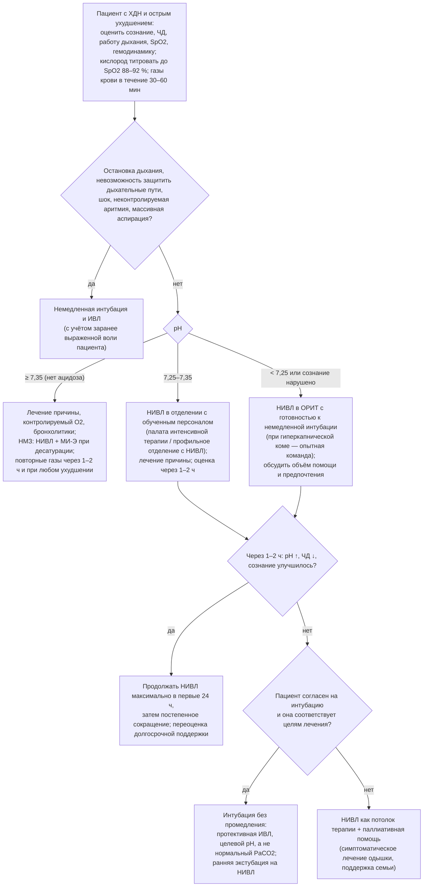

### 2.24. Острая дыхательная недостаточность на фоне хронической

Декомпенсация — самый опасный период в течении ХДН и момент, когда качество решений врача непосредственно определяет, выживет ли пациент. Острая дыхательная недостаточность на фоне хронической (п. 2.2, 2.3) отличается от «чистой» ОДН: резервы исчерпаны заранее, компенсаторные механизмы уже задействованы, а привычные для реаниматолога цели (нормальные газы) здесь вредны. Эта глава объединяет распознавание декомпенсации, контролируемую оксигенотерапию, неинвазивную и инвазивную вентиляцию, лечение причины и правожелудочковой недостаточности, а также период после эпизода — время, когда определяется дальнейшая траектория. Главу завершает интерактивный элемент — симуляция декомпенсации на дому.

#### 2.24.1. Определение, эпидемиология, прогноз

📌 **Определение:** **острая дыхательная недостаточность на фоне хронической** (acute-on-chronic respiratory failure) — быстрое (часы — дни) ухудшение газообмена у пациента с ранее существовавшей ХДН, проявляющееся нарастанием гипоксемии и/или гиперкапнии с развитием **острого респираторного ацидоза** (снижение pH < 7,35 при повышенном бикарбонате — признак, что прирост PaCO₂ опередил почечную компенсацию) либо тяжёлой гипоксемии, не корригируемой привычной терапией.

Эпизоды декомпенсации — главная причина госпитализаций при ХОБЛ, НМЗ, СОГ и кифосколиозе; гиперкапническая ОДН при обострении ХОБЛ в рандомизированных исследованиях НИВЛ сопровождалась госпитальной летальностью около 10 % при НИВЛ и 20–30 % при стандартной терапии, тогда как в аудитах реальной практики летальность пациентов, получавших НИВЛ, достигала 25–35 % — отражение позднего начала, неправильного отбора и неопытности [⚠️ Требуется верификация: данные конкретных аудитов]. Прогноз после эпизода неблагоприятен: по данным когорты из Гонконга (C. M. Chu и соавторы, 2004), после первого эпизода гиперкапнической ОДН при ХОБЛ, потребовавшего НИВЛ, в течение года 80 % пациентов были повторно госпитализированы, 63 % пережили повторный жизнеугрожающий эпизод, 49 % умерли; при ИЗЛ острое обострение ИЛФ имеет госпитальную летальность > 50 %; при НМЗ эпизод, завершившийся интубацией, нередко заканчивается трахеостомией. Поэтому каждый эпизод — не только неотложная задача, но и точка пересмотра долгосрочной стратегии (п. 2.24.12).

#### 2.24.2. Причины декомпенсации

**Табл. 35.** Причины острой декомпенсации ХДН и ключи к их распознаванию

| Причина | Доля (ориентировочно) | Ключи |
|---|---|---|
| Респираторная инфекция (вирусная, бактериальная; обострение ХОБЛ/бронхоэктазов, пневмония, аспирация) | 50–70 % | Лихорадка, изменение мокроты (объём, гнойность), инфильтрат, воспалительные маркёры; при НМЗ — задержка секрета без лихорадки |
| Сердечная недостаточность, ишемия, аритмия (ФП с быстрым ответом) | 15–25 % | Ортопноэ, отёки, набухание вен, NT-proBNP, ЭКГ, ЭхоКГ, рентгенологические признаки застоя |
| Тромбоэмболия лёгочной артерии | 5–15 % у госпитализированных с «необъяснимым» обострением | Отсутствие инфекционных признаков, внезапность, тахикардия, падение PaCO₂ относительно привычного, КТ-ангиография |
| Пневмоторакс | Редко, но критично при эмфиземе, НИВЛ, муковисцидозе | Внезапная боль, асимметрия, нарастание давления в контуре; рентген/УЗИ |
| Ятрогенные: неконтролируемый кислород, седативные, опиоиды, анестезия, бета-блокаторы (при бронхоспазме), диуретики (алкалоз) | 5–10 % | Анамнез назначений; сонливость при «хорошей» SpO₂ |
| Нарушение приверженности и технические проблемы: прекращение ингаляторов, ДКТ, НИВЛ; неисправность, утечка, неправильные параметры | Часто сопутствует | Данные вентилятора, опрос ухаживающих, осмотр оборудования |
| Задержка секрета, обтурация канюли (при трахеостоме), бронхиальная пробка | Главная причина при НМЗ и трахеостоме | Десатурация, рост пикового давления, асимметрия, ателектаз |
| Метаболические и системные: гипофосфатемия, гипокалиемия, гипомагниемия, гипотиреоз, анемия, сепсис, перегрузка жидкостью, парентеральное перекармливание | Способствующие | Лабораторные данные |
| Хирургия и травма (переломы рёбер, операции на животе и груди) | Ситуационно | Анамнез; боль, ограничивающая вдох и кашель |
| Прогрессирование основного заболевания без явного триггера | 10–20 % | Диагноз исключения; медленно нарастающая гиперкапния |

У 30 % пациентов причина остаётся неустановленной; у части — причин несколько.

#### 2.24.3. Распознавание декомпенсации и оценка тяжести

##### 2.24.3.1. Клинические признаки

Ранние (часы — дни; видны дома и в приёмном отделении): нарастание одышки сверх привычной, снижение активности (не встаёт, не ест), утренние головные боли, дневная сонливость, нарушение сна, невозможность лежать, увеличение потребности в кислороде или времени НИВЛ, новые тревоги вентилятора (утечка, рост частоты), изменение мокроты, тахипноэ > 25 в минуту, тахикардия, участие вспомогательных мышц, невозможность говорить предложениями. Поздние (угрожающие): спутанность или возбуждение, сонливость с трудным пробуждением, астериксис, парадоксальное дыхание, брадипноэ или «дыхание с усилием при малой частоте» (истощение), цианоз, гипотензия, аритмии, пот и гиперемия (гиперкапния), SpO₂ < 85–88 % несмотря на кислород или — что обманчиво — «нормальная» SpO₂ на высоком потоке кислорода у сонливого пациента.

**Табл. 36.** «Красные флаги» декомпенсации по группам заболеваний

| Группа | Специфические признаки, требующие немедленной оценки |
|---|---|
| ХОБЛ | Сонливость/спутанность, особенно после увеличения кислорода; тахипноэ > 30 или истощение с брадипноэ; невозможность откашлять; отёки и набухание вен (декомпенсация ЛС); pH < 7,35 |
| НМЗ | SpO₂ < 95 % при дыхании воздухом (или падение от базового уровня), не восстанавливаемая откашливанием/МИ-Э; потребность в НИВЛ днём; невозможность отдохнуть от вентилятора; затруднение глотания/слюнотечение; слабый голос; тахикардия; у детей — вялость, отказ от еды |
| СОГ | Нарастающая сонливость (нередко приписывается «характеру»), отёки, головная боль, pH < 7,35 с HCO₃⁻ > 30; SpO₂ < 88 % |
| ИЗЛ | Нарастание одышки за < 1 месяц, новые двусторонние затемнения, падение SpO₂ в покое, потребность в потоке > 6–10 л/мин — острое обострение (высокая летальность) |
| Трахеостома / ДМВ | Рост пикового давления, тревога обструкции, невозможность провести катетер, снижение дыхательного объёма, кровь в секрете, подкожная эмфизема, десатурация при аспирации |
| Лёгочное сердце / ЛГ | Синкопе, гипотензия, нарастающие отёки, боль в правом подреберье, олигурия — правожелудочковая недостаточность |

##### 2.24.3.2. Газы крови и оценка тяжести

Решающий показатель — **pH артериальной крови** (или капиллярной артериализированной при невозможности): PaCO₂ сам по себе не позволяет отличить привычную хроническую гиперкапнию от острой — у пациента с хроническим PaCO₂ 60 мм рт. ст. и pH 7,38 нет ОДН, а у пациента с PaCO₂ 55 и pH 7,26 — есть. Тяжесть по pH: 7,30–7,35 — лёгкий респираторный ацидоз (НИВЛ показана при сохранении после начальной терапии); 7,25–7,30 — умеренный (НИВЛ в условиях с возможностью эскалации); < 7,25 — тяжёлый (НИВЛ в ОРИТ/отделении интенсивной терапии с готовностью к интубации; при < 7,15–7,20 и нарушении сознания интубация чаще неизбежна). Дополнительно: PaO₂/FiO₂ или потребность в кислороде, лактат (тканевая гипоксия, сепсис), калий, фосфат, креатинин, гемоглобин, NT-proBNP, тропонин, прокальцитонин/СРБ, рентгенография (пневмония, пневмоторакс, застой), ЭКГ, УЗИ лёгких и сердца у постели, бактериология мокроты; при НМЗ — PCF и ЖЕЛ, если выполнимы. Прогностические шкалы при обострении ХОБЛ (DECAF: одышка по расширенной шкале MRC 5a/5b, эозинопения, консолидация, ацидемия pH < 7,30, ФП) помогают определить место лечения.

#### 2.24.4. Показания к респираторной поддержке и выбор уровня помощи

**Рис. 23.** Алгоритм первичных решений при острой декомпенсации ХДН. Схема читается сверху вниз; детали оксигенотерапии — в п. 2.24.7, НИВЛ — в п. 2.24.8, ИВЛ — в п. 2.24.10.

Показания к **немедленной интубации** (минуя НИВЛ): остановка дыхания или агональное дыхание, невозможность защитить дыхательные пути (кома с утратой кашлевого и глотательного рефлексов, не связанная с гиперкапнией, массивная рвота/кровотечение), шок и неконтролируемая аритмия, тяжёлая гипоксемия, не корригируемая НИВЛ, невозможность удалить массивный секрет (с оговоркой для НМЗ — МИ-Э). Показания к **НИВЛ**: респираторный ацидоз (pH ≤ 7,35 при PaCO₂ > 45 мм рт. ст.) при обострении ХОБЛ, СОГ, НМЗ, торакальных заболеваниях, сохраняющийся после начальной терапии (или сразу при pH < 7,30); при НМЗ — также десатурация, не устраняемая клиренсом, и нарастание одышки даже без ацидоза; кардиогенный отёк лёгких; тяжёлая одышка с признаками утомления (тахипноэ > 25–30, парадокс) при гиперкапнии; постэкстубационная поддержка. Уровень помощи определяется pH, сознанием, гемодинамикой, коморбидностью, опытом персонала и целями лечения: лёгкий ацидоз — профильное отделение с подготовленным персоналом и мониторингом; pH < 7,25–7,30, нарушение сознания, нестабильность — ОРИТ. Решение о «потолке» терапии (интубация или только НИВЛ) должно быть принято **до** её необходимости, с участием пациента (или на основании его ранее выраженной воли — п. 2.30), и зафиксировано.

#### 2.24.5. Лечение причины и общие меры

- **Бронхолитики**: короткодействующие β₂-агонист и антихолинергик через небулайзер (при гиперкапнии — небулайзер с приводом от воздуха, кислород отдельно через канюли 1–2 л/мин, или через дозированный ингалятор со спейсером) или через контур НИВЛ; внутривенный аминофиллин не рекомендуется (узкое терапевтическое окно, аритмии).
- **Системные глюкокортикоиды** при обострении ХОБЛ: преднизолон 40 мг/сут внутрь (или эквивалент) 5 дней (исследование REDUCE, 2013: 5 дней не уступают 14); при эозинофилии эффект выше; при пневмонии — по показаниям; при остром обострении ИЛФ — высокие дозы эмпирически (без доказательств из РКИ).
- **Антибиотики** при обострении ХОБЛ с гнойной мокротой (критерии Anthonisen: ≥ 2 из 3 признаков — усиление одышки, увеличение объёма мокроты, гнойность — при обязательной гнойности, либо потребность в вентиляции), при пневмонии, при обострении бронхоэктазов (14 дней с учётом микробиологии), при НМЗ — низкий порог (аспирация, задержка секрета); выбор с учётом предшествующих культур (синегнойная палочка при бронхоэктазах и трахеостоме).
- **Клиренс дыхательных путей**: при НМЗ — МИ-Э каждые 1–2 часа и при десатурации (п. 2.21.10); при ХОБЛ — активный цикл дыхания, осциллирующие устройства после стабилизации; увлажнение; при трахеостоме — проверка канюли (замена при подозрении на обтурацию), аспирация.
- **Сердечная недостаточность и ЛС**: п. 2.24.9. **ТЭЛА**: антикоагуляция. **Пневмоторакс**: дренирование до НИВЛ/ИВЛ.
- **Профилактика**: низкомолекулярный гепарин (высокий риск венозного тромбоза), защита слизистой желудка при показаниях, ранняя мобилизация, питание (не позднее 24–48 часов, без перекармливания), коррекция фосфата, калия, магния (слабость дыхательных мышц), контроль гликемии при стероидах.
- **Избегать**: седативных и снотворных (бензодиазепины!), неконтролируемого кислорода, избыточных жидкостей, миорелаксирующих препаратов; опиоиды в малых дозах при тяжёлом дистрессе под НИВЛ — только опытной командой или в рамках паллиативной стратегии.
- **Пациент на ДМВ**: не прекращать домашнюю вентиляцию — пациент поступает с собственным аппаратом и МИ-Э, параметры которых являются отправной точкой; проверяется исправность, утечка, маска; при трахеостоме — алгоритм неотложных действий (Рис. 19).

#### 2.24.6. Особенности по нозологиям (кратко; подробнее — глава 2.25)

**ХОБЛ** — контролируемый кислород, НИВЛ при ацидозе, бронхолитики, стероиды, антибиотики; при неудаче НИВЛ — ИВЛ с длинным выдохом и допустимой гиперкапнией; **НМЗ** — приоритет клиренса (МИ-Э) и НИВЛ (вплоть до круглосуточной, при необходимости через мундштук днём), кислород только вместе с вентиляцией, антибиотики рано, экстубация на НИВЛ + МИ-Э, трахеостомия — не как рефлекс после неудачного отлучения, а по обсуждённому решению; **СОГ** — НИВЛ (не CPAP) при остром ацидозе, диуретики при перегрузке, антикоагуляция (высокий риск ТЭЛА), затем переход на домашнюю терапию; **ИЗЛ** — высокопоточная терапия, исключение инфекции, ТЭЛА, сердечной недостаточности, стероиды, НИВЛ с реалистичными ожиданиями (исходы интубации при остром обострении ИЛФ крайне плохие, > 80–90 % летальности [⚠️ Требуется верификация]) — обсуждение целей, трансплантационный статус; **ЛГ/ЛС** — осторожность с жидкостью, избегать гипоксии и ацидоза (вазоконстрикция), вазопрессоры при гипотензии, специфическая терапия только в экспертном центре; **муковисцидоз, бронхоэктазы** — антибиотики по чувствительности, интенсивный клиренс, НИВЛ как мост к трансплантации.

#### 2.24.7. Контролируемая оксигенотерапия

📌 **Определение:** **контролируемая (титруемая) оксигенотерапия** — назначение кислорода с целевым диапазоном SpO₂ 88–92 % у пациентов с риском гиперкапнии (ХОБЛ, СОГ, НМЗ, торакальные деформации, муковисцидоз, бронхоэктазы, пациенты на ДМВ) вместо «максимальной» оксигенации, с контролем газов крови через 30–60 минут после начала и после каждого изменения потока.

Обоснование — п. 2.17.12.1: избыточный кислород повышает PaCO₂ через снятие гипоксической вазоконстрикции (ухудшение V̇/Q̇), эффект Холдейна и, у части пациентов, угнетение гипоксического драйва; клинически это доказано РКИ в догоспитальном звене (M. A. Austin и соавторы, 2010, Австралия): титрование SpO₂ до 88–92 % по сравнению с высокопоточным кислородом снижало смертность у пациентов с обострением ХОБЛ более чем вдвое. Практика: назальные канюли 1–2 л/мин или маска Вентури 24–28 % как стартовая терапия; при SpO₂ < 85 % — Вентури 28–35 % с быстрой переоценкой; высокий поток через маску с резервуаром допустим лишь при критической гипоксемии до момента оценки и должен титроваться вниз немедленно; небулайзеры — с приводом от воздуха; при рвоте, обструкции носа — маска; документировать целевой диапазон в назначениях и на мониторе; при сонливости и росте PaCO₂ на кислороде — не отменять кислород резко (рикошетная гипоксемия), а снижать до целевого диапазона и начинать НИВЛ. **Высокопоточная назальная терапия** (30–60 л/мин подогретого увлажнённого газа с титруемой FiO₂) уменьшает мёртвое пространство, создаёт небольшое ПДКВ и может снижать PaCO₂ и работу дыхания при лёгкой гиперкапнии без ацидоза или при непереносимости НИВЛ; при респираторном ацидозе НИВЛ остаётся методом выбора (рекомендации ERS 2022 по высокопоточной терапии), а высокопоточная терапия — вариантом в перерывах НИВЛ и при pH ≥ 7,35. Пациенты группы риска должны носить **карточку (паспорт) предупреждения** о целевом SpO₂ 88–92 % для скорой помощи и приёмных отделений (п. 2.27.7); у пациентов с НМЗ целевой диапазон на вентиляции — обычный (94–98 %), а главное правило — «кислород только вместе с вентиляцией и клиренсом».

#### 2.24.8. Неинвазивная вентиляция при острой декомпенсации

НИВЛ — главное достижение в лечении гиперкапнической ОДН за последние 30 лет. РКИ L. Brochard и соавторов (1995) показало при обострении ХОБЛ снижение частоты интубации с 74 до 26 % и госпитальной летальности с 29 до 9 %; исследование P. K. Plant и соавторов (2000) — что НИВЛ в профильных отделениях с обученным персоналом при pH 7,25–7,35 снижает интубации (27 → 15 %) и летальность (20 → 10 %); метаанализы подтверждают снижение смертности, интубаций, осложнений и длительности госпитализации; рекомендации ERS/ATS (2017) дают сильную рекомендацию НИВЛ при обострении ХОБЛ с pH ≤ 7,35 и PaCO₂ > 45 мм рт. ст. и не рекомендуют её у пациентов без ацидоза с целью профилактики. При СОГ, НМЗ и торакальных заболеваниях доказательства основаны на наблюдательных данных и физиологической логике, но НИВЛ является стандартом.

**Табл. 37.** НИВЛ при острой декомпенсации ХДН: практические положения

| Аспект | Положения |
|---|---|
| Противопоказания | Абсолютные: остановка дыхания, невозможность защитить дыхательные пути (не связанная с гиперкапнией), неконтролируемая рвота, массивное кровотечение, шок. Относительные: спутанность/ажитация (часто уменьшается на НИВЛ), обильный секрет (при НМЗ — МИ-Э), недренированный пневмоторакс, недавние операции на лице/верхних отделах ЖКТ, отказ пациента |
| Интерфейс | Ороназальная (полнолицевая) маска — первая линия в острой ситуации; при длительной НИВЛ — чередование с назальной/шлемом для профилактики пролежней; защита переносицы; подбор размера |
| Режим и стартовые параметры | Спонтанно-принудительный (S/T) или PSV с резервной частотой; IPAP 12–15 см вод. ст. с быстрым повышением до 20–25 (при необходимости до 30) по ДО 6–8 мл/кг, ЧД, комфорту; EPAP 4–5 (ХОБЛ — для компенсации auto-PEEP; СОГ/ОАС — 8–10); резервная частота 12–16; время вдоха 0,8–1,2 с при ХОБЛ (длинный выдох), 1,2–1,5 с при рестрикции; быстрое нарастание давления при ХОБЛ; FiO₂ по SpO₂ 88–92 % |
| Режим применения | В первые 24 часа — максимально возможное время (перерывы на еду, лекарства, туалет); далее — постепенное сокращение дневных сессий с сохранением ночной; общая длительность обычно 2–5 дней |
| Мониторинг | Непрерывные SpO₂, ЧД, ЧСС; газы крови через 1–2 ч после начала и через 4–6 ч, затем по динамике; сознание; синхронность (утечка, автотриггирование, неэффективные усилия); ДО по аппарату; состояние кожи; желудок |
| Предикторы успеха | Улучшение pH и снижение ЧД через 1–2 ч; pH при поступлении > 7,25; сохранное сознание; хорошая синхронность; меньшая тяжесть по шкалам (APACHE); отсутствие пневмонии |
| Критерии неудачи → интубация | Отсутствие улучшения или ухудшение pH/PaCO₂ и ЧД через 1–2 ч несмотря на оптимизацию; ухудшение сознания; непереносимость; нестабильность гемодинамики; невозможность удалить секрет; прогрессирующая гипоксемия; задержка интубации после установленной неудачи НИВЛ повышает летальность |
| Особые ситуации | Гиперкапническая кома (шкала Глазго ≤ 8 вследствие CO₂-наркоза): НИВЛ возможна с успехом около 80 % в опытных отделениях при постоянном наблюдении и немедленной готовности к интубации (M. Díaz и соавторы, 2005) — сознание обычно восстанавливается в первые 1–2 ч; «потолок терапии» — НИВЛ у пациентов, не подлежащих интубации, оправдана (выживаемость до выписки значимая при обострении ХОБЛ), с параллельной паллиативной поддержкой; лёгкая седация (дексмедетомидин) при непереносимости — в ОРИТ |
| Организация | Обученный персонал (врачи, медсёстры, респираторные терапевты), протокол, соотношение медсестра : пациент, доступность аппаратов 24/7, аудит исходов; начало НИВЛ в первые 1–3 часа от выявления ацидоза |

Технические детали: при ХОБЛ — внимание к утечке и неэффективным усилиям (auto-PEEP → повысить EPAP до 5–6, снизить IPAP при избыточном ДО, укоротить вдох, повысить чувствительность триггера); при СОГ — более высокие EPAP и IPAP (до 25–30), контроль десатураций; при НМЗ — объёмно-целевые режимы допустимы, чередование с мундштучной вентиляцией в дневное время, МИ-Э между сессиями; при трахеостомированном пациенте — вентиляция через канюлю по домашним параметрам с коррекцией.

#### 2.24.9. Лечение правожелудочковой недостаточности и гемодинамические аспекты

Декомпенсация ХЛС при ОДН (п. 2.8.8) лечится прежде всего устранением её причины — гипоксемии (вазоконстрикция), гиперкапнии и ацидоза (вазоконстрикция, снижение сократимости), инфекции, аритмии: коррекция газообмена кислородом и вентиляцией сама по себе снижает давление в лёгочной артерии и улучшает функцию ПЖ. Принципы: осторожная диурезная терапия при перегрузке объёмом (петлевые диуретики под контролем АД, креатинина, калия, бикарбоната — избыточный диурез снижает преднагрузку ПЖ и вызывает гипотензию и метаболический алкалоз, угнетающий дыхание); избегать инфузионной «нагрузки объёмом» при дилатированном ПЖ (ухудшает межжелудочковое взаимодействие) — при гипотензии предпочтительны вазопрессоры (норадреналин) с поддержанием коронарной перфузии ПЖ, при сниженной сократимости — добутамин или милринон в малых дозах; контроль ритма при ФП/ТП (восстановление синусового ритма при недавней ФП, контроль частоты — дигоксин, амиодарон; осторожность с бета-блокаторами и недигидропиридиновыми антагонистами кальция); антикоагуляция при ФП и при ТЭЛА; при ИВЛ — минимальные ПДКВ и давления плато, избегать гиперинфляции и гиперкапнии выше привычного уровня (повышают ЛСС); ингаляционные вазодилататоры (оксид азота, илопрост) — при рефрактерной правожелудочковой недостаточности в ОРИТ как временная мера; системные лёгочные вазодилататоры при ЛГ 3-й группы в острой ситуации не показаны (ухудшение V̇/Q̇ и гипоксемии); флеботомия при Hct > 60–65 % с симптомами гипервязкости (п. 2.16.11); мониторинг — ЭхоКГ (размер и функция ПЖ, нижняя полая вена), лактат, диурез, при необходимости катетер в лёгочной артерии в экспертных центрах. После стабилизации — пересмотр долгосрочной терапии: ДКТ с достаточной приверженностью, НИВЛ при гиперкапнии, лечение ОАС, диуретики минимальными дозами.

#### 2.24.10. Инвазивная ИВЛ и отлучение

Показания — п. 2.24.4 и неудача НИВЛ. Особенности ИВЛ у пациента с ХДН: при обструкции — низкая частота (10–14 в минуту), длинный выдох (I : E 1 : 3–1 : 4), ДО 6–8 мл/кг должной массы, измерение и минимизация auto-PEEP (внешнее ПДКВ ≈ 70–80 % от auto-PEEP при триггируемых режимах), ограничение давления плато, бронхолитики в контур; при рестрикции (кифосколиоз, ожирение) — умеренное ПДКВ, достаточные давления с учётом низкой растяжимости грудной стенки (давление плато переоценивает транспульмональное); при НМЗ — лёгкие обычно нормальные, вентиляция проста, проблема — секрет (МИ-Э через трубку) и ателектазы. **Целевой показатель — pH 7,30–7,40 при PaCO₂, близком к привычному для пациента, а не нормальный PaCO₂**: быстрая нормализация PaCO₂ у хронически гиперкапничного пациента вызывает постгиперкапнический метаболический алкалоз (угнетение драйва, аритмии, судороги) и обрекает на неудачу отлучения; аналогично FiO₂ титруется до SpO₂ 88–92 %. Седация — минимальная, с ежедневным прерыванием; ранняя мобилизация; питание энтеральное без перекармливания; профилактика пневмонии (положение, гигиена рта). **Отлучение** начинается с первого дня: ежедневная оценка готовности (устранение причины, FiO₂ ≤ 0,4, ПДКВ ≤ 5–8, гемодинамика, сознание, кашель), пробное самостоятельное дыхание; у пациентов с ХОБЛ и гиперкапнией — **ранняя экстубация на НИВЛ** даже при неудачной пробе (S. Nava и соавторы, 1998; M. Ferrer и соавторы, 2003; рекомендация ERS/ATS 2017) и **профилактическая НИВЛ после экстубации** у пациентов высокого риска (гиперкапния при пробе, возраст, сердечная недостаточность), при возможности в сочетании с высокопоточной терапией в перерывах (A. W. Thille и соавторы, 2019: снижение реинтубаций); у пациентов с НМЗ — протокол экстубации на круглосуточную НИВЛ с МИ-Э (SpO₂ ≥ 95 % на воздухе при вентиляции как условие), а не трахеостомия после неудачной пробы отлучения; трахеостомия обсуждается при ожидаемой вентиляции > 10–14 дней с учётом долгосрочной перспективы (п. 2.20.2–2.20.3) и воли пациента; после экстубации — НИВЛ ночью продолжается до переоценки показаний к домашней вентиляции (п. 2.24.12).

#### 2.24.11. Примеры и иллюстрации

**Пример 1** (ХОБЛ, эпизод ОДН через год наблюдения; исходные данные — п. 2.8.8). Доставлен скорой помощью с нарастающей за 3 дня одышкой, гнойной мокротой, отёками голеней; на догоспитальном этапе получал кислород 8 л/мин через маску — при поступлении сонлив, отвечает односложно, ЧД 14 в минуту с малой амплитудой, SpO₂ 97 %, АД 105/60, ЧСС 118 (ФП), набухшие шейные вены, печень +4 см; газы: pH 7,21, PaCO₂ 84 мм рт. ст., PaO₂ 88, HCO₃⁻ 33 ммоль/л, лактат 1,8. Действия: кислород снижен до канюль 2 л/мин с целью 88–92 %; НИВЛ через ороназальную маску (S/T, IPAP 16 → 24, EPAP 5, ЧД 14, Ti 1,0 с, FiO₂ 0,28) начата в палате интенсивной терапии в течение 40 минут; небулизация сальбутамол + ипратропий воздухом; преднизолон 40 мг; амоксициллин/клавуланат; фуросемид 40 мг внутривенно; эноксапарин; дигоксин для контроля частоты. Через 1 час: проснулся, ЧД 22, pH 7,27, PaCO₂ 74; через 4 часа: pH 7,33, PaCO₂ 64, PaO₂ 61 на FiO₂ 0,28; через сутки: pH 7,38, PaCO₂ 58, ритм синусовый не восстановился (контроль частоты), диурез +2,5 л. НИВЛ 20 ч/сут в первые сутки, затем ночью и 2 × 2 ч днём; на 5-е сутки — только ночью; к 7-м суткам PaCO₂ днём 55–57 без НИВЛ, пациент переведён на домашнюю ночную НИВЛ через 3 недели после подтверждения сохраняющейся гиперкапнии (PaCO₂ 56) — п. 2.19.12. Ключевые уроки: высокопоточный кислород на догоспитальном этапе усугубил гиперкапнию до комы (SpO₂ 97 % «успокоила» бригаду); НИВЛ эффективна даже при pH 7,21 и сонливости при своевременном начале; правожелудочковая недостаточность регрессировала при коррекции газообмена и осторожном диурезе; эпизод стал поводом к долгосрочной НИВЛ и повторной реабилитации.

**Пациент И** (учебный пример), 19 лет, миодистрофия Дюшенна, ночная НИВЛ 3 года, ЖЕЛ 18 % должного, PCF 150 л/мин, МИ-Э дома. Вирусная инфекция: на 2-й день — SpO₂ 91 % на воздухе днём, температура 38,2 °C, вязкая мокрота, которую не удаётся удалить, усталость. По плану действий: МИ-Э каждый час днём с мануальным толчком — SpO₂ восстанавливается до 94–95 % лишь временно; НИВЛ круглосуточно (мундштук днём); мать вызвала скорую после 6 часов с ухудшением (SpO₂ 88 % на вентиляции, ЧД 32). Бригаде предъявлен паспорт пациента: «кислород только вместе с вентиляцией; госпитализация с собственным аппаратом и МИ-Э». В стационаре: рентген — ателектаз средней доли; антибиотик; МИ-Э каждые 2 часа персоналом, обученным при поступлении, НИВЛ через назальную маску с высоким IPAP и объёмной гарантией, кислород 1 л/мин в контур; через 48 часов SpO₂ 96 % на воздухе при вентиляции, ателектаз разрешился; интубация не потребовалась; выписан на 6-е сутки с увеличением дневной НИВЛ на период восстановления. Урок: протокол «клиренс + вентиляция, кислород — не самостоятельно» предотвращает интубацию и трахеостомию при правильном исполнении дома и в стационаре.

**Пациент Г** (СОГ, до начала лечения — п. 2.7.10). Поступил с нарастающей сонливостью и отёками; pH 7,28, PaCO₂ 78, PaO₂ 48 на воздухе, HCO₃⁻ 36; НИВЛ (S/T, IPAP 22 → 28, EPAP 10, FiO₂ 0,3) с улучшением за 6 часов; диуретики, антикоагулянтная профилактика; исключена ТЭЛА (КТ); через 5 дней выписан на домашнюю НИВЛ с плановой переоценкой через 3 месяца (п. 2.19.11) — после стабилизации и снижения массы переведён на CPAP.

#### 2.24.12. После эпизода: восстановление, выписка, профилактика повторной декомпенсации

Период после ОДН — окно для изменения траектории. Перед выпиской: подтверждение стабильности (газы на привычном режиме, отсутствие ацидоза, SpO₂ на подобранном потоке), пересмотр терапии (ингаляторы и техника, ДКТ — но назначение/подтверждение постоянной ДКТ через 4–8 недель в стабильном состоянии, п. 2.17.4), решение о **долгосрочной НИВЛ** (при ХОБЛ — переоценка через 2–4 недели при сохраняющемся PaCO₂ ≥ 52–53 мм рт. ст. по данным HOT-HMV, п. 2.19.1; при СОГ, НМЗ, торакальных заболеваниях — обычно сразу), клиренс (МИ-Э при НМЗ), план действий с «антибиотиком в запас» и порогами обращения (п. 2.27.7.3), паспорт пациента, вакцинация, отказ от курения, **направление на реабилитацию в течение 2–4 недель** (снижает повторные госпитализации и смертность, п. 2.22.2), визит или телефонный контакт в течение 1–2 недель и осмотр через 4–6 недель, обсуждение прогноза и предпочтений (п. 2.30.7) — эпизод ОДН у пациента с ХДН, особенно повторный, является «триггером» для предварительного планирования помощи; у пациентов после ОРИТ — скрининг слабости критических состояний, когнитивных и психологических последствий (постреанимационный синдром), нутритивная поддержка, постепенная программа реабилитации. **Повторная госпитализация в течение 30 дней** — индикатор качества (п. 2.27.16); её снижают структурированная выписка, ранняя реабилитация, НИВЛ при стойкой гиперкапнии, интегрированное наблюдение (п. 2.27).

🔬 **Углубление: почему мишень — pH, а не PaCO₂.** Хроническая гиперкапния сопровождается почечной задержкой бикарбоната (≈ +3,5–4 ммоль/л на каждые 10 мм рт. ст. PaCO₂; п. 2.1), которая развивается за 3–5 суток и столь же медленно регрессирует. При острой декомпенсации pH падает, потому что прирост PaCO₂ опережает почки; при лечении — НИВЛ или ИВЛ — PaCO₂ можно снизить за часы, но бикарбонат останется высоким: если «нормализовать» PaCO₂ до 40 мм рт. ст. у пациента с HCO₃⁻ 34 ммоль/л, pH поднимется до ≈ 7,55 (уравнение (7)). Постгиперкапнический алкалоз угнетает дыхательный центр (пациент «не дышит» при попытке отлучения — не потому что слаб, а потому что у него нет стимула), смещает кривую диссоциации влево, вызывает гипокалиемию и аритмии, судороги. Почки выведут избыток бикарбоната только при достаточном поступлении хлорида (диуретики и гипохлоремия препятствуют этому — ацетазоламид или хлорид калия иногда используются для коррекции). Поэтому целью служит pH 7,30–7,40 при PaCO₂, близком к «домашнему» (его можно оценить по HCO₃⁻ при поступлении: при HCO₃⁻ 34 хронический PaCO₂ ≈ 60–65 мм рт. ст.), а при выписке на домашнюю НИВЛ — постепенное снижение PaCO₂ в течение недель с параллельной почечной адаптацией. Аналогичная логика объясняет, почему при длительной НИВЛ высокоинтенсивная вентиляция снижает PaCO₂ медленно и почему резкое прекращение НИВЛ после периода нормокапнии переносится плохо.

❗ **Типичная ошибка:** высокопоточный кислород «на всякий случай» на догоспитальном этапе и в приёмном отделении у пациента с ХОБЛ или НМЗ. Нормальная SpO₂ на кислороде создаёт ложное спокойствие, пока PaCO₂ растёт до комы; целевой диапазон 88–92 % и газы крови через 30–60 минут — стандарт, подтверждённый РКИ.

❗ **Типичная ошибка:** нормализовать PaCO₂ на ИВЛ у хронически гиперкапничного пациента и затем удивляться неудаче отлучения, аритмиям и спутанности. Мишень — pH и привычный для пациента PaCO₂.

❗ **Типичная ошибка:** продолжать НИВЛ часами без улучшения pH и частоты дыхания, откладывая интубацию у пациента, которому она показана и соответствует его целям. Задержка интубации после установленной неудачи НИВЛ увеличивает летальность; оценка через 1–2 часа — обязательный «контрольный пункт».

💡 **Интересный факт:** когда в начале 1990-х годов Лоран Брошар и его коллеги в Париже начали применять маску с поддержкой давлением при обострениях ХОБЛ, многие реаниматологи считали это «полумерой», откладывающей неизбежную интубацию. Опубликованное в 1995 году многоцентровое исследование показало снижение частоты интубации почти втрое и смертности — более чем втрое, что сделало НИВЛ одним из немногих вмешательств в интенсивной терапии со столь большим эффектом на выживаемость. Пять лет спустя Пол Плант в Англии доказал, что тот же результат достижим не только в ОРИТ, но и в обычных отделениях с обученными медсёстрами, — и НИВЛ стала стандартом для сотен тысяч пациентов в год.

📝 **Обобщение**

- ОДН на фоне ХДН — быстрое ухудшение газообмена у пациента с исчерпанными резервами; главный маркёр — острый респираторный ацидоз (pH < 7,35 при повышенном HCO₃⁻), а не абсолютный PaCO₂; годичная смертность после первого эпизода с НИВЛ при ХОБЛ — около половины, поэтому каждый эпизод — повод пересмотреть долгосрочную стратегию.
- Причины: инфекция (50–70 %), сердечная недостаточность, ТЭЛА, пневмоторакс, ятрогения (кислород, седативные), неприверженность и технические сбои, задержка секрета; красные флаги — сонливость на кислороде, тахипноэ или истощение, невозможность откашлять, десатурация при НМЗ ниже 95 % на воздухе.
- Первичные решения: контролируемый кислород (SpO₂ 88–92 %, газы через 30–60 минут), немедленная интубация только при остановке дыхания/невозможности защитить дыхательные пути/шоке, НИВЛ при pH ≤ 7,35 (сильная рекомендация при ХОБЛ; стандарт при СОГ, НМЗ, торакальных заболеваниях), контрольная точка через 1–2 часа с интубацией без промедления при неудаче — или НИВЛ как потолок терапии с паллиативной поддержкой при соответствующем решении.
- Лечение причины: бронхолитики через воздух, короткий курс стероидов, антибиотики по критериям, клиренс (МИ-Э при НМЗ), осторожный диурез и вазопрессоры при правожелудочковой недостаточности (без объёмной нагрузки), антикоагуляция; избегать седативных и перекармливания.
- При ИВЛ — длинный выдох, контроль auto-PEEP, целевой pH при привычном PaCO₂ (не нормокапния!), ранняя экстубация на НИВЛ (± высокопоточная терапия), при НМЗ — экстубация на круглосуточную НИВЛ с МИ-Э; после эпизода — реабилитация в течение 2–4 недель, переоценка показаний к домашней НИВЛ/ДКТ, план действий, паспорт, обсуждение предпочтений.

Главный вывод: при декомпенсации ХДН врач лечит не газы, а пациента с его хронической физиологией — титруя кислород, начиная НИВЛ рано и ориентируясь на pH; а после спасения обязан использовать эпизод как точку изменения долгосрочной стратегии. В следующей главе общие принципы преломляются через особенности отдельных нозологий.

❓ **Контрольные вопросы**

1. Пациент с ХОБЛ: PaCO₂ 68 мм рт. ст., HCO₃⁻ 36 ммоль/л, pH 7,34. Есть ли у него ОДН? Как оценить его «привычный» PaCO₂ и какой целевой PaCO₂ выбрать при вентиляции?
2. Перечислите показания к немедленной интубации, показания к НИВЛ при ОДН на фоне ХДН и критерии её неудачи; почему «контрольная точка» через 1–2 часа критически важна?
3. Объясните физиологические механизмы вреда высокопоточного кислорода при гиперкапнической ХДН и опишите протокол контролируемой оксигенотерапии, включая небулизацию.
4. Составьте план ведения правожелудочковой недостаточности при декомпенсации ХЛС: что делать с жидкостью, диуретиками, вазопрессорами, ритмом и чего избегать?
5. Пациент 20 лет с миодистрофией Дюшенна экстубирован после пневмонии, но «не прошёл» пробу самостоятельного дыхания. Какую тактику вы предложите вместо трахеостомии и при каких условиях она возможна?

---

🎮 **Интерактивный элемент 3. Симуляция «Декомпенсация на дому»**

**Формат:** ролевая симуляция для группы 6–12 человек, 40–60 минут. Роли: ухаживающий родственник (звонит), дежурный врач программы домашней вентиляции / участковый врач (принимает решения по телефону), бригада скорой помощи, врач приёмного отделения; остальные — наблюдатели с чек-листом. Ведущий выдаёт информацию поэтапно («карточки событий») и фиксирует решения; после каждого этапа — короткое обсуждение. Два сценария проводятся последовательно или параллельно в подгруппах.

**Сценарий А. Пациент с ХОБЛ на ДКТ (по мотивам Примера 1).**

- *Карточка 1 (звонок жены, 22:00):* «Третий день хуже, кашляет жёлтым, сегодня почти не вставал, после ужина стал сонливым и странно отвечает. Сатурация 84 % на 2 литрах, я прибавила до 6 литров — стало 96 %, но он спит и храпит.» — Вопросы группе: какие уточняющие вопросы задать (частота дыхания, пробуждаемость, отёки, лекарства, температура, что показал план действий)? Какое немедленное указание дать по кислороду? Вызывать ли скорую и что передать диспетчеру?
- *Карточка 2 (бригада на месте, 22:40):* ЧД 12 с малой амплитудой, реагирует на громкий оклик, SpO₂ 95 % на 6 л/мин, АД 110/70, ЧСС 120 нерегулярный, отёки голеней. — Решения: поток кислорода (целевой диапазон?), небулизация (чем приводить?), положение, что взять с собой (паспорт пациента, список лекарств, концентратор?), куда везти (стационар с НИВЛ 24/7), предупреждение приёмного отделения.
- *Карточка 3 (приёмное отделение, 23:20):* на 2 л/мин SpO₂ 89 %, разбужен, ЧД 24; газы: pH 7,24, PaCO₂ 80, PaO₂ 62, HCO₃⁻ 33. — Решения: уровень помощи (палата интенсивной терапии/ОРИТ), НИВЛ (стартовые параметры, интерфейс), медикаменты, обследования (ЭКГ, рентген, анализы), контрольная точка и критерии интубации, вопрос о «потолке» терапии и предпочтениях пациента (есть ли документ? кто решает?).
- *Карточка 4 (через 1,5 часа):* pH 7,30, PaCO₂ 70, ЧД 20, в сознании, просит снять маску «на минуту». — Решения: продолжать? режим перерывов? что сказать пациенту и жене?

**Сценарий Б. Пациент с миодистрофией Дюшенна на ночной НИВЛ (по мотивам пациента И).**

- *Карточка 1 (звонок матери, 09:00):* «Второй день насморк и температура 37,8, утром сатурация 92 % без аппарата, мокрота булькает, откашлять не может.» — Вопросы: что сделать немедленно (МИ-Э — сколько циклов, как часто; подключить НИВЛ днём; измерять SpO₂ после каждого сеанса), чего не делать (кислород без вентиляции, противокашлевые, седативные), когда начать антибиотик (есть ли «запас»), критерии вызова скорой.
- *Карточка 2 (14:00):* после сеансов МИ-Э SpO₂ поднимается до 95 %, но через 40 минут снова 90–91 %; на НИВЛ через мундштук днём; ЧД 30, устал. — Решения: госпитализация? что взять (вентилятор, МИ-Э, маски, зарядные устройства, паспорт, план)? Как сформулировать сообщение диспетчеру и бригаде («не давать кислород без аппарата; вентиляция непрерывная»)?
- *Карточка 3 (приёмное отделение):* врач предлагает «кислородную маску 10 л/мин и понаблюдать», медсестра не знает, как подключить домашний аппарат. — Решения: как действовать родственнику и дежурному врачу программы (телефонная консультация, выезд, перевод); какие параметры НИВЛ назначить; план МИ-Э персоналом; показания к интубации и условия экстубации (протокол для НМЗ); обсуждение с пациентом (19 лет — дееспособен) его предпочтений относительно трахеостомии на случай неудачи.

**Разбор (15 минут).** Группа заполняет таблицу: «решение — обоснование — что было бы, если…». Ключевые пункты, которые должны прозвучать: целевой SpO₂ 88–92 % при ХОБЛ и правило «кислород только с вентиляцией» при НМЗ; газы крови через 30–60 минут после любого изменения кислорода; НИВЛ в первые 1–3 часа при pH < 7,35; контрольная точка через 1–2 часа; НИВЛ возможна при сонливости/коме от CO₂ в условиях готовности к интубации; небулайзер через воздух; паспорт пациента и домашнее оборудование едут с пациентом; при НМЗ МИ-Э — каждые 1–2 часа и по SpO₂, антибиотик рано, госпитализация при неспособности удержать SpO₂ ≥ 94–95 %; решения о «потолке» терапии должны быть приняты заранее и документированы; после эпизода — реабилитация и переоценка долгосрочной поддержки. Наблюдатели отмечают ошибки коммуникации (не спросили о плане действий, не передали информацию приёмному отделению, не вовлекли пациента).
