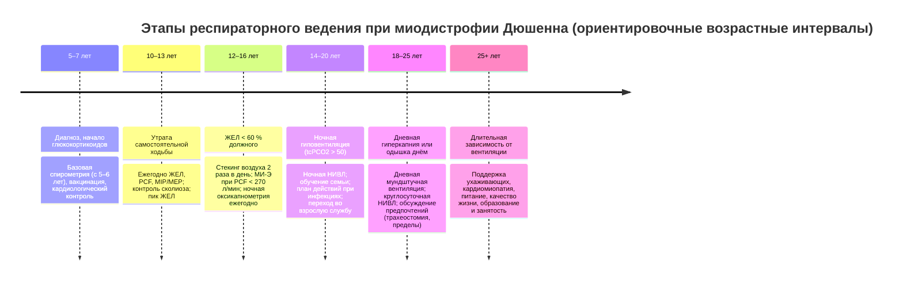

### 2.25. Нозологические особенности ведения

Общие принципы предыдущих глав преломляются через особенности каждого заболевания: механизм ДН (газообменник, насос, центр), темп прогрессирования, преобладание гипоксемии или гиперкапнии, роль сна, ожидаемый ответ на кислород и вентиляцию, прогноз, доступность радикальных методов. В этой главе собраны «нозологические профили» — компактно, с отсылками к более подробным разделам, чтобы в практической ситуации можно было быстро восстановить логику ведения для конкретного пациента.

#### 2.25.1. Хроническая обструктивная болезнь лёгких

Самая частая причина ХДН (п. 2.5.1): механизм — сочетание нарушения газообмена (V̇/Q̇-дисбаланс, снижение DLCO при эмфиземе) и перегрузки насоса (гиперинфляция, auto-PEEP, уплощённая диафрагма) с системными последствиями. Траектория — медленное прогрессирование с обострениями; гипоксемия обычно предшествует гиперкапнии; хроническая гиперкапния — маркёр тяжести и неблагоприятного прогноза (п. 3.4). Особенности ведения: фармакотерапия по GOLD с акцентом на тройную ингаляционную терапию при обострениях и эозинофилии, макролиды и рофлумиласт у отобранных (п. 2.16.1); ДКТ ≥ 15–18 ч при PaO₂ ≤ 55 (или ≤ 59 с ЛС/эритроцитозом) — единственное из медикаментозных вмешательств с доказанным влиянием на выживаемость (п. 2.17.1), не показана при умеренной десатурации (LOTT); длительная НИВЛ высокой интенсивности при стойкой гиперкапнии (PaCO₂ ≥ 50–52 мм рт. ст. в стабильном состоянии или через 2–4 недели после обострения — HOT-HMV, Köhnlein; п. 2.19.1) с целевым снижением PaCO₂ ≥ 20 % или до нормы; реабилитация — всем симптомным (п. 2.22); редукция объёма и трансплантация у отобранных (п. 2.23); контролируемый кислород и ранняя НИВЛ при обострениях (п. 2.24); скрининг ОАС (overlap), сердечной недостаточности, остеопороза, депрессии; вакцинация; план действий; паллиативная помощь интегрируется рано (одышка, тревога — п. 2.30). Ловушки: приписывание всей одышки ХОБЛ (сердечная недостаточность, ТЭЛА, анемия), «автоматическое» увеличение кислорода при одышке, пропуск гиперкапнии у пациента с «хорошей» SpO₂ на кислороде, несвоевременное направление на реабилитацию и трансплантацию.

#### 2.25.2. Бронхоэктазы, муковисцидоз, первичная цилиарная дискинезия

Механизм — гнойное воспаление и деструкция дыхательных путей с обструкцией, V̇/Q̇-дисбалансом, инфекционными обострениями; ХДН развивается на поздних стадиях (при муковисцидозе — у молодых взрослых). Ведение: клиренс дыхательных путей ежедневно (п. 2.21.4), ингаляционные антибиотики при хронической колонизации синегнойной палочкой, длительные макролиды при частых обострениях, лечение обострений 14 дней по микробиологии, муколитики (дорназа альфа и гипертонический раствор — при муковисцидозе), CFTR-модуляторы (при муковисцидозе с соответствующими мутациями — радикально изменили траекторию: улучшение ОФВ₁, снижение обострений, отсрочка ХДН и трансплантации), нутритивная поддержка (ферменты, высококалорийная диета), лечение диабета и остеопороза при муковисцидозе; при ХДН — ДКТ по общим критериям, НИВЛ при гиперкапнии как мост к трансплантации и при обострениях (снижает работу дыхания, улучшает сон; данные о выживаемости ограничены); трансплантация — при ОФВ₁ < 30 % или быстром снижении, гиперкапнии, ЛГ, частых обострениях (п. 2.23.3); резекция и эмболизация — по показаниям (п. 2.23.8); при первичной цилиарной дискинезии — аналогичный клиренс, лечение хронического риносинусита и среднего отита. Ловушки: назначение дорназы альфа при бронхоэктазах без муковисцидоза (вредна), недооценка нетуберкулёзных микобактерий, задержка направления на трансплантацию при муковисцидозе.

#### 2.25.3. Тяжёлая астма, облитерирующий бронхиолит и другие обструктивные заболевания

Астма редко приводит к ХДН, но при длительном неконтролируемом течении с ремоделированием формируется фиксированная обструкция с гипоксемией и, редко, гиперкапнией; тактика — максимальная противовоспалительная терапия, биологические препараты по фенотипу, исключение сопутствующих состояний (ОАС, рефлюкс, дисфункция голосовых связок), ДКТ по общим критериям; ОДН при астме — гиперкапния означает угрозу жизни и требует интенсивной терапии, НИВЛ — с осторожностью. **Облитерирующий бронхиолит** (после трансплантации, ингаляционных повреждений, при ревматических заболеваниях, после инфекций в детстве) — прогрессирующая обструкция мелких дыхательных путей с гипоксемией; специфической терапии мало (азитромицин, при трансплантате — коррекция иммуносупрессии, экстракорпоральный фотоферез), ДКТ и (ре)трансплантация. **Дефицит α₁-антитрипсина** — эмфизема у молодых; заместительная терапия замедляет потерю плотности лёгочной ткани по КТ (исследование RAPID, 2015), остальное — как при ХОБЛ; скрининг — всем пациентам с ХОБЛ однократно.

#### 2.25.4. Посттуберкулёзная болезнь лёгких, пневмокониозы, последствия торакопластики

**Посттуберкулёзная болезнь лёгких** — глобально одна из крупнейших причин ХДН: фиброз, бронхоэктазы, стенозы бронхов, эмфизема, плевральные шварты, деструкция паренхимы, аспергилломы; функциональные паттерны — обструктивный, рестриктивный, смешанный; ЛГ часта. Ведение: исключение активного туберкулёза и нетуберкулёзных микобактерий при ухудшении, бронхолитики при обструкции, клиренс и лечение бронхоэктазов, ДКТ и НИВЛ (хороший ответ при рестриктивно-смешанных вариантах с гиперкапнией — ранние серии длительной НИВЛ включали именно таких пациентов), лечение кровохарканья, реабилитация. **Последствия торакопластики и искусственного пневмоторакса** (пациенты, лечившиеся в середине XX века; сегодня редки, но встречаются) — экстрапульмональная рестрикция с гиперкапнией спустя десятилетия, отличный ответ на НИВЛ. **Пневмокониозы** (силикоз, антракоз с прогрессирующим массивным фиброзом, асбестоз) — рестрикция/смешанные нарушения, гипоксемия, ЛГ; прекращение экспозиции, скрининг туберкулёза и рака (силикоз, асбестоз), ДКТ, НИВЛ при гиперкапнии, трансплантация у молодых; экспертиза профессионального заболевания и компенсация (п. 2.27.14).

#### 2.25.5. Интерстициальные заболевания лёгких

Механизм — поражение газообменника: снижение DLCO, V̇/Q̇-дисбаланс, нарушение диффузии при нагрузке; ДН I типа с выраженной нагрузочной десатурацией; гиперкапния — поздно (терминальная стадия, истощение, ЛГ). Нозологии: ИЛФ (медиана выживаемости 3–5 лет без терапии; антифибротики замедляют снижение ФЖЕЛ — п. 2.16.7), прогрессирующие фиброзирующие ИЗЛ другой этиологии (ревматические, гиперчувствительный пневмонит, саркоидоз IV стадии, неклассифицируемые — нинтеданиб при прогрессировании), **синдром комбинированного фиброза и эмфиземы** (CPFE: относительно сохранённые объёмы при резко сниженной DLCO, тяжёлая гипоксемия и ЛГ, высокий риск рака — 🔬 ниже). Ведение: лечение основного заболевания (антифибротики, иммуносупрессия при воспалительных ИЗЛ, устранение антигена при гиперчувствительном пневмоните), ДКТ (критерии общие; потребность в потоке растёт быстро, высокопоточные системы при нагрузке; амбулаторный кислород уменьшает одышку при нагрузочной десатурации — исследование AmbOx, 2018), реабилитация рано (п. 2.22), лечение рефлюкса и кашля, скрининг и лечение ЛГ (при тяжёлой ЛГ при ИЗЛ — ингаляционный трепростинил, исследование INCREASE, 2021; п. 2.16.8), профилактика инфекций, **ранее направление на трансплантацию** (при установлении диагноза ИЛФ — п. 2.23.3), паллиативная помощь с момента диагноза (одышка, кашель, тревога; п. 2.30). НИВЛ и высокопоточная терапия при ИЗЛ — главным образом мост к трансплантации и средство облегчения симптомов; при остром обострении ИЛФ интубация редко оправдана (летальность > 80–90 % [⚠️ Требуется верификация]), что требует заблаговременного обсуждения «потолка» терапии; при терминальной стадии НИВЛ и кислород остаются мостом к трансплантации для кандидатов и паллиативным средством для остальных. Ловушки: позднее направление на трансплантацию, недооценка десатурации при нагрузке (SpO₂ в покое «нормальна»), приписывание одышки фиброзу при развитии ЛГ или ТЭЛА, назначение НИВЛ «по аналогии с ХОБЛ» без реалистичных целей.

#### 2.25.6. Overlap-синдром и дыхательная недостаточность при сердечной недостаточности

**Overlap-синдром** (ХОБЛ + ОАС; п. 2.12.6): механизмы суммируются — ночная гипоксемия глубже и длиннее, гиперкапния развивается при менее тяжёлой обструкции, ЛГ и правожелудочковая недостаточность чаще; нелеченый overlap ассоциирован с большей смертностью и частотой госпитализаций по сравнению с изолированной ХОБЛ, а терапия CPAP — с их снижением (J. M. Marin и соавторы, 2010, наблюдательные данные). Ведение: диагностика сна у пациентов с ХОБЛ при несоответствии гипоксемии/гиперкапнии тяжести обструкции, ожирении, храпе, сонливости, утренних головных болях, ЛГ; терапия положительным давлением — CPAP при ОАС без значимой гиперкапнии, НИВЛ (двухуровневая с достаточным EPAP для устранения обструкции и IPAP для вентиляции) при гиперкапнии; кислород добавляется к положительному давлению при сохраняющейся гипоксемии (не вместо него — изолированный кислород удлиняет апноэ и усиливает гиперкапнию); лечение ХОБЛ в полном объёме, снижение массы тела. **Сердечная недостаточность** при ХДН: сочетание с ХОБЛ часто (до 20–30 % пациентов с ХОБЛ), одышка многофакторна; гиперкапния при «чистой» сердечной недостаточности нехарактерна — её наличие заставляет искать ХОБЛ, СОГ, НМЗ; центральное апноэ с дыханием Чейна — Стокса при сердечной недостаточности со сниженной фракцией выброса — маркёр тяжести, адаптивная сервовентиляция при этом противопоказана (исследование SERVE-HF, 2015: повышение сердечно-сосудистой смертности), основа — оптимизация терапии сердечной недостаточности; при сочетании ОАС и сердечной недостаточности — CPAP по симптомным показаниям; при гиперкапнической ДН с сердечной недостаточностью НИВЛ применяется по механизму гиповентиляции с осторожным подбором EPAP (преднагрузка) и контролем АД; кардиоселективные бета-блокаторы при ХОБЛ не противопоказаны (п. 2.16.14); диуретики — с контролем бикарбоната и калия (алкалоз угнетает дыхание); ЛГ при сердечной недостаточности (2-я группа) — посткапиллярная, лёгочные вазодилататоры не показаны.

#### 2.25.7. Синдром ожирения-гиповентиляции

СОГ (п. 2.5, 2.7.10, 2.12) — ожирение (ИМТ ≥ 30) + дневная гиперкапния (PaCO₂ > 45) при исключении других причин; у 90 % — сопутствующий ОАС (у 70 % тяжёлый), у 10 % — изолированная гиповентиляция во сне. Диагностика часто запаздывает до первой декомпенсации (п. 3.5): скрининг — HCO₃⁻ ≥ 27 ммоль/л у пациента с ожирением и сонливостью (ATS 2019), затем газы крови и исследование сна. Ведение (ATS 2019): терапия положительным давлением — CPAP как первая линия при стабильном СОГ с тяжёлым ОАС (эквивалентность НИВЛ по данным исследования Pickwick, п. 2.19.4), НИВЛ при неэффективности CPAP, при сохраняющейся гиперкапнии, при менее выраженном ОАС, при тяжёлой гиперкапнии (PaCO₂ > 55–60 [⚠️ Требуется верификация: точный порог не установлен]) и после госпитализации с ОДН (с переоценкой через 3 месяца); кислород добавляется только при сохраняющейся гипоксемии на эффективном положительном давлении (изолированная ДКТ усугубляет гиперкапнию — п. 2.17.12.1); снижение массы тела на 25–30 % как патогенетическое лечение (структурированная программа, фармакотерапия, бариатрическая хирургия — п. 2.16.18, 2.23.5), что может привести к отмене вентиляции; лечение ЛГ и ЛС через коррекцию газообмена, диуретики при отёках, профилактика ТЭЛА, скрининг диабета и сердечно-сосудистых заболеваний; по наблюдательным данным, терапия положительным давлением улучшает выживаемость, тогда как нелеченый СОГ имеет высокую смертность (п. 2.14). Ловушки: лечение «ОАС» CPAP без оценки CO₂ и контроля эффективности (сохраняющаяся гиперкапния), назначение кислорода без положительного давления, седативные и опиоиды, недооценка периоперационного риска, отсутствие программы снижения массы тела.

#### 2.25.8. Нервно-мышечные заболевания

Общие принципы (п. 2.19.4, 2.21.5): ДН — следствие слабости инспираторных мышц (гиповентиляция, сначала в REM-сне), экспираторных (кашель) и бульбарных (аспирация, обструкция верхних дыхательных путей); лёгкие изначально нормальны, но микроателектазы, инфекции и снижение растяжимости грудной стенки присоединяются; мониторинг — ЖЕЛ сидя и лёжа, MIP/SNIP, PCF, SpO₂ и tcPCO₂ ночью, симптомы (ортопноэ, утренние головные боли, нарушение сна, сонливость, инфекции); вмешательства — НИВЛ (рано: при симптомах гиповентиляции, ЖЕЛ < 50 % или падении лёжа > 20–25 %, SNIP/MIP < 40 см вод. ст., ночной гиповентиляции, PaCO₂ > 45 — не дожидаясь дневной гиперкапнии; п. 3.12), поддержка кашля (PCF < 270), стекинг воздуха, лечение сиалореи, питание (гастростомия при дисфагии), профилактика инфекций, адаптивное оборудование, мультидисциплинарная команда; решения о трахеостомии и о пределах терапии — заблаговременно (п. 2.20, 2.30).

- **Боковой амиотрофический склероз.** ДН — основная причина смерти; медиана выживаемости 2–4 года; НИВЛ продлевает жизнь (в РКИ S. C. Bourke и соавторов, 2006, медиана выживаемости у пациентов без тяжёлых бульбарных нарушений увеличилась примерно на 7 месяцев) и улучшает качество жизни, включая пациентов с бульбарными нарушениями (у них — за счёт сна и симптомов, при худшей переносимости); показания к НИВЛ: ортопноэ, симптомы ночной гиповентиляции, SNIP или MIP < 40 см вод. ст., ФЖЕЛ < 50–80 % с симптомами, PaCO₂ > 45, ночная десатурация; бульбарные нарушения требуют лечения сиалореи, подбора маски, при неэффективности — обсуждения трахеостомии как осознанного выбора (п. 2.20.10); гастростомия — при потере массы ≥ 10 %, дисфагии, желательно при ФЖЕЛ > 50 % или под НИВЛ; рилузол и эдаравон — скромный эффект на течение; диафрагмальная стимуляция противопоказана (п. 2.20.11); паллиативная помощь — с момента диагноза, включая план прекращения вентиляции по желанию пациента (п. 2.30.8); в стационаре при ОДН — НИВЛ, МИ-Э, обсуждение целей; интубация у пациента, не желающего трахеостомии, должна быть исключена заранее документом.
- **Миодистрофия Дюшенна.** Предсказуемая траектория (Рис. 24): утрата ходьбы ≈ 10–13 лет (стероиды отодвигают), ЖЕЛ достигает пика и снижается на 5–10 % в год, ночная гиповентиляция — в подростковом возрасте, дневная — к 18–22 годам; ведение — ежегодный (при ЖЕЛ < 60 % — каждые 6 месяцев) мониторинг ЖЕЛ, PCF, ночной оксикапнометрии, стекинг воздуха при ЖЕЛ < 60 %, МИ-Э при PCF < 270, НИВЛ при ночной гиповентиляции, дневная мундштучная вентиляция при дневной гиперкапнии или одышке, кардиомиопатия (ингибиторы АПФ профилактически, ЭхоКГ/МРТ ежегодно), сколиоз (коррекция при угле > 20–30° до падения ЖЕЛ < 30–35 %), питание, остеопороз, переход во взрослую службу; выживаемость при полном респираторном ведении — за 30 лет; трахеостомия нужна немногим при доступности круглосуточной НИВЛ и МИ-Э (п. 2.20.1).
- **Спинальная мышечная атрофия.** Тип 1 — ДН в первый год жизни; патогенетическая терапия (нусинерсен, рисдиплам, онасемноген абепарвовек) кардинально изменила естественное течение, но большинство пациентов с ранним началом нуждаются в респираторной поддержке (НИВЛ, МИ-Э; трахеостомия — этический выбор семьи — п. 2.26.1); тип 2 — ночная НИВЛ в детстве/подростковом возрасте, сколиоз; тип 3 — редко.
- **Миотоническая дистрофия 1-го типа** — сочетание слабости мышц, центральной гиповентиляции и гиперсомнии, высокой чувствительности к седативным и анестетикам, нарушений ритма; НИВЛ при гиповентиляции, но приверженность низкая (апатия, когнитивные особенности); периоперационный риск высок.
- **Миопатии (помпе, конечностно-поясные, врождённые), митохондриальные болезни** — болезнь Помпе: ферментозаместительная терапия, диафрагмальная слабость опережает слабость конечностей (ЖЕЛ лёжа!), НИВЛ рано; при других — по общим принципам.
- **Миастения** — ХДН нехарактерна; кризы — ОДН (ЖЕЛ < 15–20 мл/кг, MIP < −30 см вод. ст. — показания к интубации; НИВЛ при ранних кризах без гиперкапнии), лечение — иммунотерапия; остерегаться препаратов, усугубляющих слабость (аминогликозиды, магний, бета-блокаторы).
- **Постполиомиелитный синдром** — поздняя (через 30–40 лет) гиповентиляция у перенёсших полиомиелит с поражением дыхательных мышц; НИВЛ эффективна; сколиоз, ОАС, слабость бульбарных мышц; некоторые пациенты сохраняют навык глоссофарингеального дыхания.
- **Синдром Гийена — Барре и критическая полинейропатия** — обычно ОДН с восстановлением; редко — длительная зависимость от вентиляции с последующим отлучением (п. 2.20.12).

**Рис. 24.** Ориентировочная хронология респираторного ведения при миодистрофии Дюшенна. Возрастные интервалы индивидуальны и смещаются при терапии глюкокортикоидами и новых методах лечения; схема читается слева направо.

#### 2.25.9. Травма спинного мозга и паралич диафрагмы

При повреждении на уровне C1–C3 — зависимость от вентиляции (ИВЛ через трахеостому; стимуляция диафрагмального нерва при сохранных нижних мотонейронах — п. 2.20.11; у части — безманжетная вентиляция с речью), C3–C5 — частичная функция диафрагмы с ночной гиповентиляцией и риском отсроченного ухудшения; при любых шейных и верхнегрудных повреждениях — слабость экспираторных мышц (неэффективный кашель — МИ-Э, ассистированный кашель, абдоминальный бандаж улучшает механику сидя), высокая распространённость ОАС (до половины пациентов с тетраплегией), вегетативная дисрефлексия, ателектазы и пневмонии — главные осложнения первого года; позднее — старение, снижение резерва, ожирение. **Односторонний паралич диафрагмы** — одышка лёжа и при нагрузке, снижение ЖЕЛ лёжа; ведение — наблюдение (восстановление возможно в течение 1–2 лет), пликация при стойкой симптоматике (п. 2.23.6); **двусторонний** — ортопноэ, парадоксальное дыхание, гиповентиляция во сне — НИВЛ (ночью, затем по потребности), поиск причины (невралгическая амиотрофия, БАС, травма, операции на сердце, идиопатический).

#### 2.25.10. Торакальные деформации

Кифосколиоз (идиопатический, врождённый, нервно-мышечный, посттуберкулёзный): риск ДН при угле Кобба > 100°, ЖЕЛ < 45 %, раннем начале деформации (до 5 лет), слабости мышц; течение — медленное нарастание гиперкапнии с ночным дебютом, ЛС; НИВЛ — метод выбора с одним из лучших результатов среди всех показаний (выживаемость на НИВЛ существенно выше, чем на одном кислороде, — наблюдательные данные B. Buyse и соавторов, 2003; 5-летняя выживаемость ≈ 80 %); параметры — высокие давления из-за низкой растяжимости, ПДКВ умеренное, контроль ночного CO₂; кислород — только при сохраняющейся гипоксемии на НИВЛ; хирургическая коррекция у взрослых с ДН не показана (п. 2.23.6); беременность — п. 2.26.9. **Анкилозирующий спондилит** — редко вызывает ДН (диафрагмальное дыхание компенсирует), фиброз верхних долей; **последствия торакопластики, фиброторакс** — экстрапульмональная рестрикция, НИВЛ; **воронкообразная грудь** — ДН крайне редко.

#### 2.25.11. Центральные гиповентиляции у взрослых

Причины: поражения ствола и продолговатого мозга (инсульт, опухоли, рассеянный склероз, сирингобульбия, мальформация Киари — компрессия на уровне большого затылочного отверстия), последствия энцефалита, нейродегенеративные заболевания (мультисистемная атрофия — стридор и центральное апноэ), ВСЦГ с поздним дебютом (мутации *PHOX2B* с малым числом повторов — п. 2.26.1), гипотиреоз, опиоиды и другие депрессанты (при хроническом приёме — центральное апноэ, атактическое дыхание, гиповентиляция), идиопатическая центральная альвеолярная гиповентиляция (диагноз исключения). Признаки: гиперкапния при нормальной функции лёгких и силе мышц (Табл. 18), отсутствие одышки («не чувствует»), усугубление во сне, особенно в медленноволновом сне (в отличие от НМЗ, где худший — REM), нарушение вентиляционного ответа на CO₂. Ведение: лечение причины (декомпрессия при Киари, отмена опиоидов, гормоны), вентиляция во сне (НИВЛ; при тяжёлых формах — круглосуточная или стимуляция диафрагмального нерва), дыхательные стимуляторы (ацетазоламид, прогестины, теофиллин — слабые, вспомогательные), запрет седативных и алкоголя, кислород только с вентиляцией (без неё углубляет гиповентиляцию), обучение семьи (пациент не ощущает ухудшения).

#### 2.25.12. Лёгочная гипертензия и ХТЭЛГ как причина ХДН

ЛГ любой группы при прогрессировании вызывает гипоксемию (снижение сердечного выброса с низким PvO₂, V̇/Q̇-дисбаланс, открытие овального окна с шунтом) и ДН I типа; при лёгочной артериальной гипертензии (1-я группа) — специфическая терапия (ингибиторы ФДЭ-5, антагонисты рецепторов эндотелина, простаноиды, стимуляторы гуанилатциклазы, активин-сигнальный ингибитор сотатерцепт с 2023–2024 годов), ДКТ при гипоксемии (физиологически обоснована, доказательств по выживаемости нет), антикоагуляция при показаниях, реабилитация под наблюдением, трансплантация (п. 2.23.3); при ХТЭЛГ (4-я группа) — эндартерэктомия/ангиопластика/риоцигуат (п. 2.23.4); при ЛГ 3-й группы — лечение основного заболевания и ДН, вазодилататоры только при тяжёлой ЛГ в экспертных центрах (п. 2.16.8, 3.16); ОДН при ЛГ — опасность гипотензии и правожелудочковой недостаточности (п. 2.24.9), избегать интубации, если возможно; беременность при ЛГ противопоказана (п. 2.26.9); планирование помощи — рано.

#### 2.25.13. ХДН при онкологических заболеваниях и после резекций лёгких

Причины: рак лёгкого на фоне ХОБЛ (сочетание частое — курение), пневмонэктомия/лобэктомия у пациента с ограниченным резервом (прогноз по предсказанным послеоперационным ОФВ₁ и DLCO < 30–40 %; КПНТ при V̇O₂max < 10–15 мл/кг/мин — высокий риск), лучевой пневмонит и фиброз, лекарственный пневмонит (блеомицин, иммунные ингибиторы контрольных точек, ингибиторы EGFR/ALK), лимфангитический карциноматоз, плевральный выпот, обструкция дыхательных путей, тромбоэмболии, кахексия, опиоиды. Ведение: восстановление после резекции (реабилитация до и после, ДКТ при критериях, НИВЛ редко), лечение пневмонитов (стероиды, отмена препарата), дренирование выпота и плевродез, стентирование при обструкции, антикоагуляция, ДКТ по критериям (и паллиативный кислород при гипоксемии; при одышке без гипоксемии — поток воздуха, опиоиды, п. 3.9), реалистичные цели — НИВЛ при онкологической ОДН оправдана при обратимой причине и приемлемом прогнозе, иначе — паллиативная стратегия (п. 2.30).

#### 2.25.14. Последствия COVID-19 и ОРДС

У большинства пациентов, перенёсших тяжёлую COVID-пневмонию и ОРДС, изменения на КТ и снижение DLCO регрессируют в течение 6–12 месяцев; стойкая потребность в кислороде через 3–6 месяцев сохраняется у меньшинства (главным образом после длительной ИВЛ, ЭКМО, у пожилых и при предшествующих ИЗЛ) [⚠️ Требуется верификация: точные доли по когортам]; у части формируются фиброзоподобные изменения, у единиц — прогрессирующий фиброз, требующий антифибротической терапии (данные РКИ ограничены) или трансплантации. Ведение: оценка через 6–12 недель и 6 месяцев (SpO₂ в покое и при нагрузке, ФВД с DLCO, КТ по показаниям, ЭхоКГ при одышке, исключение ТЭЛА/ХТЭЛГ), временная домашняя ДКТ с плановой переоценкой и отменой по критериям (п. 2.17.11), реабилитация (включая когнитивные и психологические аспекты, слабость после ОРИТ), лечение сопутствующих состояний (ОАС, сердечная недостаточность, деконди­ционирование, гипервентиляционный синдром — частая причина одышки без гипоксемии), гиперкапническая ХДН после COVID — редко (при длительной ИВЛ, слабости диафрагмы, предшествующих заболеваниях) и требует стандартного подхода (НИВЛ); трахеостомированные после длительной ИВЛ — программы деканюляции (п. 2.20.12). Дискуссионные вопросы — п. 3.24. Те же принципы применимы к последствиям ОРДС иной этиологии: функция чаще восстанавливается, а инвалидизацию определяют нейромышечные и психологические последствия.

#### 2.25.15. Редкие причины

**Лимфангиолейомиоматоз** — обструкция и кисты у женщин, пневмотораксы, хилоторакс; сиролимус стабилизирует функцию; ДКТ, трансплантация. **Гистиоцитоз из клеток Лангерганса** — курение, кисты, ЛГ; отказ от курения, кладрибин при прогрессировании. **Лёгочный альвеолярный протеиноз** — гипоксемия при «нормальной» аускультации, молочный лаваж, ингаляционный ГМ-КСФ при аутоиммунной форме. **Гепатопульмональный синдром** (п. 2.13) — ДКТ, трансплантация печени излечивает. **Серповидноклеточная болезнь** — хроническая гипоксемия, ЛГ, рестрикция после острых грудных синдромов; гидроксимочевина, трансфузии, ДКТ, лечение ОАС. **Врождённые пороки сердца с синдромом Эйзенменгера** — цианотическая гипоксемия, кислород не корригирует шунт (паллиативно), специфическая терапия ЛГ, избегать кровопусканий без симптомов гипервязкости и дегидратации. **Нарушения дыхания при болезни Паркинсона и других экстрапирамидных заболеваниях** — рестрикция, дискоординация, аспирация, ОАС; оптимизация терапии, глотание, НИВЛ редко. **Болезнь Помпе, ВСЦГ у взрослых, синдром Прадера — Вилли** (ожирение, гиповентиляция, центральное апноэ, осторожность с гормоном роста) — по соответствующим принципам.

#### 2.25.16. Многофакторная дыхательная недостаточность

У значительной части пациентов, особенно пожилых, ХДН обусловлена несколькими причинами, ни одна из которых не объясняет её полностью: ХОБЛ средней тяжести + ожирение + сердечная недостаточность + ОАС + саркопения + опиоиды для хронической боли; ИЗЛ + эмфизема + ЛГ; кифосколиоз + постполиомиелитная слабость + ОАС. Признаки: несоответствие тяжести газообмена каждому отдельному заболеванию (п. 2.13.9), гиперкапния при «не столь тяжёлой» спирометрии, быстрая декомпенсация при малых триггерах. Подход: явное перечисление всех вкладов в диагнозе (п. 2.13.11), оценка каждого компонента инструментально (спирометрия, DLCO, сила мышц, исследование сна, ЭхоКГ, нутритивный статус, лекарства), воздействие на все обратимые компоненты одновременно (снижение массы, лечение ОАС, оптимизация сердечной терапии, отмена седативных, реабилитация), выбор респираторной поддержки по преобладающему механизму (НИВЛ при гиповентиляции независимо от «главного» диагноза), координация специалистов одним врачом (пульмонолог или терапевт как «держатель» плана — п. 2.27), реалистичные цели и ранняя паллиативная интеграция у хрупких пациентов. Ошибка — лечить каждое заболевание в отдельности «по своему руководству» и оставить ДН без объяснения и без ответственного.

#### 2.25.17. Сводная таблица

**Табл. 38.** Нозологические профили ХДН: механизм, мониторинг, ключевые вмешательства

| Нозология | Доминирующий механизм / тип ДН | Ключевой мониторинг | Специфика респираторной поддержки | Радикальные опции |
|---|---|---|---|---|
| ХОБЛ | Газообменник + насос; I → II тип | Спирометрия, газы, SpO₂ при нагрузке, HCO₃⁻, ЭхоКГ, сон при несоответствии | ДКТ по критериям; НИВЛ высокой интенсивности при PaCO₂ ≥ 50–52; контролируемый O₂ при обострении | Редукция объёма, трансплантация |
| Бронхоэктазы / муковисцидоз | Обструкция + инфекция; I → II | Микробиология, ОФВ₁, газы, нутритивный статус | Клиренс; НИВЛ как мост; CFTR-модуляторы | Трансплантация |
| ИЗЛ | Газообменник; I тип, нагрузочная десатурация | ФЖЕЛ, DLCO, 6MWT с SpO₂, ЭхоКГ | ДКТ с высокими потоками; НИВЛ/HFNC как мост и симптоматически | Трансплантация (направлять при диагнозе) |
| Overlap | Обструкция + ОАС; II тип рано | Исследование сна, tcPCO₂ | CPAP или НИВЛ + O₂ при необходимости | — |
| СОГ | Насос (нагрузка) + ОАС + центр; II тип | HCO₃⁻, газы, ПСГ, масса тела | CPAP (при тяжёлом ОАС) или НИВЛ; O₂ только с давлением | Бариатрическая хирургия |
| НМЗ | Насос (слабость) + кашель + бульбарные; II тип | ЖЕЛ сидя/лёжа, SNIP/MIP, PCF, ночная оксикапнометрия | Ранняя НИВЛ, МИ-Э, стекинг, мундштучная вентиляция; трахеостомия по выбору | Патогенетическая терапия (СМА, Помпе) |
| Торакальные деформации | Насос (рестрикция); II тип | ЖЕЛ, газы, ночной CO₂, ЭхоКГ | НИВЛ с высокими давлениями — отличный ответ | Коррекция у детей |
| Травма спинного мозга | Насос (паралич) + кашель + ОАС | ЖЕЛ, PCF, сон | ИВЛ/безманжетная вентиляция, стимуляция диафрагмы, МИ-Э | Стимуляция диафрагмального нерва |
| Центральные гиповентиляции | Центр; II тип без одышки | Ночной CO₂, вентиляционный ответ | Вентиляция во сне (± днём); без седативных | Лечение причины (Киари, опиоиды) |
| ЛГ / ХТЭЛГ | Сосуды; I тип | ЭхоКГ, катетеризация, 6MWT, BNP | ДКТ; осторожность при ОДН | Эндартерэктомия, трансплантация |
| Пост-COVID / после ОРДС | Газообменник (обратимо); I тип | SpO₂ в покое/нагрузке, DLCO, КТ | Временная ДКТ с отменой; реабилитация | Трансплантация (единицы) |
| Многофакторная | Сочетание | Полная оценка всех компонентов | По преобладающему механизму | По компонентам |

🔬 **Углубление: синдром комбинированного фиброза и эмфиземы (CPFE).** У курильщиков с эмфиземой верхних долей и фиброзом нижних формируется особый фенотип: объёмы лёгких относительно сохранны (гиперинфляция эмфиземы «компенсирует» рестрикцию фиброза — спирометрия может быть почти нормальной), тогда как DLCO резко снижена (оба процесса разрушают газообменную поверхность), гипоксемия при нагрузке глубокая, ЛГ развивается часто (до 50 % пациентов) и является главным предиктором смерти, риск рака лёгкого высок. Диагностические ловушки: «нормальная спирометрия» успокаивает, а истинная тяжесть видна только по DLCO, нагрузочному тесту и ЭхоКГ; ОФВ₁ не годится для оценки прогрессирования. Терапевтически CPFE не имеет собственных РКИ: прекращение курения, антифибротики при прогрессирующем фиброзе, бронхолитики при обструкции, ДКТ при критериях, оценка ЛГ (при тяжёлой — ингаляционный трепростинил или экспертное решение), скрининг рака, ранняя оценка трансплантации; НИВЛ редко показана (гиперкапния нехарактерна, пока не разовьётся истощение насоса). Пример иллюстрирует общий принцип главы: механизм ДН, а не название болезни, определяет, что мониторировать и чем лечить.

❗ **Типичная ошибка:** назначать пациенту с overlap-синдромом или СОГ только ночной кислород («для сатурации»). Без положительного давления кислород удлиняет апноэ, усиливает гиперкапнию и маскирует гиповентиляцию; терапия положительным давлением — основа, кислород — дополнение при сохраняющейся гипоксемии.

❗ **Типичная ошибка:** при БАС и других НМЗ ждать дневной гиперкапнии (PaCO₂ > 45) для начала НИВЛ. Ночная гиповентиляция, ортопноэ, SNIP < 40 см вод. ст. и снижение ЖЕЛ лёжа — достаточные основания; отсрочка оборачивается декомпенсацией при первой инфекции и экстренной интубацией без обсуждения предпочтений.

💡 **Интересный факт:** в 1960-е годы медиана продолжительности жизни при миодистрофии Дюшенна составляла около 14 лет, и смерть почти всегда наступала от дыхательной недостаточности. Анализ британской когорты (M. Eagle и соавторы, 2002) показал, что внедрение ночной вентиляции в 1990-е годы увеличило медиану выживаемости до 25 лет, а в современных центрах с круглосуточной НИВЛ, поддержкой кашля и кардиологическим лечением многие пациенты живут за 30 и 40 лет, получают образование, работают и создают семьи. Это один из самых наглядных примеров того, как «технология ухода» без единого нового лекарства удвоила продолжительность жизни при генетическом заболевании.

📝 **Обобщение**

- Нозология определяет механизм ДН (газообменник, насос, центр, сосуды), темп прогрессирования, соотношение гипоксемии и гиперкапнии, роль сна и доступность радикальных методов; алгоритмы предыдущих глав применяются через эту призму.
- Заболевания газообменника (ХОБЛ на ранних стадиях ХДН, ИЗЛ, ЛГ, пост-COVID) — гипоксемия, ДКТ и лечение причины, вентиляция как мост/симптоматическая мера; заболевания насоса и центра (НМЗ, торакальные деформации, СОГ, центральные гиповентиляции, травма спинного мозга) — гиперкапния с ночным дебютом, НИВЛ рано и с отличным ответом, кислород только вместе с вентиляцией, поддержка кашля при слабости.
- ХОБЛ: ДКТ по критериям, НИВЛ высокой интенсивности при стойкой гиперкапнии, реабилитация, редукция объёма/трансплантация у отобранных; ИЗЛ: ранняя трансплантационная оценка, высокие потоки кислорода, паллиативная интеграция; overlap и СОГ: положительное давление первично; БАС: НИВЛ по симптомам и SNIP/ЖЕЛ, сиалорея, гастростомия, заблаговременные решения о трахеостомии; Дюшенн: предсказуемая хронология — мониторинг, стекинг, МИ-Э, ночная, затем дневная НИВЛ.
- Многофакторная ДН у пожилых требует перечисления всех вкладов, одновременного воздействия на обратимые компоненты и одного ответственного координатора.

Главный вывод: лечить следует механизм, а не ярлык диагноза — но знание естественного течения каждой нозологии позволяет предвидеть, когда механизм изменится, и готовить пациента заранее. В следующей главе — особые группы пациентов, где к нозологии добавляются возраст, физиологическое состояние и обстоятельства.

❓ **Контрольные вопросы**

1. Сравните ведение ХДН при ХОБЛ и при ИЛФ по четырём позициям: тип ДН, критерии ДКТ, место НИВЛ, сроки направления на трансплантацию.
2. Почему при overlap-синдроме и СОГ изолированная кислородотерапия опасна, а при кифосколиозе и НМЗ кислород назначается только вместе с вентиляцией? Объясните механизмы.
3. Перечислите показания к началу НИВЛ при БАС и опишите, какие решения должны быть обсуждены с пациентом заранее и почему.
4. Составьте план респираторного мониторинга и вмешательств для пациента с миодистрофией Дюшенна от 10 до 25 лет.
5. У 74-летнего пациента ХОБЛ GOLD 2, ИМТ 36, фракция выброса 40 %, ИАГ 32, принимает трамадол; PaCO₂ 58 мм рт. ст. Сформулируйте диагноз многофакторной ДН и план воздействия на каждый компонент.
