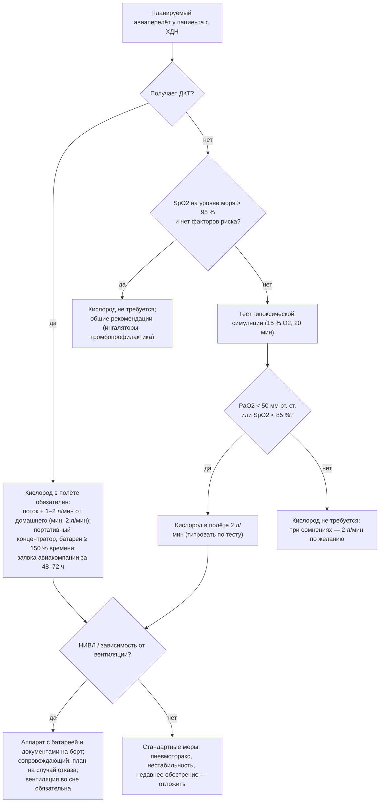

### 2.26. Особые группы пациентов

Возраст, физиологическое состояние, сопутствующие заболевания и обстоятельства жизни меняют не только параметры терапии, но и сами цели. Ребёнок с ВСЦГ, 85-летняя пациентка с ХОБЛ и деменцией, беременная женщина с кифосколиозом, пациент с ХДН перед операцией на брюшной полости или в самолёте на высоте 2400 м — у каждого свои пороги, риски и приоритеты. В этой главе собраны особенности ведения для групп, которые чаще всего ставят врача в затруднение.

#### 2.26.1. Дети

##### 2.26.1.1. Физиологические особенности

Ребёнок — не маленький взрослый: более высокий метаболизм и потребление кислорода на килограмм массы (в 2–3 раза выше у грудных детей), низкая функциональная остаточная ёмкость при объёме закрытия, превышающем ФОЕ у младенцев (склонность к ателектазам), податливая грудная клетка (парадоксальное движение при нагрузке на диафрагму), высокая доля REM-сна (до 50 % у новорождённых), меньшая доля устойчивых к утомлению волокон в диафрагме, узкие дыхательные пути (сопротивление обратно пропорционально четвёртой степени радиуса — небольшой отёк резко повышает сопротивление), незрелость контроля дыхания (периодическое дыхание, апноэ недоношенных). Следствия: быстрая десатурация, быстрый переход от компенсации к истощению, высокая чувствительность к инфекциям, иные критерии гиповентиляции (PaCO₂ > 50 мм рт. ст. более 25 % времени сна — AASM), более высокие целевые SpO₂ (обычно ≥ 92–95 % в зависимости от заболевания и возраста; при БЛД большинство рекомендаций — ≥ 92–93 % [⚠️ Требуется верификация: пороги различаются между руководствами]), особенности оборудования (маски, канюли малого диаметра, дыхательные объёмы, чувствительность триггера, алгоритмы компенсации утечки для малых объёмов).

##### 2.26.1.2. Основные причины и их специфика

**Бронхолёгочная дисплазия** — главная причина домашней ДКТ у детей раннего возраста; кислород для роста и профилактики ЛГ, отмена по мере роста лёгких (большинство — к 1–2 годам) по данным ночной оксиметрии; скрининг ЛГ ЭхоКГ; профилактика РСВ-инфекции. **Нервно-мышечные заболевания** (СМА, врождённые миопатии и дистрофии, Дюшенн) — НИВЛ, МИ-Э, стекинг (у детей — с игровыми элементами), решения о трахеостомии при СМА 1-го типа принимаются семьёй с командой с учётом патогенетической терапии; **ВСЦГ** — мутация *PHOX2B* (полиаланиновые экспансии 20/24–20/33 и неполиаланиновые мутации; тяжесть коррелирует с генотипом: при 20/27 и более — обычно потребность в круглосуточной вентиляции, при неполиаланиновых — ассоциация с болезнью Гиршпрунга и нейробластомой), отсутствие ощущения одышки и ответа на гипоксию и гиперкапнию, обязательная вентиляция во сне (а при тяжёлых формах — постоянно), трахеостомия у младенцев с последующим переходом на НИВЛ или стимуляцию диафрагмы (позволяет дневную свободу у детей, зависящих от вентиляции круглосуточно), наблюдение за нарушениями ритма (паузы — показание к кардиостимулятору), вегетативными нарушениями, обучением; запрет на самостоятельное плавание и ныряние, осторожность с седацией; **пороки развития дыхательных путей** (трахеомаляция, стенозы), **врождённые пороки сердца**, **последствия тяжёлых инфекций и ОРДС**, **спинальные травмы**, **муковисцидоз и бронхоэктазы**, **ИЗЛ детского возраста**, **синдромы с ОАС и гиповентиляцией** (Дауна, Прадера — Вилли, ахондроплазия, краниофациальные аномалии).

##### 2.26.1.3. Домашняя вентиляция у детей

Руководство ATS (2016) по длительной инвазивной вентиляции у детей рекомендует: стандартизованный процесс выписки с обучением минимум двух ухаживающих, бодрствующего обученного человека рядом с ребёнком круглосуточно (ребёнок не может сам отреагировать на разгерметизацию), непрерывную пульсоксиметрию дома, резервный вентилятор, план действий, регулярное наблюдение мультидисциплинарной командой, оценку готовности семьи и домашних условий; при НИВЛ у детей — внимание к гипоплазии средней зоны лица при длительном давлении маской (чередование интерфейсов, ортодонтический контроль), росту (пересмотр параметров и масок каждые 3–6 месяцев), приверженности (поведенческие стратегии, игровая адаптация), участию в школьной жизни (сопровождение, обучение персонала школы), сиблингам и семье (п. 2.28.3). Перспективы: при БЛД и многих врождённых состояниях — отмена поддержки с ростом; при ВСЦГ и тяжёлых НМЗ — пожизненная поддержка с хорошим качеством жизни при правильной организации; деканюляция у детей — поэтапная (уменьшение канюли, клапан, окклюзия, ПСГ с закрытой канюлей).

##### 2.26.1.4. Переход во взрослую службу

См. п. 2.26.3.

#### 2.26.2. Пожилые и хрупкие пациенты

С возрастом снижаются эластическая тяга, сила дыхательных мышц, хемочувствительность, DLCO, растёт объём закрытия; сопутствующие заболевания (сердечная недостаточность, ХБП, диабет, когнитивные нарушения, остеопороз, саркопения) и полипрагмазия (бензодиазепины, опиоиды, антихолинергики, бета-блокаторы) делают ХДН многофакторной (п. 2.25.16) при меньшей тяжести каждого компонента и ухудшают переносимость декомпенсаций. Особенности: интерпретация PaO₂ с поправкой на возраст (п. 2.2), но не «снижение планки» целей лечения — пожилые получают от ДКТ, НИВЛ и реабилитации пользу, сопоставимую с более молодыми (приверженность НИВЛ у пожилых не ниже); оценка хрупкости (шкала клинической хрупкости, скорость ходьбы, сила хвата), функционального статуса, когнитивных функций, зрения, слуха, ловкости рук (ингаляторы, маски — выбор простых устройств), риска падений (кислородные трубки, ночные подъёмы), питания, социальной поддержки; упрощение схем (один ингалятор, фиксированные комбинации), обучение с демонстрацией, вовлечение ухаживающих; при острых состояниях — делирий как проявление гиперкапнии, атипичные обострения (без лихорадки, с падениями и спутанностью); осторожность с седативными и снотворными; обсуждение целей и предпочтений рано, с учётом прогноза коморбидности, но без презумпции «не лечить из-за возраста» — возраст сам по себе не является критерием отказа от НИВЛ или ОРИТ, а хрупкость и функциональный статус — да. Гериатрическая оценка перед решением о домашней вентиляции и после госпитализации улучшает исходы и реалистичность плана.

#### 2.26.3. Подростки и переход во взрослую службу

Переход (transition) из детской во взрослую систему помощи — критический период для пациентов с НМЗ, муковисцидозом, ВСЦГ, БЛД: меняются врачи, стиль общения, ответственность (от родителей к пациенту), финансирование; риски — потеря наблюдения, снижение приверженности, декомпенсации, психологические проблемы. Принципы: структурированная программа перехода с 12–14 лет (постепенное обучение подростка самостоятельному управлению терапией, часть визита без родителей), совместные визиты детской и взрослой команд, письменный «паспорт» с историей, параметрами, оборудованием, предпочтениями; взрослая команда, знакомая с «детскими» заболеваниями (специализированные центры НМЗ, муковисцидоза); внимание к образованию, профессии, сексуальности и репродукции, независимому проживанию, вождению, употреблению веществ; психологическая поддержка; участие пациента в решениях о трахеостомии, пределах терапии, трансплантации по мере взросления; соблюдение правовых аспектов дееспособности.

#### 2.26.4. Пациенты с психическими расстройствами и зависимостями

Депрессия и тревога при ХДН встречаются у 30–50 % пациентов и ухудшают приверженность, качество жизни, частоту госпитализаций и выживаемость (п. 2.9, 2.16.15); панические атаки имитируют и провоцируют декомпенсацию, затрудняют НИВЛ (клаустрофобия — постепенная адаптация, назальные интерфейсы, когнитивно-поведенческие техники, при необходимости — кратковременная поддержка СИОЗС; бензодиазепины — избегать). Тяжёлые психические расстройства (шизофрения, биполярное расстройство) — высокое курение, ожирение на антипсихотиках (СОГ), седация, низкий доступ к помощи; требуется координация с психиатром, упрощение режима, участие социального работника. **Зависимости**: продолжающееся курение — не основание для отказа в ДКТ, но требует оценки риска пожара и ожогов (запрет курения при кислороде, информирование, при невозможности — обсуждение альтернатив и документирование — п. 2.17.12); алкоголь — угнетение дыхания во сне, аспирация, усиление ОАС, тиамин; опиоидная зависимость и заместительная терапия (метадон — центральное апноэ, гиповентиляция, удлинение QT) — требуют оценки сна и осторожных доз; каннабис, стимуляторы — сердечно-сосудистые и лёгочные риски. Решения о домашней вентиляции при нестабильном психическом состоянии принимаются индивидуально с оценкой безопасности и поддержки.

#### 2.26.5. Когнитивные нарушения и деменция

Когнитивные нарушения при ХДН частично обусловлены самой гипоксемией и гиперкапнией (обратимы при лечении — п. 2.9) и частично — сопутствующей нейродегенерацией. Практические следствия: скрининг (MoCA или аналог) у пожилых пациентов перед выпиской на домашнюю респираторную поддержку и при сомнениях в приверженности; оценка дееспособности для информированного согласия на инвазивные решения (трахеостомия, ОРИТ) с привлечением законных представителей и заранее выраженной воли; обучение ухаживающих, а не только пациента; выбор оборудования с минимальным участием пациента (концентратор с простым управлением, НИВЛ с автоматическими режимами, фиксация маски ухаживающим); учёт поведенческих реакций (снятие маски ночью — чередование интерфейсов, лечение делирия, иногда — отказ от НИВЛ в пользу комфорта); при умеренной и тяжёлой деменции — цели лечения смещаются к комфорту и качеству жизни, долгосрочная инвазивная вентиляция, как правило, не соответствует интересам пациента, а НИВЛ применяется, если переносится и облегчает симптомы; делирий при госпитализации — профилактика (ориентация, сон, очки/слуховой аппарат, мобилизация, избегание седативных).

#### 2.26.6. Пациенты, получающие опиоиды, седативные и другие депрессанты дыхания

Хроническая боль, онкологические заболевания, зависимости, тревожные расстройства и бессонница приводят к длительному приёму опиоидов, бензодиазепинов, Z-препаратов, габапентиноидов, седативных антигистаминных, антипсихотиков. У пациента с ХДН эти препараты снижают вентиляционный ответ на CO₂ и гипоксию, тонус верхних дыхательных путей, кашель, вызывают центральное апноэ (опиоиды — атактическое дыхание), удлиняют и углубляют ночную гиповентиляцию, провоцируют декомпенсацию (особенно при сочетании и при инфекции). Принципы: ревизия всех препаратов при каждом визите («дыхательная токсичность» в списке проблем), отмена или минимизация с постепенным снижением дозы, альтернативы (когнитивно-поведенческая терапия бессонницы, мелатонин, немедикаментозное лечение боли, нестероидные препараты при отсутствии противопоказаний, габапентиноиды с осторожностью), при неизбежности опиоидов (онкологическая боль, тяжёлая одышка в паллиативной стратегии) — низкие дозы, медленное титрование, мониторинг сна (оксикапнометрия), налоксон дома при высоких дозах, НИВЛ при гиповентиляции; информирование пациента и других врачей (анестезиологи, стоматологи, психиатры) через паспорт пациента; при зависимости — согласованная тактика с наркологом без резкой отмены.

#### 2.26.7. Хроническая болезнь почек и диализ

Взаимодействия многочисленны: метаболический ацидоз при ХБП увеличивает вентиляционную потребность (компенсаторная гипокапния) — у пациента с ограниченным резервом это ускоряет истощение насоса, а при гиперкапнической ХДН смешанное нарушение КОС затрудняет интерпретацию (п. 2.10); диализ с бикарбонатным диализатом может вызвать посткоррекционный алкалоз и гиповентиляцию; гипоксемия во время гемодиализа (лёгочная секвестрация лейкоцитов, снижение PaCO₂ при элиминации CO₂, ультрафильтрация) требует кислорода на сеансе у пациентов с ХДН; перегрузка жидкостью между сеансами — отёк лёгких и ухудшение газообмена (строгий контроль «сухого веса», ночной или более частый диализ); перитонеальный диализ повышает внутрибрюшное давление и снижает ФОЕ (объём заливки, положение); уремическая миопатия, анемия (целевой гемоглобин, эритропоэтин), гиперкалиемия и гипофосфатемия (слабость мышц), кальцификация сосудов и ЛГ (частая при ХБП), ОАС (очень часто; улучшается при ночном диализе); дозирование лекарств (морфин и его метаболиты, габапентин, некоторые антибиотики накапливаются и угнетают дыхание), контрастные исследования; НИВЛ во время диализа возможна; при декомпенсации — диализ помогает корригировать перегрузку и ацидоз, но не заменяет вентиляцию при респираторном ацидозе; прогностическое обсуждение — сочетание терминальной ХБП и тяжёлой ХДН имеет плохой прогноз, и решения о начале или продолжении диализа и вентиляции должны приниматься совместно с пациентом.

#### 2.26.8. Периоперационный период

##### 2.26.8.1. Оценка риска

Пациенты с ХДН имеют высокий риск послеоперационных лёгочных осложнений (ателектазы, пневмония, ОДН, длительная ИВЛ) и смерти; факторы риска: гиперкапния, SpO₂ < 90 % в покое, ОФВ₁ < 1 л или < 50 %, ЛГ и правожелудочковая дисфункция, недиагностированный или нелеченый ОАС/СОГ (скрининг STOP-BANG, HCO₃⁻), НМЗ (ЖЕЛ < 50 %, слабый кашель, бульбарные нарушения), возраст, низкий функциональный статус, кахексия или морбидное ожирение, курение, тип операции (торакальные и верхнеабдоминальные — наибольший риск, затем сосудистые, нейрохирургические; лапароскопия — пневмоперитонеум с абсорбцией CO₂ и подъёмом диафрагмы), длительность > 3 часов, экстренность, общая анестезия с миорелаксантами, опиоиды. Шкалы (ARISCAT и др.) дополняют клиническую оценку; КПНТ или простые нагрузочные тесты — при больших операциях.

##### 2.26.8.2. Подготовка, анестезия, послеоперационный период

**Табл. 39.** Периоперационное ведение пациента с ХДН

| Этап | Меры |
|---|---|
| Перед операцией (недели) | Оптимизация терапии основного заболевания; отказ от курения ≥ 4–8 недель; реабилитация/преабилитация; нутритивная поддержка; начало CPAP/НИВЛ у пациентов с нелеченым ОАС/СОГ/гиповентиляцией (желательно ≥ 2–4 недели); контроль сердечной недостаточности и ЛГ; обучение МИ-Э и стекингу при НМЗ; газы крови и SpO₂ исходные (ориентир для послеоперационных целей); обсуждение целей, риска длительной ИВЛ/трахеостомии и предпочтений; плановые операции в стабильном состоянии (не ранее 4–6 недель после обострения) |
| Выбор метода | Регионарная/нейроаксиальная анестезия и периферические блокады при возможности (с учётом, что высокий блок ослабляет экспираторные и вспомогательные мышцы); при общей анестезии — короткодействующие препараты, минимизация опиоидов (мультимодальная анальгезия: парацетамол, НПВП при отсутствии противопоказаний, блокады, кетамин, дексмедетомидин), миорелаксанты короткого действия с объективным мониторингом и полной реверсией (сугаммадекс при рокуронии); избегать бензодиазепиновой премедикации у СОГ/ОАС/НМЗ; при миотонической дистрофии, митохондриальных миопатиях, Дюшенне — специфические анестезиологические протоколы (избегать сукцинилхолина, осторожность с ингаляционными анестетиками) |
| Интраоперационно | Протективная вентиляция (ДО 6–8 мл/кг должной массы, умеренное ПДКВ, рекрутмент при показаниях, у ХОБЛ — длинный выдох и контроль auto-PEEP); FiO₂ минимальная достаточная (избегать гипероксии — резорбционные ателектазы); поддержание привычного для пациента PaCO₂ (не нормокапнии); капнография; согревание; позиционирование (ожирение — возвышенное положение головы); ограничение инфузий; при трахеостомированных — вентиляция через канюлю/замена на трубку с манжетой |
| Экстубация | В операционной или ОРИТ в полном сознании, в положении полусидя, после полной реверсии блока, с готовым CPAP/НИВЛ — непосредственно на маску у пациентов с СОГ/ОАС/гиперкапнией/НМЗ («экстубация на НИВЛ»); МИ-Э при НМЗ; для операций высокого риска — плановое продолжение ИВЛ коротко с ранним отлучением по протоколу |
| После операции | Непрерывная пульсоксиметрия и, при гиперкапнии, капнометрия ≥ 24–48 ч (особенно при опиоидах — риск максимален в первые ночи, когда восстанавливается REM-сон); кислород титровать до привычного целевого диапазона (88–92 % при гиперкапнии); CPAP/НИВЛ во время сна и при одышке; ранняя мобилизация и физиотерапия (глубокое дыхание, побудительная спирометрия, при НМЗ — МИ-Э), адекватная анальгезия без избытка опиоидов, тромбопрофилактика, контроль баланса жидкости, ингаляционная терапия, раннее питание; низкий порог для газов крови при сонливости; продолжение домашней вентиляции с собственным аппаратом |
| Амбулаторные и малые вмешательства | Амбулаторная хирургия не подходит при тяжёлой ХДН/СОГ; эндоскопии под седацией — анестезиолог, капнография, кислород с осторожностью (маскирует гиповентиляцию), CPAP/HFNC при показаниях, минимальные дозы пропофола, избегать мидазолам + опиоид; стоматология — положение, короткие сеансы |

#### 2.26.9. Беременность и роды

Беременность повышает вентиляцию (прогестерон: V̇E на 30–50 %, PaCO₂ снижается до 28–32 мм рт. ст. с компенсаторным HCO₃⁻ 18–21 ммоль/л), потребление кислорода на 20–30 %, снижает ФОЕ на 15–20 % к третьему триместру (подъём диафрагмы), сохраняет ЖЕЛ, увеличивает объём крови и сердечный выброс; у здоровых это компенсируется, у пациентки с ограниченным резервом (кифосколиоз, НМЗ, муковисцидоз, ИЗЛ, ЛГ, СОГ) — приводит к декомпенсации, особенно в третьем триместре, в родах и в первые дни после них (перемещение жидкости). Особенности ведения: прегравидарное консультирование (при ЛГ беременность противопоказана — материнская смертность высока даже в современных сериях; при ЖЕЛ < 1 л или гиперкапнии — высокий риск, требующий НИВЛ и ведения в экспертном центре; при муковисцидозе — зависит от ОФВ₁ и нутритивного статуса); целевой SpO₂ матери ≥ 94–95 % (оксигенация плода зависит от PaO₂ матери; гиперкапния матери вызывает ацидоз плода, гипокапния — сужение маточных сосудов); НИВЛ безопасна и эффективна при гиповентиляции (кифосколиоз, НМЗ, СОГ) — начать заранее, корректировать по мере роста матки, ночной мониторинг CO₂; ДКТ при гипоксемии; лекарства — ингаляционные бронхолитики и стероиды, большинство антибиотиков, низкомолекулярные гепарины допустимы, антифибротики и ряд препаратов ЛГ противопоказаны; мультидисциплинарный план родов (акушер, анестезиолог, пульмонолог): предпочтительно вагинальные роды с эпидуральной анальгезией (снижает потребление кислорода и работу дыхания; укорочение второго периода при слабости мышц), НИВЛ в родах при необходимости, кесарево сечение по акушерским показаниям под регионарной анестезией (общая — риск трудной интубации и гиповентиляции), контроль жидкости, ранняя мобилизация, тромбопрофилактика; послеродовый период — наибольший риск отёка лёгких и декомпенсации (48–72 часа), продолжение НИВЛ; грудное вскармливание совместимо с большинством терапий; контрацепция и планирование — обсуждать со всеми пациентками репродуктивного возраста (включая девушек с НМЗ).

#### 2.26.10. Путешествия, авиаперелёты, пребывание на высоте

##### 2.26.10.1. Авиаперелёты

Давление в салоне соответствует высоте до 2438 м (8000 футов): PiO₂ ≈ 108 мм рт. ст., что эквивалентно дыханию ≈ 15 % кислородом на уровне моря; у здоровых PaO₂ падает до 55–65 мм рт. ст. (SpO₂ ≈ 90 %), у пациентов с ХДН — ниже порога безопасности. Ожидаемый PaO₂ на высоте у пациентов с ХОБЛ можно оценить по уравнению (T. A. Dillard и соавторы, 1989):

$$
PaO_{2\,(2438\,м)} \approx 0{,}410 \times PaO_{2\,(уровень\ моря)} + 17{,}652, \tag{14}
$$

где PaO₂ в мм рт. ст.; точнее — **тест гипоксической симуляции высоты** (дыхание смесью с 15 % O₂ в течение 20 минут с измерением SpO₂/PaO₂, при возможности с нагрузкой): PaO₂ < 50 мм рт. ст. (6,6 кПа) или SpO₂ < 85 % — показание к кислороду в полёте. Практические правила (BTS, 2022): пациенты на ДКТ летят с кислородом (поток обычно увеличивается на 1–2 л/мин относительно домашнего; минимум 2 л/мин); при SpO₂ на уровне моря ≤ 92–95 % без ДКТ или при факторах риска (гиперкапния, ОФВ₁ < 30 %, ЛГ, недавнее обострение, десатурация при нагрузке) — тест гипоксической симуляции или консультация; источник — портативный концентратор, одобренный для авиации (баллоны пассажиров запрещены, авиакомпании предоставляют кислород по-разному; заявка за 48–72 часа, медицинская форма), батареи на 150 % продолжительности полёта с учётом задержек; НИВЛ/CPAP в полёте разрешены (батарея, адаптер, документы), при зависимости от вентиляции — сопровождающий и план; противопоказания к полёту: недавний пневмоторакс (до разрешения + 1–2 недели), нестабильное состояние, недавнее обострение, тяжёлая ЛГ с синкопе; дополнительные меры — тромбопрофилактика (компрессия, движение, низкомолекулярный гепарин при высоком риске), ингаляторы в ручной клади, лекарства с запасом, медицинская справка, страховка, покрывающая ХДН, информация об оборудовании и поставщике кислорода в пункте назначения. Пациенты с ВСЦГ и центральными гиповентиляциями — вентиляция во время сна в полёте обязательна.

**Рис. 25.** Алгоритм оценки готовности к авиаперелёту пациента с ХДН (по принципам рекомендаций BTS 2022). Схема читается сверху вниз.

##### 2.26.10.2. Высота, круизы, автомобиль, отдалённые районы

Пребывание на высоте > 1500–2000 м (горные курорты, города на высоте) требует той же оценки, что и полёт, но на более длительный срок (ночная гипоксемия усугубляется; нет возможности «приземлиться»); пациентам с тяжёлой ХДН лучше избегать высоты или обеспечить кислород с запасом и ночную оксиметрию. Круизы — доступ к кислороду и оборудованию (крупные компании позволяют концентраторы), медицинская часть на борту ограничена, эвакуация сложна. Автомобиль — концентратор от бортовой сети, фиксация баллонов, запрет курения, вентиляция салона; вождение при гиперкапнии и сонливости небезопасно — оценка сонливости, лечение ОАС, при выраженных когнитивных нарушениях — ограничение (п. 2.27.14). Отдалённые районы — резервный источник кислорода и питания, связь, план эвакуации, информирование местной службы; климат (жара — обезвоживание и вязкая мокрота; холод — бронхоспазм, инфекции; загрязнение воздуха); вакцинация перед поездками; достаточный запас лекарств и расходных материалов; международная поставка кислорода через производителей оборудования и пациентские организации.

#### 2.26.11. Социально уязвимые пациенты

Одинокие пациенты, пациенты в сельской местности, с низким доходом, без постоянного жилья, мигранты, пациенты в учреждениях длительного ухода сталкиваются с барьерами на каждом этапе: диагностика (нет доступа к газам крови, спирометрии, исследованию сна), оборудование (электроэнергия, место, оплата расходных материалов, сырость и холод в жилье), обучение (язык, грамотность), наблюдение (расстояние, транспорт с кислородом), безопасность (пожар при курении, отсутствие человека, способного помочь ночью — ограничение для инвазивной вентиляции). Стратегии: социальный работник в команде, телемониторинг, выездные бригады, упрощённое оборудование (концентратор без баллонов, НИВЛ с удалённым контролем), координация с местной первичной помощью, обучение персонала учреждений (смена канюли, тревоги, аспирация, МИ-Э), пациентские организации, учёт финансовых аспектов (п. 2.28); решения о домашней инвазивной вентиляции у одинокого пациента требуют альтернативных форм проживания (специализированные отделения длительной вентиляции, п. 2.27).

#### 2.26.12. Примеры и иллюстрации

**Ребёнок Ж** (ВСЦГ, п. 2.20.13). В 4 года — трахеостомическая вентиляция во сне, дневная свобода; в 6 лет — имплантация стимулятора диафрагмального нерва рассматривалась для дневной поддержки при дальнейшем росте потребности, но дневная вентиляция не потребовалась; школа с обученным сопровождающим; пульсоксиметрия ночью с тревогами; ЭКГ-мониторинг выявил паузы до 3,5 с → кардиостимулятор; в 10 лет — плановая деканюляция с переходом на ночную НИВЛ после ПСГ с закрытой канюлей; запрет на плавание без наблюдения, карточка пациента для анестезиологов; программа перехода во взрослую службу начата в 13 лет.

**Пациентка К** (учебный пример), 29 лет, кифосколиоз (угол 95°), ЖЕЛ 0,95 л, ночная НИВЛ 3 года, PaCO₂ днём 44 мм рт. ст. Планирует беременность: консультирование — риск высокий, но приемлемый при ведении в экспертном центре; на 20-й неделе — увеличение времени НИВЛ (дневной отдых на аппарате), IPAP повышен на 3 см вод. ст. по данным ночной tcPCO₂; на 32-й неделе — ортопноэ, PaCO₂ 50 → НИВЛ 14 ч/сут, госпитализация на 36-й неделе; индуцированные вагинальные роды с эпидуральной анальгезией и НИВЛ в первом периоде, вакуум-экстракция для укорочения потуг; послеродовый период — НИВЛ круглосуточно 48 часов, диуретик при отёке лёгких на 2-е сутки; через 3 месяца — возврат к ночной НИВЛ, PaCO₂ 45. Урок: заблаговременная вентиляция и план родов сделали возможной безопасную беременность при ЖЕЛ менее литра.

**Пациент Г** (СОГ) перед бариатрической операцией (п. 2.23.12): НИВЛ 8 недель до операции, проверка приверженности по данным аппарата (6,8 ч/ночь); анестезия с мультимодальной анальгезией без длительных опиоидов, сугаммадекс, экстубация полусидя на НИВЛ в операционной, капнометрия 48 ч, мобилизация через 6 часов; осложнений не было.

**Пример 1** (ХОБЛ) планирует полёт 4 часа к сыну: на ДКТ 2 л/мин — кислород в полёте обязателен; портативный концентратор, настроенный на 3 л/мин (импульсный режим проверен на нагрузке), две батареи (общий ресурс 7 часов), заявка авиакомпании, медицинская форма, ингаляторы в ручной клади, компрессионный трикотаж, план действий на случай обострения и адрес пульмонологической службы в пункте назначения; на обратном пути — та же схема; НИВЛ ночная — аппарат в ручной клади (не засчитывается в норму багажа как медицинское оборудование у большинства перевозчиков).

🔬 **Углубление: почему дети и беременные декомпенсируются быстрее.** Запас времени при остановке или ограничении вентиляции определяется отношением запасов кислорода (главным образом ФОЕ × FAO₂) к его потреблению. У взрослого ФОЕ ≈ 2,5–3 л при потреблении ≈ 250 мл/мин; у грудного ребёнка ФОЕ ≈ 25–30 мл/кг при потреблении 6–8 мл/кг/мин — то есть запас относительно потребления в 2–3 раза меньше, а объём закрытия, превышающий ФОЕ, дополнительно выводит часть альвеол из газообмена при спокойном дыхании; потому десатурация при апноэ у младенца развивается за десятки секунд. У беременной ФОЕ снижена на 15–20 %, а потребление кислорода повышено на 20–30 %: тот же расчёт даёт сокращение «времени безопасного апноэ» примерно вдвое (клинически известно анестезиологам как быстрая десатурация при индукции). Добавим сниженный резерв при ХДН — и становится ясно, почему у ребёнка с НМЗ и у беременной с кифосколиозом вентиляционная поддержка должна начинаться профилактически, а любая инфекция рассматривается как потенциальная неотложная ситуация. Этот же расчёт объясняет эффективность преоксигенации и высокопоточной назальной оксигенации перед интубацией: увеличение FAO₂ в ФОЕ умножает запас.

❗ **Типичная ошибка:** применять к детям взрослые пороги (SpO₂ 88–92 %, PaCO₂ > 45 как критерий гиповентиляции во сне) и взрослые интерфейсы/параметры. У детей иные целевые значения, иные критерии и иное оборудование, а также обязательное присутствие обученного бодрствующего ухаживающего при инвазивной вентиляции.

❗ **Типичная ошибка:** запрещать пациенту с ХДН авиаперелёт «на всякий случай» или, напротив, отпускать на ДКТ без кислорода в полёте. Риск оценивается тестом гипоксической симуляции и простыми правилами (ДКТ → кислород обязателен), а организация портативного концентратора решает большинство проблем.

❗ **Типичная ошибка:** общая анестезия с длительными миорелаксантами и опиоидами у пациента с СОГ или НМЗ с последующей экстубацией на обычную кислородную маску и переводом в палату без мониторинга. Декомпенсация развивается в первую-вторую ночь при восстановлении REM-сна; стандарт — экстубация на НИВЛ, капнометрия, минимизация опиоидов.

💡 **Интересный факт:** название «проклятие Ундины» (Ondine's curse), долгое время применявшееся к врождённому центральному гиповентиляционному синдрому, предложили в 1962 году Джон Северингхаус и Роберт Митчелл, описав троих пациентов, утративших автоматическое дыхание во сне после высокой шейной хордотомии по поводу боли: они дышали, пока бодрствовали и помнили об этом, и переставали — засыпая. Образ взят из пьесы Жана Жироду об Ундине, русалке, чей неверный возлюбленный был обречён помнить о каждом вдохе. Сегодня термин считается неточным и стигматизирующим (в мифе проклятие — кара за неверность), и в литературе используют нейтральное «врождённый центральный гиповентиляционный синдром», но история напоминает о сути болезни: дыхание — единственная жизненно важная функция, которой мы управляем одновременно сознательно и автоматически, и утрата автоматики смертельна именно во сне.

📝 **Обобщение**

- Дети: иные физиология (малый запас O₂, податливая грудная клетка, много REM-сна), критерии (PaCO₂ > 50 > 25 % сна) и цели (SpO₂ ≥ 92–95 %), иное оборудование; главные причины — БЛД (временная ДКТ), НМЗ, ВСЦГ (*PHOX2B*, пожизненная вентиляция во сне, стимуляция диафрагмы, аритмии); домашняя инвазивная вентиляция требует двух обученных ухаживающих и бодрствующего наблюдателя круглосуточно (ATS 2016); структурированный переход во взрослую службу с 12–14 лет.
- Пожилые и хрупкие: многофакторная ДН, полипрагмазия, когнитивные нарушения; возраст — не основание для отказа от ДКТ, НИВЛ, реабилитации; гериатрическая оценка, упрощение схем, обучение ухаживающих, ранние обсуждения целей; при деменции — смещение к комфорту и решения с законными представителями.
- Психические расстройства, зависимости, опиоиды и седативные: скрининг, минимизация депрессантов дыхания, координация с психиатром/наркологом, безопасность кислорода при курении, паспорт пациента; ХБП: ацидоз/алкалоз, гипоксемия на диализе, перегрузка жидкостью, ОАС, дозирование препаратов.
- Периоперационно: оценка риска (гиперкапния, ОАС/СОГ, ЛГ, НМЗ), подготовка (реабилитация, НИВЛ ≥ 2–4 недели, отказ от курения), регионарная анестезия и опиоид-сберегающие схемы, протективная вентиляция с привычным PaCO₂, экстубация на НИВЛ, капнометрия 24–48 ч, МИ-Э при НМЗ; беременность: прегравидарное консультирование (ЛГ — противопоказание), SpO₂ ≥ 94–95 %, ранняя НИВЛ, план родов с эпидуральной анальгезией, пик риска в первые 48–72 часа после родов.
- Путешествия: ДКТ → кислород в полёте обязателен (портативный концентратор, батареи 150 %), тест гипоксической симуляции при SpO₂ ≤ 92–95 % и факторах риска (PaO₂ < 50 / SpO₂ < 85 % → кислород), НИВЛ на борту с батареей, избегать высоты > 1500–2000 м без оценки, план на случай обострения; социально уязвимые пациенты требуют социального работника, телемониторинга и адаптации оборудования.

Главный вывод: особые группы требуют не исключений из принципов, а их адаптации — иных порогов, иного оборудования, иных сроков и большего внимания к организации; большинство осложнений в этих группах предсказуемы и предотвратимы планированием. Следующая глава — о том, как организовать длительную помощь и наблюдение.

❓ **Контрольные вопросы**

1. Назовите пять физиологических отличий ребёнка, определяющих специфику ХДН, и укажите, как они меняют критерии гиповентиляции, целевые SpO₂ и требования к домашней вентиляции.
2. Что такое ВСЦГ, какова роль гена *PHOX2B* и какие компоненты обязательны в программе ведения такого ребёнка?
3. Составьте периоперационный план для пациентки 62 лет с СОГ (ИМТ 44, PaCO₂ 52, на НИВЛ 2 месяца), которой предстоит холецистэктомия: от предоперационной подготовки до вторых послеоперационных суток.
4. Какие физиологические изменения беременности опасны при ХДН и как построить ведение беременности и родов у женщины с кифосколиозом на ночной НИВЛ?
5. Пациент с ХОБЛ, SpO₂ 93 % на уровне моря, ОФВ₁ 32 %, без ДКТ, собирается лететь 5 часов. Нужен ли ему кислород в полёте и как это определить? Что изменится, если он на ДКТ 2 л/мин?
