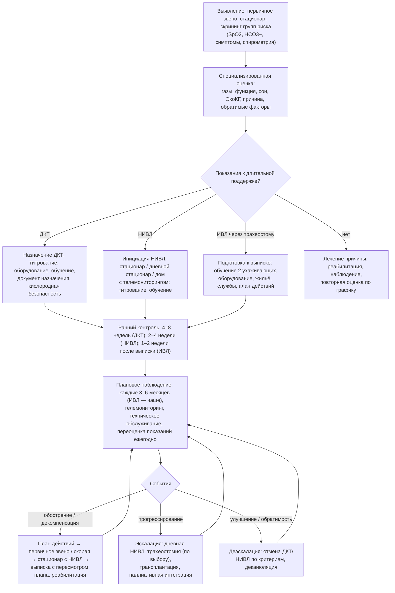

### 2.27. Организация длительной помощи и наблюдения

Правильно назначенная терапия ХДН бесполезна без системы, которая её поддерживает: кто обучит пациента, кто заметит утечку маски через три месяца, кто ответит на звонок в субботу ночью, кто заменит концентратор, кто сообщит бригаде скорой о целевой сатурации, кто пересмотрит показания через год. Организация помощи при ХДН — самостоятельное вмешательство с измеримым влиянием на исходы, и эта глава описывает её элементы: модели и команду, маршрут пациента, инициацию и наблюдение, телемониторинг, документы и планы действий, оборудование, обучение, взаимодействие со службами, экспертизу, регистры и индикаторы качества.

#### 2.27.1. Модели организации помощи

Исторически сложились три модели: **централизованная** (специализированный центр домашней респираторной поддержки при крупной больнице ведёт всех пациентов региона — Франция, Швейцария, часть Германии и Скандинавии), **сетевая/ассоциативная** (некоммерческие ассоциации обеспечивают оборудование и домашние визиты, врачи — назначение и контроль; французская модель ANTADIR), **рыночная** (коммерческие поставщики оборудования под контролем страховщика; врач — назначает, поставщик — обслуживает; США, часть стран Европы). Каждая работает при условии чёткого распределения ответственности и обмена информацией; слабое место рыночной модели — разрыв между поставкой и клиническим наблюдением, централизованной — доступность в отдалённых районах, сетевой — зависимость от финансирования. Современная концепция — **интегрированная помощь**: пациент с ХДН наблюдается единой командой, охватывающей стационар, амбулаторное звено, дом и паллиативную службу, с общей документацией, планом и единым координатором; для ДМВ оптимален **центр домашней вентиляции** с территорией обслуживания, круглосуточной линией связи, выездной службой и связью с ОРИТ; для ДКТ — пульмонологический кабинет/отделение с кислородной службой и регламентированной переоценкой.

#### 2.27.2. Мультидисциплинарная команда

Ядро: пульмонолог (или специалист по респираторной поддержке, реаниматолог, педиатр-пульмонолог), медсестра-координатор (кейс-менеджер), респираторный терапевт/физиотерапевт (настройка оборудования, клиренс, реабилитация), техник по оборудованию; расширенный круг: невролог (НМЗ), кардиолог, сомнолог, диетолог, логопед (глотание, речь при трахеостоме), психолог, социальный работник, эрготерапевт, паллиативная служба, врач первичного звена, фармацевт, при необходимости — хирург, анестезиолог, акушер. Роль **координатора** критична: единая точка контакта для пациента, отслеживание графика визитов и переоценок, связь между службами, «владелец» плана; при отсутствии такой роли пациент «теряется» между специалистами (п. 2.25.16). Регулярные междисциплинарные разборы (еженедельные для сложных пациентов) и формализованные критерии направления к смежным специалистам — элементы зрелой программы.

#### 2.27.3. Маршрут пациента

**Рис. 26.** Маршрут пациента с ХДН в системе длительной помощи. Схема читается сверху вниз; все ветви возвращаются в цикл планового наблюдения.

#### 2.27.4. Инициация длительной терапии: стационар, дневной стационар, дом

Традиционно НИВЛ начиналась в стационаре (3–7 дней титрования с ночным мониторингом); современные данные показывают, что у стабильных пациентов инициация **дома с телемониторингом** или в **дневном стационаре** не уступает стационарной по эффективности (PaCO₂, качество жизни, приверженность) и значительно дешевле: РКИ у пациентов с НМЗ и торакальными заболеваниями (A. Hazenberg и соавторы, 2014, Нидерланды) и у пациентов с ХОБЛ (M. L. Duiverman и соавторы, 2020) подтвердили эквивалентность домашней инициации при наличии выездной команды, телемониторинга параметров вентилятора и tcPCO₂. Выбор места зависит от тяжести (дневная гиперкапния > 60 мм рт. ст., нестабильность — стационар), бульбарных и когнитивных нарушений, расстояния, возможностей службы; при ИВЛ через трахеостому — обязательно стационарная подготовка с «репетицией» домашнего режима (п. 2.20.9). ДКТ назначается амбулаторно после подтверждения в стабильном состоянии (п. 2.17.4) с титрованием потока в покое, при нагрузке и, при необходимости, во сне.

#### 2.27.5. График и содержание наблюдения

**Табл. 40.** Плановое наблюдение пациентов на длительной респираторной поддержке (ориентировочная схема)

| Терапия | Сроки визитов | Содержание визита | Дополнительно |
|---|---|---|---|
| ДКТ | 4–8 недель после назначения (подтверждение показаний, если начата при обострении), далее каждые 6–12 месяцев | Симптомы, приверженность (счётчик часов концентратора), SpO₂ и газы крови на воздухе и на потоке, проверка потока при нагрузке/во сне, состояние оборудования, курение/безопасность, сопутствующие заболевания, вакцинация, реабилитация | Ночная оксиметрия при подозрении на недостаточный ночной поток; ЭхоКГ раз в 1–2 года; пересмотр при изменении состояния |
| НИВЛ | 2–4 недели (данные аппарата, ночная оксикапнометрия, коррекция), 3 месяца, затем каждые 3–6 месяцев (НМЗ прогрессирующие — чаще) | Симптомы и качество сна, приверженность (ч/ночь), утечка, ИАГ по аппарату, ДО, доля триггируемых вдохов, побочные эффекты (кожа, сухость, аэрофагия), газы днём, ночная SpO₂/tcPCO₂ на НИВЛ, состояние маски и контура, увлажнитель, план действий, PCF/МИ-Э при НМЗ, масса тела, оценка потребности в дневной вентиляции | ПСГ/полиграфия на НИВЛ при подозрении на остаточные события; переоценка показаний при обратимых причинах (п. 2.19.11); замена интерфейсов по износу |
| ИВЛ через трахеостому | 1–2 недели после выписки (визит на дом), затем ежемесячно первые 3 месяца, далее каждые 2–3 месяца + визиты на дом | Параметры и тревоги, SpO₂/EtCO₂, состояние стомы и канюли (плановая замена), манжета, аспирация и МИ-Э, речь и глотание, питание, оборудование (резерв, батареи, увлажнение), навыки ухаживающих (повторная проверка), психологическое состояние семьи, социальная поддержка, план действий и доступность экстренной помощи | Бронхоскопический осмотр трахеи при показаниях; ежегодная оценка возможности деканюляции/перехода на НИВЛ; регулярное обучение новых ухаживающих |
| Все группы | Ежегодно | Полная переоценка: функция, газы, ЭхоКГ, нутритивный статус, психологический статус, цели и предпочтения, прогноз, инвалидность и социальные вопросы, вакцинация | Обсуждение предварительного планирования помощи при прогрессировании (п. 2.30.7) |

Визиты сочетают очные (осмотр, газы крови, оборудование) и дистанционные (анализ данных аппарата, телефон/видео); частота увеличивается при нестабильности, после госпитализаций, при изменении параметров.

#### 2.27.6. Телемониторинг и телемедицина

Современные вентиляторы передают данные (часы использования, утечка, ДО, частота, ИАГ, доля спонтанных вдохов) через модем в облачную платформу; дополнительно дома измеряются SpO₂ (иногда tcPCO₂ при инициации), масса тела, симптомы по опроснику. Доказательная база неоднородна: телемониторинг данных вентилятора повышает выявление проблем (утечка, низкая приверженность) и позволяет корректировать терапию дистанционно, в том числе при домашней инициации; телемониторинг симптомов и SpO₂ при ХОБЛ в РКИ в целом не снижал госпитализаций и смертности при добавлении к хорошо организованной помощи, а его польза зависит от того, кто и как реагирует на сигналы (без ресурса реагирования мониторинг бесполезен или вреден — ложные тревоги, перегрузка). Принципы: мониторинг — инструмент команды, а не замена визитов; чёткие алгоритмы реагирования на отклонения; защита данных и информированное согласие; видеоконсультации для отдалённых пациентов и проверки техники (маска, ингалятор, МИ-Э); телереабилитация (п. 2.22.9). Пандемия COVID-19 ускорила внедрение дистанционных форм; их место — дополнение к очному наблюдению с акцентом на периоды инициации, нестабильности и для пациентов с ограниченной мобильностью.

#### 2.27.7. Документация и инструменты самоменеджмента

##### 2.27.7.1. Паспорт пациента

📌 **Определение:** **паспорт пациента с ХДН** (карточка предупреждения) — краткий документ (бумажная карточка и/или запись в электронной системе), который пациент носит с собой и который содержит ключевую информацию для любого медицинского работника при экстренной ситуации: диагноз и механизм ДН, факт хронической гиперкапнии и целевой диапазон SpO₂ (88–92 % при риске гиперкапнии), привычные значения газов крови, вид респираторной поддержки и параметры (НИВЛ/ИВЛ, ДКТ — поток), наличие трахеостомы (тип и размер канюли), правило «кислород только вместе с вентиляцией» для НМЗ, лекарственные предостережения (седативные, опиоиды), контакты курирующей службы (круглосуточные), контакт ухаживающих, наличие и место хранения заранее выраженной воли/распоряжений. Прообраз — «кислородная карточка предупреждения» BTS; в некоторых странах аналогичную функцию выполняет медицинский браслет.

##### 2.27.7.2. Домашний мониторинг и дневник

Пульсоксиметр (с обучением интерпретации: измерять в покое, при ухудшении, после процедур клиренса; знать свои обычные значения и пороги), весы (задержка жидкости, нутритивный статус), дневник симптомов/обострений, учёт использования оборудования, записи параметров; при НИВЛ — данные аппарата через приложение; при ИВЛ — журнал замен канюли, тревог, инфекций. Цель — не «нагрузить» пациента измерениями, а дать ему ориентиры для плана действий.

##### 2.27.7.3. Индивидуальный план действий

📌 **Определение:** **индивидуальный план действий** — письменный документ, согласованный с пациентом и ухаживающими, описывающий признаки ухудшения («зелёная — жёлтая — красная зона»), конкретные действия пациента на каждом уровне (увеличение бронхолитиков, начало «запасных» преднизолона и антибиотика по критериям, усиление клиренса — МИ-Э по SpO₂, увеличение времени НИВЛ, что делать с кислородом), пороги и способы обращения за помощью (телефон службы, скорая — с указанием, что сообщить), и действия при технических неполадках (отказ концентратора, вентилятора, отключение электричества). План составляется при назначении терапии, пересматривается после каждого обострения и ежегодно; его эффективность зависит от обучения (самоменеджмент с планом действий и обучением снижает госпитализации при ХОБЛ — систематический обзор Cochrane 2017; однако программы без достаточной поддержки и с неясными порогами обращения могут быть небезопасны — 🔬 ниже). Для пациентов с НМЗ план строится вокруг оксиметрии и клиренса (п. 2.21.10), для пациентов на ИВЛ — вокруг алгоритма неотложных действий при трахеостоме (Рис. 19), для пациентов с ХОБЛ — вокруг симптомов обострения и контролируемого кислорода.

##### 2.27.7.4. Письменные инструкции и документ назначения

Инструкции по оборудованию (включение, тревоги, чистка, замена фильтров, действия при неполадках), по маске и уходу за кожей, по кислородной безопасности, список контактов; документ назначения (рецепт) на ДКТ/НИВЛ с обоснованием, параметрами и датой переоценки (п. 2.17.11); выписной эпикриз с разделом «респираторная поддержка» (параметры, оборудование, план наблюдения) — для первичного звена.

#### 2.27.8. Оборудование: обеспечение, обслуживание, безопасность

Элементы: выбор оборудования под клиническую задачу (п. 2.18, 2.20), договор на техническое обслуживание (профилактика по регламенту, калибровка, замена по сроку), служба замены 24/7 при поломке (резервный аппарат на дому при зависимости > 16 ч/сут; срок замены — часы), расходные материалы (маски — замена каждые 3–6 месяцев или по износу, контуры, фильтры, канюли, катетеры, вода для увлажнителя), электроснабжение (регистрация зависимого от вентиляции пациента у энергоснабжающей организации для приоритетного восстановления; источник бесперебойного питания, внешние батареи, генератор в отдалённых районах; план на случай длительного отключения), кислород (концентраторы стационарные и портативные, жидкий кислород — логистика заправки, баллоны как резерв; пожарная безопасность, п. 2.17.12), гигиена (мытьё масок и контуров, дезинфекция увлажнителя, дистиллированная вода, индивидуальное оборудование), обучение пользователей, утилизация и возврат оборудования; документирование серийных номеров и настроек; при путешествиях — п. 2.26.10. Финансирование и собственность оборудования различаются по странам (п. 2.28.2).

#### 2.27.9. Обучение пациентов и ухаживающих

Структурированное обучение — условие безопасности и приверженности: компетенции (понимание болезни и цели терапии, работа с оборудованием, тревоги и неполадки, клиренс, распознавание ухудшения, план действий, кислородная безопасность, при трахеостоме — полный объём ухода и неотложные действия) с проверкой методом обратной демонстрации, письменные и видеоматериалы, повторение при каждом визите и после госпитализаций, обучение новых ухаживающих (включая персонал школ, учреждений, нанятых помощников), группы пациентов и школы здоровья; учёт грамотности, языка, когнитивных и сенсорных особенностей; документирование пройденного обучения (п. 2.20.9).

#### 2.27.10. Домашний уход и «стационар на дому»

Домашние визиты медсестры/респираторного терапевта (проверка оборудования и техники, состояния кожи и стомы, обучение, забор анализов, оценка условий), услуги ухода и личных ассистентов (при зависимости от вентиляции — часы ухода определяют возможность проживания дома; п. 2.28.3), физиотерапия на дому, социальная помощь; **стационар на дому** при обострениях ХОБЛ (ранняя выписка с ежедневными визитами) безопасен и эффективен у отобранных пациентов без ацидоза и тяжёлой коморбидности (данные систематических обзоров) и предпочитается пациентами; для пациентов на ДМВ выездная бригада может решить часть острых проблем дома (замена канюли, коррекция параметров, антибиотик), но при декомпенсации госпитализация не должна откладываться.

#### 2.27.11. Взаимодействие с первичным звеном, скорой помощью и стационарами

Врач первичного звена должен знать о пациенте на длительной поддержке, иметь выписку с параметрами, понимать цели лечения и целевой SpO₂, иметь прямой контакт с центром; скорая помощь — алгоритмы контролируемого кислорода (п. 2.24.7), информацию о зависимых от вентиляции пациентах на территории (реестр диспетчерской с адресами, особенностями, оборудованием), обучение работе с домашними вентиляторами и трахеостомами, правило «домашнее оборудование едет с пациентом»; приёмные отделения и стационары без центра респираторной поддержки — протоколы НИВЛ, линия связи с центром для консультаций и перевода; при госпитализации пациента на ДМВ стационар продолжает домашнюю вентиляцию (собственный аппарат, параметры из паспорта), привлекает ухаживающих как экспертов по уходу и уведомляет центр.

#### 2.27.12. Учреждения для длительно вентилируемых пациентов

Часть пациентов не может жить дома (отсутствие ухаживающих, тяжёлая коморбидность, социальные причины) — для них нужны **отделения длительной вентиляции/отлучения** (структурированные программы отлучения после ОРИТ — п. 2.20.12; постоянное проживание для зависимых от ИВЛ), **учреждения длительного ухода с респираторной поддержкой** (дома сестринского ухода с обученным персоналом — модель, развитая в Японии, Германии, США), **хосписы и паллиативные отделения** с возможностью НИВЛ/ИВЛ как симптоматического средства; требования — квалификация персонала, оборудование, связь с центром, индивидуальные планы, качество жизни (приватность, активность, социальные контакты), а также регулирование и финансирование (п. 2.28). Отсутствие таких структур приводит к «блокированию» коек ОРИТ пациентами, которым интенсивная терапия больше не нужна.

#### 2.27.13. Инфекционный контроль дома и в учреждениях

Гигиена рук ухаживающих, индивидуальные маски и контуры, регулярная мойка (маски — ежедневно, контуры — еженедельно, фильтры — по регламенту), чистая техника аспирации дома (стерильная — в стационаре), дезинфекция и смена воды увлажнителя, уход за стомой, вакцинация пациента и ухаживающих (грипп, пневмококк, COVID-19, коклюш, РСВ по показаниям — п. 2.31.7), ограничение контактов при вспышках респираторных инфекций, раннее лечение инфекций по плану, рациональная антибиотикотерапия (колонизация трахеостомы не равна инфекции — не лечить культуру без клиники), при колонизации резистентными микроорганизмами — информирование стационара.

#### 2.27.14. Медико-социальная экспертиза, трудоспособность, вождение

ХДН — одна из главных причин стойкой утраты трудоспособности при болезнях органов дыхания. Экспертиза ограничений жизнедеятельности основывается на степени ДН (газы крови, SpO₂, функция лёгких), зависимости от респираторной поддержки, переносимости нагрузки, осложнениях (ЛС), частоте обострений, потребности в постороннем уходе; конкретные критерии и группы/категории инвалидности определяются национальным законодательством и регулярно пересматриваются [⚠️ Требуется верификация: действующие критерии конкретной страны на момент чтения]; задача врача — объективная документация (протоколы функциональных тестов, газы, выписки, данные аппаратов, дневник обострений), указание потребности в технических средствах реабилитации (концентратор, вентилятор, расходные материалы, коляска, подъёмник), в уходе и в адаптации жилья. **Трудоспособность**: многие пациенты на ДКТ и ночной НИВЛ могут работать (портативный кислород, удалённая работа, гибкий график, исключение физических нагрузок, вредных факторов, ночных смен); сохранение занятости улучшает качество жизни и финансовое положение и должно поддерживаться эрготерапевтом и социальным работником; профессиональные заболевания (пневмокониозы, профессиональная ХОБЛ) — отдельная экспертиза связи с профессией и компенсации. **Вождение**: ограничения при выраженной дневной сонливости (нелеченый ОАС/СОГ — до начала эффективной терапии), гиперкапнической энцефалопатии, тяжёлой гипоксемии без коррекции, синкопе; на ДКТ вождение возможно с кислородом в салоне и соблюдением безопасности; оценку сонливости и рекомендации о вождении документируют (правовые нормы различаются).

#### 2.27.15. Регистры

📌 **Определение:** **регистр пациентов на длительной респираторной поддержке** — систематический сбор стандартизованных данных обо всех пациентах региона/страны, получающих ДКТ, НИВЛ и/или ИВЛ на дому (демография, диагноз, показания и газы при назначении, параметры и оборудование, приверженность, осложнения, госпитализации, исходы), с целью планирования ресурсов, контроля качества, исследований и обратной связи центрам.

Примеры: шведский Swedevox (ДКТ — с 1987 года, домашняя вентиляция — с 1996 года), французские данные ANTADIR, датский, швейцарский, австралийско-новозеландские регистры, исследование Eurovent (2001–2002) как «моментальный снимок» Европы; регистры показали рост распространённости ДМВ, различия в структуре показаний (в Швеции и Нидерландах преобладали НМЗ и торакальные болезни, затем выросла доля ХОБЛ и СОГ), выживаемость по группам (Табл. 21), пользу ранней НИВЛ, недостатки практики (ДКТ без газов крови, низкая приверженность) и позволили улучшить её через обратную связь. Во многих странах, включая значительную часть Восточной Европы и Азии, национальных регистров нет, а данные о числе пациентов на домашней вентиляции — оценочные [⚠️ Требуется верификация: наличие регистра в конкретной стране]. Минимальный набор данных для регистра и практические шаги по его созданию — п. 4.13.

#### 2.27.16. Индикаторы качества и аудит

**Табл. 41.** Примеры индикаторов качества помощи при ХДН

| Домен | Индикатор (пример) | Ориентир |
|---|---|---|
| Структура | Наличие центра/программы ДМВ с круглосуточной связью; обученный персонал на 100 пациентов; аппараты НИВЛ 24/7 в стационаре на N коек; протоколы и планы действий | Национальные/региональные стандарты |
| Процесс: ДКТ | Доля назначений ДКТ на основании газов артериальной крови в стабильном состоянии; доля переоценённых через 4–8 недель после назначения при обострении; доля с титрованным потоком при нагрузке и во сне; документированное обсуждение курения/пожарной безопасности | ≥ 90 % |
| Процесс: острая НИВЛ | Время от выявления ацидоза до начала НИВЛ (< 1–3 ч); газы крови через 1–2 ч после начала; доля пациентов с документированным решением о «потолке» терапии; соответствие параметров протоколу | Аудиты (например, национальные аудиты Великобритании) |
| Процесс: длительная НИВЛ | Доля с ночной оксикапнометрией на НИВЛ в первые 3 месяца; приверженность ≥ 4 ч/ночь у ≥ 70–80 %; доля с письменным планом действий и паспортом; доля НМЗ с оценкой PCF и доступом к МИ-Э; визит в 2–4 недели после инициации | Установленные программой |
| Процесс: ИВЛ дома | Два обученных ухаживающих с подтверждёнными навыками; резервное оборудование; визит на дом в первые 2 недели; плановая замена канюли; ежегодная оценка деканюляции | 100 % |
| Исход | Снижение PaCO₂ на НИВЛ (доля достигших целевого); 30-дневная повторная госпитализация после обострения; летальность в стационаре при НИВЛ по поводу ОДН с учётом тяжести; частота пролежней от маски, обтураций канюли, незапланированных деканюляций; выживаемость по группам; качество жизни (SRI, п. 2.29.1); удовлетворённость пациентов и ухаживающих; доля направленных на реабилитацию после госпитализации; доля с документированным предварительным планированием помощи | Сравнение с регистрами и внутри программы во времени |

Аудит — цикл «измерить → сравнить → изменить → измерить»; национальные аудиты (Великобритания — аудиты ХОБЛ и острой НИВЛ) выявляли системные дефекты (поздняя НИВЛ, кислород без контроля, высокая летальность) и приводили к стандартам; внутри программы полезны регулярные разборы смертей и незапланированных госпитализаций.

#### 2.27.17. Преемственность при переходах

Критические переходы — выписка из стационара на домашнюю поддержку (структурированная выписка, контакт в 48–72 часа, визит в 1–2 недели), перевод из ОРИТ в отделение/домой при трахеостоме, из детской службы во взрослую (п. 2.26.3), из активной стратегии в паллиативную (п. 2.30), смена места жительства или поставщика. Инструменты: единый план, передача документов (паспорт, параметры, предпочтения), именованный ответственный на каждом этапе, «тёплая» передача (совместный визит/звонок), проверка понимания пациентом.

#### 2.27.18. Примеры и иллюстрации

**Пример 1** (ХОБЛ). Маршрут: выявлен участковым терапевтом по SpO₂ 88 % → пульмонолог: газы, функция, ЭхоКГ → ДКТ назначена амбулаторно с титрованием, концентратор + портативный источник, обучение, документ назначения, визит через 2 месяца (приверженность по счётчику 11 ч/сут → беседа, ночной поток скорректирован) → реабилитация → через год декомпенсация (п. 2.24.11) → выписка с планом действий, паспортом («целевой SpO₂ 88–92 %»), контакт медсестры-координатора через 3 дня, визит через 3 недели с решением о НИВЛ (п. 2.19.12) → домашняя инициация НИВЛ с телемониторингом (данные аппарата: 5,5 ч/ночь, утечка в норме через 2 недели после смены маски) → визит через 3 месяца: PaCO₂ 49, SRI улучшение → далее каждые 6 месяцев; скорая помощь региона имеет запись о пациенте; план действий включает «запасные» преднизолон и антибиотик с критериями; ежегодно — переоценка и обсуждение предпочтений.

**Пациентка Е** (БАС, инвазивная вентиляция дома; п. 2.20.13). Организация: центр ДМВ — координатор, визиты на дом ежемесячно первые 3 месяца, затем каждые 2 месяца; 2 обученных ухаживающих (муж, дочь) + нанятый помощник 40 ч/нед через социальную службу; оборудование — два вентилятора, батареи на 10 часов, генератор (дом в пригороде), МИ-Э, аспиратор, резервный комплект канюль; регистрация у энергоснабжающей организации и в диспетчерской скорой помощи; паспорт с параметрами и распоряжением об отказе от реанимационных мероприятий при остановке сердца; телемониторинг вентилятора; невролог и паллиативная служба — в единой команде; ежеквартальные междисциплинарные обсуждения; план на прекращение вентиляции по её желанию согласован заранее (п. 2.30.8).

🔬 **Углубление: организация как вмешательство — что показали рандомизированные исследования.** Доказательства того, что способ организации меняет исходы, получены в РКИ: домашняя инициация НИВЛ с телемониторингом не уступает стационарной при существенно меньших затратах (Hazenberg 2014; Duiverman 2020); ранняя реабилитация после госпитализации снижает повторные госпитализации (п. 2.22.2); обучение самоменеджменту с планом действий снижает госпитализации при ХОБЛ (Cochrane 2017), но одно крупное американское исследование комплексной программы ведения (BREATHE, 2012) было остановлено досрочно из-за **повышения** смертности в группе вмешательства — вероятно, потому что пациенты, обученные самостоятельно начинать лечение обострения, откладывали обращение за помощью, а программа не обеспечивала быстрого доступа к врачу. Телемониторинг симптомов при ХОБЛ в крупных РКИ (Великобритания, 2013) не снижал госпитализаций при добавлении к хорошей стандартной помощи. Уроки: (1) эффективны программы с чёткими порогами обращения, быстрым доступом к команде и ответственным реагированием на сигналы; (2) «цифровые» инструменты не заменяют людей, а усиливают их; (3) организационные вмешательства нужно оценивать так же строго, как лекарства, — с учётом контекста системы здравоохранения; (4) показатели структуры и процесса (Табл. 41) должны быть привязаны к исходам, иначе аудит измеряет не то.

❗ **Типичная ошибка:** выписать пациента на домашнюю НИВЛ или ДКТ «в никуда» — без назначенной даты контроля, без контакта с ответственным, без плана действий и без информирования первичного звена. Первые недели — период наибольшего риска отказа от терапии и нераспознанных проблем; ранний контакт (48–72 часа, визит через 2–4 недели) — обязательный стандарт.

❗ **Типичная ошибка:** выдать план действий с «запасными» антибиотиком и стероидом без обучения и без ясных порогов обращения за помощью. План без поддержки может отсрочить необходимую госпитализацию; он работает только в связке с обучением, доступностью команды и регулярным пересмотром.

💡 **Интересный факт:** первые организованные системы домашней респираторной помощи выросли из эпидемий полиомиелита: когда в 1950-е годы пациенты, зависимые от «железных лёгких», были выписаны домой, в Дании, Франции, Великобритании и США потребовались сети техников, медсестёр и врачей, способных обслуживать аппараты и семьи. Во Франции региональные ассоциации, начавшие с полиомиелита, объединились в 1981 году в федерацию ANTADIR, которая десятилетиями обеспечивала кислородом и вентиляторами сотни тысяч пациентов и собрала одну из крупнейших баз данных о выживаемости на длительной поддержке; шведский регистр Swedevox, начатый в 1987 году, стал образцом национального контроля качества. Модель «ассоциация + регистр» показала, что систематическое наблюдение само по себе улучшает практику — независимо от появления новых лекарств.

📝 **Обобщение**

- Организация помощи при ХДН — самостоятельное вмешательство: модели (централизованная, сетевая, рыночная) работают при чётком распределении ответственности; оптимальна интегрированная помощь с центром домашней респираторной поддержки, мультидисциплинарной командой и координатором.
- Маршрут пациента включает выявление, специализированную оценку, инициацию (стационар, дневной стационар или дом с телемониторингом — эквивалентны у стабильных пациентов), ранний контроль (2–8 недель), плановое наблюдение каждые 3–12 месяцев с ежегодной полной переоценкой, реагирование на события и преемственность при переходах.
- Инструменты самоменеджмента — паспорт пациента (целевой SpO₂, параметры, контакты, предпочтения), домашний мониторинг, индивидуальный план действий с порогами обращения, письменные инструкции; они эффективны только в связке с обучением и доступной командой.
- Оборудование требует системы обслуживания, резерва, электроснабжения, расходных материалов и гигиены; взаимодействие с первичным звеном, скорой помощью и стационарами, учреждения для длительно вентилируемых пациентов и инфекционный контроль — необходимые элементы.
- Экспертиза ограничений жизнедеятельности, поддержка занятости и решения о вождении требуют объективной документации; регистры (Swedevox, ANTADIR, Eurovent) и индикаторы качества с аудитом обеспечивают планирование, контроль и улучшение практики.

Главный вывод: исходы ХДН определяются не только тем, что назначено, но и тем, как организовано назначенное; каждый пациент на длительной поддержке должен иметь ответственную команду, дату следующего контроля, план действий и паспорт. Следующая глава — об экономической и социальной цене этой системы и о том, кто её несёт.

❓ **Контрольные вопросы**

1. Опишите состав мультидисциплинарной команды центра домашней респираторной поддержки и роль координатора; какие проблемы возникают при его отсутствии?
2. Сравните инициацию НИВЛ в стационаре и дома с телемониторингом: каковы доказательства эквивалентности и каким пациентам домашняя инициация не подходит?
3. Что должен содержать паспорт пациента с ХДН и индивидуальный план действий? Почему план без обучения и доступа к команде может быть небезопасен?
4. Составьте график наблюдения на первый год для пациента, выписанного на домашнюю ИВЛ через трахеостому, с перечнем проверяемого при каждом визите.
5. Предложите пять индикаторов качества для программы длительной НИВЛ в вашем регионе (структура, процесс, исход) и объясните, как их измерять и с чем сравнивать.
