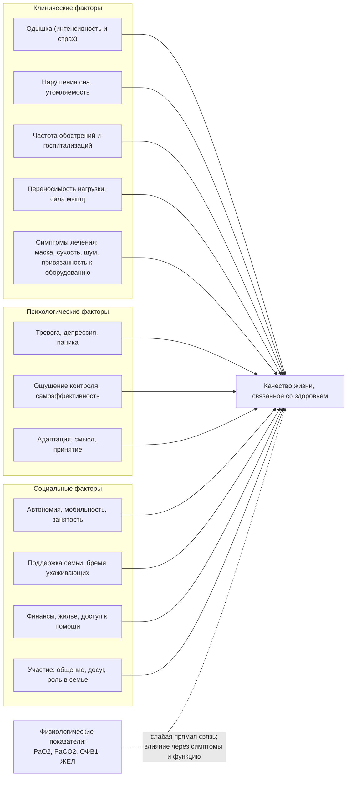

### 2.29. Качество жизни и исходы

Газы крови, ОФВ₁ и даже выживаемость — не конечные цели лечения ХДН с точки зрения пациента. Он хочет спать без головной боли, дойти до магазина, не бояться следующей инфекции, не быть обузой, сохранить работу и отношения; для одних пациентов продление жизни ценой зависимости от аппарата приемлемо и желанно, для других — нет. Поэтому современная оценка результатов лечения ХДН строится на **исходах, важных для пациента**: качестве жизни, симптомах, функции, частоте госпитализаций, выживаемости и качестве умирания. В этой главе — как измерять качество жизни, что его определяет, как на него влияют вмешательства и какие исходы следует отслеживать.

#### 2.29.1. Измерение качества жизни и симптомов

📌 **Определение:** **качество жизни, связанное со здоровьем** (health-related quality of life) — субъективная оценка пациентом влияния болезни и лечения на физическое, психологическое и социальное благополучие; измеряется стандартизованными опросниками, валидированными для конкретных групп, и является **сообщаемым пациентом исходом** (patient-reported outcome).

**Табл. 43.** Инструменты оценки качества жизни и симптомов при ХДН

| Инструмент | Тип | Содержание | Применение и комментарии |
|---|---|---|---|
| SF-36, SF-12 | Общий | 8 доменов (физическое и ролевое функционирование, боль, общее здоровье, жизнеспособность, социальное функционирование, эмоциональная роль, психическое здоровье) | Сравнение с другими заболеваниями и популяцией; малочувствителен к специфическим изменениям |
| EQ-5D | Общий, для расчёта полезности | 5 измерений (подвижность, самообслуживание, активность, боль, тревога/депрессия) + визуальная шкала | Основа QALY в экономических оценках; «эффект потолка/пола» |
| SGRQ (респираторный опросник больницы Святого Георгия) | Респираторный | 50 пунктов: симптомы, активность, влияние; 0–100 (выше — хуже) | Стандарт при ХОБЛ, бронхоэктазах, ИЗЛ; минимально значимое изменение 4 балла |
| CRQ (хронический респираторный опросник) | Респираторный | Одышка, усталость, эмоции, контроль над болезнью | Чувствителен к реабилитации; минимально значимое изменение 0,5 балла на пункт |
| CAT | Респираторный, краткий | 8 пунктов, 0–40 | Рутинный мониторинг при ХОБЛ; минимально значимое изменение 2 балла |
| **SRI** (опросник тяжёлой дыхательной недостаточности, Severe Respiratory Insufficiency questionnaire) | Специфичный для ХДН на длительной вентиляции | 49 пунктов, 7 доменов: респираторные жалобы, физическое функционирование, сопутствующие симптомы и сон, социальные отношения, тревога, психологическое благополучие, социальное функционирование; суммарный индекс 0–100 (выше — лучше) | Разработан для пациентов на домашней НИВЛ (W. Windisch и соавторы, 2003), валидирован при ХОБЛ, НМЗ, торакальных заболеваниях, СОГ; стандарт в исследованиях ДМВ; переведён на многие языки |
| MRF-28 (опросник Маугери при дыхательной недостаточности) | Специфичный для ХДН | 28 пунктов: повседневная активность, когнитивные функции, инвалидность | Пациенты на ДКТ и вентиляции |
| S3-NIV | Краткий, специфичный для НИВЛ | 11 пунктов: симптомы, сон, побочные эффекты НИВЛ | Рутинный мониторинг переносимости НИВЛ |
| ALSAQ-40, ALSFRS-R | Специфичные для БАС | Качество жизни; функциональный статус (включая респираторный субдомен) | Мониторинг при БАС |
| PedsQL, детские модули | Детские (самооценка и оценка родителем) | Физическое, эмоциональное, социальное, школьное функционирование | Дети на вентиляции; расхождение оценок ребёнка и родителя закономерно |
| CFQ-R, K-BILD, emPHasis-10 | Специфичные для муковисцидоза, ИЗЛ, ЛГ | Нозологические домены | В соответствующих группах |
| mMRC, Борг, D-12, шкала одышки CRQ | Симптом: одышка | Степень ограничения / интенсивность / многомерная (физический и аффективный компоненты) | Одышка — главный детерминант качества жизни |
| HADS, PHQ-9, GAD-7 | Симптом: тревога, депрессия | Скрининг | Обязательны при ХДН |
| Эпворт, PSQI, ISI | Сон | Сонливость, качество сна, бессонница | Особенно при НИВЛ, СОГ, НМЗ |
| Шкала Зарита | Ухаживающие | Бремя ухода | Семейный исход (п. 2.28.3) |
| Шкала Карновского, индекс Бартел, FIM | Функция | Общее функционирование, самообслуживание | У тяжёлых пациентов, при ИВЛ |

Принципы применения: выбор инструмента под вопрос (общий — для сравнения и экономики; специфичный — для чувствительности к изменениям), оценка в стабильном состоянии и в динамике, интерпретация с учётом минимально клинически значимого изменения, самостоятельное заполнение пациентом (прокси-оценка родственниками систематически занижает качество жизни тяжёлых пациентов и допустима лишь при невозможности самооценки — с указанием источника), доступные форматы (крупный шрифт, электронные версии, помощь при двигательных нарушениях — ответы взглядом/голосом у пациентов с БАС), учёт эффекта «сдвига отклика» (🔬 ниже).

#### 2.29.2. Что определяет качество жизни при ХДН

**Рис. 27.** Детерминанты качества жизни при ХДН. Физиологические показатели влияют на качество жизни опосредованно — через симптомы, функцию и психосоциальные факторы.

Исследования последовательно показывают: корреляция качества жизни с ОФВ₁, PaO₂ и PaCO₂ слабая или умеренная; наиболее сильные предикторы — одышка, тревога и депрессия, качество сна, переносимость нагрузки, частота обострений, социальная поддержка и ощущение контроля. Отсюда следствия: (1) улучшение газов без улучшения симптомов и функции может не изменить качество жизни (пациент на ДКТ с нормализованным PaO₂, но изолированный дома); (2) вмешательства, не меняющие физиологию, могут резко улучшать качество жизни (реабилитация, лечение депрессии, эрготерапия); (3) лечение, улучшающее физиологию, но добавляющее бремя (шумная маска, ограничения), может иметь нулевой или отрицательный баланс; (4) пациенты с объективно одинаковой тяжестью имеют разное качество жизни. Для вентилируемых пациентов ключевыми оказываются автономия (возможность управлять своим днём), коммуникация (речь при трахеостоме), мобильность (портативное оборудование, коляска), отсутствие боли и страха, социальные контакты и смысл (работа, творчество, семья).

#### 2.29.3. Влияние вмешательств на качество жизни

- **ДКТ**: умеренное улучшение (сон, когнитивные функции, переносимость нагрузки) у гипоксемичных пациентов; у пациентов с умеренной гипоксемией — без влияния (LOTT); ограничения (привязанность, стигма) частично нивелируют пользу — портативные источники и обучение важны.
- **НИВЛ**: при НМЗ, торакальных заболеваниях, СОГ — большое и устойчивое улучшение (сон, утренние симптомы, энергия, когнитивные функции, настроение; SRI растёт на 10–20 баллов); при ХОБЛ — улучшение при высокоинтенсивной НИВЛ, снижающей PaCO₂ (исследования Köhnlein, HOT-HMV; домены сна и симптомов), при низкоинтенсивной — нет; побочные эффекты маски и шум ухудшают сон части пациентов — подбор интерфейса и увлажнение критичны; дневная мундштучная вентиляция улучшает речь и свободу при НМЗ.
- **Инвазивная вентиляция**: качество жизни при БАС, травме спинного мозга, Дюшенне на домашней ИВЛ сопоставимо с другими хроническими состояниями и часто оценивается пациентами значительно выше, чем ожидают врачи и родственники (п. 2.20.10); определяется уходом, коммуникацией, автономией и социальной средой.
- **Реабилитация**: одно из наибольших улучшений среди всех вмешательств (CRQ, SGRQ выше порога значимости), включая тревогу и депрессию; эффект угасает без поддержки.
- **Поддержка кашля** при НМЗ: уменьшение страха инфекций и госпитализаций; **трансплантация**: резкое улучшение у большинства с последующим снижением при хронической дисфункции трансплантата; **хирургия эмфиземы**: значимое улучшение на 2–5 лет; **паллиативная помощь**: уменьшение одышки и тревоги, качество жизни улучшается при раннем начале; **лечение депрессии и тревоги**: самостоятельный значимый эффект (п. 2.16.15).

#### 2.29.4. Исходы: выживаемость, госпитализации, функция

Выживаемость на длительной поддержке подробно обсуждалась в главе 2.14 (Табл. 21): наилучшая — при медленно прогрессирующих НМЗ (Дюшенн, постполиомиелит), кифосколиозе (5-летняя ≈ 80 %), СОГ на эффективной терапии (5-летняя ≈ 70–80 % [⚠️ Требуется верификация]); промежуточная — при ХОБЛ на ДКТ и НИВЛ (5-летняя ≈ 30–45 %); наихудшая — при БАС (медиана на НИВЛ 1–2 года от начала, при трахеостомии дольше), ИЛФ без трансплантации и при многофакторной ДН у хрупких пожилых. Предикторы: возраст, индекс массы тела и безжировая масса, ЛГ и правожелудочковая функция, уровень PaCO₂ и его динамика на НИВЛ, приверженность (часы ДКТ и НИВЛ), частота обострений за предыдущий год, функциональный статус (6MWT, ADL), коморбидность, депрессия, социальная поддержка, доступ к организованной помощи. Госпитализации — исход, важный и для пациента (страдание, риск), и для системы (стоимость); их снижают НИВЛ при стойкой гиперкапнии, реабилитация, самоменеджмент с поддержкой, интегрированная помощь, вакцинация, поддержка кашля при НМЗ. Функциональные исходы (способность к самообслуживанию, мобильность, речь, работа, обучение) особенно важны при НМЗ и у детей.

#### 2.29.5. Суррогатные и важные для пациента исходы

Исследования и клиническая практика часто ориентируются на **суррогатные показатели** (PaCO₂, ОФВ₁, часы приверженности, ИАГ на аппарате), которые удобны, но не всегда отражают то, что важно пациенту; снижение PaCO₂ на НИВЛ ассоциировано с выживаемостью при ХОБЛ и потому полезно как цель, однако пациент с «идеальными» газами и невыносимой маской — неудача лечения. Современный стандарт — сочетание физиологических целей с **сообщаемыми пациентом исходами** (PROM: качество жизни, симптомы, сон, побочные эффекты) и **сообщаемым пациентом опытом помощи** (PREM: удовлетворённость, информированность, вовлечённость, доступность), а в исследованиях — использование комбинированных конечных точек, значимых для пациентов (например, «выживаемость без повторной госпитализации» в HOT-HMV), и **базовых наборов исходов** (core outcome sets), согласованных с пациентами, для сопоставимости исследований.

#### 2.29.6. Цели, важные для пациента, и совместное принятие решений

Практический инструмент — обсуждение и запись **индивидуальных целей** пациента (что он хочет вернуть или сохранить: спать без пробуждений, посещать внуков, работать неполный день, говорить, путешествовать) и оценка их достижения при визитах (шкалирование достижения целей); цели структурируют выбор между опциями (например, портативный концентратор дороже, но делает достижимой цель «гулять»; дневная мундштучная вентиляция возвращает речь; трахеостомия при БАС продлевает жизнь, но для одного пациента цель — «быть на свадьбе дочери», для другого — «не зависеть от аппарата»). **Совместное принятие решений** (информирование о вариантах с их пользой и бременем, выявление ценностей и предпочтений, совместный выбор, документирование, пересмотр) — стандарт при всех решениях о долгосрочной поддержке; вспомогательные материалы для принятия решений (decision aids) по НИВЛ, трахеостомии, трансплантации улучшают информированность и снижают конфликт решений.

#### 2.29.7. Исходы для семьи и ухаживающих

Качество жизни ухаживающих, их здоровье, занятость и финансовое положение — семейные исходы, измеряемые (Зарит, HADS, занятость) и улучшаемые (п. 2.28.3); у детей на вентиляции — исходы для сиблингов и родительских отношений; после смерти пациента — исходы горевания (осложнённое горе чаще при травматичном умирании в ОРИТ без подготовки — п. 2.30).

#### 2.29.8. Качество умирания как исход

Для прогрессирующих заболеваний исходом является и то, как пациент умирает: контроль одышки и тревоги, место смерти в соответствии с предпочтением (дома, в хосписе, в стационаре), отсутствие нежелательных инвазивных вмешательств, присутствие близких, соблюдение заранее выраженной воли, поддержка семьи; пациенты с ХОБЛ умирают в ОРИТ на ИВЛ и без паллиативной поддержки чаще, чем пациенты с раком лёгкого при сопоставимом бремени симптомов, — индикатор неудачи планирования (п. 2.30).

#### 2.29.9. Исходы в исследованиях ДМВ: методологические замечания

Гетерогенность популяций (нозологии, тяжесть, системы помощи), малые выборки при редких заболеваниях, невозможность ослепления, этические ограничения контроля (нельзя рандомизировать пациента с НМЗ и гиповентиляцией к «без вентиляции»), долгий горизонт, различия в технологии и параметрах, суррогатные конечные точки — причины, по которым доказательная база длительной поддержки неравномерна; выход — регистры с стандартизованными исходами, прагматичные РКИ с конечными точками, важными для пациентов, базовые наборы исходов (например, инициативы по ДМВ с участием пациентов), качественные исследования опыта пациентов и семей.

#### 2.29.10. Примеры и иллюстрации

**Пример 1** (ХОБЛ). Динамика: до ДКТ — CAT 24, SGRQ 68, HADS тревога 11/депрессия 9, SF-36 физический компонент 28; после реабилитации — CAT 18, SGRQ 58, HADS 7/6; через год при декомпенсации — CAT 30; через 3 месяца НИВЛ — SRI суммарный 52 → 61 (наибольший прирост в доменах сна и респираторных жалоб), CAT 20; цели пациента: «спать без пробуждений от головной боли» (достигнута), «ездить к сыну» (достигнута с портативным концентратором и планом перелёта), «не попадать в больницу зимой» (достигнута в первую зиму на НИВЛ). Без портативного кислорода и реабилитации нормализованные газы не изменили бы его оценки жизни.

**Пример 2** (кифосколиоз, НИВЛ). SRI 48 → 70 через 6 месяцев; шкала Эпворта 14 → 6; вернулась к работе на полный день; ограничение — шум аппарата мешал мужу (решено сменой модели); оценка побочных эффектов (S3-NIV) — сухость носа устранена увлажнителем.

**Пациентка Е** (БАС, инвазивная вентиляция). ALSAQ-40 ухудшался по мере прогрессирования, но оценка общего качества жизни по визуальной шкале оставалась 6–7 из 10 в течение полутора лет при полном параличе: коммуникация через айтрекер, присутствие семьи, работа над книгой; снижение до 3–4 из 10 совпало с утратой возможности коммуникации и стало основанием для её заранее оговорённого решения о прекращении вентиляции (п. 2.30.8). Родственники в начале оценивали её качество жизни на 2–3 из 10 — типичное расхождение, подчёркивающее недопустимость прокси-оценок при принятии решений.

**Ребёнок Ж** (ВСЦГ). PedsQL по самооценке в 10 лет — в пределах популяционных значений; по оценке матери — ниже (тревога за ночи); школьная успеваемость нормальная; цели семьи — ночёвки у друзей (достигнуто с обучением их родителей и портативным оборудованием).

🔬 **Углубление: сдвиг отклика и парадокс инвалидности.** Когда пациент с ХДН оценивает своё качество жизни по тому же опроснику через год, он может использовать иную внутреннюю шкалу, иные приоритеты и иное понимание понятий («сдвиг отклика», response shift): после адаптации к вентиляции «хороший день» означает не то, что год назад. Это затрудняет интерпретацию продольных данных (улучшение может отражать адаптацию, а не эффект лечения; ухудшение может быть скрыто адаптацией) и объясняет **парадокс инвалидности**: в классическом исследовании Г. Олбрехта и П. Девлигера (1999) более половины людей с умеренной и тяжёлой инвалидностью оценивали своё качество жизни как хорошее или отличное — вопреки ожиданиям окружающих; аналогичные данные получены у пациентов на домашней ИВЛ при БАС, Дюшенне и тетраплегии. Механизмы — изменение ценностей (от физического к отношениям и смыслу), сравнение с худшими альтернативами, чувство контроля, социальная поддержка. Практические следствия: (1) врачи и родственники систематически недооценивают качество жизни вентилируемых пациентов и могут принимать решения (не предлагать вентиляцию, ограничивать терапию) на основании собственных проекций; (2) решения должны опираться на оценки самого пациента, желательно — пациента, уже имеющего опыт состояния (или на встречи с такими пациентами до решения); (3) при интерпретации исследований качества жизни учитывать время от начала терапии и адаптацию; (4) парадокс не отменяет страдания части пациентов и не должен использоваться как аргумент против их права на отказ от лечения.

❗ **Типичная ошибка:** судить об успехе лечения ХДН по газам крови и ОФВ₁, не спрашивая пациента о сне, одышке, настроении, автономии и побочных эффектах. Исходы, важные для пациента, измеряются опросниками и беседой, а не только анализатором.

❗ **Типичная ошибка:** принимать решения о (не)предложении вентиляции, исходя из собственного представления о «невыносимости» жизни с аппаратом или из прокси-оценки родственников. Самооценка качества жизни вентилируемых пациентов систематически выше внешних оценок; решения принадлежат информированному пациенту.

💡 **Интересный факт:** опросник SRI — стандарт оценки качества жизни при длительной домашней вентиляции — был создан в 2003 году группой Вольфрама Виндиша во Фрайбурге именно потому, что существовавшие респираторные опросники (SGRQ, CRQ), разработанные для амбулаторных пациентов с ХОБЛ, не улавливали того, что волнует людей на вентиляции: сон, зависимость от аппарата, социальные отношения, тревогу. Валидация потребовала участия сотен пациентов на НИВЛ с разными заболеваниями, и инструмент показал, что пациенты с НМЗ и кифосколиозом на вентиляции оценивают своё качество жизни заметно выше, чем пациенты с ХОБЛ при сопоставимых газах крови, — наблюдение, которое изменило представления о «тяжести» и подтолкнуло исследования высокоинтенсивной НИВЛ при ХОБЛ.

📝 **Обобщение**

- Исходы, важные для пациента, — качество жизни, симптомы, функция, госпитализации, выживаемость и качество умирания; качество жизни измеряется валидированными опросниками (общие — SF-36, EQ-5D; респираторные — SGRQ, CRQ, CAT; специфичные для длительной вентиляции — SRI, MRF-28, S3-NIV; нозологические и симптомные шкалы) с учётом минимально значимых изменений и самооценкой пациента.
- Качество жизни при ХДН определяется одышкой, сном, тревогой и депрессией, переносимостью нагрузки, обострениями, автономией, социальной поддержкой и бременем лечения, а не напрямую PaO₂, PaCO₂ или ОФВ₁; вмешательства без физиологического эффекта (реабилитация, лечение депрессии, эрготерапия) могут улучшать его сильнее, чем коррекция газов.
- НИВЛ при НМЗ, торакальных заболеваниях и СОГ, высокоинтенсивная НИВЛ при ХОБЛ, реабилитация, трансплантация и ранняя паллиативная помощь значимо улучшают качество жизни; качество жизни на домашней ИВЛ оценивается пациентами выше, чем ожидают окружающие (парадокс инвалидности, сдвиг отклика).
- Выживаемость на длительной поддержке зависит от нозологии (лучшая — НМЗ медленного течения, кифосколиоз, СОГ; худшая — БАС, ИЛФ) и модифицируемых факторов (питание, ЛГ, приверженность, обострения, доступ к организованной помощи).
- Практика должна сочетать физиологические цели с сообщаемыми пациентом исходами и опытом, индивидуальными целями и совместным принятием решений; исходы семьи и качество умирания — часть оценки результата.

Главный вывод: лечение ХДН успешно тогда, когда так считает пациент, — и это измеримо; врач обязан спрашивать, измерять и действовать по ответам. Следующая глава — о той части пути, где цели лечения смещаются к комфорту, достоинству и уважению воли пациента.

❓ **Контрольные вопросы**

1. Какие инструменты оценки качества жизни применяются при ХДН и чем опросник SRI отличается от SGRQ по назначению и содержанию?
2. Почему корреляция качества жизни с PaO₂, PaCO₂ и ОФВ₁ слабая? Назовите пять наиболее сильных детерминант качества жизни при ХДН.
3. Объясните понятия «сдвиг отклика» и «парадокс инвалидности» и их значение для клинических решений о вентиляции.
4. Сравните влияние ДКТ, НИВЛ и реабилитации на качество жизни при ХОБЛ; при каких условиях НИВЛ улучшает качество жизни пациентов с ХОБЛ?
5. Пациент с НМЗ на ночной НИВЛ сообщает о хорошем сне, но PaCO₂ днём 50 мм рт. ст.; второй пациент с нормальным PaCO₂ жалуется на невыносимую сухость и бессонницу. Как оценить результат лечения у каждого и что изменить?
