### 2.30. Паллиативная помощь и этические аспекты

ХДН при большинстве причин — прогрессирующее и в конечном счёте смертельное состояние, но смерть от неё редко бывает внезапной: ей предшествуют месяцы и годы нарастающей одышки, зависимости, страха и решений — о вентиляции, об интубации, о трахеостомии, о том, где и как умирать. Паллиативная помощь при ХДН — не «последние дни», а параллельная линия ведения, которая начинается рано и усиливается по мере прогрессирования; этика при ХДН — не абстракция, а ежедневная практика информированного выбора, уважения воли пациента и честного разговора о прогнозе. Главу завершает интерактивный элемент — дискуссия по этическому кейсу.

#### 2.30.1. Паллиативная помощь при ХДН: место и доказательства

📌 **Определение:** **паллиативная помощь** — подход, улучшающий качество жизни пациентов и их семей, сталкивающихся с угрожающим жизни заболеванием, путём предупреждения и облегчения страдания через раннее выявление, оценку и лечение боли и других проблем — физических, психосоциальных и духовных (определение ВОЗ); она применима на любой стадии болезни параллельно с лечением, направленным на продление жизни, и не тождественна помощи в конце жизни (терминальной помощи).

Пациенты с тяжёлой ХОБЛ имеют бремя симптомов (одышка, тревога, депрессия, бессонница, усталость), сопоставимое или превышающее таковое при раке лёгкого, но получают паллиативную поддержку многократно реже и чаще умирают в ОРИТ без обсуждения предпочтений (классическое сравнение J. M. Gore и соавторов, 2000); причины — непредсказуемая траектория («может ещё раз выкарабкаться»), отождествление паллиативной помощи с отказом от лечения, нехватка служб, неготовность врачей к разговору. Доказательства пользы: интегрированные службы одышки (пульмонолог + паллиативный специалист + физиотерапевт + эрготерапевт) улучшали контроль над одышкой и выживаемость в РКИ (I. J. Higginson и соавторы, 2014); ранняя паллиативная интеграция при ИЛФ, БАС и ХОБЛ улучшает качество жизни, снижает число нежелательных госпитализаций и повышает соответствие места смерти предпочтениям; рекомендации (ATS 2008 и обновления, ERS 2023 по паллиативной помощи при ХОБЛ и ИЗЛ) призывают предлагать паллиативную помощь на основании потребностей, а не прогноза. Модели: интеграция паллиативных компетенций в респираторную команду (первичная паллиативная помощь — каждый пульмонолог умеет лечить одышку и говорить о прогнозе) плюс специализированная служба для сложных случаев; «триггеры» направления — п. 2.30.7.

#### 2.30.2. Рефрактерная одышка

📌 **Определение:** **хроническая рефрактерная (персистирующая) одышка** — одышка, сохраняющаяся несмотря на оптимальное лечение основного заболевания и обратимых факторов, и ограничивающая повседневную жизнь.

**Табл. 44.** Лечение рефрактерной одышки и других симптомов при ХДН

| Симптом / подход | Вмешательства | Доказательства и комментарии |
|---|---|---|
| Одышка — немедикаментозные | Поток воздуха на лицо (ручной вентилятор), положения с опорой, техники дыхания и темпа, когнитивно-поведенческие техники и управление паникой, релаксация, реабилитация и тренировки (при возможности), эрготерапия и вспомогательные средства (роллатор, коляска), обучение семьи, служба одышки | Первая линия; РКИ по вентилятору (Galbraith 2010), службам одышки (Higginson 2014); реабилитация — п. 2.22 |
| Одышка — опиоиды | Морфин перорально в низких дозах (стартово 1–2,5 мг короткого действия по потребности или 5–10 мг/сут пролонгированного с титрованием до 10–30 мг/сут; у опиоид-наивных и пожилых — минимальные дозы), при непереносимости — другие опиоиды; профилактика запора; контроль седации и дыхания при гиперкапнии | Систематические обзоры показывают небольшое, но значимое уменьшение одышки; РКИ противоречивы (положительные при индивидуальном титровании; крупное РКИ 2022 года с фиксированными дозами при ХОБЛ — без эффекта на «худшую» одышку); низкие дозы у пациентов с ХОБЛ на ДКТ не увеличивали госпитализаций и смертности по регистровым данным (Ekström 2014); рекомендации допускают пробное назначение при рефрактерной одышке с оценкой через 1–2 недели |
| Одышка — бензодиазепины | Лоразепам/мидазолам в малых дозах — только при выраженной тревоге/панике, в терминальной фазе | Нет доказательств эффекта на одышку как таковую; риск угнетения дыхания при гиперкапнии; не первая линия |
| Одышка — кислород | ДКТ при гипоксемии по критериям; у негипоксемичных пациентов — не превосходит поток воздуха (Abernethy 2010); пробное назначение при SpO₂ 90–94 % с оценкой эффекта (п. 3.9) | Психологическая зависимость и ограничения; вентилятор и воздух — сначала |
| Одышка — вентиляция | Высокопоточная назальная терапия (комфорт, уменьшение одышки у части пациентов); НИВЛ как средство облегчения одышки в терминальной фазе (снижает одышку и потребность в морфине при терминальной ОДН у онкологических пациентов — Nava 2013), с условием: только если переносится и облегчает, с готовностью прекратить | Цель — комфорт; параметры «по ощущению», не по газам |
| Кашель | Лечение причины (рефлюкс, постназальный затёк, лекарства), демульценты, опиоиды (кодеин, морфин), габапентин при рефрактерном кашле (ИЛФ), при ИЛФ — ограниченные данные по антифибротикам | Хронический кашель — мучительный симптом при ИЛФ |
| Секрет и «предсмертные хрипы» | Позиционирование, ограничение жидкости, аспирация ротоглотки (не глубокая), антихолинергические препараты (гликопирроний, гиосцин, атропин) | Объяснить семье природу звука |
| Тревога, депрессия, паника | Психологическая помощь, когнитивно-поведенческая терапия, СИОЗС/миртазапин (также при бессоннице и анорексии), дыхательные и релаксационные техники | п. 2.16.15; депрессия при ХДН недолечена |
| Бессонница | Лечение ночной гиповентиляции/ОАС, гигиена сна, когнитивно-поведенческая терапия бессонницы, мелатонин, миртазапин/тразодон малыми дозами; избегать бензодиазепинов и Z-препаратов | — |
| Усталость, кахексия | Реабилитация по возможности, нутритивная поддержка, лечение депрессии, анемии; стероиды кратковременно; в терминальной фазе — принятие | п. 2.22.6 |
| Боль | Общие принципы (лестница ВОЗ); при НМЗ — позиционирование, спастичность, контрактуры; при переломах рёбер/позвонков — анальгезия, позволяющая дышать и кашлять | — |
| Делирий, спутанность | Поиск причины (гиперкапния, гипоксия, инфекция, лекарства, задержка мочи), немедикаментозные меры, при необходимости галоперидол малыми дозами | Гиперкапническая энцефалопатия обратима при вентиляции |
| Духовные и экзистенциальные потребности | Беседа, капеллан/духовный наставник по желанию, терапия достоинства, работа с смыслом | Часто упускаются |

#### 2.30.3. Этические принципы и правовые рамки

Четыре принципа — **автономия** (право информированного дееспособного пациента принимать решения о своём лечении, включая отказ от любого вмешательства, даже жизнеобеспечивающего), **благодеяние**, **непричинение вреда** (включая вред от бесполезной или непропорциональной терапии), **справедливость** (распределение ресурсов, недискриминация, в том числе по инвалидности и возрасту) — дополняются принципами достоинства, правдивости и конфиденциальности. Ключевые положения, разделяемые большинством этических и правовых систем: (1) отказ от начала (withholding) и прекращение (withdrawing) жизнеобеспечивающего лечения этически эквивалентны — иначе врачи боялись бы начинать пробную терапию; (2) прекращение вентиляции по просьбе дееспособного пациента — реализация его права на отказ от лечения, а не эвтаназия и не самоубийство с помощью врача; смерть наступает от болезни; (3) симптоматическое лечение (опиоиды, седация), титруемое по страданию, допустимо, даже если оно теоретически может приблизить смерть (принцип двойного эффекта; при правильном титровании ускорения смерти обычно не происходит); (4) эвтаназия и ассистированное врачом умирание (намеренное причинение смерти по просьбе) легализованы лишь в некоторых юрисдикциях и этически отличаются от перечисленного; в большинстве стран запрещены; (5) при утрате дееспособности решения принимаются на основании заранее выраженной воли пациента (распоряжения, доверенность), затем — предполагаемой воли (что хотел бы этот человек) и наилучших интересов, с участием законных представителей и близких; (6) врач не обязан предоставлять лечение, которое, по его профессиональному суждению, бесполезно или противоречит стандартам, но обязан объяснить, предложить второе мнение и не оставлять пациента без помощи; (7) национальное законодательство (формы распоряжений, статус родственников, процедуры при разногласиях, правила седации) различается, и врач обязан знать применимые нормы [⚠️ Требуется верификация: правовые нормы конкретной страны].

#### 2.30.4. Решения о респираторной поддержке: принципы

- **Пробная терапия с оговорённым сроком** (time-limited trial): НИВЛ или даже ИВЛ начинается с явно сформулированными целями и сроком оценки (например, 48–72 часа), после которого при недостижении целей терапия прекращается, — решает проблему прогностической неопределённости и страха «не отключить потом».
- **НИВЛ как «потолок» терапии** у пациентов, не желающих интубации или с неблагоприятным прогнозом: оправдана при обратимой причине и переносимости, с параллельным паллиативным лечением и готовностью прекратить при неэффективности или дискомфорте; **решение об отказе от интубации** (DNI) и **от реанимации** (DNACPR) обсуждается заранее и документируется, не означая отказа от остального лечения.
- **Трахеостомическая вентиляция при прогрессирующих заболеваниях** (БАС, Дюшенн, СМА, тяжёлые ИЗЛ) — решение, требующее многократных бесед с реалистичным описанием жизни на ИВЛ (включая возможность синдрома «запертого человека» при БАС), ресурсов семьи и системы, предпочтений пациента и плана на случай изменения решения; у детей — родители с командой на основе наилучших интересов ребёнка с учётом страданий и ожидаемого качества жизни; разногласия — этический консилиум, второе мнение, медиация, при неразрешимости — суд (редко).
- **Экстренные ситуации без известной воли**: презумпция в пользу жизнеобеспечивающего лечения с последующим пересмотром при появлении информации (отсюда важность паспорта и документов — п. 2.27.7).
- **Культурные и религиозные особенности**: отношение к прекращению лечения, к раскрытию прогноза, роль семьи в решениях различаются; выяснять, а не предполагать; большинство религиозных традиций допускают отказ от непропорционального лечения и симптоматическое лечение.

#### 2.30.5. Коммуникация

Навыки: структурированное сообщение плохих новостей (подготовка, выяснение, что пациент знает и хочет знать, предупреждение, информация порциями на понятном языке, эмпатическая реакция на эмоции, план), обсуждение прогноза с признанием неопределённости («надеемся на лучшее, готовимся к худшему»), выяснение ценностей и целей открытыми вопросами («что для вас важнее всего сейчас?», «чего вы боитесь?», «какие состояния вы считаете неприемлемыми?»), «спросить — сказать — спросить», вовлечение семьи по желанию пациента, документирование и передача решений команде, повторные беседы (решения меняются). Сложные беседы о вентиляции: честное описание опыта (маска, зависимость, уход, речь, прогноз), баланс пользы и бремени, альтернативы, возможность пробной терапии и прекращения, приглашение к встрече с пациентами, живущими на вентиляции, время на размышление; обсуждения следует начинать в стабильном состоянии, а не в приёмном отделении в 3 часа ночи.

#### 2.30.6. Дети и семьи

Педиатрическая паллиативная помощь при ВСЦГ, СМА, тяжёлых НМЗ, БЛД сочетается с активным лечением годами; решения принимают родители с командой на основе наилучших интересов ребёнка; подростки участвуют в соответствии со зрелостью; особые ситуации — СМА 1-го типа (выбор между патогенетической терапией с респираторной поддержкой, паллиативной стратегией и их сочетанием), перинатальные диагнозы, конфликты между родителями и врачами (независимое второе мнение, этический комитет, медиация); поддержка сиблингов и родителей, помощь в горевании; детские хосписы с возможностью временного ухода.

#### 2.30.7. Прогнозирование и предварительное планирование помощи

📌 **Определение:** **предварительное планирование помощи** (advance care planning) — процесс, в ходе которого пациент, обладающий дееспособностью, обсуждает с близкими и медицинской командой свои ценности, цели и предпочтения относительно будущего лечения (в том числе жизнеобеспечивающего) на случай утраты способности принимать решения, назначает доверенное лицо и фиксирует результат в документах (**предварительное распоряжение**, доверенность на принятие медицинских решений, формы врачебных назначений о реанимации/интубации), которые регулярно пересматриваются.

Прогноз при ХДН неопределён (особенно при ХОБЛ — п. 2.14), но неопределённость — аргумент за планирование, а не против: **триггеры** для начала обсуждения — госпитализация с ОДН и НИВЛ/ИВЛ, назначение ДКТ или длительной НИВЛ, ОФВ₁ < 30 %, BODE ≥ 7, потеря массы тела, частые обострения, ЛГ и правожелудочковая недостаточность, отрицательный ответ на «вопрос-сюрприз» (п. 2.14), диагноз БАС или ИЛФ, прогрессирование НМЗ до ЖЕЛ < 50 %, решение о трансплантации (и отказ в ней), состояния с плохим ответом на ИВЛ (острое обострение ИЛФ, терминальная ХОБЛ с кахексией, многофакторная ДН у хрупких пожилых); **содержание** — понимание пациентом болезни и прогноза, ценности и цели, приемлемые и неприемлемые состояния (зависимость от аппарата, невозможность общаться, постоянный уход), предпочтения относительно НИВЛ, интубации, трахеостомии, реанимации, госпитализации в ОРИТ, искусственного питания, места ухода и смерти, доверенное лицо, духовные потребности, что важно семье; **документы** — в соответствии с законодательством, доступные экстренным службам (паспорт пациента, электронная запись); **пересмотр** — при каждом значимом изменении состояния и не реже раза в год. Доказательства: предварительное планирование при ХОБЛ и других заболеваниях повышает соответствие лечения предпочтениям, снижает тревогу у пациентов и семей, уменьшает число нежелательных вмешательств в конце жизни и осложнённое горе у родственников, но проводится у меньшинства пациентов с ХДН; барьеры — время, навыки, страх «отнять надежду» (исследования показывают обратное: пациенты хотят таких бесед и чувствуют облегчение), неопределённость прогноза, система (отсутствие оплаты, документов).

#### 2.30.8. Прекращение вентиляции по желанию пациента

Дееспособный пациент на длительной вентиляции (НИВЛ или через трахеостому) вправе в любой момент потребовать её прекращения; типичные ситуации — БАС при прогрессировании до утраты коммуникации или наступления заранее определённого пациентом «неприемлемого состояния», тяжёлая травма спинного мозга, терминальные стадии ХОБЛ и ИЗЛ на НИВЛ, иногда — Дюшенн; просьба может быть зафиксирована заранее в распоряжении на случай утраты дееспособности (например, «при невозможности общаться любыми средствами прекратить вентиляцию»). Процесс (на основе руководств, например, Ассоциации паллиативной медицины Великобритании по прекращению вентиляции при болезни мотонейрона, 2015, и ATS 2008):

```mermaid
flowchart TD
    A["Просьба пациента о прекращении вентиляции<br/>(или наступление условия, указанного в распоряжении)"] --> B["Подтверждение: дееспособность, информированность, устойчивость просьбы во времени,<br/>отсутствие обратимых причин (депрессия, нелеченые симптомы, конфликт, давление);<br/>при необходимости — психиатр, этический консилиум"]
    B --> C["Обсуждение с пациентом и семьёй: процесс, ожидаемое течение (минуты — часы при полной зависимости;<br/>дольше при частичной), место (дом, хоспис, стационар), кто присутствует, духовные потребности"]
    C --> D["Планирование: команда (врач, медсестра, паллиативная служба), дата и время, препараты,<br/>документация (решение, согласие, план), информирование служб (скорая, первичное звено), поддержка персонала"]
    D --> E["Упреждающая симптоматическая терапия до снижения поддержки:<br/>опиоид + бензодиазепин парентерально, титрование до спокойствия и отсутствия одышки;<br/>антихолинергик против секрета; отключение тревог; при трахеостоме — сдуть манжету не требуется"]
    E --> F["Снижение/прекращение вентиляции: при полной зависимости — отключение после достижения комфорта;<br/>при частичной — постепенное снижение параметров или переход на кислород/воздух;<br/>снятие маски; непрерывное наблюдение и титрование препаратов по симптомам"]
    F --> G["После смерти: констатация, поддержка семьи, уход за телом, документирование,<br/>разбор с командой (дебрифинг), помощь в горевании"]
```

**Рис. 28.** Этапы прекращения вентиляции по желанию пациента. Схема читается сверху вниз; все этапы требуют участия команды паллиативной помощи и документирования.

Ключевые положения: решение принадлежит пациенту, врач не обязан лично участвовать при принципиальном несогласии, но обязан обеспечить передачу другому специалисту; цель препаратов — предотвратить страдание (одышку, тревогу), а не ускорить смерть: дозы титруются до комфорта до снижения поддержки (упреждающе, так как после отключения дистресс развивается быстро), миорелаксанты недопустимы; при НИВЛ у пациента с ХОБЛ в терминальной фазе процесс аналогичен (снятие маски после достижения комфорта, кислород для комфорта по желанию); пациент может изменить решение в любой момент процесса; семья нуждается в подготовке (что они увидят — изменение дыхания, цвет кожи, звуки) и присутствии персонала; персонал нуждается в поддержке (моральный дистресс). В ОРИТ прекращение ИВЛ у некомпетентного пациента по решению о бесполезности/предполагаемой воле следует тем же принципам (терминальная экстубация или терминальное отлучение с упреждающей седацией).

#### 2.30.9. Паллиативная седация

📌 **Определение:** **паллиативная седация** — контролируемое медикаментозное снижение уровня сознания у пациента в терминальной фазе для облегчения рефрактерного страдания, пропорциональное тяжести симптомов (от лёгкой до глубокой, прерывистой до непрерывной), с продолжением ухода и, как правило, без намерения и эффекта ускорить смерть (рамки Европейской ассоциации паллиативной помощи, 2009).

Показания при ХДН — рефрактерная терминальная одышка и дистресс, не контролируемые опиоидами и немедикаментозными мерами, терминальный делирий; препараты — мидазолам (первая линия), при необходимости — левомепромазин, пропофол в стационаре; принципы — информированное согласие пациента (или представителя), междисциплинарное решение, документирование показаний и целей, мониторинг комфорта (а не витальных функций), продолжение гигиенического ухода и присутствия семьи; вопрос об искусственном питании и гидратации решается отдельно по целям и прогнозу. Отличие от эвтаназии — в намерении (облегчение симптома, а не смерть), пропорциональности дозы (титрование до контроля симптома) и исходе (смерть от болезни).

#### 2.30.10. Место смерти и организация помощи в конце жизни

Большинство пациентов предпочитают умереть дома или в хосписе, но при ХДН чаще умирают в стационаре и ОРИТ; обеспечение предпочтения требует: заранее принятого решения и документов, доступной паллиативной службы на дому (включая ночью), препаратов «на случай» (опиоид, бензодиазепин, антихолинергик, противорвотное — для подкожного введения), обученных ухаживающих, оборудования (кислород/вентиляция для комфорта по желанию), информирования скорой помощи (чтобы приезд бригады не заканчивался реанимацией вопреки воле), поддержки семьи после смерти; хоспис — альтернатива при невозможности ухода дома; в стационаре — отдельная палата, присутствие семьи без ограничений, отмена ненужных мониторов и анализов, протоколы помощи в последние дни жизни.

#### 2.30.11. Поддержка персонала

Моральный дистресс (продолжение терапии, воспринимаемой бесполезной; участие в прекращении вентиляции; конфликты с семьями; смерть длительно наблюдаемых пациентов) ведёт к выгоранию; меры — разборы случаев, дебрифинг после смертей и прекращений поддержки, этические консультации, супервизия, культура, допускающая выражение сомнений, обучение коммуникации.

#### 2.30.12. Примеры и иллюстрации

**Пациентка Е** (БАС). Предварительное планирование начато при диагнозе; в распоряжении: трахеостомия — «да, пока могу общаться»; условие прекращения — «невозможность общаться любым способом в течение 2 недель при отсутствии обратимых причин»; доверенное лицо — дочь. Через 2,5 года на ИВЛ утратила контроль глаз (айтрекер неэффективен); невролог подтвердил отсутствие обратимых причин; дочь и муж поддержали выполнение воли; паллиативная служба организовала прекращение дома: за 30 минут до отключения — морфин и мидазолам подкожно с титрованием до спокойного дыхания, гликопирроний; вентилятор отключён после достижения комфорта; смерть через 25 минут в присутствии семьи и медсестры; дебрифинг команды; семья получила поддержку в горевании и впоследствии участвовала в обучающем семинаре для персонала.

**Пример 1** (ХОБЛ). После эпизода ОДН с НИВЛ — беседа о прогнозе и предпочтениях (триггер: госпитализация с НИВЛ + BODE 6 + ДКТ): пациент выбрал НИВЛ и ОРИТ при следующем эпизоде, но отказался от интубации при неэффективности НИВЛ и от реанимации при остановке сердца; доверенное лицо — жена; документ в паспорте и в электронной карте; пересмотр через год — без изменений; параллельно — лечение одышки (вентилятор, опиоид не потребовался), тревоги (КПТ), обсуждение места ухода при ухудшении (дома с паллиативной службой). Через 2,5 года — декомпенсация с пневмонией, неудача НИВЛ через 4 часа: в соответствии с решением интубация не выполнена, НИВЛ продолжена как средство комфорта с морфином и мидазоламом, маска снята по его просьбе, умер в палате с женой через 9 часов; жена позднее отметила, что заранее принятые решения «избавили от невозможного выбора в ту ночь».

**Пациент Л** (учебный пример, см. интерактивный элемент 4). 44 года, БАС со спинальным дебютом, через 14 месяцев — ЖЕЛ 35 %, НИВЛ 16 ч/сут, бульбарные нарушения умеренные; двое детей 8 и 12 лет; просит трахеостомию «чтобы увидеть, как дети вырастут»; жена истощена, финансирование ухода — 20 часов в неделю; лечащий врач сомневается в «качестве жизни».

🔬 **Углубление: нейрофизиология одышки и почему опиоиды работают (когда работают).** Одышка — не «нехватка кислорода», а осознанное переживание несоответствия между командой дыхательного центра (копия которой — «эфферентная копия» — поступает в кору) и афферентной обратной связью от механорецепторов лёгких, грудной стенки и хеморецепторов; ощущение имеет сенсорный (интенсивность, качество — «воздушный голод», «усилие», «стеснение») и аффективный (неприятность, страх) компоненты, обрабатываемые в островковой коре, передней поясной извилине, миндалине — тех же структурах, что и боль. Опиоиды снижают одышку несколькими путями: уменьшают центральный респираторный драйв (и тем самым «эфферентную копию»), снижают чувствительность к CO₂ и гипоксии, действуют на опиоидные рецепторы в лимбических структурах (ослабляя аффективный компонент — «одышка та же, но меньше пугает»), возможно, на периферические рецепторы; при малых дозах эффект на одышку достигается без клинически значимого угнетения вентиляции у большинства пациентов, что подтверждено измерениями PaCO₂ в РКИ. Неоднородность результатов РКИ объясняется различиями доз и схем (индивидуальное титрование против фиксированных доз), исходов («худшая одышка» против «средней» и против функциональных исходов), популяций (ХОБЛ против рака) и высокой плацебо-реакцией, типичной для субъективных симптомов. Клинический вывод: опиоиды — инструмент с умеренным и индивидуально вариабельным эффектом, требующий пробного назначения, титрования и оценки, в сочетании с немедикаментозными методами, действующими на те же аффективные и сенсорные контуры (вентилятор — тригеминальная афферентация; КПТ — страх; тренировки — соответствие команды и ответа).

❗ **Типичная ошибка:** отождествлять паллиативную помощь с отказом от лечения и откладывать её до «терминальной стадии». Паллиативная помощь при ХДН начинается по потребностям — при рефрактерной одышке, тревоге, первой госпитализации с НИВЛ — параллельно с лечением, продлевающим жизнь, и улучшает, а не сокращает её.

❗ **Типичная ошибка:** отказывать пациенту с гиперкапнической ХДН в опиоидах при рефрактерной одышке из страха угнетения дыхания — или, напротив, назначать бензодиазепины «от одышки». Низкие титруемые дозы опиоидов безопасны у большинства пациентов и имеют доказательства эффекта; бензодиазепины показаны лишь при выраженной тревоге/панике и в терминальной фазе.

❗ **Типичная ошибка:** начинать разговор о предпочтениях относительно интубации и реанимации в момент декомпенсации. Решения, принятые в приёмном отделении в состоянии гиперкапнии и страха, не являются информированными; планирование — задача стабильного периода с триггерами (ДКТ, НИВЛ, госпитализация, BODE ≥ 7, «вопрос-сюрприз»).

💡 **Интересный факт:** исследование, опубликованное в журнале Thorax в 2000 году (J. M. Gore и соавторы), сравнило пациентов с терминальной ХОБЛ и с неоперабельным немелкоклеточным раком лёгкого: пациенты с ХОБЛ имели значительно худшее качество жизни, больше тревоги и депрессии, жили с болезнью дольше, но практически никто из них не получал паллиативной помощи, тогда как среди онкологических пациентов её получало большинство; авторы назвали это «неравенством в заботе». Спустя четверть века это исследование остаётся одним из самых цитируемых аргументов за интеграцию паллиативной помощи в пульмонологию — и неравенство, хотя и уменьшилось, не устранено.

📝 **Обобщение**

- Паллиативная помощь при ХДН начинается рано, по потребностям, параллельно с лечением, продлевающим жизнь; пациенты с ХОБЛ и другими причинами ХДН имеют бремя симптомов, сопоставимое с онкологическим, но получают паллиативную поддержку реже; службы одышки и ранняя интеграция улучшают качество жизни и исходы.
- Рефрактерная одышка лечится немедикаментозно (поток воздуха, положения, темп, КПТ, реабилитация, эрготерапия) и низкими титруемыми дозами опиоидов (умеренный, индивидуальный эффект; безопасность при контроле); бензодиазепины — только при тревоге/панике; кислород у негипоксемичных не лучше воздуха; НИВЛ/HFNC — как средство комфорта при переносимости; остальные симптомы (кашель, секрет, тревога, депрессия, бессонница, боль, делирий, духовные потребности) требуют активного лечения.
- Этические основы: автономия и право на отказ от любого лечения, эквивалентность непачала и прекращения, принцип двойного эффекта, отличие прекращения вентиляции и паллиативной седации от эвтаназии, решения при недееспособности по заранее выраженной и предполагаемой воле; пробная терапия с оговорённым сроком, НИВЛ как потолок, DNI/DNACPR — инструменты индивидуализации.
- Предварительное планирование помощи — процесс с триггерами (ДКТ, НИВЛ, госпитализация с ОДН, BODE ≥ 7, диагноз БАС/ИЛФ, «вопрос-сюрприз»), содержанием (ценности, приемлемые состояния, предпочтения по вентиляции/интубации/трахеостомии/реанимации, место ухода, доверенное лицо) и документами, пересматриваемыми регулярно; оно повышает соответствие лечения воле пациента и снижает страдание семей.
- Прекращение вентиляции по желанию пациента — его право; проводится командой по протоколу (подтверждение дееспособности и устойчивости просьбы, подготовка, упреждающая симптоматическая терапия до снижения поддержки, присутствие близких, поддержка персонала); паллиативная седация пропорциональна рефрактерному страданию; место смерти должно соответствовать предпочтениям.

Главный вывод: хорошая медицина ХДН включает умение не только продлевать жизнь аппаратами, но и говорить о смерти, уважать выбор и облегчать страдание — и эти навыки нужны каждому, кто лечит таких пациентов, а не только паллиативной службе. Последняя глава основной части посвящена тому, как сделать так, чтобы ХДН наступала позже или не наступала вовсе, — профилактике.

❓ **Контрольные вопросы**

1. Почему пациенты с ХОБЛ получают паллиативную помощь реже, чем онкологические, при сопоставимом бремени симптомов, и какие «триггеры» должны инициировать паллиативную интеграцию при ХДН?
2. Опишите ступенчатый подход к рефрактерной одышке с указанием доказательной базы каждого компонента и места опиоидов, бензодиазепинов и кислорода.
3. Объясните этическое различие между прекращением вентиляции по просьбе пациента, паллиативной седацией и эвтаназией; почему непачало и прекращение лечения считаются эквивалентными?
4. Что такое предварительное планирование помощи, что оно включает при ХДН и как построить беседу с пациентом после первой госпитализации с НИВЛ?
5. Составьте протокол прекращения вентиляции дома у пациента с БАС по его просьбе: подготовка, препараты, последовательность, поддержка семьи и персонала.

---

🎮 **Интерактивный элемент 4. Дискуссия по этическому кейсу «Трахеостомия при БАС: чьё решение?»**

**Формат:** структурированная дискуссия 45–60 минут для группы 8–16 человек. Роли (по 1–2 участника): пациент Л, его жена, лечащий пульмонолог, невролог, врач паллиативной помощи, медсестра-координатор программы домашней вентиляции, представитель плательщика/администрации, клинический этик; остальные — «этический комитет», выносящий рекомендации. Модератор ведёт по этапам и фиксирует аргументы на доске в четырёх колонках: медицинские факты — предпочтения пациента — качество жизни — контекст (ресурсы, семья, право).

**Исходные данные.** Пациент Л, 44 года, БАС со спинальным дебютом 14 месяцев назад; ЖЕЛ 35 %, SNIP 28 см вод. ст., НИВЛ 16 ч/сут, PCF 170 л/мин с МИ-Э, бульбарные нарушения умеренные (речь замедленная, но понятна; глотание — мягкая пища), ALSFRS-R 24; когнитивно сохранен (скрининг без лобно-височных нарушений); двое детей (8 и 12 лет); жена работает на полставки, сообщает об истощении и нарушении сна; оплачиваемый уход доступен 20 часов в неделю; ближайший центр ДМВ в 90 км; пациент просит трахеостомию: «Хочу увидеть, как дети вырастут; мне нужно ещё хотя бы несколько лет»; лечащий врач считает, что «качество жизни на ИВЛ при БАС будет ужасным, и это обречёт семью».

**Этап 1 (10 мин). Факты и прогноз.** Группа формулирует, что известно и неизвестно: ожидаемая выживаемость на трахеостомической вентиляции при БАС (медиана 1–3 года, у части — значительно дольше), вероятность развития синдрома «запертого человека» (10–20 % при длительной вентиляции [⚠️ Требуется верификация]), сохранность когнитивных функций, бульбарное прогрессирование и коммуникация (айтрекер), данные о качестве жизни вентилируемых пациентов с БАС (самооценка часто удовлетворительная; оценка родственников ниже), бремя ухаживающих и его предикторы. Вопрос: какие из утверждений лечащего врача — факты, а какие — проекции?

**Этап 2 (10 мин). Предпочтения и ценности.** «Пациент» и «жена» излагают позиции; группа выясняет открытыми вопросами: что именно значит для пациента «увидеть, как дети вырастут»; какие состояния он считает неприемлемыми; обсуждал ли он условия прекращения вентиляции; что для жены означает согласие и отказ; чьи интересы учитываются (пациент, жена, дети) и как; является ли истощение жены основанием ограничить выбор пациента; какую информацию пациент получил и от кого (встречался ли с пациентами на ИВЛ).

**Этап 3 (10 мин). Варианты и их последствия.** Группа перечисляет опции: (а) трахеостомия с домашней ИВЛ при увеличении оплачиваемого ухода (сколько часов необходимо; как добиться); (б) трахеостомия с проживанием в учреждении длительной вентиляции; (в) продолжение НИВЛ с переходом к круглосуточной мундштучной вентиляции и МИ-Э, с паллиативным планом при неэффективности; (г) пробная трахеостомическая вентиляция с заранее оговорёнными условиями пересмотра; (д) отказ от эскалации с паллиативной помощью. Для каждой — польза, бремя, риски, требуемые ресурсы, обратимость, соответствие предпочтениям.

**Этап 4 (10 мин). Принципы, право, ресурсы.** «Этик» и «представитель плательщика» структурируют: автономия пациента против благодеяния/непричинения вреда (с чьей точки зрения вред?); справедливость (стоимость круглосуточного ухода против других нужд; но допустима ли дискриминация по диагнозу?); права и интересы жены и детей; обязанности врача (информировать, не навязывать свои ценности, не оставлять без помощи, право на отказ от личного участия при передаче другому); правовые рамки (право на отказ от лечения в будущем — возможность прекращения вентиляции по просьбе пациента, статус предварительного распоряжения).

**Этап 5 (10 мин). Решение и план.** «Этический комитет» формулирует рекомендацию, которая должна включать: процесс информирования (встречи с пациентами на ИВЛ, письменные материалы, повторная беседа через 2 недели); оценку и обеспечение ресурсов ухода до операции (социальная служба, часы помощника, временный уход, обучение второго ухаживающего); предварительное распоряжение с условиями, при которых пациент хотел бы прекратить вентиляцию (например, утрата коммуникации), и доверенным лицом; план паллиативной поддержки параллельно; поддержку жены (психолог, группа); план наблюдения и пересмотра; что делать, если ресурсы ухода не удастся обеспечить (честное обсуждение альтернатив, а не скрытый отказ).

**Разбор (10 мин).** Ключевые тезисы: решение принадлежит информированному дееспособному пациенту; роль врача — обеспечить информацию (включая опыт других пациентов), реалистичную оценку ресурсов и план на будущее, а не решать за пациента на основании собственного представления о качестве жизни; интересы семьи учитываются через обеспечение поддержки, а не через ограничение выбора пациента; трахеостомия при БАС должна сопровождаться предварительным распоряжением об условиях прекращения; «пробная» вентиляция возможна, но решение о прекращении должно быть заранее понято как реальное право; системные ограничения (уход, расстояние) — предмет адвокации команды, а не аргумент «против» в беседе с пациентом; документирование и пересмотр обязательны. Вариант для второго раунда: ребёнок 4 месяцев с СМА 1-го типа на патогенетической терапии, нарастающая гиповентиляция; родители расходятся во мнениях о трахеостомии — как меняются принципы (наилучшие интересы ребёнка, роль обоих родителей, неопределённость эффекта терапии, педиатрическая паллиативная помощь)?
