### 2.31. Профилактика

Большинство случаев ХДН — отдалённое следствие предотвратимых воздействий (табак, загрязнённый воздух, профессиональные факторы, инфекции, недоношенность) и упущенных возможностей (поздняя диагностика, нелеченые ОАС и ожирение, непривитый пациент, неконтролируемый кислород). Профилактика ХДН действует на всех уровнях — от налогов на табак до правильного потока кислорода в карете скорой помощи — и в этой главе она рассматривается именно так: как непрерывная цепь вмешательств, в которой у каждого врача есть своё звено.

#### 2.31.1. Уровни профилактики применительно к ХДН

```mermaid
flowchart LR
    subgraph Первичная["Первичная профилактика: предотвратить болезнь"]
        P1["Контроль табака"]
        P2["Чистый воздух дома и на улице"]
        P3["Охрана труда"]
        P4["Здоровое развитие лёгких:<br/>беременность, недоношенность, детские инфекции, питание"]
        P5["Вакцинация, профилактика туберкулёза"]
    end
    subgraph Вторичная["Вторичная профилактика: выявить рано, замедлить"]
        S1["Выявление ХОБЛ, ИЗЛ, НМЗ, ОАС/СОГ"]
        S2["Скрининг латентной ХДН в группах риска"]
        S3["Болезнь-модифицирующая терапия,<br/>отказ от курения на любой стадии"]
    end
    subgraph Третичная["Третичная профилактика: предотвратить декомпенсации и осложнения"]
        T1["ДКТ, НИВЛ, реабилитация, клиренс"]
        T2["Вакцинация, план действий, самоменеджмент"]
        T3["Профилактика ЛС, тромбозов, остеопороза, депрессии"]
    end
    subgraph Четвертичная["Четвертичная профилактика: защитить от ятрогении"]
        Q1["Контролируемый кислород"]
        Q2["Ревизия седативных и опиоидов"]
        Q3["Избегание бесполезных вмешательств; планирование помощи"]
    end
    Первичная --> Вторичная --> Третичная --> Четвертичная
```

**Рис. 29.** Уровни профилактики ХДН. Схема читается слева направо вдоль траектории от здоровья к тяжёлой болезни.

#### 2.31.2. Контроль табака

Курение — главная предотвратимая причина ХДН (ХОБЛ, часть ИЗЛ, рак лёгкого, ускорение прогрессирования при любых заболеваниях лёгких). Популяционные меры (Рамочная конвенция ВОЗ по борьбе против табака: налоги и цены, запрет рекламы, свободные от дыма общественные места, предупреждения на упаковках, помощь в отказе, борьба с незаконной торговлей) снижают распространённость курения и, с лагом в десятилетия, заболеваемость ХОБЛ; индивидуальные — выявление статуса курения при каждом контакте, краткий совет, фармакотерапия (варениклин, никотинзаместительная терапия, бупропион, цитизин) с поведенческой поддержкой (п. 2.16.2). Отказ от курения эффективен на любой стадии: он замедляет снижение ОФВ₁ до темпа некурящих (🔬 ниже), снижает частоту обострений, улучшает ответ на терапию, продлевает жизнь и является условием большинства хирургических методов. Пассивное курение (дети, партнёры) и курение во время беременности — отдельные мишени; электронные системы доставки никотина — не безопасная альтернатива, их место в отказе от курения дискуссионно; кальян, нагреваемый табак, каннабис — также вредны для лёгких.

#### 2.31.3. Чистый воздух: загрязнение атмосферное, бытовое, профессиональное

Атмосферное загрязнение (твёрдые частицы PM₂.₅, озон, диоксид азота) увеличивает заболеваемость и смертность от болезней органов дыхания, провоцирует обострения ХОБЛ и астмы, замедляет развитие лёгких у детей; бытовое загрязнение от сжигания твёрдого топлива (дрова, уголь, навоз, керосин) для приготовления пищи и отопления — одна из главных причин ХОБЛ у некурящих женщин в странах с низким и средним доходом (воздействию подвержены миллиарды людей); профессиональные факторы (кремнезём, угольная и зерновая пыль, кадмий, изоцианаты, асбест, сварочные аэрозоли, сельскохозяйственные экспозиции) ответственны за заметную долю ХОБЛ (по оценкам, 10–20 %) и за пневмокониозы и ИЗЛ. Меры: политика качества воздуха и транспорта, переход на чистые источники энергии и улучшенные печи с вентиляцией, охрана труда (контроль экспозиции, средства защиты, медицинские осмотры с спирометрией, устранение экспозиции при первых признаках), индивидуальные (ограничение активности на улице в дни высокого загрязнения, очистители воздуха, вентиляция при готовке, отказ от открытого огня в помещении); врачи — выявление экспозиций в анамнезе (профессия, топливо, хобби, птицы и плесень для гиперчувствительного пневмонита) и их устранение.

#### 2.31.4. Развитие лёгких и ранний возраст

Пиковая функция лёгких достигается к 20–25 годам, и примерно половина случаев ХОБЛ формируется не ускоренным снижением, а низким пиком (траектории P. Lange и соавторов, 2015): недоношенность и БЛД, курение матери, низкая масса при рождении, тяжёлые инфекции нижних дыхательных путей в раннем детстве (включая РСВ), пассивное курение, загрязнение воздуха, недостаточное питание, нелеченая астма, туберкулёз, бедность — «ранние» факторы, определяющие риск ХДН через десятилетия. Профилактика: антенатальные стероиды и современные щадящие стратегии вентиляции недоношенных (снижение БЛД), профилактика РСВ у детей группы риска (моноклональные антитела), вакцинация детей, контроль астмы, борьба с курением в семье, чистый воздух в жилищах, питание, лечение туберкулёза; наблюдение детей с БЛД и другими факторами риска с оценкой функции в подростковом возрасте; концепция «здоровья лёгких на протяжении жизни» ставит профилактику ХДН в педиатрию и акушерство.

#### 2.31.5. Скрининг групп риска и раннее выявление

Латентная ХДН (п. 2.3) — газообмен в покое нормален, но нарушен при нагрузке, во сне или при инфекции — выявляется только целенаправленным поиском; его цель — начать вмешательства (НИВЛ при НМЗ, лечение ОАС/СОГ, кислород при нагрузке, подготовка к инфекциям) до первой декомпенсации.

**Табл. 45.** Скрининг латентной и ранней ХДН в группах риска

| Группа риска | Что и как часто оценивать | Порог действия |
|---|---|---|
| ХОБЛ ОФВ₁ < 50 % или mMRC ≥ 2, или обострения | SpO₂ в покое при каждом визите; при SpO₂ ≤ 92 % — газы крови; 6MWT с SpO₂ ежегодно; HCO₃⁻ при биохимии; скрининг ОАС (опросники, ночная оксиметрия при ожирении/симптомах); ЭхоКГ при признаках ЛГ | SpO₂ ≤ 92 % → газы; PaO₂ ≤ 55–59 → ДКТ; PaCO₂ > 45 → ночной CO₂, обсуждение НИВЛ при ≥ 50–52 |
| ИЗЛ | SpO₂ в покое и при 6MWT при каждом визите (3–6 мес); DLCO; ЭхоКГ ежегодно и при ухудшении | Десатурация ≤ 88 % → амбулаторный кислород, трансплантационная оценка |
| НМЗ (с момента диагноза) | ЖЕЛ сидя/лёжа, SNIP/MIP, PCF, симптомы гиповентиляции; каждые 3–12 мес по темпу; ночная оксикапнометрия при ЖЕЛ < 50–60 %, симптомах, падении ЖЕЛ лёжа > 20 %; HCO₃⁻ | ЖЕЛ < 50 %, SNIP < 40, PCF < 270, ночная гиповентиляция, PaCO₂ > 45, симптомы → НИВЛ/поддержка кашля |
| Кифосколиоз (угол > 70–100°), последствия торакопластики, ранние деформации | ЖЕЛ, газы, ночная оксикапнометрия ежегодно при ЖЕЛ < 50 % или симптомах; ЭхоКГ | Ночная гиповентиляция / PaCO₂ > 45 → НИВЛ |
| Ожирение ИМТ ≥ 35–40, особенно с ОАС или сонливостью | HCO₃⁻ (≥ 27 ммоль/л → газы крови), SpO₂ бодрствования, исследование сна; при госпитализациях — газы | PaCO₂ > 45 → СОГ: терапия положительным давлением, снижение массы |
| Травма спинного мозга (шейная, верхнегрудная) | ЖЕЛ, PCF, ночная оксикапнометрия, исследование сна в первый год и далее ежегодно | ОАС/гиповентиляция → терапия; PCF < 270 → поддержка кашля |
| Центральные причины (Киари, ствол, опиоиды > 100 мг морфинового эквивалента/сут, ВСЦГ в семье) | Ночная оксикапнометрия/ПСГ, HCO₃⁻ | Ночная гиповентиляция/центральное апноэ → лечение причины, вентиляция |
| После ОДН/ОРИТ, после COVID-19 с кислородом | SpO₂ покой/нагрузка через 6–12 недель и 6 мес; функция с DLCO | Стойкая гипоксемия → ДКТ с переоценкой; гиперкапния → НИВЛ |
| Дети с БЛД, НМЗ, синдромами с ОАС, после длительной ИВЛ | Ночная оксиметрия/ПСГ по протоколам, рост, ЭхоКГ | По детским критериям (п. 2.26.1) |

Параллельно — **выявление самих заболеваний**: спирометрия у симптомных курильщиков и лиц с экспозициями (активное выявление случаев; скрининг бессимптомных спирометрией популяционно не рекомендуется), скрининг ОАС у пациентов с ожирением, резистентной гипертензией, ФП, скрининг дефицита α₁-антитрипсина у всех с ХОБЛ, ранняя диагностика ИЗЛ (аускультация «целлофановых» хрипов, КТ при подозрении), НМЗ (неврологи) с направлением к пульмонологу при диагнозе, выявление сколиоза у детей; доступность газов крови и пульсоксиметрии в первичном звене — необходимое условие.

#### 2.31.6. Замедление прогрессирования

Болезнь-модифицирующие вмешательства: отказ от курения (универсально), антифибротики при ИЛФ и прогрессирующих фиброзирующих ИЗЛ, CFTR-модуляторы при муковисцидозе, патогенетическая терапия СМА и болезни Помпе, заместительная терапия при дефиците α₁-антитрипсина, иммуносупрессия при воспалительных ИЗЛ, устранение антигена при гиперчувствительном пневмоните и экспозиций при профессиональных болезнях, лечение ОАС и снижение массы тела (предотвращают СОГ и ЛГ), лечение ЛГ по показаниям, контроль астмы (предотвращение ремоделирования), своевременная коррекция сколиоза у детей, контроль сердечной недостаточности; на уровне ДН — ДКТ при тяжёлой гипоксемии (замедляет прогрессирование ЛГ), НИВЛ при гиповентиляции (предотвращает ЛС, декомпенсации, при НМЗ — возможно, замедляет снижение ЖЕЛ за счёт профилактики инфекций и ателектазов), реабилитация (поддерживает функцию), питание (предотвращает кахексию и слабость мышц), поддержка кашля (предотвращает пневмонии и необратимые повреждения лёгких).

#### 2.31.7. Вакцинопрофилактика

Инфекции — главный триггер декомпенсаций (п. 2.24.2), и вакцинация — одно из самых эффективных и экономичных вмешательств третичной профилактики ХДН; при этом охват у пациентов с ХДН остаётся недостаточным из-за мифов (о «противопоказаниях» при тяжёлой болезни, кислороде, стероидах), организационных пробелов и недооценки.

**Табл. 46.** Вакцинация взрослых пациентов с ХДН (принципы; конкретные препараты и схемы — по национальным календарям и рекомендациям на момент вакцинации) [⚠️ Требуется верификация: актуальные схемы и возрастные пороги в стране]

| Инфекция | Рекомендация | Обоснование и комментарии |
|---|---|---|
| Грипп | Ежегодно инактивированной вакциной всем пациентам с ХДН и ухаживающим; у пожилых — высокодозные/адъювантные вакцины при доступности | Снижает обострения ХОБЛ, госпитализации и смертность (систематические обзоры); живая интраназальная вакцина не для пациентов с тяжёлыми болезнями лёгких |
| Пневмококк | Конъюгированная вакцина широкого охвата (ПКВ20/ПКВ21) однократно или ПКВ15 с последующей ППВ23 — по действующим схемам для лиц с хроническими болезнями лёгких и ≥ 65 лет | Снижает инвазивную пневмококковую инфекцию и пневмонию; хронические болезни лёгких, курение, ДКТ — показания независимо от возраста |
| COVID-19 | Вакцинация и ревакцинация обновлёнными вакцинами согласно рекомендациям для групп высокого риска | Пациенты с ХДН — группа высокого риска тяжёлого течения и смерти |
| Респираторно-синцитиальный вирус | Однократная вакцинация для пожилых и взрослых с хроническими болезнями лёгких и сердца (возрастные пороги по рекомендациям: ≥ 75 лет всем, 60–74 и, в ряде стран, 50–59 лет при факторах риска) | РСВ — значимая причина госпитализаций при ХОБЛ и сердечной недостаточности у пожилых; вакцины зарегистрированы с 2023 года |
| Коклюш (в составе АаКДС для взрослых) | Однократно взрослым, не привитым ранее; при беременности; ухаживающим за младенцами | Коклюш у пациентов с ХДН протекает тяжело; защита младенцев |
| Опоясывающий лишай | Рекомбинантная вакцина лицам ≥ 50 лет и иммунокомпрометированным (стероиды, иммуносупрессия после трансплантации) | Профилактика осложнений у иммуносупрессированных |
| Гепатит B, другие | По общим показаниям (диализ, трансплантация, путешествия) | — |
| Дети с ХДН | Национальный календарь полностью + грипп ежегодно с 6 месяцев, пневмококк по схемам риска, профилактика РСВ моноклональными антителами у младенцев с БЛД и других групп риска, COVID-19 по рекомендациям | Отставание от календаря у детей с хроническими болезнями — частая проблема |
| Ухаживающие и персонал | Грипп, COVID-19, коклюш, корь по статусу | «Кокон» вокруг пациента |

Практика: вакцинация в стабильном состоянии (обострение — временное противопоказание для планового введения, но не абсолютное), совместимость с ДКТ, НИВЛ, стероидами и иммуносупрессией (инактивированные вакцины безопасны; живые — противопоказаны при выраженной иммуносупрессии), одновременное введение нескольких вакцин допустимо, документирование и напоминания (регистр, медсестра-координатор, аптека), объяснение пациенту пользы и ответы на опасения; проверка статуса при каждом визите и при выписке из стационара («вакцинация перед выпиской» — эффективная стратегия).

#### 2.31.8. Профилактика обострений и декомпенсаций

Компоненты (большинство рассмотрено ранее): оптимальная терапия основного заболевания и правильная ингаляционная техника, отказ от курения, реабилитация и физическая активность, НИВЛ при стойкой гиперкапнии (снижает повторные госпитализации — HOT-HMV), ДКТ с достаточной приверженностью, поддержка кашля при НМЗ, лечение ОАС, вакцинация, план действий и самоменеджмент с поддержкой, раннее лечение инфекций, инфекционный контроль дома (гигиена рук, избегание контактов в сезон, маски), гигиена оборудования, питание и гидратация, лечение рефлюкса, контроль сердечной недостаточности и аритмий, тромбопрофилактика при госпитализациях и иммобилизации, подготовка к сезонным и погодным рискам (жара, холод, загрязнение — уведомления о качестве воздуха), психологическая поддержка (депрессия — предиктор обострений), регулярное наблюдение и телемониторинг с реагированием, коррекция обратимых факторов (п. 2.15.3) при каждом визите.

#### 2.31.9. Профилактика осложнений и ятрогении (четвертичная профилактика)

Осложнения ХДН предотвратимы: ЛГ и ЛС — своевременной коррекцией гипоксемии и гиповентиляции; эритроцитоз — тем же; венозные тромбозы — профилактикой при иммобилизации и госпитализациях; остеопороз и переломы — витамином D, кальцием, антирезорбтивной терапией при стероидах и низкой активности, профилактикой падений; кахексия и саркопения — питанием и тренировками; депрессия и когнитивные нарушения — скринингом и лечением; повреждения кожи от масок — подбором интерфейсов и уходом; осложнения трахеостомы — уходом и контролем манжеты; пожары — кислородной безопасностью. **Четвертичная профилактика** — защита пациента от вреда медицинских вмешательств: контролируемый кислород (п. 2.24.7), отказ от бензодиазепинов и неоправданных опиоидов, осторожность с бета-блокаторами (кардиоселективные допустимы), седацией при процедурах, периоперационное планирование, избегание бесполезных интенсивных вмешательств вопреки воле пациента (предварительное планирование — п. 2.30.7), критическое отношение к «рутинным» назначениям (муколитики, антибиотики «профилактически», теофиллин), регулярная ревизия лекарств, минимизация ненужных госпитализаций (внутрибольничные инфекции, делирий, деконди­ционирование).

#### 2.31.10. Профилактика на уровне системы здравоохранения

Доступность пульсоксиметрии, спирометрии и газов крови в первичном звене; обучение врачей распознаванию латентной ХДН и правилам кислородотерапии; программы ДКТ и домашней вентиляции с наблюдением; стандарты и аудиты (п. 2.27.16); регистры (п. 2.27.15, 4.13); интеграция пульмонологов с неврологами (НМЗ), ортопедами (сколиоз), бариатрическими и сомнологическими службами (СОГ), неонатологами (БЛД), реаниматологами (после ОДН); политика контроля табака и качества воздуха; доступ к вакцинам; поддержка пациентских организаций; исследования эффективности профилактических программ.

#### 2.31.11. Профилактика в особых группах

Дети с НМЗ — контроль сколиоза и своевременная коррекция, стекинг с ранних лет, вакцинация, питание, профилактика ожирения при стероидах; дети с БЛД — профилактика РСВ, наблюдение функции, отказ семьи от курения; пациенты с ожирением — профилактика СОГ через лечение ОАС и снижение массы до развития гиперкапнии; пациенты после ОРИТ — наблюдение для выявления стойкой ДН и слабости; работники вредных производств — медицинские осмотры со спирометрией и прекращение экспозиции при снижении функции; пожилые — профилактика падений, ревизия лекарств, вакцинация, профилактика делирия при госпитализациях; беременные с риском — прегравидарное планирование (п. 2.26.9).

#### 2.31.12. Примеры и иллюстрации

**Пример 1** (ХОБЛ): упущенные возможности — курение 45 пачка-лет (кратких советов врачей не помнит; попыток с фармакотерапией не было до 60 лет), спирометрия впервые в 58 лет при ОФВ₁ 45 % (одышка при подъёме была с 50 лет), первая оценка SpO₂ — в 64 года при обострении, вакцинация против гриппа нерегулярная, пневмококковой не было; декомпенсация через год наблюдения была спровоцирована гриппоподобной инфекцией в сезон, когда он не привился («болел в октябре»), и усугублена неконтролируемым кислородом. Реализованные меры после: вакцинация (грипп, пневмококк, COVID-19, РСВ), план действий, НИВЛ, реабилитация, паспорт; зимы на НИВЛ прошли без госпитализаций.

**Пациент Г** (СОГ): в течение 5 лет наблюдался с ожирением, гипертензией и «храпом»; HCO₃⁻ 30–32 ммоль/л в биохимических анализах дважды оставался без внимания; диагноз установлен при декомпенсации с pH 7,28. Простой скрининговый шаг (HCO₃⁻ ≥ 27 → газы крови → исследование сна) мог предотвратить эпизод ОДН и годы нелеченой гиповентиляции.

**Ребёнок с миодистрофией Дюшенна** (учебный пример): в 12 лет ЖЕЛ 62 %, PCF 290 л/мин — обучен стекингу воздуха; в 14 лет при ЖЕЛ 48 % и падении лёжа на 22 % — ночная оксикапнометрия (tcPCO₂ до 52 мм рт. ст. в REM) → НИВЛ начата планово; сколиоз 35° корригирован в 13 лет при ЖЕЛ > 40 %; вакцинация полная; к 19 годам — ни одной госпитализации с пневмонией, в отличие от старшего кузена с тем же диагнозом, у которого первая НИВЛ была начата после интубации в 17 лет.

🔬 **Углубление: кривая Флетчера — Пето и траектории функции лёгких.** Классическое проспективное исследование Ч. Флетчера и Р. Пето (1977) у лондонских рабочих показало, что ОФВ₁ после 25 лет снижается у всех примерно на 20–30 мл в год, у «чувствительных» курильщиков — в 2–3 раза быстрее, и что отказ от курения в любом возрасте возвращает темп снижения к нормальному (утраченное не восстанавливается, но дальнейшая потеря замедляется); график, изображающий расходящиеся кривые и «возврат к нормальному наклону» при отказе в 45 и 65 лет, стал основой пропаганды отказа от курения. Современные когорты (Lange 2015; Framingham, CARDIA, Lovelace) уточнили картину: существуют разные траектории — нормальный пик с ускоренным снижением, низкий пик с нормальным снижением (около половины случаев ХОБЛ), раннее снижение после нормального пика; низкий пик связан с детскими факторами (недоношенность, инфекции, астма, пассивное курение, бедность), а люди с низкой функцией в молодости имеют повышенный риск не только ХОБЛ, но и сердечно-сосудистых заболеваний и ранней смерти. Следствия для профилактики ХДН: (1) отказ от курения эффективен всегда, но наибольший выигрыш — рано; (2) часть ХОБЛ и ХДН предотвратима только в детстве; (3) спирометрия в молодом возрасте у людей с факторами риска может выявить «низкую траекторию» для усиленной профилактики (концепция в стадии изучения); (4) «ускоренное снижение» — не единственный путь, поэтому профилактика ХДН должна включать акушерство, неонатологию и педиатрию.

❗ **Типичная ошибка:** считать вакцинацию противопоказанной «тяжёлому» пациенту на кислороде, НИВЛ или стероидах либо откладывать её «до стабилизации» бесконечно. Инактивированные вакцины безопасны при любой тяжести ХДН и иммуносупрессии; именно эти пациенты получают наибольшую пользу, а вакцинация перед выпиской из стационара — эффективная стратегия.

❗ **Типичная ошибка:** не измерять SpO₂ при нагрузке и не смотреть на HCO₃⁻ в «обычной» биохимии у пациентов групп риска. Латентная ХДН не видна по SpO₂ в покое; десатурация при ходьбе и повышенный бикарбонат — самые дешёвые скрининговые сигналы.

💡 **Интересный факт:** Великий лондонский смог 5–9 декабря 1952 года — сочетание угольного дыма, безветрия и температурной инверсии — за несколько дней привёл к примерно 4 000 дополнительных смертей (по позднейшим оценкам — до 12 000 в последующие месяцы), главным образом от болезней органов дыхания и сердца у пожилых и больных бронхитом; катастрофа стала толчком к принятию британского Закона о чистом воздухе 1956 года — одного из первых в мире законов, регулирующих бытовые и промышленные выбросы, — и к осознанию загрязнения воздуха как причины хронических болезней лёгких. Исследование Флетчера и Пето, определившее роль курения, началось в том же Лондоне спустя менее десяти лет.

📝 **Обобщение**

- Профилактика ХДН действует на четырёх уровнях: первичном (контроль табака, чистый воздух дома, на улице и на работе, здоровое развитие лёгких с беременности и раннего детства, вакцинация и борьба с туберкулёзом), вторичном (выявление заболеваний и скрининг латентной ХДН в группах риска, отказ от курения и болезнь-модифицирующая терапия), третичном (ДКТ, НИВЛ, реабилитация, поддержка кашля, вакцинация, план действий, профилактика осложнений) и четвертичном (защита от ятрогении — контролируемый кислород, отказ от седативных, планирование помощи).
- Скрининг латентной ХДН в группах риска (ХОБЛ с ОФВ₁ < 50 %, ИЗЛ, НМЗ с момента диагноза, деформации, ожирение с ИМТ ≥ 35–40, травма спинного мозга, центральные причины, после ОДН) опирается на SpO₂ при нагрузке, HCO₃⁻, ЖЕЛ сидя/лёжа, SNIP, PCF и ночную оксикапнометрию и позволяет начать вмешательства до первой декомпенсации.
- Вакцинация (грипп ежегодно, пневмококк, COVID-19, РСВ у пожилых и при болезнях лёгких, коклюш, опоясывающий лишай по показаниям; полный календарь и профилактика РСВ у детей; «кокон» ухаживающих) — одно из самых эффективных средств предотвращения декомпенсаций, безопасна при любой тяжести ХДН и недостаточно используется.
- Примерно половина случаев ХОБЛ формируется низким пиком функции лёгких, заложенным в детстве; отказ от курения эффективен в любом возрасте, но наибольший выигрыш — ранний; профилактика ХДН начинается в акушерстве и педиатрии и требует системных мер (доступность диагностики, программы, регистры, политика).

Главный вывод: каждая декомпенсация ХДН — это цепь событий, в которой почти всегда есть звено, которое можно было разорвать раньше: сигарета, непривитый сезон, пропущенный бикарбонат, лишний литр кислорода; задача врача — видеть эти звенья заранее. На этом основная часть лекции завершена; далее — дискуссионные вопросы, практическое применение и заключение.

❓ **Контрольные вопросы**

1. Распределите меры профилактики ХДН по четырём уровням и приведите по два примера на каждый с указанием, кто их реализует.
2. Какие группы риска подлежат скринингу латентной ХДН, какими методами и с какими порогами действия? Почему SpO₂ в покое недостаточно?
3. Составьте план вакцинации для 68-летнего пациента с ХОБЛ на ДКТ и для 15-летнего подростка с миодистрофией Дюшенна на ночной НИВЛ и их ухаживающих.
4. Объясните, что показали исследования Флетчера — Пето и современные когорты о траекториях функции лёгких и какие выводы для профилактики из них следуют.
5. Проанализируйте историю Пациента Г (СОГ, диагноз при декомпенсации): на каких этапах и какими простыми мерами можно было предотвратить эпизод ОДН?
