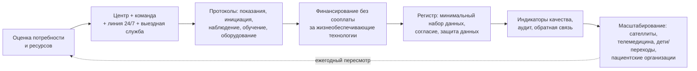

## 4. Практическое значение и применение

Этот раздел переводит содержание лекции в инструменты, которые можно использовать на следующий день: алгоритмы первичной оценки, шпаргалки по газам крови, протоколы назначения кислорода и НИВЛ, чек-листы выписки, шаблоны плана действий и паспорта пациента, протокол поддержки кашля, скрипты сложных бесед, схему создания региональной программы и регистра, сводку типичных ошибок и перечень источников. Все шаблоны — учебные и требуют адаптации к местным условиям, нормативам и оборудованию.

### 4.1. Первичная оценка пациента с подозрением на ХДН: чек-лист

**Табл. 47.** Чек-лист первичной оценки (амбулаторно или в стационаре в стабильном состоянии)

| Шаг | Что сделать | Зачем |
|---|---|---|
| 1 | Анамнез: причина (ХОБЛ, ИЗЛ, НМЗ, деформация, ожирение, центральная), курение/экспозиции, симптомы гиповентиляции (утренняя головная боль, сонливость, ортопноэ, нарушения сна), обострения за год, лекарства (седативные, опиоиды), социальная ситуация | Механизм, темп, обратимые факторы |
| 2 | Осмотр: ЧД, участие вспомогательных мышц, парадокс, цианоз, отёки, вены шеи, ИМТ, деформации, сила кашля, речь, глотание, когнитивный статус | Тип ДН, ЛС, бульбарные нарушения |
| 3 | SpO₂ в покое сидя и лёжа, при ходьбе (6MWT или коридорный тест) | Латентная гипоксемия |
| 4 | Газы артериальной (артериализированной капиллярной) крови на воздухе ≥ 30 мин после отмены кислорода: PaO₂, PaCO₂, pH, HCO₃⁻ | Диагноз, тип, компенсация |
| 5 | Общий анализ крови (Hb, Hct), биохимия (HCO₃⁻, калий, фосфат, креатинин, альбумин), ТТГ, NT-proBNP | Эритроцитоз, компенсация, коморбидность |
| 6 | Спирометрия с бронхолитиком, при возможности бодиплетизмография и DLCO; при НМЗ — ЖЕЛ сидя и лёжа, MIP/SNIP, MEP, PCF | Паттерн и резерв |
| 7 | Рентгенография/КТ по показаниям | Причина, осложнения |
| 8 | ЭКГ, ЭхоКГ (при гипоксемии, гиперкапнии, отёках, несоответствии) | ЛГ, ЛС, сердечная недостаточность |
| 9 | Ночная оксикапнометрия (при гиперкапнии, HCO₃⁻ ≥ 27, НМЗ, деформациях, ожирении, симптомах); полиграфия/ПСГ при подозрении на ОАС | Гиповентиляция во сне, ОАС |
| 10 | Нутритивный статус, HADS, mMRC/CAT, качество жизни, цели пациента, ухаживающие | Исходная точка и план |
| 11 | Формулировка диагноза по структуре (п. 2.13.11) и плана по иерархии (Рис. 15) | Единое понимание в команде |

### 4.2. Интерпретация газов крови: шпаргалка

1. **Проверить условия**: воздух или кислород (FiO₂), время после изменения, температура, положение, бодрствование.
2. **Оксигенация**: PaO₂ сравнить с должным по возрасту (≈ 104 − 0,27 × возраст); PaO₂ < 60 — гипоксемия; оценить P(A–a)O₂ (норма ≈ возраст/4 + 4 на воздухе): нормальный градиент при гипоксемии → гиповентиляция/низкий PiO₂ (насос, центр, высота); повышенный → лёгкие/сосуды (V̇/Q̇, шунт, диффузия).
3. **Вентиляция**: PaCO₂ > 45 — гиперкапния.
4. **pH**: < 7,35 — ацидемия, > 7,45 — алкалемия.
5. **Хроничность** (по HCO₃⁻ и pH при гиперкапнии): острая — HCO₃⁻ ↑ на ≈ 1 ммоль/л на каждые 10 мм рт. ст. PaCO₂, pH снижен значительно; хроническая компенсированная — HCO₃⁻ ↑ на ≈ 3,5–4 на 10 мм рт. ст., pH близок к норме; острая на хронической — HCO₃⁻ высокий, но pH < 7,35.
6. **Оценка «привычного» PaCO₂**: по HCO₃⁻ (например, HCO₃⁻ 34 ≈ хронический PaCO₂ 60–65).
7. **Смешанные нарушения**: HCO₃⁻ выше ожидаемого — сопутствующий метаболический алкалоз (диуретики, стероиды, рвота); ниже — метаболический ацидоз (ХБП, лактат, диарея); анионный интервал.
8. **Решения**: гипоксемия без гиперкапнии в стабильном состоянии → ДКТ по критериям; гиперкапния хроническая → ночной CO₂, обсуждение НИВЛ; острый респираторный ацидоз → НИВЛ (п. 2.24); PaCO₂ «нормальный» при тяжёлой обструкции и тахипноэ → настороженность (истощение впереди).

### 4.3. Назначение длительной кислородотерапии: пошагово

1. Подтвердить показания в стабильном состоянии (≥ 4–8 недель после обострения) дважды с интервалом ≥ 3 недель: PaO₂ ≤ 55 мм рт. ст. (SaO₂ ≤ 88 %) или PaO₂ 56–59 при ЛС/ЛГ/Hct > 55 %.
2. Исключить/лечить обратимые факторы (п. 2.15.3), гиповентиляцию (HCO₃⁻, ночной CO₂ — при гиперкапнии кислород сочетать с вентиляцией при показаниях).
3. Титровать поток в покое до SpO₂ 90–92 % (PaO₂ 60–65) с контролем PaCO₂ через 30–60 мин; при нагрузке — поток, обеспечивающий SpO₂ ≥ 88–90 % при ходьбе; во сне — поток покоя + 1 л/мин или по ночной оксиметрии (при подозрении на гиповентиляцию — капнометрия).
4. Выбрать оборудование: стационарный концентратор (+ портативный источник при активности вне дома), резерв (баллон) при зависимости; увлажнение при потоках > 4 л/мин; интерфейс — канюли.
5. Режим ≥ 15–18 ч/сут, включая сон и нагрузку; объяснить, что кислород — лечение, а не средство от одышки «по потребности».
6. Безопасность: запрет курения и открытого огня, хранение, электропитание, пожарные извещатели; документировать беседу; при продолжении курения — оценка риска.
7. Оформить документ назначения: диагноз, газы и дата, потоки (покой/нагрузка/сон), часы, оборудование, дата переоценки, ответственный, контакты.
8. Обучить пациента и семью; выдать письменные инструкции и паспорт.
9. Контроль через 4–8 недель (газы на потоке и воздухе, приверженность по счётчику, SpO₂ при нагрузке), затем каждые 6–12 месяцев; переоценка показаний при улучшении (отмена при PaO₂ > 60 на воздухе стойко).
10. Интегрировать с реабилитацией, вакцинацией, планом действий.

### 4.4. Инициация длительной НИВЛ: протокол

**Табл. 48.** Протокол инициации НИВЛ (стационар, дневной стационар или дом с телемониторингом)

| Этап | Содержание |
|---|---|
| Показания и цели | Подтверждённая хроническая гиповентиляция по критериям нозологии (п. 2.19.2–2.19.4); цели: симптомы, ночной CO₂, дневной PaCO₂ (при ХОБЛ — снижение ≥ 20 % или норма), качество сна и жизни; обсуждение ожиданий и бремени |
| Оборудование | Аппарат с режимами S/T (± объёмная гарантия), увлажнитель, интерфейс (назальная маска/подушки для НМЗ и комфорта; ороназальная при утечке через рот и ХОБЛ/СОГ), запасная маска, батарея при зависимости > 12–16 ч; мундштук для дневной вентиляции при НМЗ |
| Стартовые параметры | ХОБЛ: IPAP 14–18 → титровать до 20–30, EPAP 4–6 (выше при ОАС), резервная частота 14–18, Ti 0,8–1,2 с, быстрое нарастание. НМЗ/деформации: IPAP 10–14 → 16–24, EPAP 3–5, частота 12–16 (близко к спонтанной, для «захвата»), Ti 1,0–1,5 с. СОГ: IPAP 16–20 → 22–30, EPAP 8–12 (по ОАС), частота 14–16. Объёмная гарантия: целевой ДО 8–10 мл/кг должной массы при НМЗ, 6–8 при ХОБЛ. Кислород в контур только при сохраняющейся гипоксемии на эффективной вентиляции |
| Адаптация | Дневные сессии 20–60 мин под наблюдением для привыкания, подбор маски, обучение надеванию, увлажнение; первая ночь на невысоких давлениях с мониторингом SpO₂/tcPCO₂; повышение давлений в последующие ночи по данным |
| Титрование | По ночной оксикапнометрии (цель: tcPCO₂ < 50, отсутствие подъёма > 10 от бодрствования, SpO₂ ≥ 90 % > 90 % времени), данным аппарата (утечка, ИАГ, ДО, доля триггируемых вдохов), комфорту; при остаточных обструктивных событиях — повысить EPAP; при неэффективных усилиях — чувствительность триггера, Ti, EPAP (auto-PEEP); при десатурации без гиповентиляции — кислород |
| Обучение | Пациент и ухаживающий: надевание маски, включение/выключение, тревоги, чистка, увлажнитель, что делать при неполадках, план действий, когда звонить; при НМЗ — МИ-Э и стекинг |
| Критерии готовности к выписке/завершению инициации | Переносимость ≥ 4–5 ч/ночь, ночные показатели близки к целевым или план дальнейшего титрования, дневной PaCO₂ не хуже исходного, пациент и семья уверены в обращении с аппаратом, документы оформлены, дата контроля назначена |
| Контроль | 2–4 недели: данные аппарата, симптомы, ночная оксикапнометрия, газы; 3 месяца; далее каждые 3–6 месяцев (Табл. 40) |

### 4.5. Параметры респираторной поддержки по нозологиям: сводка

**Табл. 49.** Ориентиры респираторной поддержки по группам (сводка глав 2.17–2.25; индивидуализация обязательна)

| Группа | ДКТ | НИВЛ: когда | НИВЛ: особенности | Кашель/прочее |
|---|---|---|---|---|
| ХОБЛ | PaO₂ ≤ 55 / ≤ 59 с ЛС; ≥ 15–18 ч | PaCO₂ ≥ 50–52 стабильно или через 2–4 нед после обострения | Высокая интенсивность, EPAP с учётом auto-PEEP/ОАС, цель — снижение CO₂ | Клиренс при мокроте; реабилитация; план действий |
| ИЗЛ | Те же критерии; высокие потоки при нагрузке | Редко (терминально/мост) | Реалистичные цели; HFNC | Трансплантационная оценка рано |
| СОГ | Только при гипоксемии на эффективном давлении | Дневная гиперкапния (CPAP — при тяжёлом ОАС и стабильности); после ОДН — НИВЛ | Высокие EPAP и IPAP; контроль CO₂ через 1–3 мес | Снижение массы тела |
| НМЗ | Только с вентиляцией | Ночная гиповентиляция, ЖЕЛ < 50 %, SNIP/MIP < 40, симптомы | Назальные интерфейсы, объёмная гарантия, частота «захвата», дневная мундштучная вентиляция | PCF < 270 → стекинг, ассистированный кашель, МИ-Э; бульбарный статус |
| Деформации | Только с вентиляцией при остаточной гипоксемии | Ночная гиповентиляция, PaCO₂ > 45, ЛС | Высокие давления (низкая растяжимость), длинный Ti | Отличный прогноз на НИВЛ |
| Центральные | Только с вентиляцией | Всегда при гиповентиляции во сне | Контролируемый режим с частотой, ± днём | Без седативных; обучение семьи |
| Травма СМ (высокая) | — | ИВЛ через трахеостому / НИВЛ при частичной функции | Безманжетная вентиляция, стимуляция диафрагмы | МИ-Э, бандаж |

### 4.6. Чек-лист выписки на домашнюю респираторную поддержку

- [ ] Показания документированы (газы, ночные данные, функция), цели сформулированы.
- [ ] Параметры подобраны и записаны; данные аппарата и ночная оксикапнометрия на терапии приемлемы.
- [ ] Оборудование дома: основной аппарат (+ резервный при зависимости > 16 ч/сут), увлажнитель, интерфейсы (2 комплекта), контуры, фильтры, батареи/ИБП, концентратор и резерв кислорода при ДКТ, МИ-Э и аспиратор при показаниях, пульсоксиметр, набор для трахеостомы (2 канюли — текущего и меньшего размера, обтуратор, тесьма, мешок Амбу).
- [ ] Электроснабжение: регистрация у энергоснабжающей организации, план на случай отключения.
- [ ] Обучение: пациент и ≥ 1 (при ИВЛ ≥ 2) ухаживающих продемонстрировали навыки по чек-листу; письменные инструкции и видео выданы.
- [ ] План действий составлен (зоны, действия, пороги, контакты), «запасные» препараты при показаниях.
- [ ] Паспорт пациента заполнен (целевой SpO₂, параметры, контакты, предпочтения).
- [ ] Вакцинация проверена/выполнена; ингаляционная техника проверена; лекарства пересмотрены (седативные!).
- [ ] Реабилитация: направление в течение 2–4 недель.
- [ ] Коммуникация: выписка с разделом «респираторная поддержка» направлена врачу первичного звена; скорая помощь/диспетчерская уведомлены (при ДМВ); центр ДМВ зарегистрировал пациента; при необходимости — социальный работник, уход, инвалидность.
- [ ] Контроль: контакт через 48–72 ч, визит через 2–4 недели (ДМВ) / 4–8 недель (ДКТ), дата записана; телемониторинг подключён.
- [ ] Предпочтения и цели лечения обсуждены (при триггерах — предварительное планирование), доверенное лицо указано.

### 4.7. Шаблон индивидуального плана действий

**План действий пациента: ____________ Дата: ______ Пересмотр: ______**

**Мои обычные показатели:** SpO₂ в покое ____ % (на воздухе / на кислороде ____ л/мин); часы НИВЛ ____; масса ____ кг; мокрота ______; PCF ____ л/мин (при НМЗ).

**Зелёная зона (обычное состояние):** принимаю лекарства по схеме; кислород ____ л/мин ≥ 15 ч; НИВЛ ночью ≥ ____ ч; клиренс (техника/МИ-Э) ____ раз в день; активность/упражнения; контролирую SpO₂ ____ раз в неделю.

**Жёлтая зона (ухудшение):** признаки — усиление одышки, изменение мокроты (цвет/объём), температура, отёки, SpO₂ ниже ____ % (ХОБЛ: < 88 % на обычном потоке; НМЗ: < 95 % на воздухе), новые пробуждения, утренняя головная боль, сонливость. **Действия:** увеличить короткодействующий бронхолитик до ____; при гнойной мокроте и усилении одышки ≥ 2 дней — начать «запасной» антибиотик ____ и преднизолон ____ мг ____ дней (ХОБЛ); при НМЗ — МИ-Э каждые 1–2 часа до SpO₂ ≥ 95 %, НИВЛ днём, антибиотик ____ при лихорадке/мокроте; увеличить время НИВЛ; **не** увеличивать кислород выше ____ л/мин без контроля; **не** принимать снотворные; позвонить в службу ____________ в течение 24 часов (телефон ______).

**Красная зона (опасность):** SpO₂ ниже ____ % несмотря на меры; сонливость, спутанность; невозможность говорить предложениями; ЧД > 30; невозможность откашлять с МИ-Э; боль в груди; отказ оборудования без резерва. **Действия:** вызвать скорую помощь (телефон ____), сообщить: «пациент с хронической дыхательной недостаточностью, целевая сатурация 88–92 % (или: на домашней вентиляции — кислород только вместе с аппаратом)», показать паспорт; взять аппарат, маски, МИ-Э, зарядные устройства, лекарства; позвонить в службу ____________.

**Технические неполадки:** отказ концентратора → резервный баллон ____ л/мин, звонок в сервис ____; отказ вентилятора → резервный аппарат / мешок Амбу (при трахеостоме), звонок ____; отключение электричества → батарея/ИБП (часов ____), звонок энергослужбе ____.

Подписи: пациент ______ врач ______ ухаживающий ______

### 4.8. Шаблон паспорта пациента с ХДН (карточка)

Лицевая сторона: ФИО, дата рождения; **«Хроническая дыхательная недостаточность с риском гиперкапнии. Целевая SpO₂ 88–92 %. Кислород титровать, газы крови через 30–60 мин»** (или для НМЗ/ДМВ: **«Пациент на домашней вентиляции. Кислород только вместе с вентиляцией. Доставить с аппаратом и инсуффлятором-экссуффлятором»**); диагноз; привычные газы (дата); респираторная поддержка: ДКТ ____ л/мин; НИВЛ (аппарат, режим, IPAP/EPAP/частота); трахеостома (тип, размер канюли, манжета); лекарственные предостережения (седативные, опиоиды, бета-блокаторы); аллергии. Оборотная сторона: контакты курирующей службы (круглосуточно), лечащего врача, ухаживающих; «Имеются предварительные распоряжения: да/нет; где хранятся; доверенное лицо»; дата заполнения и обновления.

### 4.9. Ведение ОДН на фоне ХДН: чек-лист приёмного отделения

1. **Первые 5 минут**: ABC; SpO₂; при SpO₂ < 85 % — кислород с быстрым титрованием к 88–92 %; сознание (шкала Глазго); ЧД, работа дыхания; АД, ЧСС; паспорт пациента/анамнез у сопровождающих; домашнее оборудование?
2. **Первые 30 минут**: газы артериальной крови; ЭКГ; глюкоза; венозная кровь (ОАК, биохимия, лактат, тропонин, NT-proBNP, прокальцитонин/СРБ); рентген/УЗИ лёгких; небулизация бронхолитиков воздухом; при трахеостоме — проверка проходимости (Рис. 19).
3. **Решение по pH** (Рис. 23): ≥ 7,35 — лечение причины, наблюдение, повторные газы через 1–2 ч; 7,25–7,35 — НИВЛ в отделении с подготовкой; < 7,25 или нарушение сознания — НИВЛ в ОРИТ с готовностью к интубации; критерии немедленной интубации.
4. **НИВЛ**: ороназальная маска; S/T, IPAP 12–15 → 20–25, EPAP 4–5 (СОГ 8–10), частота 12–16, FiO₂ по SpO₂ 88–92; объяснить пациенту; оценка через 1–2 ч (pH, ЧД, сознание, комфорт); критерии неудачи → интубация без промедления (если соответствует целям).
5. **Причина**: стероиды (ХОБЛ), антибиотики по критериям, диуретики при перегрузке, антикоагуляция при ТЭЛА/ФП, дренирование пневмоторакса, МИ-Э при НМЗ, коррекция электролитов; отмена седативных; тромбопрофилактика.
6. **Цели лечения**: есть ли документ? Обсудить с пациентом (если способен) или доверенным лицом: интубация, реанимация, потолок; записать.
7. **Коммуникация**: информировать курирующий центр ДМВ; семью; продолжить домашнюю вентиляцию на собственном аппарате при госпитализации.
8. **Документирование**: целевой SpO₂ в листе назначений; параметры НИВЛ; время начала; план переоценки.

### 4.10. Протокол поддержки кашля при слабости (НМЗ)

1. Оценка: PCF (пикфлоуметр через маску), ЖЕЛ, MEP, бульбарный статус; повторять каждые 3–12 месяцев и при инфекциях.
2. PCF > 270 л/мин: обучение признакам задержки секрета; стекинг воздуха при ЖЕЛ < 60 % (мешок с клапаном, 3–5 манёвров × 2 раза в день).
3. PCF 160–270: стекинг + мануально ассистированный кашель (обучить двух ухаживающих); измерить PCF с поддержкой; МИ-Э — обеспечить дома, обучить, применять при инфекциях и по SpO₂ < 95 %.
4. PCF < 160: МИ-Э ежедневно 1–2 сеанса (4–6 циклов × 3–5 серий, +40/−40 см вод. ст., 2–3 с/2–3 с, мануальный толчок на выдохе) и по потребности; при бульбарных нарушениях — индивидуальная настройка (меньшее инспираторное давление, медленное нарастание, короткая инсуффляция); НИВЛ по показаниям.
5. Инфекция: протокол оксиметрии — SpO₂ < 95 % на воздухе → МИ-Э (повторять каждые 1–2 ч), НИВЛ непрерывно, антибиотик рано, кислород только в контур вентиляции; госпитализация при невозможности удержать SpO₂ ≥ 94–95 %, нарастании одышки, усталости.
6. Трахеостома: МИ-Э через канюлю, увлажнение, аспирация по потребности.
7. Документировать параметры МИ-Э в плане действий и паспорте; проверять навыки при визитах.

### 4.11. Реабилитация: направление и минимальная домашняя программа

Направление: всем симптомным пациентам (mMRC ≥ 2), после госпитализаций (в течение 2–4 недель), перед/после вмешательств; указать: диагноз, функция, газы, кислород при нагрузке (поток), НИВЛ, коморбидность, противопоказания, цели пациента. Минимальная домашняя программа при недоступности центра (с письменным планом и телефонной поддержкой): ходьба 5 дней в неделю с постепенным увеличением (от 5–10 до 30 мин; интервалами при одышке; темп по Боргу 3–4; с кислородом при десатурации; с роллатором при необходимости), силовые упражнения для ног и рук 2–3 раза в неделю (вставание со стула, подъёмы на носки, упражнения с эластичной лентой/бутылками с водой; 2–3 подхода по 8–12), дыхательные техники (сжатые губы, положение с опорой, темп), ежедневная активность (шагомер, цель +500–1000 шагов в неделю), дневник, питание (белок с каждым приёмом пищи), обучение по плану действий; контроль через 4 и 8 недель (6MWT или тест «встань-сядь», CAT, mMRC); при НМЗ — субмаксимальные упражнения, растяжка, стекинг; при ИЗЛ — высокий поток кислорода и интервалы.

### 4.12. Скрипты сложных бесед

- **Сообщение о необходимости ДКТ/НИВЛ**: «Ваши анализы показывают, что уровень кислорода (углекислоты) в крови выходит за безопасные пределы, особенно ночью. Это не означает, что вам стало резко хуже сегодня, — это даёт нам возможность защитить сердце и мозг и улучшить сон и силы. Есть лечение, которое доказанно продлевает жизнь (улучшает самочувствие) при вашей ситуации, — это… Что вы знаете об этом? Что вас беспокоит в связи с этим?» → информация порциями → «Давайте обсудим, как это впишется в вашу жизнь: работа, сон, поездки» → план адаптации и дата контроля.
- **Разговор о прогнозе** (триггер — госпитализация с НИВЛ): «Могу я поговорить с вами о том, чего ожидать в будущем? … Вы перенесли тяжёлое обострение. Мы сделаем всё, чтобы снизить риск повторения, но при вашей болезни такие эпизоды могут повторяться, и каждый опасен. Я надеюсь на лучшее и хочу, чтобы мы были готовы к худшему. Что для вас важнее всего, если состояние ухудшится? Есть ли состояния, которые вы считаете неприемлемыми? Кто мог бы говорить за вас, если вы не сможете?» → запись → «Мы вернёмся к этому разговору; вы можете изменить решение в любой момент».
- **Обсуждение трахеостомии при БАС**: «Со временем маска может перестать справляться. Тогда есть два пути: вентиляция через трахеостому, которая может продлить жизнь на месяцы и годы, но означает круглосуточную зависимость от аппарата и ухода, и путь без трахеостомии, при котором мы обеспечим комфорт и отсутствие удушья. Я расскажу о том и о другом честно, предложу встретиться с людьми, которые живут с трахеостомой, и мы обсудим, какие ресурсы есть у вашей семьи. Решение — за вами, и его можно пересматривать, в том числе прекратить вентиляцию, если вы так решите в будущем».
- **Беседа с бригадой скорой/коллегой по телефону**: «Пациент с хронической гиперкапнической дыхательной недостаточностью; привычный PaCO₂ около 55; целевая сатурация 88–92 %; небулайзер через воздух; при сонливости — не наращивать кислород, нужна НИВЛ; везти в ___, где есть НИВЛ; взять домашний аппарат».

### 4.13. Создание региональной программы домашней респираторной поддержки и регистра

**Шаг 1. Оценка потребности**: население, ожидаемая распространённость (ДКТ ≈ 80–150 на 100 000 [⚠️ Требуется верификация: зависит от распространённости ХОБЛ и критериев]; ДМВ 10–30 на 100 000 при развитой системе), текущее число пациентов, госпитализации с гиперкапнической ОДН, наличие ОРИТ «заблокированных» вентилируемыми пациентами, доступность газов крови, спирометрии, исследований сна.
**Шаг 2. Структура**: центр на базе пульмонологического (или многопрофильного) отделения; штат (врач-руководитель, медсёстры-координаторы, респираторный терапевт/физиотерапевт, техник, психолог/социальный работник по совместительству); линия связи 24/7; выездная бригада; койки для инициации; договор с ОРИТ, неврологами, педиатрами, паллиативной службой, поставщиками.
**Шаг 3. Протоколы**: показания (на основе ERS/ATS/CHEST и национальных рекомендаций), инициация, наблюдение (Табл. 40), план действий, паспорт, обучение (чек-листы), оборудование (спецификации, резерв, обслуживание), инфекционный контроль, прекращение/деэскалация, паллиативная интеграция.
**Шаг 4. Финансирование**: оборудование и расходные материалы без сооплаты для жизнеобеспечивающих технологий; оплата наблюдения и визитов на дом; уход для зависимых от ИВЛ; источники — бюджет, страхование, фонды; экономическое обоснование через ожидаемое снижение госпитализаций и дней в ОРИТ.
**Шаг 5. Регистр — минимальный набор данных**: идентификатор, пол, дата рождения, регион; основной диагноз (группа: ХОБЛ, ИЗЛ, СОГ, НМЗ с подтипом, деформации, центральные, прочие) и коморбидность; дата начала терапии; показание и газы крови/ночные данные при назначении; вид поддержки (ДКТ/НИВЛ/ИВЛ; интерфейс; параметры; часы); место инициации; ЖЕЛ/ОФВ₁, ИМТ; приверженность и PaCO₂ при контроле (3, 12 месяцев, далее ежегодно); госпитализации и ОДН; осложнения (пролежни, обтурации, пневмонии); изменения терапии (эскалация, деэскалация, деканюляция); качество жизни (SRI/EQ-5D ежегодно); исход (жив/умер/дата/причина/место; трансплантация); предварительное планирование (да/нет). Правила: информированное согласие/правовое основание, защита данных, ответственный за ввод, ежегодный отчёт центрам, сопоставление с международными регистрами.
**Шаг 6. Качество**: индикаторы (Табл. 41), ежеквартальный аудит, разбор смертей и незапланированных госпитализаций, обратная связь первичному звену и скорой помощи, обучение.
**Шаг 7. Масштабирование**: обучение «сателлитных» отделений, телемедицинские консультации, интеграция детской службы и переходов, участие пациентских организаций, публикация результатов.

**Рис. 30.** Этапы создания региональной программы домашней респираторной поддержки. Схема читается слева направо, с ежегодным циклом пересмотра.

### 4.14. Сводка типичных ошибок

**Табл. 50.** Двадцать типичных ошибок при ведении ХДН и их профилактика

| № | Ошибка | Как избежать |
|---|---|---|
| 1 | Диагностика по SpO₂ в покое без газов крови и без нагрузки | Газы крови при SpO₂ ≤ 92 %, HCO₃⁻ ≥ 27, симптомах; SpO₂ при ходьбе |
| 2 | Игнорирование HCO₃⁻ в «рутинной» биохимии | HCO₃⁻ ≥ 27 у пациента группы риска → газы крови |
| 3 | Приписывание всей одышки основному диагнозу | Поиск сердечной недостаточности, ТЭЛА, анемии, ОАС, депрессии, многофакторности |
| 4 | Ожидание дневной гиперкапнии для НИВЛ при НМЗ | Ночной CO₂, ЖЕЛ лёжа, SNIP; начинать по ночной гиповентиляции и симптомам |
| 5 | Кислород без вентиляции при СОГ, overlap, НМЗ, центральных гиповентиляциях | Положительное давление/вентиляция первично; кислород — дополнение |
| 6 | Назначение ДКТ при обострении без переоценки | Подтверждение через 4–8 недель |
| 7 | ДКТ «по потребности» или < 15 ч/сут | Обучение; счётчик часов; портативный источник |
| 8 | Высокопоточный кислород при декомпенсации | Целевой SpO₂ 88–92 %; газы через 30–60 мин; паспорт |
| 9 | Поздняя НИВЛ при остром ацидозе; продолжение неэффективной НИВЛ без интубации | Начало в 1–3 ч; контрольная точка через 1–2 ч |
| 10 | Нормализация PaCO₂ на ИВЛ у хронически гиперкапничного пациента | Целевой pH при привычном PaCO₂ |
| 11 | Низкоинтенсивная НИВЛ при ХОБЛ без цели снижения CO₂ | Титрование до снижения PaCO₂ ≥ 20 %/нормы; контроль ночного CO₂ |
| 12 | Отсутствие контроля после инициации («назначил и забыл») | Контакт 48–72 ч, визит 2–4 нед, данные аппарата, график наблюдения |
| 13 | Бензодиазепины/снотворные при бессоннице и тревоге у гиперкапничного пациента | Лечение гиповентиляции, КПТ, СИОЗС/миртазапин, ревизия лекарств |
| 14 | Не направлять на реабилитацию «слишком тяжёлых» | Адаптированная программа всем симптомным, особенно после госпитализации |
| 15 | Откладывать поддержку кашля до первой пневмонии при НМЗ | PCF при каждом визите; обучение при PCF < 270 |
| 16 | Позднее направление на трансплантацию (ИЛФ) | Направление при диагнозе ИЛФ; критерии ISHLT |
| 17 | Выписка на домашнюю ИВЛ без оценки ресурсов семьи и оплачиваемого ухода | Чек-лист выписки; оценка бремени; социальная служба |
| 18 | Обсуждение интубации/реанимации только при декомпенсации | Предварительное планирование по триггерам в стабильном состоянии |
| 19 | Отказ от опиоидов при рефрактерной одышке; паллиативная помощь «в конце» | Ступенчатый подход к одышке; ранняя паллиативная интеграция |
| 20 | Пропуск вакцинации из-за «тяжести» пациента | Вакцинация в стабильном состоянии и перед выпиской; проверка статуса при каждом визите |

### 4.15. Источники и ресурсы для дальнейшего изучения

Учебные руководства по физиологии: J. B. West «Respiratory Physiology: The Essentials» и «Pulmonary Pathophysiology» (русские переводы «Физиология дыхания. Основы», «Патофизиология органов дыхания»); отечественные руководства: «Респираторная медицина» под ред. А. Г. Чучалина (2-е изд., 2017), А. П. Зильбер «Дыхательная недостаточность» (1989) и «Этюды критической медицины»; клинические рекомендации: GOLD (ежегодные отчёты), ATS 2020 по домашней кислородотерапии при ХОБЛ и ИЗЛ, BTS 2015 по домашней кислородотерапии и BTS 2017 по экстренному кислороду, ERS 2019 по длительной НИВЛ при ХОБЛ, ATS 2020 по длительной НИВЛ при ХОБЛ, ATS 2019 по СОГ, CHEST 2023 по респираторному ведению НМЗ, ERS/ATS 2017 по НИВЛ при ОДН, ERS 2022 по высокопоточной терапии, ATS 2023 по лёгочной реабилитации, ATS 2016 по длительной инвазивной вентиляции у детей, ATS 2010 по ВСЦГ, ESC/ERS 2022 по ЛГ, ISHLT 2021 по отбору на трансплантацию, BTS 2022 по авиаперелётам, руководства по паллиативной помощи при болезнях лёгких (ATS 2008, ERS 2023), Ассоциации паллиативной медицины Великобритании по прекращению вентиляции при болезни мотонейрона (2015); ключевые исследования: NOTT (1980), MRC (1981), LOTT (2016), INOX (2020), Brochard (1995), Plant (2000), Köhnlein (2014), HOT-HMV (2017), Pickwick (Masa 2015–2019), Bourke (2006), NETT (2003), LIBERATE (2018), DiPALS (2015), Austin (2010), Abernethy (2010), Higginson (2014), van den Biggelaar (2023; ERS/рабочие группы по ДМВ), регистры Swedevox, ANTADIR, Eurovent (Lloyd-Owen 2005); пациентские и профессиональные ресурсы: Европейское респираторное общество (ERS), Американское торакальное общество (ATS), Российское респираторное общество, ассоциации пациентов с БАС, миодистрофиями, СМА, муковисцидозом, ЛГ, ХОБЛ. При использовании любых источников следует проверять актуальность версии — рекомендации в этой области обновляются каждые 2–4 года.

🔬 **Углубление: внедрение — почему хорошие протоколы не работают сами.** Исследования внедрения (implementation science) показывают, что разрыв между рекомендациями и практикой при ХДН велик (ДКТ без газов, поздняя НИВЛ, нулевые направления на реабилитацию) и объясняется не незнанием, а системными барьерами: отсутствием времени и ролей (кто измеряет PCF? кто звонит через 72 часа?), оборудования (нет капнометра), финансовых стимулов, обратной связи (никто не видит исходов), культурными установками («реаниматологи решают»). Эффективные стратегии внедрения — не лекции, а: «чемпионы» на местах, встроенные в рутину инструменты (чек-лист выписки в электронной карте, автоматический флаг HCO₃⁻ ≥ 27), аудит с обратной связью, стандартизованные наборы назначений (order sets) с целевым SpO₂, обучение с симуляцией (как интерактивные элементы этой лекции), включение пациентов в контроль (паспорт, план), и измерение процесса и исходов (регистр). Практический совет для врача, начинающего программу: выбрать одну измеримую проблему (например, доля пациентов с ХОБЛ, у которых при выписке документирован целевой SpO₂ и назначена дата переоценки ДКТ), измерить исходное значение, внедрить один инструмент, измерить снова через 3 месяца — и только потом расширять.

❗ **Типичная ошибка:** внедрять шаблоны (план действий, паспорт, чек-лист) формально — заполнять «для галочки» без обучения пациента и без системы реагирования. Документ без процесса не меняет исходов и может создавать ложную уверенность.

💡 **Интересный факт:** простейший инструмент этого раздела — карточка с надписью «целевая сатурация 88–92 %» — появился в Великобритании после аудитов, показавших, что значительная часть пациентов с ХОБЛ получала в скорой помощи и приёмных отделениях высокопоточный кислород вопреки рекомендациям; внедрение карточек и стандартных назначений с целевым диапазоном в сочетании с обучением бригад сопровождалось снижением частоты респираторного ацидоза при поступлении. Одна строка на карточке оказалась действеннее многих страниц рекомендаций, потому что оказалась в нужном месте в нужное время.

📝 **Обобщение**

- Практические инструменты лекции: чек-лист первичной оценки, шпаргалка по газам крови, пошаговое назначение ДКТ, протокол инициации НИВЛ, сводка параметров по нозологиям, чек-лист выписки, шаблоны плана действий и паспорта, чек-лист ведения ОДН в приёмном отделении, протокол поддержки кашля, минимальная домашняя программа реабилитации, скрипты бесед, этапы создания региональной программы и регистра с минимальным набором данных, сводка типичных ошибок, перечень источников.
- Каждый инструмент работает только внутри процесса: с обучением, ответственными, датами контроля и измерением результата; внедрение требует выбора одной измеримой проблемы, аудита и обратной связи.

Главный вывод: знания о ХДН становятся пользой для пациента через простые, встроенные в рутину инструменты и организованную команду — и начать можно с одной карточки, одного чек-листа и одной даты контроля.

❓ **Контрольные вопросы**

1. Используя чек-лист 4.1 и шпаргалку 4.2, опишите оценку пациента 70 лет с ХОБЛ, SpO₂ 90 % в покое, HCO₃⁻ 31 ммоль/л и отёками голеней; какие решения вы примете по результатам?
2. Составьте документ назначения ДКТ и план действий для этого пациента (шаблоны 4.3 и 4.7).
3. Какие параметры НИВЛ вы установите при инициации у пациентки с кифосколиозом (ЖЕЛ 1,0 л, PaCO₂ 55) и у пациента с СОГ (ИМТ 48, ИАГ 48, PaCO₂ 56)? Как будете титровать?
4. Перечислите пункты чек-листа выписки на домашнюю ИВЛ, которые чаще всего пропускаются, и объясните последствия каждого пропуска.
5. Предложите минимальный набор данных регистра и три индикатора качества для программы домашней вентиляции в вашем регионе; как вы обоснуете финансирование программы?
